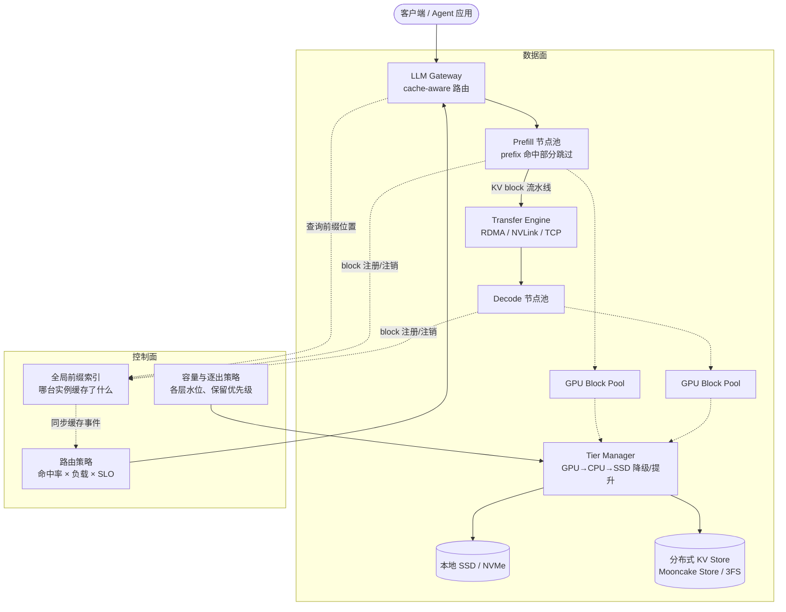

# 3. 架构设计：分层 KV 缓存架构

> 一句话理解：一套生产级的 KV 缓存基础设施由**数据面**（前缀索引、block 池、传输引擎、分层存储）与**控制面**（全局索引、路由策略、容量与逐出策略）组成，两者分离使得缓存层可以独立于推理引擎演进。

## 3.1 总体架构



## 3.2 数据面组件

| 组件 | 职责 | 代表实现 |
|---|---|---|
| Prefix 索引（引擎内） | 维护 token 序列 → block 链的映射，回答「命中到哪一段」 | vLLM prefix caching、SGLang RadixAttention |
| Block 池 | block 分配、引用计数、COW、LRU 逐出 | vLLM BlockManager v1/v2 |
| Transfer Engine | 跨节点按 block 搬运 KV：拓扑感知选路、多流聚合、故障切换 | Mooncake Transfer Engine、NVIDIA NIXL |
| Tier Manager | GPU/CPU/SSD/远端之间的降级与提升，异步搬运 | LMCache、Dynamo KVBM、SGLang HiCache |
| 分布式 KV Store | 跨实例共享的 KV 对象池：条带化、副本、逐出 | Mooncake Store、DeepSeek 3FS KV 客户端 |

## 3.3 控制面组件

**全局前缀索引（Global Cache Index）**：在集群尺度记录「哪个前缀缓存在哪台实例 / 哪个 Store 分片上」。实现上通常不是中心化数据库，而是「实例本地 radix tree + 路由侧缓存事件」的松耦合结构——实例把 block 注册/逐出事件推给路由层（如 Dynamo 的 KV events、Gateway API Inference Extension 的 EPP），路由据此做决策。

**路由策略（Router）**：cache-aware 路由的目标函数：

```text
score(实例) = w1 × 前缀命中长度 − w2 × 队列深度 − w3 × 负载
```

纯命中率路由会把所有同前缀请求打到同一实例造成热点，所以生产策略都会叠加负载项（SGLang 的 cache-aware load balancing、Dynamo Smart Router 的 KV overlap + 负载打分）。

**容量与逐出策略（Eviction Policy）**：分层之后逐出决策变复杂——显存满了先沉 CPU 还是直接丢？生产系统普遍采用「下沉优先」（demote-first）：GPU 逐出的 block 先尝试写入 CPU/SSD，慢层写不下才真正丢弃。这样慢层命中率始终有源头活水。

## 3.4 数据面 / 控制面的边界

| | 数据面 | 控制面 |
|---|---|---|
| 延迟要求 | 微秒~毫秒，在请求关键路径上 | 百毫秒~秒级，可异步 |
| 状态 | block 内容、引用计数、分层水位 | 前缀位置、路由表、逐出策略参数 |
| 故障影响 | 直接拖慢请求 | 降级为不感知缓存的默认行为 |
| 扩展方式 | 按带宽/容量横向扩 | 按实例数分片索引 |

关键设计原则：**控制面挂了数据面要能用**。路由拿不到缓存位置时退化为普通负载均衡，KV 复用率下降但服务不中断；逐出策略失效时退化为显存 LRU。

## 3.5 部署形态

三种典型形态，按集群规模递增：

1. **单引擎 prefix caching**：一台 vLLM/SGLang 实例内部复用，零外部依赖，适合小到中型集群（本架构去掉 Transfer Engine 与全局索引）；
2. **PD 分离 + 共享缓存池**：prefill/decode 分池，KV 经 Transfer Engine 直传，Store 作共享前缀池（Mooncake、Dynamo 的标准形态）；
3. **全局缓存网格**：多个 decode 池共享一个分布式 KV Store，跨池复用前缀，路由层统一做 cache-aware 调度（Mooncake Store、HiCache L3 的方向）。

## 小结

- 数据面 = 前缀索引 + block 池 + 传输引擎 + 分层存储，在关键路径上，要求快。
- 控制面 = 全局索引 + 路由 + 逐出策略，可异步，挂了要能降级。
- 生产架构普遍采用「下沉优先」逐出与「命中率 × 负载」加权路由，避免缓存把热点打爆。
