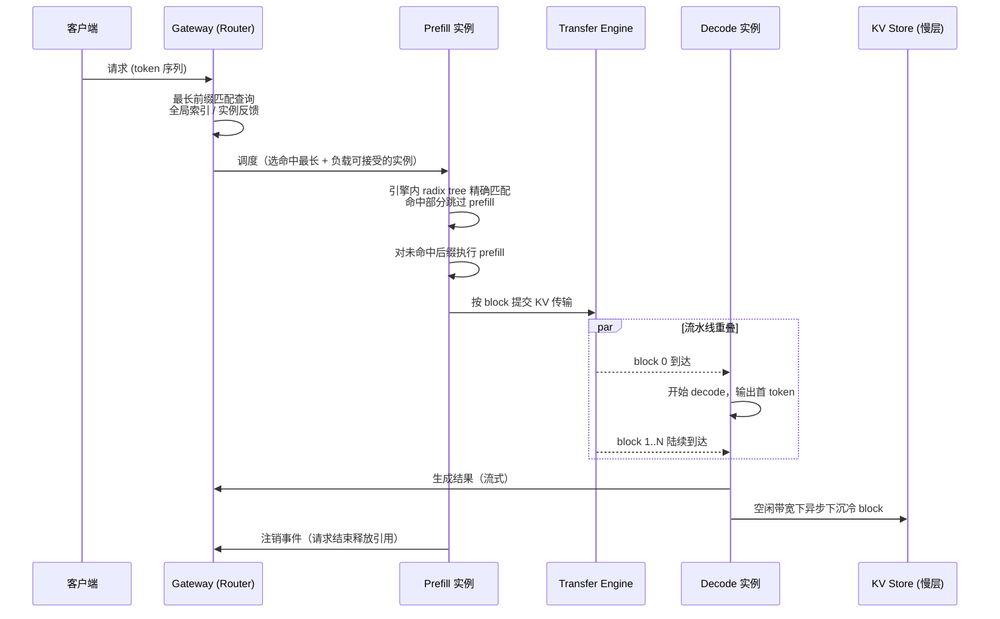

# 4. 工作流程：一个请求的 KV 生命周期

> 一句话理解：一个请求携带的 token 序列穿过「路由 → 前缀匹配 → prefill → KV 迁移 → decode → 缓存保留」六道工序，每一道工序都在做同一个判断——**这段 KV 值得放在哪里、怎么用最省**。

## 4.1 端到端时序



## 4.2 工序详解

### 工序一：路由与前缀匹配

Gateway 提取请求的 token 前缀，查询「这段前缀的 KV 在哪里」：

- **完全命中某实例**（命中长度 ≈ 上下文长度）：直接转 decode 侧续写，TTFT 逼近纯解码时间；
- **部分命中**：调度到命中最长的 prefill 实例，只需计算未命中后缀；
- **完全未命中**：按普通负载均衡选最闲的 prefill 实例。

路由查询通常是「尽力而为」：索引可能滞后（block 刚被逐出），实例侧会以引擎内 radix tree 的精确匹配结果为准——**控制面给建议，数据面做裁决**。

### 工序二：Prefill 与前缀复用

Prefill 实例内部：

1. 用内容哈希在 radix tree 中做最长前缀匹配，得到命中长度 H；
2. 命中部分的 block 引用计数 +1（与既有请求共享）；
3. 未命中后缀正常前向计算，逐 block 写入 GPU block 池；
4. 新算出的 block 注册进 radix tree 与全局索引。

若命中前缀的 KV 不在本机 GPU 上（在慢层或别的实例），实例通过 Tier Manager / Transfer Engine 拉取，拉取仍按「收益 > 成本」判断，否则宁可重算。

### 工序三：KV 迁移与流水线重叠

PD 分离下，prefill 产出的 KV 按 block 交给 Transfer Engine：

- **按 token 顺序**提交：decode 按相同顺序消费，先提交的 block 价值最高；
- **多流并发**：多个 RDMA QP / 多网卡聚合带宽，block 轮流分发到各流；
- **首 block 到达即解码**：把 TTFT 从「N × 单块传输时间」压到「1 × 单块传输时间 + 首块解码时间」（Mini Demo 场景 4 会量化：64 块串行 6.68 ms → 流水线 4.04 ms）。

### 工序四：Decode 与缓存维护

Decode 阶段持续生成新 token，其 KV 追加到 block 池：

- 生成中的 block 引用计数 ≥ 1，不可逐出；
- 每完成一个 block 即注册进索引，后续请求可复用——**缓存是在生成过程中增量可复用的，不用等请求结束**；
- 显存水位吃紧时，Tier Manager 把冷的已结束 block 异步下沉到 CPU/SSD（下沉优先策略）。

### 工序五：请求结束与资源释放

请求结束后，其 block 引用计数减一：

- 引用计数归零的 block 不立即释放，标记为「可逐出缓存」——这就是 prefix caching 的复用来源；
- LRU 到期后，先尝试下沉到慢层，慢层也满才真正丢弃；
- 全局索引收到注销事件，更新路由侧的缓存视图。

## 4.3 失败与退化路径

| 故障 | 退化行为 |
|---|---|
| 全局索引不可用 | 路由退化为纯负载均衡，复用率下降，服务不中断 |
| 慢层 Store 不可用 | 禁用下沉与慢层命中，退化为纯显存缓存 |
| 传输超时 | 目标实例放弃等待，回退为本地重算 prefill |
| 实例崩溃 | 引用计数泄漏由超时兜底，Store 中的副本供其他实例复用 |

注意这些退化都是「缓存失效但不失效请求」——这正是把 KV 做成独立缓存层而非引擎内部状态的最大红利。

## 4.4 生命周期中的成本账本

把生命周期映射到第 2 章的成本模型：

```text
TTFT = 路由查询
     + (1 − 命中率) × 上下文长度 × 单位 prefill 成本   ← 复用决定
     + 需等待的 KV 传输时间（流水线后 ≈ 单块传输）      ← 迁移决定
     + 首块解码时间

TPOT / 吞吐 = decode 阶段受 GPU 带宽与 batch 构成影响，
              分层卸载腾出的显存可换更大 batch            ← 分层决定
```

## 小结

- 请求 KV 生命周期六道工序：路由匹配 → prefill 复用 → block 迁移（流水线）→ decode 增量注册 → 结束释放 → 下沉/逐出。
- 控制面给建议、数据面做裁决：索引结果只是提示，引擎内精确匹配才是事实。
- 所有故障路径都退化为「不感知缓存的默认行为」，缓存层从不使请求失败。
