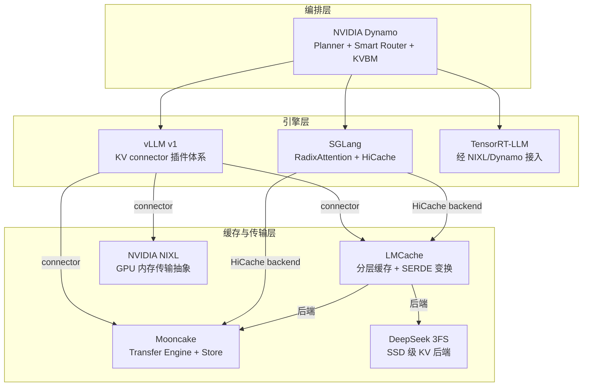

# 6. 生态与源码分析

> 一句话理解：2026 年的 KV Cache 基础设施已经形成一个清晰分工的生态——**Mooncake 提供传输与分布式 Store，LMCache 提供引擎旁的分层缓存，NIXL 提供裸机级传输抽象，vLLM/SGLang 通过 KV connector 开放插件点，Dynamo 在引擎之上做全局编排**；本节对比它们的定位、架构与集成方式（版本号截至 2026-10-17，以 GitHub release 为准）。

## 6.1 生态全景

## 6.2 Mooncake（月之暗面）

**定位**：KVCache-centric 的 PD 分离推理底座，论文发表于 OSDI'24（Mooncake: A KVCache-centric Disaggregated Architecture for LLM Serving），在 Kimi 生产上线。

**架构**：两大件 + MoE 扩展。

- **Transfer Engine**：统一批量数据搬运接口。支持 TCP/RDMA/NVLink/EFA/NVMe-oF 等多传输后端，拓扑感知选路、多 NIC 带宽聚合、故障自动切换。官方数据：4×200Gbps RoCE 下 ~87 GB/s，8×400Gbps RoCE 下 ~190 GB/s（约为 TCP 的 2.4x/4.6x）。
- **Mooncake Store**：基于 TE 的分布式对象存储，管理 KV 与权重对象：大对象条带化、并行 I/O、零拷贝、多副本、逐出、软硬 pin，支持 DRAM + SSD/NVMe 多级缓存，并有 Redis HA 后端与对象存储后端（含 3FS）重构。
- **EP/PG**：面向 MoE 的容错专家并行与 PyTorch ProcessGroup 后端。

**集成**：vLLM 侧提供 `MooncakeConnector`（PD 分离传输）与 `MooncakeStoreConnector`（多实例共享 KV 池/前缀复用）；SGLang 侧 TE 用于 PD/EPD 传输、Store 作为 HiCache 分层后端。TensorRT-LLM 于 2026-10 合并了 Mooncake Store connector。

**版本**：v0.3.13.post1（2026-08-31，Latest），v0.3.14-rc1 预发布中。

**论文关键数字**：在 Kimi 生产 trace 上，Mooncake 架构在满足 SLO 的前提下多承载约 75% 请求；长上下文场景单用户 decode 吞吐达 525 tokens/s。

## 6.3 LMCache

**定位**：厂商中立的 KV Cache 管理层（Apache-2.0），把 KV 从「引擎临时状态」变为可持久复用的资产，口号是 engine 崩溃不丢缓存（no fate-sharing）。

**架构**：

- 作为独立守护进程运行，推理引擎通过 KV connector 与之交互；
- 分层后端：CPU RAM、本地 SSD、Redis/Valkey、Mooncake、InfiniStore、S3 兼容对象存储、NIXL、GDS；
- **非前缀复用**：基于 CacheBlend 技术，可在 prompt 任意位置复用缓存块并选择性重算——突破「只能前缀命中」的限制；
- **SERDE 插件接口**：搬运途中插入压缩、token dropping、自定义序列化；
- 2026-04 发布多进程（MP）架构，面向 MoE 推理显著降延迟。

**版本**：v0.5.6（2026-10-15），按 CUDA/ROCm/XPU/MUSA 分平台发 wheel。

## 6.4 NVIDIA NIXL 与 Dynamo

**NIXL**（NVIDIA Inference Xfer Library）：GPU 内存到 GPU 内存的传输抽象库，统一 NVLink、RDMA、GPUDirect 等路径，提供元数据驱动的零拷贝传输，是 Dynamo 以及 LMCache/vLLM encoder-cache 共享的底层传输件。

**Dynamo**：数据中心级分布式推理编排框架（1.5.1，2026-10），组件：

| 组件 | 职责 |
|---|---|
| Frontend | OpenAI 兼容入口 |
| Smart Router | KV 重合度 + 负载打分路由 |
| Planner | 按 SLA（TTFT/ITL）自动扩缩 prefill/decode 池 |
| KV Block Manager (KVBM) | GPU→CPU→SSD→S3/Azure Blob 多级卸载；SGLang 侧标记为实验中，TensorRT-LLM/vLLM 已支持 |
| Grove | K8s 算子，NVL72 等拓扑感知调度 |
| Fault Tolerance | canary 健康检查、在途请求迁移 |

Dynamo 不替代引擎，而是把 SGLang/TensorRT-LLM/vLLM 组织成统一系统；也支持 Gateway API + EPP 的集群边缘路由模式。

## 6.5 vLLM KV Connector 与 SGLang HiCache

**vLLM v1（v0.31.0，2026-10-05）**：KV connector 已发展成插件生态。最近版本的 KV 相关演进：

- v0.31.0：KV offload 背压检测；prefix-cache extra keys 按来源打标；修复 KV connector + MTP 在 KV 压力下的死锁；
- v0.30.0：新增 HiSparse（稀疏 MLA decode 的 host 驻留层，KV page 下沉到 pinned host memory，HiSparseConnector）；Mooncake Store 异构 TP 共享；encoder-cache 经 NIXL/Mooncake 共享；
- v0.29.0：Mamba 前缀缓存内部 prefill checkpoint，TTFT 提升 9%-25%。

**SGLang（v0.5.21，2026-10-02）**：

- RadixAttention 持续强化：前缀缓存默认跑在 Rust 核心上；统一 radix tree 新增 SWA 分支缓存（token 命中率 43.8%→60.8%，平均 TTFT 1.57s→1.07s）；会话感知逐出（`--enable-session-radix-cache`）；
- **HiCache 分层**：L1 GPU → L2（CPU/NVMe，如 over DCP）→ L3 远端（Mooncake Store、可动态挂载/卸载），运行中可切换；
- PD 实例可动态在 prefill/decode 角色间切换，无需重启；mooncake 依赖升至 0.3.12.post1。

## 6.6 DeepSeek 3FS

**定位**：Fire-Flyer File System，面向 AI 训练与推理的开源分布式文件系统（MIT），KVCache 推理缓存是其两大推理场景之一（替代 DRAM 缓存的低成本大容量层）。

- **架构**：无状态元数据服务 + CRAQ 链式复制强一致 + 事务型 KV 存储（FoundationDB）存元数据；聚合数千块 SSD 与数百存储节点的带宽，应用无需关心数据局部性；
- **性能**（官方测试集群）：180 存储节点聚合读 ~6.6 TiB/s；KVCache 客户端读峰值 ~40 GiB/s；
- 与 Mooncake Store 的对象存储后端对接，也是 LMCache 的存储后端之一。

## 6.7 横向对比表

| 系统 | 层级 | 核心抽象 | 传输/存储后端 | 引擎集成 | 适合场景 |
|---|---|---|---|---|---|
| Mooncake TE | 传输层 | 批量传输句柄 | RDMA/NVLink/TCP/EFA | vLLM/SGLang connector | PD 分离的 KV 直传 |
| Mooncake Store | 分布式缓存 | KV 对象池 + 逐出 | DRAM/SSD/Redis/3FS | vLLM/SGLang/TRT-LLM | 跨实例共享前缀池 |
| LMCache | 引擎旁缓存层 | 分层后端 + SERDE | CPU/SSD/Redis/Mooncake/S3/NIXL | vLLM KV connector | 跨请求/跨会话复用、非前缀复用 |
| NIXL | 传输层 | GPU 内存传输抽象 | NVLink/RDMA/GPUDirect | Dynamo/LMCache/vLLM | 裸机级低延迟搬运 |
| Dynamo KVBM | 编排层 | 多级 KV 池 | GPU→CPU→SSD→对象存储 | SGLang/TRT-LLM/vLLM | 集群级容量调度 |
| 3FS | 存储层 | 分布式文件系统 | NVMe SSD + RDMA | Mooncake/LMCache 后端 | 大容量低成本 KV 层 |
| vLLM connector | 插件点 | KV 生产者/消费者接口 | 由插件决定 | 引擎原生 | 生态集成标准 |
| SGLang HiCache | 引擎内分层 | L1/L2/L3 栈 | GPU/CPU/NVMe/Mooncake | 引擎原生 | SGLang 用户的一站式分层 |

## 6.8 源码阅读建议

1. **vLLM `vllm/distributed/kv_transfer/`**：KV connector 的抽象定义（`KVConnectorBase` 的 produce/consume 接口），读一遍就能理解「插件点」的设计；
2. **Mooncake `transfer_engine/`**：看 `TransferEngine` 的批量提交与拓扑感知选路如何实现；
3. **SGLang `python/sglang/srt/mem_cache/`**：RadixTree + HiCache 的分层组织，是「引擎内缓存层」最干净的参考实现；
4. **LMCache `lmcache/`**：SERDE 接口与后端插件化，学习如何把「变换」插进搬运管线。

## 小结

- 生态分工清晰：Mooncake 管传输与共享池，LMCache 管引擎旁分层，NIXL 管裸机传输，Dynamo 管集群编排，3FS 管 SSD 容量。
- 引擎侧的标准化点是 vLLM KV connector 与 SGLang HiCache backend——缓存层厂商只需对接这两个插件点。
- 版本核实（2026-10-17）：vLLM v0.31.0、SGLang v0.5.21、Mooncake v0.3.13.post1、LMCache v0.5.6、Dynamo 1.5.1。
