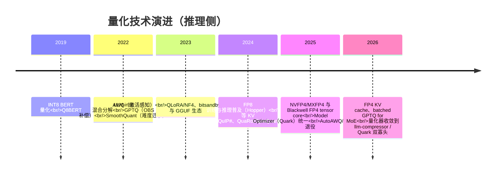
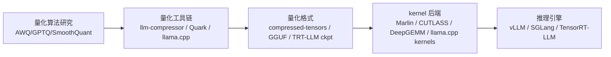

# 1. 背景：显存墙与带宽墙

> 一句话理解：LLM 推理的钱花在「搬数据」上——权重每生成一个 token 就要从显存完整读一遍，而显存容量和带宽的增长远慢于模型规模的增长；量化用更低的位宽存储和搬运权重与 KV cache，是同时缓解**容量墙**（显存装不下）与**带宽墙**（搬得太慢）的第一杠杆。

## 1.1 推理成本的两面墙

LLM 推理的显存占用 = 权重 + KV cache + 激活。两个约束各自独立成墙：

```text
容量墙：权重 + KV cache 必须装得进显存（H100 单卡 80 GiB）
带宽墙：每生成 1 个 token 都要把参与计算的权重完整读一遍
        → 理论吞吐上限 = 显存带宽 / 权重字节数
```

带宽墙的一个直观算术：H100 HBM3 带宽约 3.35 TB/s，70B 模型 BF16 权重约 140 GB，batch=1 时理论上限只有 **约 24 token/s**——不管 GPU 有多少算力都白搭。带宽是 decode 阶段的硬约束（每步只算 1 个 token，算术强度极低），这正是推理系统一切优化（量化、投机解码、PD 分离）的共同出发点。

## 1.2 位宽就是容量与带宽：一行乘法

把权重从 16 bit 降到 8 bit，容量与带宽需求直接减半；降到 4 bit 再减半：

| 表示 | 70B 权重占用 | batch=1 理论上限（H100） | 相对显存 |
|---|---|---|---|
| FP32 | 280 GB | 12 token/s | 4x |
| FP16 / BF16 | 140 GB | 24 token/s | 2x |
| FP8 / INT8 | 70 GB | 48 token/s | 1x |
| FP4 / INT4 | 35 GB | 96 token/s | 0.5x |

两个要点：

- **显存收益是确定的**（按比例缩小），**吞吐收益是有条件的**（需要低精度 kernel 把位宽兑现成带宽节省；W4A16 还需要反量化开销足够小，见第 5 章）。
- 等效位宽不等于标称位宽：INT4 group-wise（g=128）每组 128 个权重带一个 FP16 scale，等效 4.125 bit/weight（Mini Demo 场景 2 会实测这个权衡）。

## 1.3 历史脉络：从 PTQ 论文到 FP4 原生硬件



三个结构性变化值得记住：

1. **算法收敛**：早期「一论文一工具」的碎片化（AutoGPTQ、AutoAWQ、各写各的 kernel）正在收敛——vLLM 项目的 llm-compressor 与 NVIDIA Model Optimizer（Quark）成为两条主线，AutoAWQ 已于 2025-05 归档、AutoGPTQ 由 GPTQModel 接班。
2. **硬件牵引**：FP8 随 Hopper 落地、FP4（NVFP4/MXFP4）随 Blackwell 原生进 tensor core，格式选择越来越由 GPU 代际决定。
3. **对象扩展**：量化对象从「权重」扩展到「权重+激活」（W8A8）再到「KV cache」——推理时的状态也变成了可压缩对象（与 [KV Cache 管理主题](/04-llmops/kv-cache/) 交汇）。

## 1.4 三个角色的分工

手册的引擎主题里，量化常常以「启动参数」的形式出现（如 `--quantization awq`）。本主题强调三个角色的分工：



- **引擎**关心「怎么跑得最快」——它消费格式、调度 kernel；
- **工具链**关心「怎么压得好」——它选择算法、组织校准、产出格式；
- 本主题站在工具链这一层，但所有讨论最终以「引擎能不能高效消费」为验收标准。

## 1.5 量化不是什么

量化不改变模型结构、不减少计算图节点（剪枝/蒸馏才改变结构）。一个 70B INT4 模型仍是 70B 参数——它只是每个参数占的比特少了。把「量化」与「剪枝、稀疏化、蒸馏」混为一谈是常见误解；它们是正交的压缩手段，可以叠加（llm-compressor 就支持量化+稀疏的混合 recipe）。

## 小结

- 容量墙与带宽墙是推理成本的根约束；位宽减半 = 容量与带宽需求减半。
- 吞吐收益兑现的前提是有匹配的低精度 kernel——量化是「格式 + kernel」的组合交付。
- 生态正在收敛：llm-compressor 与 NVIDIA Model Optimizer 两条主线，AutoAWQ/AutoGPTQ 时代结束。
