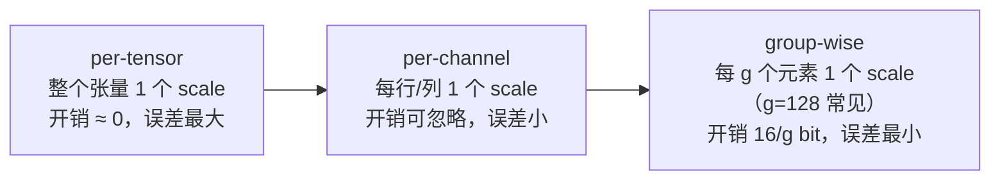
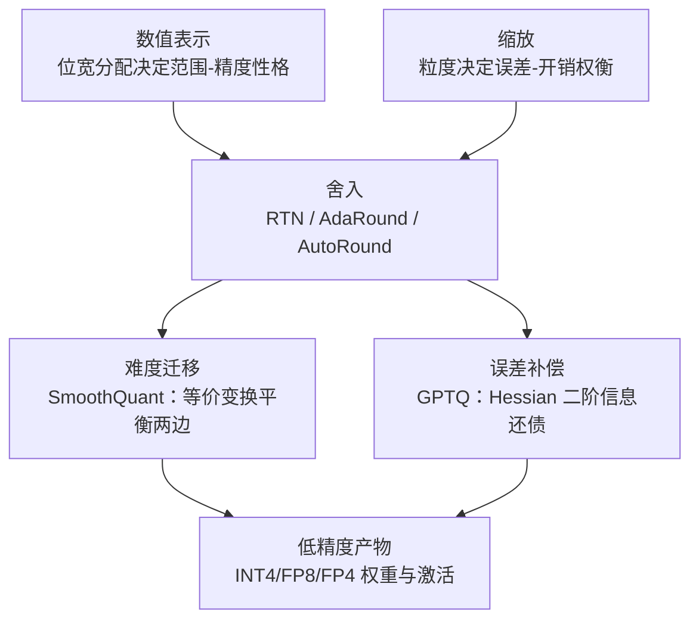

# 2. 核心思想：数值表示、舍入、缩放与难度迁移

> 一句话理解：量化全部的理论困难来自一个事实——**低精度表示装不下高精度数值**，于是必须做三件事：选一套装得下的数值表示（位宽分配），把装不下的部分扔掉（舍入），用缩放把「扔哪部分」的决定权交给数据分布（缩放与粒度），而当数据分布本身太极端时，就通过等价变换把难度从难量化的一侧迁到好量化的一侧（难度迁移）。

## 2.1 数值表示：位宽怎么分

每个数值用 b 个 bit 表示，内部怎么分配给「符号 / 指数 / 尾数」，决定了这套格式的**动态范围**与**精度**：

```text
FP16: 1 符号 + 5 指数 + 10 尾数   范围 ±65504，精度 ~2^-11
BF16: 1 符号 + 8 指数 + 7 尾数    范围 ~±3.4e38（与 FP32 同），精度 ~2^-8
FP8 E4M3: 1+4+3   范围 ±448（OCP：S.1111.111 为 NaN），最小正规数 2^-6
FP8 E5M2: 1+5+2   范围 ±57344（IEEE 风格，指数全 1 保留给 Inf/NaN）
FP4 E2M1: 1+2+1   只能表示 {0, ±0.5, ±1, ±1.5, ±2, ±3, ±4, ±6}
INT8:  1 符号 + 7 数值           均匀刻度，范围由 scale 决定
INT4:  1 符号 + 3 数值           同上
```

两条规律：

- **浮点格式的指数位换范围，尾数位换精度**；E4M3 与 E5M2 只差一位分配，性格迥异（Mini Demo 场景 6：含 2000× 离群通道时 E4M3 相对误差 0.83、E5M2 仅 0.05；无离群时 E4M3 误差只有 E5M2 的一半）。
- **整数格式本身没有范围概念**，范围完全由外挂的 scale 决定——所以 INT4 单独存在没有意义，「INT4 + scale 管理」才是完整方案。

## 2.2 舍入：误差从哪来

给定 scale，量化就是一次舍入映射：

```text
对称:    q = clip(round(x / s), -2^(b-1), 2^(b-1)-1),   s = max|x| / (2^(b-1)-1)
非对称:  q = clip(round(x / s) + zp, 0, 2^b-1),          s = (max-min)/(2^b-1), zp = round(-min/s)
反量化:  x̂ = (q - zp) · s
```

误差有两个来源：

1. **舍入误差**：典型量级为 scale 的一半，随位宽降低按比例放大；
2. **截断/饱和误差**：超出表示范围的值被 clip 到边界——对 FP8/FP4 是「饱和到最大有限值」，对带离群通道的激活这是主要误差源（场景 6 的 E4M3 灾难）。

舍入方式默认 round-to-nearest-even（IEEE 惯例）；研究层面还有 AdaRound（可学习舍入）、AutoRound（符号梯度下降优化舍入）等「让舍入本身可学」的方向，本质都是在 RTN 的基础上把舍入误差再压低一档。

## 2.3 缩放：粒度决定误差，也决定开销

同一个 INT4，scale 取多大范围就有多大效果。粒度从粗到细：



Mini Demo 场景 1 的实测（256×512 权重，对称量化，相对 L2 误差）：

| 粒度 | INT8 | INT4 |
|---|---|---|
| per-tensor | 0.0108 | 0.1947 |
| per-channel（每输出行） | 0.0075 | 0.1358 |
| group-wise g=128 | 0.0065 | 0.1180 |
| group-wise g=32 | 0.0054 | 0.0976 |

两个工程结论：

- **per-tensor 在 INT8 时代够用，在 INT4 时代不可接受**——INT4 per-tensor 误差接近 20%，这就是 AWQ/GPTQ 论文全部用 group-wise（g=128 或 64）的原因。
- **粒度有成本**：每组要存 scale（FP16）甚至 zero-point。等效位宽 = b + (scale 位宽)/g（+ zp/g），g=128 时 INT4 实际为 4.125 bit/weight。场景 2 实测：g 从 128 缩到 32，误差降 17%，位宽涨 9%——这是每个量化 recipe 都要面对的权衡。

## 2.4 难度迁移：量化不了的，换个等价形式

有些分布就是难量化：LLM 激活有少数「离群通道」，幅度比典型值大几十倍，per-tensor INT8 时被它们决定 scale，其余通道全部「吃不饱」精度。SmoothQuant 的解法不是硬量化，而是**先做数学等价变换**：

```text
逐输入通道缩放 s_j = max|X_j|^α / max|W_j|^(1-α)
X' = X / s,   W' = W · diag(s)   ⇒   X'W'ᵀ ≡ XWᵀ（恒等，零误差）
```

变换把激活的离群「搬进」权重（激活除以 s 后分布变均匀），代价是权重变难一点（乘以 s）——总难度不变，但两边都变成了「中等难度」，per-tensor INT8 就能吃了。α 控制迁移方向：α=0.5 均衡，α→1 全推给权重。

Mini Demo 场景 3 实测（激活含 30× 离群通道，per-tensor INT8 W8A8 输出相对误差）：

| α | 0.00 | 0.25 | 0.50 | 0.75 | 1.00 |
|---|---|---|---|---|---|
| 输出误差 | 0.0786 | 0.0329 | **0.0198** | 0.0288 | 0.0671 |

baseline（不迁移）为 0.0664。三点读法：

- 最优 α=0.5，误差降低 **3.35×**；
- **迁移方向错了会更糟**（α=0 时比不迁移还差：0.0786 > 0.0664）——难度迁移不是免费午餐；
- 变换本身在浮点下严格恒等，引入误差的只有变换后的量化——这是它与 QAT 的本质区别：不动训练，只动表示。

## 2.5 误差补偿：量化错了，后面列来还

难度迁移解决「激活难」，误差补偿解决「权重难」：GPTQ 利用校准数据二阶信息（Hessian H = XᵀX），量化第 j 列时把误差按最优系数摊给尚未量化的列：

```text
量化 w_j 得 q_j，误差 e = (w_j - q_j) / U[j,j]
剩余列更新: W[:, j+1:] -= e ⊗ U[j, j+1:]   （U 为 H⁻¹ 的 upper Cholesky 因子）
```

直觉：如果两个输入特征强相关，第一列量化错了，可以在第二列的权重里「补回来」。

Mini Demo 场景 4 实测（校准特征低秩相关，INT4 g=64）：

| 方案 | 权重 rel L2 | 输出 rel L2 |
|---|---|---|
| RTN | 0.1084 | 0.1059 |
| GPTQ | 0.1583 | **0.0372** |

一个反直觉但重要的读法：**GPTQ 的输出误差降低 2.85×，权重本身的误差反而更大**——补偿扰动刻意落在校准数据的零空间里，对输出无影响。评判量化算法要看「校准集输出误差 / 下游任务精度」，不能只看权重范数。

## 2.6 四个思想的组合关系



表示与舍入是「必选动作」，缩放是「调参旋钮」，迁移与补偿是「进阶算法」——它们正交可叠加：实际 recipe 里常见「SmoothQuant 迁移 + GPTQ 补偿 + FP8 封装」的组合拳（llm-compressor 的 recipe 即如此）。

## 小结

- 位宽分配决定性格：浮点用指数位换范围，整数把范围完全外包给 scale。
- 误差来自舍入与饱和两处；INT4 时代 per-tensor 粒度不可接受，group-wise（g=128）是甜点。
- 难度迁移（SmoothQuant）与误差补偿（GPTQ）是正交的两把刀：一个换表示，一个用二阶信息；可以叠加。
- 评判量化看输出误差与下游任务，不看权重范数。
