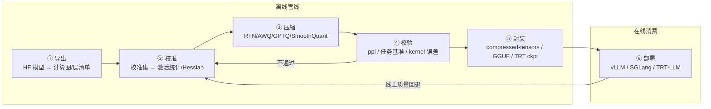
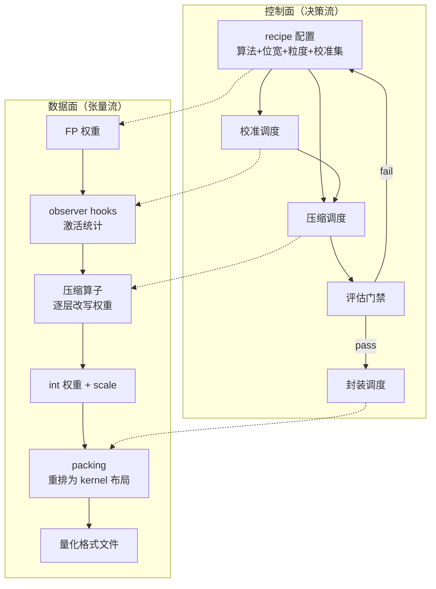

# 3. 架构设计：量化管线的六个环节

> 一句话理解：成熟的量化基础设施把「压缩一个模型」拆成六个职责清晰的环节——**导出 → 校准 → 压缩 → 校验 → 封装 → 部署**，每个环节有明确的输入/输出契约，任一环节不达标都能局部回炉，而不必重跑全流程；这条管线既是 llm-compressor、Quark 这类工具的组织方式，也是企业自建量化平台的参考架构。

## 3.1 管线总览



三个设计要点：

1. **校准与压缩分离**：校准只负责「看数据、产统计量」（一次前向），压缩负责「改权重」（一次优化）；分离后同一批校准统计量可以喂给多种算法对比（同一校准集上试 AWQ 与 GPTQ，成本只多一份压缩时间）。
2. **校验在环内**：质量不达标直接回炉（换校准集、换算法、换粒度），而不是等到线上翻车——校验指标与阈值在 8/9 章展开。
3. **封装是独立环节**：压缩产物（int 权重 + scale）必须按目标引擎的格式契约重新排列（packing、对齐、元数据），封装错了引擎根本加载不了——大量「量化模型跑不快」的 bug 都在这一环。

## 3.2 各环节契约

| 环节 | 输入 | 输出 | 关键决策 | 代表实现 |
|---|---|---|---|---|
| 导出 | HF checkpoint | 层清单、模块名映射、可量化范围 | 哪些层量化（embedding/lm_head 通常豁免）、融合方式 | transformers / modelopt 的 trace |
| 校准 | 校准语料（512~4096 条） | per-tensor/channel/group 的 min-max、AWQ saliency、Hessian | 校准集域匹配、样本数、seq len | llm-compressor `calibration/`、Quark calibration |
| 压缩 | FP 权重 + 统计量 | int 权重 + scale/zp（或浮点低精度权重） | 算法（RTN/AWQ/GPTQ/SmoothQuant/AutoRound）、位宽、粒度、对称性 | 各算法实现 |
| 校验 | 量化权重 + 评估集 | ppl、任务基准、逐层误差报告 | 验收阈值、回归门禁 | lm-eval、自研 harness |
| 封装 | 量化权重 + 格式契约 | safetensors/GGUF/TRT ckpt + config.json | 目标引擎、packing 布局（Marlin/interleaved）、scale dtype | compressed-tensors、GGUF writer |
| 部署 | 量化格式 | serving 实例 + 性能/质量指标 | kernel 后端、并行策略、KV 量化叠加 | vLLM/SGLang/TRT-LLM |

## 3.3 数据面与控制面



控制面是「跑什么、按什么顺序、不过怎么办」（DAG 调度 + 门禁），数据面是「张量怎么流」（权重流经 observer → 压缩 → packing）。工具链的质量很大程度上取决于控制面的灵活性：recipe 能否逐层覆盖（「MoE expert 用 INT4、attention 用 FP8」）、能否断点续跑、评估失败能否只重跑压缩。

## 3.4 与推理引擎的边界

```text
量化工具链的责任边界：产出「格式正确 + 附带 kernel 所需全部元数据」的文件
推理引擎的责任边界：按格式选择/调度 kernel，把位宽兑现成吞吐
```

边界上最容易出问题的三件事：

1. **kernel 缺失**：格式合法但没有对应 kernel，引擎只能拒绝加载或走慢速回退（如 Marlin 不支持的 Turing 上跑 MXFP4）；
2. **scale dtype 不一致**：压缩端按 FP32 scale 量化、kernel 按 FP16 读，引入二次误差；
3. **MoE/多模态覆盖**：新架构（MoE 专家层、视觉塔）的量化支持滞后于 dense LLM，选型时必须核对引擎 release note（第 6 章矩阵）。

## 3.5 管线的三个形态

同一个架构按团队规模有三个落地形态：

- **脚本形态**：llm-compressor 的 `oneshot()` 几十行脚本——适合单模型、单格式；
- **平台形态**：把六环节做成带 UI/API 的服务（模型库管理、recipe 版本化、评估报告归档、一键发布）——适合多团队复用；
- **流水线形态**：CI/CD 化（PR 触发校准→压缩→评估→发布候选），量化产物像镜像一样走制品库——适合模型高频迭代的团队。

## 小结

- 六环节契约：导出、校准、压缩、校验、封装、部署；校验在环内，质量不过局部回炉。
- 校准与压缩分离让「同一校准数据对比多算法」成为低成本操作。
- 封装是独立环节且高频出错：格式对了、kernel 爱吃的布局错了，一样跑不快。
- 控制面（recipe DAG + 门禁）决定工具链上限，数据面（张量流）决定正确性。
