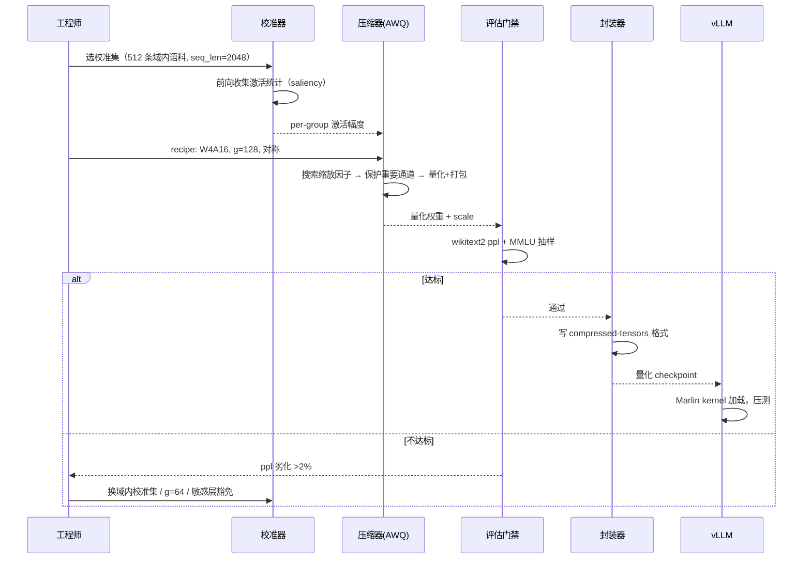

# 4. 工作流程：一次 AWQ 量化的完整流程

> 一句话理解：以「把一个 32B  dense 模型量化成 W4A16（INT4 权重 + FP16 激活）并上线 vLLM」为例，走一遍六环节管线——每一步给出输入、动作、产物与常见坑，最后形成可复用的 recipe。

## 4.1 流程总览



## 4.2 第一步：环境与目标定义

先定验收标准，再动手。一个典型的目标卡片：

```text
模型：32B dense，BF16 基线
目标格式：W4A16 对称 group-wise（g=128）
验收：wikitext2 ppl 劣化 < 1.5%；业务 eval 集分数降幅 < 0.5%；
      部署后单卡吞吐提升 ≥ 1.8×（Marlin kernel 路径）
```

## 4.3 第二步：校准

校准集的选择比算法选择更影响精度：

- **域匹配**：客服模型用客服日志微调过，校准集就该用客服语料而不是通用 wiki；
- **规模**：经验值 128~1024 条、单条 2048~4096 token；AWQ 类算法看的是幅度统计（鲁棒），GPTQ 类看的是 Hessian（样本太少会过拟合校准分布）；
- **覆盖**：多轮对话格式、system prompt、长上下文样例都要出现——它们决定统计量是否覆盖线上分布。

产物是逐层的激活统计量（per-group amax、saliency 排序），校准本身只做前向、不改动权重，成本通常是分钟级。

## 4.4 第三步：压缩（AWQ 为例）

AWQ 的两个动作（对应第 2 章的「缩放」思想）：

1. **搜索缩放因子**：按校准激活幅度，为每组权重找到让激活「好量化」的缩放 s；
2. **保护重要通道**：激活幅度 top-1% 的输入通道（saliency）保持更高有效精度——AWQ 论文的关键发现是**只需保护 1% 的通道**就能保住精度。

与 GPTQ 的对比选择（详见第 6 章）：AWQ 校准成本低、不需要 Hessian、对校准集过拟合不敏感；GPTQ 输出误差更低（场景 4 的 2.85×）但校准成本更高、对校准分布更敏感。生产上常两者都跑一遍，用评估门禁挑赢家。

## 4.5 第四步：校验

三级校验，由便宜到贵：

| 级别 | 指标 | 成本 | 用途 |
|---|---|---|---|
| 权重级 | 逐层 rel L2 / 余弦 | 秒级 | 快速发现配置错误（粒度轴选反、scale dtype 错） |
| 模型级 | wikitext2 / c4 perplexity | 分钟级 | 门槛指标，<1-2% 劣化为常见门禁 |
| 任务级 | MMLU / 业务 eval 抽样 | 十分钟级 | 最终放行依据，尤其小模型与多模态 |

校验不通过时的回炉旋钮（按性价比排序）：换校准集 → g=128 改 64 → 敏感层豁免（首尾层、embedding）→ 换算法（AWQ↔GPTQ↔AutoRound）→ 升位宽（W4→W8）。

## 4.6 第五步：封装

压缩产物是「int 权重 + scale」，封装把它写成引擎认的格式：

- **compressed-tensors**（llm-compressor 原生）：safetensors + `quantization_config`，vLLM/SGLang 直接 `LLM("path")`；
- **GGUF**：llama.cpp 生态，含 K-quants 超级块布局与 `general.quantization_version` 元数据；
- **TensorRT-LLM checkpoint**：Quark/Model Optimizer 产物，scale 布局与 kernel 严格对齐。

封装期的检查项：config 里的 `bits/group_size/sym/axis` 与实际打包一致；scale 按 kernel 要求的 dtype（FP16/FP8）存储；MoE 专家层是否全部覆盖。

## 4.7 第六步：部署与灰度

```text
1. vLLM 加载：LLM("quantized_ckpt") —— 从 config 自动识别 AWQ → Marlin kernel
2. 离线压测：吞吐/TTFT/TPOT 对比 BF16 基线，确认 ≥1.8× 目标
3. 影子流量：真实请求双跑（BF16 vs INT4），比对输出分布（KL/胜率）
4. 灰度 5% → 50% → 100%，指标护栏：ppl 代理指标 + 业务 eval + 用户反馈率
5. 回退预案：网关按模型版本路由，一键切回 FP8/BF16 版本
```

量化版本发布本质上是「换模型」，所有模型发布的治理流程（版本化、灰度、回退）都适用——这也是 [LLM Gateway](/04-llmops/llm-gateway/) 主题的分工。

## 4.8 全流程的耗时画像（32B 模型参考）

| 环节 | 参考耗时 | 主要资源 |
|---|---|---|
| 校准（512 条 × 2048） | 10~30 min | 1×GPU 前向 |
| AWQ 压缩 | 20~60 min | 1×GPU |
| ppl 校验 | 5~10 min | 1×GPU |
| 任务基准抽样 | 0.5~2 h | 1~4×GPU |
| 封装 + vLLM 压测 | 10~30 min | 2×GPU |

全流程半天内可完成一轮迭代——这决定了「评估门禁不过就回炉」的实践可行性。

## 小结

- 先定验收标准（ppl 劣化、吞吐提升）再动手；校准集域匹配是第一优先级。
- AWQ = 缩放搜索 + 1% 通道保护；与 GPTQ 互为对照，用门禁挑赢家。
- 三级校验逐级放大成本；回炉旋钮按性价比排序，换校准集永远先试。
- 量化版本按「换模型」治理：版本化、影子流量、灰度、一键回退。
