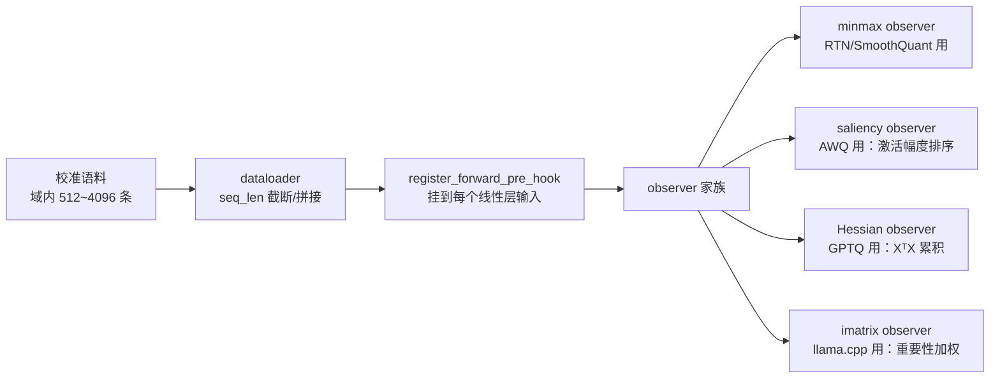
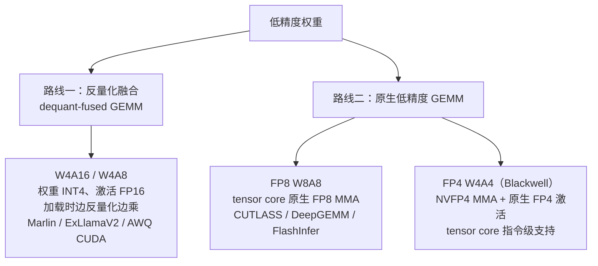

# 5. 核心模块：校准器、压缩算法、格式封装与 kernel 后端

> 一句话理解：量化管线拆到模块级就是四件套——**校准器**把语料变成统计量，**压缩算法**把统计量变成低精度权重，**格式封装**把低精度权重排成引擎认的文件，**kernel 后端**决定这些比特最终跑多快；前三个模块决定「对不对」，最后一个决定「快不快」。

## 5.1 校准器（Calibrator）

职责：在不改动权重的前提下，用最小成本产出算法需要的全部统计量。



设计要点：

- **observer 与算法解耦**：同一轮前向可以同时喂多个 observer（llm-compressor 的 MSE/iMatrix observer 即此设计），避免为每个算法重跑校准；
- **统计量精度随位宽收紧而升级**：INT8 用 minmax 够；INT4 需要 MSE 最优 clip（minmax 会被离群值带偏）；FP4 需要 iMatrix 类重要性加权——「位宽越低、校准越贵」是普遍规律；
- **域漂移即校准漂移**：线上分布变了（新 prompt 模板、新功能），统计量过期，量化质量无声劣化——校准集要随业务迭代，这也是平台形态管线的核心价值（校准集版本化）。

## 5.2 压缩算法（Compressor）

按「需要多少模型信息」排成一个谱系：

| 算法 | 校准信息 | 机制（第 2 章思想） | 位宽能力 | 成本 |
|---|---|---|---|---|
| RTN | 无 | 直接舍入 | INT8 尚可，INT4 差 | 秒级 |
| FP8 cast | 无/per-tensor scale | 浮点截位 | FP8 | 秒级 |
| AWQ | 激活幅度 | 缩放搜索 + 1% 通道保护 | W4A16 甜点 | 分钟级 |
| SmoothQuant | 激活幅度 | 难度迁移（恒等变换） | W8A8 | 分钟级 |
| GPTQ | Hessian | 逐列误差补偿 | 3-4 bit 可用 | 十分钟级（MoE 已可 batched） |
| AutoRound | 少量梯度步 | 可学习舍入 | 低 bit 强 | 小时级 |
| QuIP#/QuaRot 系 | Hessian + 随机旋转 | 非相干化 + 格码本 | 2 bit 研究前沿 | 高 |

工程经验：

- **W4A16（INT4 权重、FP16 激活）选 AWQ 或 GPTQ**：两者精度接近时 AWQ 更快更稳，GPTQ 在校准分布可靠时输出误差更低（llm-compressor v0.13 起 GPTQ 有 Triton kernel，速度提升约 15 倍，MoE batched 端到端约 30 倍）；
- **W8A8 选 SmoothQuant 或直接 FP8**：激活离群不极端时 SmoothQuant INT8 足够且 CPU 友好；要极致吞吐且硬件支持（Hopper+）直接 FP8；
- **QAT/QAFT 是兜底而非首选**：量化感知训练/微调后量化精度最高，但要训练资源与数据——只在 PTQ 全家族都过不了门禁时使用。

## 5.3 格式封装（Packer）

封装回答「这些 int 和 scale 在文件里怎么摆」。三个主流格式：

```text
compressed-tensors（llm-compressor）:
  safetensors 存 int32 打包的 int4 + 独立 scale 张量
  + quantization_config.json（bits, group_size, sym, axis, 豁免层清单）
  → vLLM / SGLang 原生消费

GGUF（llama.cpp 生态）:
  自描述二进制：元数据 KV（tokenizer、架构参数、quantization_version）
  + K-quants 超级块（如 Q4_K_M = 256 权重大块内套 8 子块共享 scale/min）
  → llama.cpp / 各类 GGML 推理器；新格式如 IQ4_XS、MXFP4 持续扩展

TRT-LLM checkpoint（NVIDIA）:
  Quark/Model Optimizer 产出，scale 布局与 CUTLASS/TRT kernel 严格对齐
  → TensorRT-LLM 引擎构建
```

封装的隐性工作：**packing 与对齐**。INT4 权重通常 8 个一包进 int32；Marlin kernel 要求特定的交错布局（interleaving）以便向量化反量化；scale 要按 kernel 要求的粒度（per-group 还是 per-block）预计算好。压缩算法产出的数学内容与最终文件布局之间，隔着这一层「为 kernel 服务」的重排。

## 5.4 kernel 后端：位宽如何兑现成速度

低精度 GEMM 有两条技术路线：



关键认知：

- **W4A16 的加速来自带宽而非算力**：权重读少了 4 倍，乘法还是 FP16 做；所以 decode（带宽瓶颈）收益大，prefill（算力瓶颈）收益小；
- **W8A8/FP8 与 W4A4 才是算力收益**：tensor core 原生低精度 MMA 让乘法本身变快，但要求激活也量化——激活量化引入的精度问题（第 2 章难度迁移）就是为此付的账；
- **kernel 支持矩阵是硬约束**：同样的 NVFP4，Blackwell 有原生指令、Ampere/Hopper 只能走 Marlin W4A16 回退（SGLang 的 `modelopt_fp4` 即如此设计）；Turing 连 Marlin MXFP4 都不支持。选格式前先查引擎矩阵（第 6 章）。

## 5.5 模块间的契约

四个模块靠三张契约咬合：

1. **统计量契约**：observer 输出什么（minmax / saliency / Hessian），算法就消费什么——新增算法只需新增 observer，不用动校准器骨架；
2. **量化参数契约**：bits、group_size、sym、axis、scale dtype、豁免层清单——封装按它写 config，引擎按它选 kernel，一处出错全链路失败；
3. **布局契约**：int 打包方式、scale 摆放、对齐要求——压缩器与 packer 之间的私有协议，也是跨工具链（llm-compressor ↔ Quark）最难互通的一层。

## 小结

- 校准器是位宽越低越贵的环节：INT8 用 minmax，INT4 用 MSE clip，FP4 用重要性加权。
- 压缩算法按校准信息排谱系：RTN < FP8 cast < AWQ/SmoothQuant < GPTQ < AutoRound < 旋转系。
- 封装 = 数学内容 + kernel 布局的翻译层；布局契约是跨工具链互通的最大障碍。
- kernel 两条路线：W4A16 省带宽、W8A8/FP4 省算力；硬件代际决定格式天花板。
