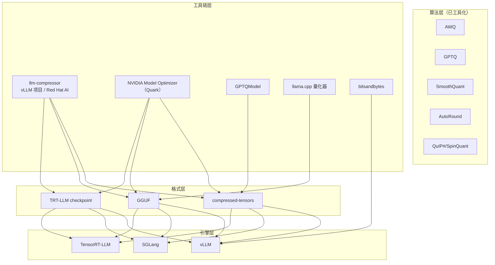

# 6. 生态与源码分析：工具链横向对比

> 一句话理解：2026 年的量化工具链呈「双寡头 + 长尾」格局——**llm-compressor**（vLLM 项目/Red Hat AI）与 **NVIDIA Model Optimizer（Quark）** 覆盖「从校准到部署」的主线，**llama.cpp 量化器**与 **GPTQModel** 守住特定生态位，算法层 AWQ/GPTQ/SmoothQuant 已被吸收为标准 recipe 而非独立工具（版本信息截至 2026-10，以官方文档/release 为准）。

## 6.1 生态全景

## 6.2 主线一：llm-compressor

**定位**：vLLM 项目的官方压缩库（Apache-2.0，原 Neural Magic 团队，现 Red Hat AI），口号「built for production inference with vLLM」——产出 compressed-tensors 格式，vLLM 零配置加载。

- **算法全集**：Simple PTQ、GPTQ、AWQ、SmoothQuant、AutoRound、SpinQuant/QuIP 等旋转系，以及 REAP（MoE 专家剪枝）；支持量化 + 稀疏叠加；
- **格式覆盖**：FP8、NVFP4/MXFP4、INT4、INT8 及 W4A16 / W8A8 / W4AFP8 等混合精度，WNA4/8/16 任意位宽；
- **API 形态**：recipe（YAML/Python）+ `oneshot()` 一次性压缩；DDP 与磁盘 offload 支撑超大模型；
- **近期演进（v0.13.0）**：Triton GPTQ kernel（约 15× 加速）、MoE batched GPTQ（端到端约 30×）、MSE/iMatrix observer 扩展支持 FP4；Red Hat AI 持续发布 Nemotron、Kimi-K3 等量化 checkpoint。

## 6.3 主线二：NVIDIA Model Optimizer（Quark）

**定位**：NVIDIA 的统一模型优化库（原 TensorRT Model Optimizer，2025-12-08 起正式更名 NVIDIA Model Optimizer），深度绑定 TensorRT-LLM，同时导出 vLLM/SGLang/ONNX。

- **能力面**：PTQ 与 QAT/蒸馏；量化（NVFP4/FP8/INT4）、剪枝、蒸馏、投机解码一体化；
- **KV cache 量化**：AutoQuant KV 自动决定 K/V 量化策略与粒度（呼应第 2 章 K/V 粒度差异问题）；
- **硬件协同**：NVFP4/FP4 KV cache 等 Blackwell 特性首发支持（TRT-LLM 侧 NVFP4 KV 需离线 ModelOpt 量化 + FP8 权活量化配合）；
- **校准**：与 TensorRT-LLM 的 calibration cache 体系互通，适合「编译型引擎 + 企业级 QAT」场景。

## 6.4 生态位玩家

**GPTQModel**（ModelCloud）：AutoGPTQ 的接班者——AutoGPTQ 已停止维护，GPTQModel 重写内核、支持现代 GPU 与更多格式，是 GPTQ 路线事实上的维护方。

**llama.cpp 量化器**：GGUF 生态的源头。imatrix（importance matrix）校准是 INT4/IQ 系列质量的隐形功臣——它把「哪些权重重要」加权进量化误差，等效于给 GPTQ 的 Hessian 思路做了一个轻量近似；社区约定俗成的命名（Q4_K_M = Q4_K 混合粒度「Medium」）决定了 GGUF 文件的流通性。

**bitsandbytes**：研究/训练侧基础设施——LLM.int8() 的混合精度分解（outlier 特征走 FP16，其余 INT8）与 QLoRA 的 NF4（对正态分布信息论最优的非均匀 4bit）。推理引擎侧 vLLM/SGLang 均有加载支持，但生产吞吐一般不如 Marlin 系。

**AutoAWQ / AutoGPTQ（历史地位）**：前者 2025-05-11 归档（官方指引迁移至 llm-compressor），后者由 GPTQModel 接班——「一论文一工具」时代的终结标志。

## 6.5 算法横向对比（GPTQ vs AWQ vs SmoothQuant vs FP8 cast）

| 维度 | AWQ | GPTQ | SmoothQuant | FP8 cast |
|---|---|---|---|---|
| 量化对象 | 权重（W4A16） | 权重（W4A16/W8A8） | 权重+激活（W8A8） | 权重+激活（W8A8） |
| 校准信息 | 激活幅度（saliency） | Hessian（二阶） | 激活+权重幅度 | 可选 per-tensor scale |
| 核心机制 | 缩放搜索 + 1% 通道保护 | 逐列误差补偿 | 难度迁移（恒等变换） | 浮点截位 |
| INT4 质量 | 好 | 更好（输出误差 2-3× 低于 RTN，见 Mini Demo 场景 4） | 不适用（迁移后仍走 INT8） | 不适用 |
| 激活量化 | 不涉及 | 不涉及 | 核心目标 | 核心目标 |
| 校准成本 | 低（单次前向） | 中（Hessian 累积） | 低 | 极低 |
| 典型搭配 | Marlin kernel | Marlin kernel | INT8 tensor core | Hopper+ FP8 MMA |

## 6.6 serving 引擎支持矩阵（截至 2026-10，以官方文档为准）

**vLLM**：AWQ、GPTQ（GPTQModel）、Marlin（覆盖 GPTQ/AWQ/FP8/FP4）、llm-compressor compressed-tensors（FP8 W8A8 / INT4 W4A16 / INT8 W4A8 / W8A8）、bitsandbytes、DeepSpeedFP、GGUF、TorchAO、NVIDIA Model Optimizer（quark）、FP8 ViT；量化 KV cache（`kv_cache_dtype`）；NVFP4 W4A16 在 Blackwell 上走 CUTLASS/Humming kernel。硬件注意：Marlin 不支持 Volta；Turing 不支持 Marlin MXFP4。

**SGLang**：`fp8`、`mxfp4`（NVIDIA + AMD）、`w8a8_int8/fp8`、`awq`、`gptq_marlin`（GPU 上 `gptq` 已移除，用 marlin 变体）、`compressed-tensors`、`quark`、`auto-round`、`gguf`、`modelopt_fp8/modelopt_fp4`（Blackwell 原生 FP4、Ampere/Hopper 走 Marlin W4A16 回退）、`nvfp4_online`（Blackwell MoE 在线转 NVFP4）、`bitsandbytes`；AMD 侧有 `quark_int4fp8_moe`、`petit_nvfp4`。官方明确建议**离线量化优于在线量化**。

**TensorRT-LLM**：FP8 per-tensor / block scaling / rowwise（Blackwell 上用 MXFP8 配方）、FP8 KV cache、NVFP4 KV cache；NVFP4/MXFP4 权重（sm100/103/120）；W4A16/W4A8 AWQ/GPTQ。Hopper 无 FP4，Ada 无 block scaling——硬件代际决定上限。

**横向结论**：三引擎对「AWQ/GPTQ INT4 W4A16 + FP8 W8A8」全覆盖（这是生产基线）；差异在 FP4/KV 量化等新特性上——Blackwell 用户优先看 TRT-LLM 与 SGLang 的 NVFP4 路径，vLLM 用户吃 llm-compressor 生态最顺。

## 6.7 源码阅读建议

1. **llm-compressor `oneshot()` 入口**：看 recipe 如何解析成 modifier DAG（量化/校准 modifier 的组合与执行顺序），学「控制面」设计；
2. **GPTQ 参考实现（`gptq_like.py` 的完整版）**：Hessian 累积 → damp → Cholesky 求逆 → 逐列补偿，百余行看清二阶算法的全部秘密；
3. **llama.cpp `llama-quantize` + imatrix**：看 GGUF 写出与 K-quants 超级块布局，理解「格式封装」的最小完整实现；
4. **vLLM `vllm/model_executor/layers/quantization/`**：每个格式一个目录，看引擎如何按 `quantization_config` 分发到 kernel——量化契约的消费端。

## 小结

- 工具链双寡头：llm-compressor（开源生态 + vLLM 闭环）与 NVIDIA Model Optimizer（编译型引擎 + QAT + Blackwell 首发）。
- AutoAWQ 归档、AutoGPTQ 由 GPTQModel 接班——算法已 recipe 化，单独维护的工具失去存在价值。
- 三引擎基线一致（INT4 W4A16 + FP8 W8A8），新格式（FP4/KV 量化）支持分化，选型以官方矩阵为准。
