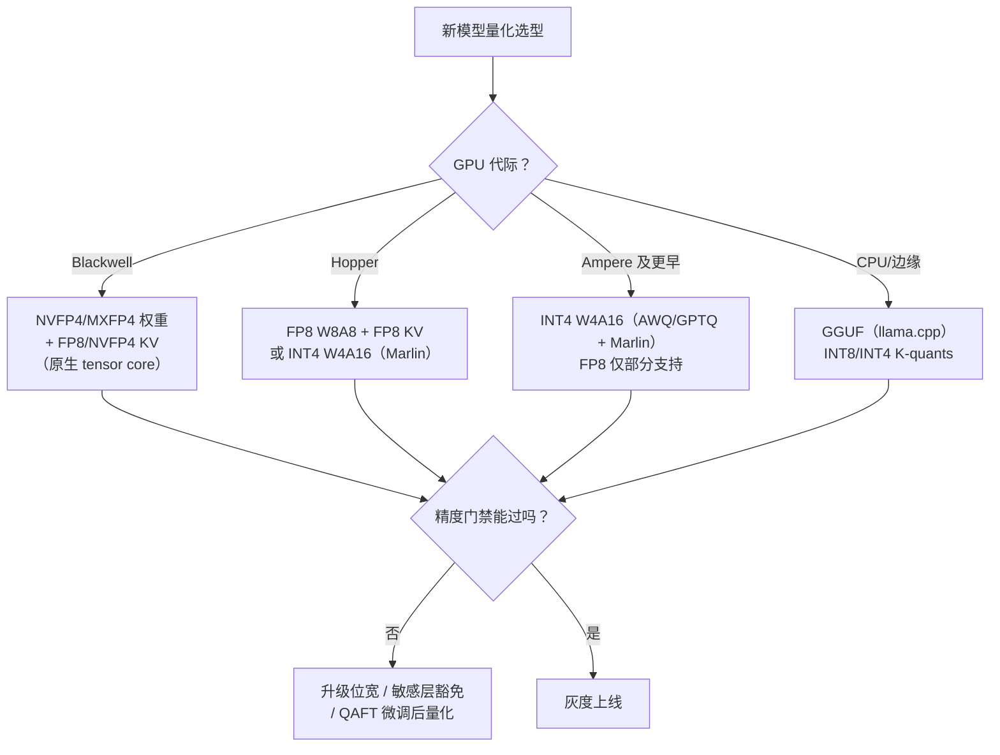

# 8. 企业生产实践：选型决策、精度回归与线上灰度

> 一句话理解：量化上线的工程难点不在「压出来」，而在「选得对、验得准、上得稳」——选型要同时考虑 GPU 代际、模型架构与 SLA，精度回归要建立「权重级→模型级→任务级」的三级门禁，上线要按「换模型」的标准走影子流量与灰度回退。

## 8.1 选型决策：格式选择的决策树



三个常被低估的选型变量：

- **模型架构**：MoE 模型（DeepSeek 类）专家层对量化更鲁棒（专家专门化、激活稀疏），注意力层更敏感；小模型（<3B）量化精度折损占比更大；多模态模型的视觉塔经常要保持 FP16（vLLM/TRT-LLM 均默认视觉组件 FP16）。
- **上下文长度**：长上下文服务 KV cache 是显存第一大户（见 [KV Cache 主题](/04-llmops/kv-cache/)），此时「权重 INT4 + KV FP8」的组合往往比「权重 FP8 + KV FP16」整体更优——量化预算是全局的，不要只盯权重。
- **SLA 类型**：TTFT 敏感（短请求、高并发）优先压权重带宽；TPOT 敏感（长生成）同时吃权重带宽与 KV 带宽——两者都压。

## 8.2 精度回归：三级门禁

```text
权重级（秒级）    逐层 rel L2 / 余弦、scale 分布检查
      ↓ 防配置错误：粒度轴选反、scale dtype 错、某层漏量化
模型级（分钟级）  wikitext2 / c4 perplexity
      ↓ 门槛：ppl 劣化 < 1~2%（按模型大小与位宽调整）
任务级（小时级）  MMLU/GSM8K 等公开基准 + 业务 eval 集
      ↓ 放行依据：业务指标降幅 < 0.5%（按场景容忍度）
```

实践要点：

- **iso-accuracy 对比表**：同一份验收集上对比 BF16 / FP8 / INT4-awq / INT4-gptq，一次产出选型的全部证据，归档进模型卡片；
- **ppl 不是万能的**：ppl 对长文本生成敏感，对指令跟随、结构化输出不敏感——业务 eval 集必须覆盖真实流量形态（多轮、JSON、代码）；
- **kernel 级二次验证**：压缩端精度过了，不代表部署端精度一样——scale 按 FP16 存储后反量化有舍入，建议部署端抽样跑一次 eval 确认端到端无损。

## 8.3 线上灰度与监控

量化版本按「换模型」治理（版本化、影子流量、灰度、回退）：

| 阶段 | 动作 | 护栏 |
|---|---|---|
| 离线压测 | vLLM/TRT-LLM 压测吞吐、TTFT/TPOT | 吞吐提升 ≥ 预期（如 1.8×）；精度抽样通过 |
| 影子流量 | 真实请求双跑 BF16 vs 量化版 | 输出分布 KL 散度、抽样人评胜率 |
| 灰度 5%→50%→100% | 网关按版本路由 | 业务指标（满意度、解析成功率）无显著回退 |
| 全量 + 监控 | 持续观测 | 质量代理指标 + 显存/吞吐基线漂移告警 |

回退预案必须「一键」：网关保留 BF16/FP8 版本路由，量化版本异常时秒级切回。KV cache 量化的灰度要单独走一轮——它影响所有请求且与长度强相关，建议先用「热数据 FP16、冷数据 FP8」的分层策略过渡（呼应 KV Cache 主题的分层思想）。

## 8.4 组织形态：量化平台的三个收益

当模型数量与迭代频率上来后，脚本形态的量化流程会出现三类事故：校准集口径不一致、recipe 散落无法复现、评估报告丢失。量化平台（管线形态）的三个直接收益：

1. **制品化**：量化产物走制品库（版本 + recipe 哈希 + 校准集版本 + 评估报告四元组绑定），任何一个线上 checkpoint 可完整复现；
2. **门禁标准化**：评估不过自动阻断发布，回炉旋钮（换校准集/粒度/算法）沉淀为平台能力；
3. **复用与对比**：同一校准集批量产出多算法/多位宽候选，评估报告并排——选型从「拍脑袋」变成「查表」。

## 8.5 来自公开实践的信号

- **DeepSeek-V3** 证明了 FP8 混合精度可以贯穿训练到推理（细粒度 FP8 缩放、E4M3 权重与激活），FP8 不再是「推理侧的妥协」而是全链路一等公民；
- **Red Hat AI / vLLM 项目**持续发布生产级量化 checkpoint（Nemotron、Kimi-K3 等，基于 llm-compressor），社区量化模型的质量基线被持续抬高——自研 recipe 前先查社区是否已有同型号官方量化版；
- **K-quants + imatrix 生态**（llama.cpp）证明了「校准质量 > 算法复杂度」：没有 Hessian、没有补偿，仅靠重要性加权校准 + 成熟格式，就在消费级硬件上支撑了海量 4-bit 模型。

## 小结

- 选型决策树：GPU 代际定格式天花板，模型架构与上下文长度定预算分配，SLA 定优先级。
- 三级门禁：权重级防配置错、模型级卡 ppl、任务级放行业务指标；iso-accuracy 对比表是选型的标准交付物。
- 灰度按「换模型」治理；KV 量化单独灰度，可先用热 FP16/冷 FP8 分层过渡。
- 平台化的核心价值：制品可复现、门禁标准化、多候选批量对比。
