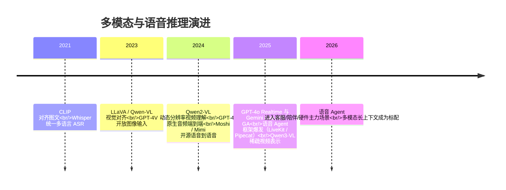

# 1. 背景：模态爆炸与延迟预算

> 一句话理解：2023-2026 年，模型的输入从「一段文本」膨胀为「任意数量的图像、整段视频和连续的音频流」——**token 的生产成本、调度单位和延迟约束全部改变**，推理基础设施从「批处理优化问题」变成了「实时媒体系统问题」。

## 1.1 从单模态到任意模态：一条时间线



关键转折点有三个：

1. **GPT-4o（2024-05）**：第一次在旗舰模型里把文本、图像、音频训练进同一个模型，音频不再走「ASR→LLM→TTS」外挂流水线；
2. **Realtime API 类产品化（2025）**：OpenAI Realtime 与 Gemini Live 把「语音进、语音出、随时打断」封装成云 API，语音 Agent 的创业门槛骤降；
3. **视频理解的工程化（2025）**：Qwen3-VL 一类模型把 1 小时级视频压进可承受的 token 预算，视频从「抽几帧看」走向「连续时序理解」。

## 1.2 为什么文本推理的成熟方案不能直接搬过来

纯文本 serving 的世界里有几个「理所当然」，在多模态里全部不成立：

| 文本世界的假设 | 多模态现实的反例 |
|---|---|
| 1 token ≈ 0.75 个英文单词，prompt 长度可知 | 一张图片 = 256~1280 个视觉 token，取决于分辨率；一段音频 = 100~600 tokens/秒，取决于 codec |
| prefill 成本与输入长度近似线性 | 视觉 encoder 是另一个模型，有自己的 batch、显存和调度；prefill 变成两段流水线 |
| 请求可以排队几百毫秒无所谓 | 语音对话要求 500ms 内出声，排队即死亡 |
| 请求-响应一次交互 | 语音是双向流：用户随时打断，Agent 要边听边说 |
| KV 随文本长度线性增长，可预测 | 视频 token 可以瞬间灌入数万；音频上下文 1 分钟 = 文本 30 倍 |

## 1.3 模态带来的三类新成本

多模态请求的成本可以拆成三个独立的部分，这也是本主题 5-7 章的组织方式：

```text
多模态请求总成本
├── 编码成本：vision encoder / audio encoder 前向（与 LLM 不同的模型、不同的卡）
├── prefill 成本：视觉/音频 token 进入 LLM 注意力（token 数 x 每 token 成本）
└── 流式约束成本：首包延迟 SLO 把「批处理换吞吐」的空间压缩到极限
```

一个具体例子（Mini Demo 场景 1 的实测）：一张 3024×4032 的手机照片，经动态分辨率缩放后变成 **1230 个视觉 token**——相当于 6.2 倍于一段 200 token 的文本 prompt。4 个「图文混合」请求与一个「纯文本」batch 相比，**prefill 成本放大 7.15 倍**，且 86% 的 prefill token 来自图像。

## 1.4 延迟预算：语音场景的硬约束

人类对话研究表明，超过约 1 秒的响应间隙就会被感知为「迟钝」，而 200-500ms 是自然对话的节奏。这意味着语音 Agent 的整条链路必须压进亚秒级：

```text
用户停止说话
  → VAD 端点检测（等确认用户真说完了）      ~240ms
  → STT 把最后几个词定稿                    ~150ms
  → LLM 产出第一个 token                    ~300ms
  → TTS 合成第一帧可播音频                  ~120ms
  → 网络传输 + 播放缓冲                     ~40ms
  ─────────────────────────────────────
  合计                                      ~850ms   ← 超预算！
```

这个默认配置的 850ms 明显超标的数字是故意放进 Mini Demo 的——**语音工程的日常就是给每一段压预算**：砍半每一段后能看到只有 endpointing、STT 定稿和 LLM TTFT 是主要杠杆（见 7.4 节）。

## 1.5 新问题域总览

| 经典系统问题 | 多模态/语音版本 |
|---|---|
| 批处理调度 | 视觉 encoder 与 LLM 双资源调度；图文混合 batch 的 skew 治理 |
| 缓存 | 视觉 embedding 按内容哈希复用（vLLM 默认行为）；音频 KV 的 prefix 复用 |
| 实时系统 | 全双工会话状态机；打断确认的 grace 窗口；历史按已播放量截断 |
| 流媒体 | 音频分帧、codec token 流式进出、WebRTC vs WebSocket 传输选型 |
| 容量规划 | 按「视觉 token/s」和「并发语音路数」而不是「token/s」做预算 |
| 成本核算 | 输入音频按秒计费、视觉 token 按张计费，与文本按 token 计费混杂 |

## 小结

- 多模态的输入单位（图片/视频/音频流）不是 token，**要先经过编码器变成 token**，这引入了第二模型、第二显存池和第二调度问题。
- 模态决定了成本结构：图片按张计费、视频按时长计费、音频按秒计费，都远贵于同信息量文本。
- 语音场景把这一切压进亚秒级延迟预算，并追加「随时打断」这一实时系统约束——这是本主题与文本推理主题最本质的区别。
