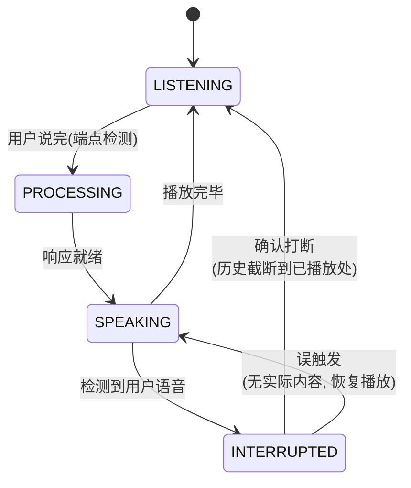
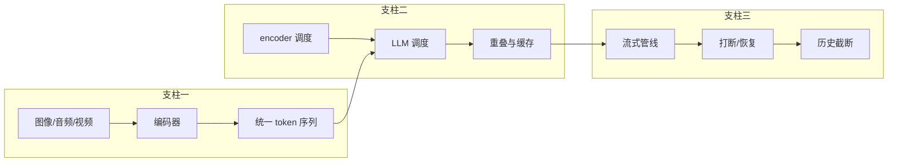

# 2. 核心思想：统一 token 序列、模态调度、流式与打断

> 一句话理解：多模态推理基础设施建立在三根支柱上——**把一切模态统一成 token 序列**（让 LLM 只面对一种数据类型）、**把每个模态当成独立资源来调度**（编码器与 LLM 双资源流水线）、**把交互建模成全双工流**（流式输出 + 随时打断），三者缺一，系统要么不 work，要么贵到不可用。

## 2.1 支柱一：统一 token 序列

现代视觉语言模型（LLaVA、Qwen-VL、InternVL）几乎都采用同一套三段式架构：

```text
图像 ──▶ vision encoder (ViT) ──▶ projector ──▶ LLM embedding 空间
                                                  │
文本 ──▶ tokenizer ──▶ embedding 查表 ──────────────┤
                                                  ▼
                                          统一的 token 序列（一个注意力上下文）
```

在 LLM 看来，一张图片就是「被替换成视觉 embedding 的一串特殊 token」：

```text
prompt: "<|vision_start|> v v v v ... v <|vision_end|> 请描述这张图"
                              ↑
              v 是占位符 token，运行时被视觉 embedding 逐一替换
```

这个「占位符 + embedding 替换」机制是整个多模态 serving 栈的地基：

- **调度器只看 token**：视觉 token 与文本 token 在 paged KV、prefix cache、batching 里同权对待（vLLM 的 `multi_modal_data` 最终在引擎内变成普通 token 序列）；
- **成本可计算**：prefill 成本 = (文本 token + 视觉 token) × 每 token 成本，问题转化为「数清一张图有多少 token」；
- **可缓存**：同一张图重复出现时，视觉 embedding 可以按内容哈希缓存（vLLM 默认按媒体内容哈希启用跨请求缓存），跳过 encoder 前向。

**视频与音频同理**：视频是「带时间序的视觉 token 序列」（Qwen2.5-VL 用 mRoPE 把时间维度编码进位置），音频在端到端语音模型里是 codec token 序列（见 2.3 与第五章）。

## 2.2 支柱二：模态调度——双资源流水线

多模态请求要经过两个模型，而这两个模型的资源画像完全不同：

| | vision encoder | LLM |
|---|---|---|
| 计算形态 |  dense ViT，计算量随 patch 数线性 | prefill/decode 两阶段不对称 |
| 显存占用 |  小（0.3-1B 参数级） | 巨大（权重 + KV） |
| 适合共置 |  可与 LLM 共卡（分时）或独立小卡池 | 主推理池 |

由此产生调度上的三个关键决策：

1. **编码与 prefill 重叠**：encoder 跑完后 LLM 才能 prefill 对应请求，但不同请求的 encoder 与 LLM prefill 可以流水重叠（Mini Demo 场景 2：encoder 307.5ms 与 LLM prefill 286ms 重叠后 makespan 307.5ms，串行则要 593.5ms）；
2. **图文混合 batch 的 skew**：一个带高清图的请求顶 6 个文本请求的 prefill 量，batch 内请求成本方差极大——需要用 chunked prefill 或按成本加权调度防止长视觉请求饿死短文本请求；
3. **按内容缓存 encoder 输出**：UI 截图、重复上传的图片在 agentic 负载里占比很高，内容哈希缓存可以直接砍掉大部分 encoder 前向。

## 2.3 支柱三：流式与打断——全双工会话模型

语音 Agent 不是「请求-响应」，而是打电话。这要求推理链路支持三个文本系统没有的能力：

**（a）全链路流式**。每一级都以流对流方式工作：

```text
麦克风 PCM 流 → VAD 切分 → STT 部分结果流 → LLM 增量 token 流 → TTS 音频帧流 → 扬声器
                （边说边转）   （边说边出词）     （边出边说）      （边合成边播）
```

任何一级「攒够再出」都会把延迟预算击穿——TTS 的第一帧目标通常是 100-150ms。

**（b）打断（barge-in）**。用户在 Agent 说话时开口，系统必须：

1. VAD 在 80ms 内检测到语音能量（OpenAI Realtime 的 server VAD、LiveKit 的自适应打断门控）；
2. 立即停掉 TTS 播放与 LLM 生成（取消传播通常 10-50ms）；
3. **按用户实际听到的内容截断对话历史**——Agent 说了 4 秒、用户第 0.4 秒就开口，那么历史里只能保留前 0.4 秒的内容，否则模型会「记得自己没说完的话」；
4. 用新的 pipeline 响应，打断后的二次响应延迟 ≈ VAD 触发 + 取消 + 整条链路重启（Mini Demo 实测：80 + 30 + 850 = 960ms）。

**（c）误触发治理**。咳嗽、环境噪声、「嗯嗯」式的回通道（backchannel）不应触发打断。生产系统用「确认窗口」区分真打断与误触发（Mini Demo 场景 5）：VAD 触发后若窗口内没有真实词语，恢复播放且不截断历史。



## 2.4 两条技术路线的取舍：三段式 vs 端到端

语音 Agent 的推理架构有两条路线，本质是「模块化的可控性」与「端到端的延迟/自然度」之间的交换：

| | 三段式（cascaded） | 端到端（speech-to-speech） |
|---|---|---|
| 结构 | ASR → LLM → TTS 三个独立服务 | 一个模型直接音频进、音频出 |
| 代表 | Whisper + GPT + ElevenLabs；LiveKit/Pipecat 默认模式 | OpenAI GPT-4o Realtime、Gemini Live、Moshi |
| 首音延迟 | 三段累加（约 600-900ms 常见） | 模型直接出声（官方目标 500ms 级） |
| 可控性 | 每段可独立替换/降级/限流，文本中间态可审计 | 黑盒程度高；文本 transcript 只是旁路 |
| 成本 | 三个服务三套计费，但可用小模型组合 | 音频 token 计费（输入音频按 token/秒），量级更高 |
| 打断语义 | 自己实现（框架层） | API 内建（server VAD + 打断事件） |
| 生态成熟度 | 组件任意替换、自托管友好 | 绑定特定云 API，自托管选项少（Moshi 系例外） |

工程现实（2026）：**生产系统大量采用混合**——用端到端 API 扛主对话的低延迟体验，三段式承接需要审计文本、私有部署或特殊 TTS 音色的场景；框架层（LiveKit、Pipecat）把两者抽象成同一接口，运行时可选。

## 2.5 三条主线如何串成一章



统一 token 序列解决「表示」，模态调度解决「成本」，流式与打断解决「交互」。接下来三章分别展开架构（3）、时序（4）与模块（5）。

## 小结

- 多模态的地基是「占位符 + embedding 替换」：一切模态最终都是统一 token 序列里的 token。
- 多模态请求消耗双资源（encoder + LLM），调度的核心是重叠流水、混合 batch 的 skew 治理和 encoder 输出缓存。
- 语音把系统推向全双工：全链路流式、可打断、能区分真打断与误触发，并按已播放内容截断历史。
- 三段式 vs 端到端是可控性与延迟/自然度的交换；2026 年的生产形态以混合为主。
