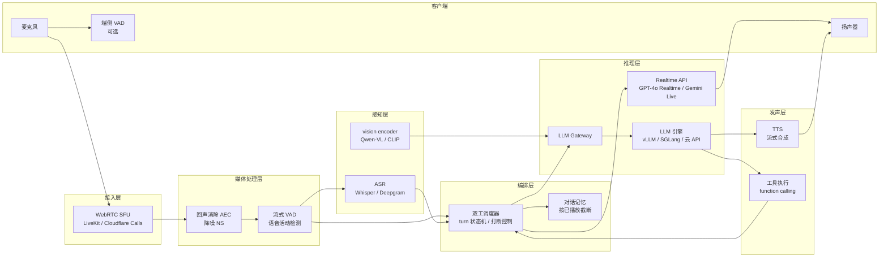
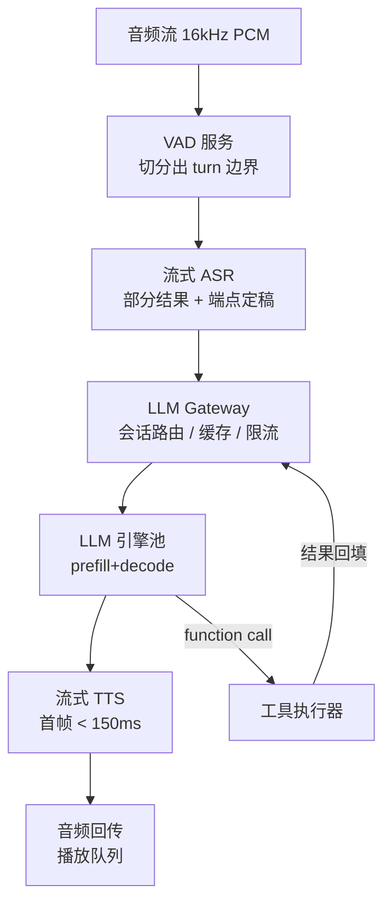
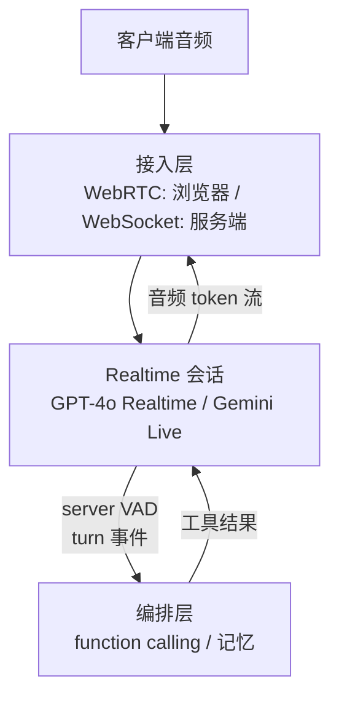
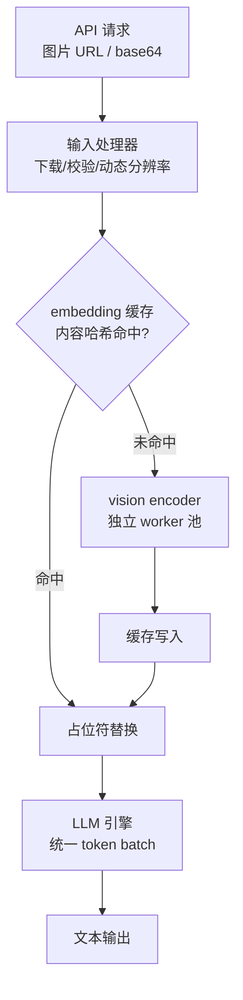

# 3. 架构设计：语音 Agent 推理链路全景

> 一句话理解：一个生产级语音 Agent 的推理链路横跨六个子系统——**接入层（WebRTC）→ 媒体处理（VAD/降噪）→ 感知（ASR 或音频编码）→ 大脑（LLM）→ 发声（TTS 或音频解码）→ 编排（双工调度与工具调用）**，每个子系统都有自己的延迟预算、扩缩容曲线和故障模式。

## 3.1 全景架构

注意架构上的两个「分叉」：

1. **感知分叉**：多模态（图文）请求走 gateway → 自托管引擎；语音请求可以走云 Realtime API（感知+大脑+发声合一）或本地三段式。编排层对两条路下发统一的 turn 控制语义。
2. **控制面与数据面分离**：音频数据流走 WebRTC 媒体面（UDP、低延迟、抗抖动），控制事件（打断、工具调用、状态迁移）走 WebSocket 控制面。两者不能互相阻塞。

## 3.2 三段式部署形态

三段式里每一级都是独立的无状态服务（会话状态在编排层），可以独立扩缩容：VAD/ASR 按「并发音频路数」扩容，LLM 按「token/s」扩容，TTS 按「并发合成路数 + 首帧延迟 SLO」扩容。这也解释了为什么三段式对成本敏感的业务更友好——每一级都能选「够用」的模型。

## 3.3 端到端（Realtime API）部署形态

端到端形态把 VAD、感知、大脑、发声全部折叠进模型提供方的一个会话里，基础设施团队只负责：

- **会话接入**：浏览器的 WebRTC 直连（OpenAI 要求用临时 client secret，避免 API key 落客户端）；服务端代理场景用 WebSocket；
- **工具编排**：function calling 的执行与回填——这是唯一留在你手里的「大脑」；
- **记忆与个性化**：长期记忆、用户画像的注入与回写（对话文本旁路落库）。

## 3.4 多模态（图文/视频）serving 形态

图文请求没有「实时打断」问题，但有第二个模型要安置：

生产部署中 encoder 的三种安置方式：

| 安置 | 优点 | 代价 |
|---|---|---|
| 与 LLM 共卡（vLLM 默认） | 零额外硬件；embedding 传输走显存 | 抢占 LLM 计算；显存碎片 |
| 独立小卡池（如 L4 池） | 独立扩缩容；不干扰 decode | 跨节点传输 embedding；多一个服务 |
| CPU/边缘预处理 | 最省钱 | ViT 前向在 CPU 上慢一个数量级，只适合小图低频 |

视频请求额外多一层**帧抽取策略**：先解码（CPU 的 OpenCV 或 GPU 的 NVDEC），再按模型约定的 FPS 采样（Qwen2.5-VL 支持动态 FPS），帧 token 数 = 帧数 × 每帧 token。vLLM 2025 年起支持可插拔视频解码后端（`opencv`/`torchcodec`/`pynvvideocodec`/`deepstream`）与视频 token 剪枝（Qwen3-VL 的 `vidcom2`）——**解码与采样本身就是一条值得优化的流水线**。

## 3.5 控制面：双工调度器作为「空中交通管制」

无论哪种形态，编排层的双工调度器都是整个系统的中枢。它维护每条会话的状态机（见 2.3），并裁决三个资源竞争：

1. **说 vs 听**：Agent 正在播放时收到用户语音——打断还是忽略（backchannel 过滤）；
2. **旧响应 vs 新请求**：用户打断后，旧 LLM 生成的取消与新请求的 prefill 竞争算力——取消要尽快，新响应也要尽快；
3. **工具调用 vs 对话流畅度**：function call 执行期间不能让用户干等，需要用「填充话术」（filler audio）或流式中间状态保住交互感。

## 3.6 数据面：媒体传输选型

| 传输 | 适用 | 备注 |
|---|---|---|
| WebRTC | 浏览器/移动端直连 | UDP 抗抖动、内建回声消除参考；OpenAI Realtime 浏览器场景官方推荐 |
| WebSocket | 服务端到服务端、电话桥接 | TCP 有队头阻塞风险，但穿透与运维简单；Gemini Live 的唯一传输 |
| SIP/PSTN 网关 | 传统电话接入 | 电话语音 8kHz 窄带，ASR/TTS 模型需要适配 |

## 小结

- 语音 Agent 链路 = 接入 + 媒体 + 感知 + 大脑 + 发声 + 编排六层；多模态图文链路 = 输入处理 + encoder + LLM 三层，两者共享编排与网关。
- 三段式把每一级做成可独立伸缩的无状态服务；端到端把五级折叠成一个云会话，只留工具编排与记忆。
- 双工调度器是中枢：裁决打断、取消竞争、工具等待三件事，其状态机设计决定对话体验的下限。
