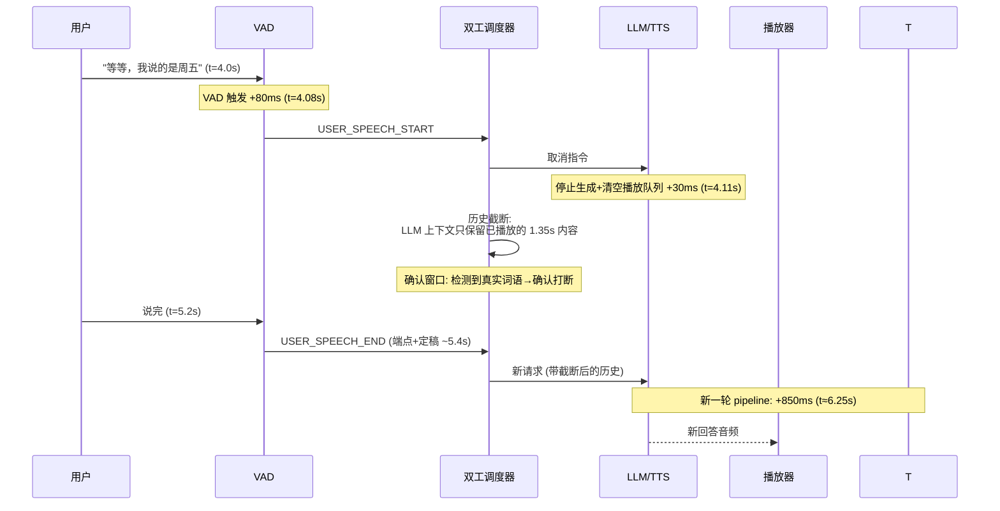
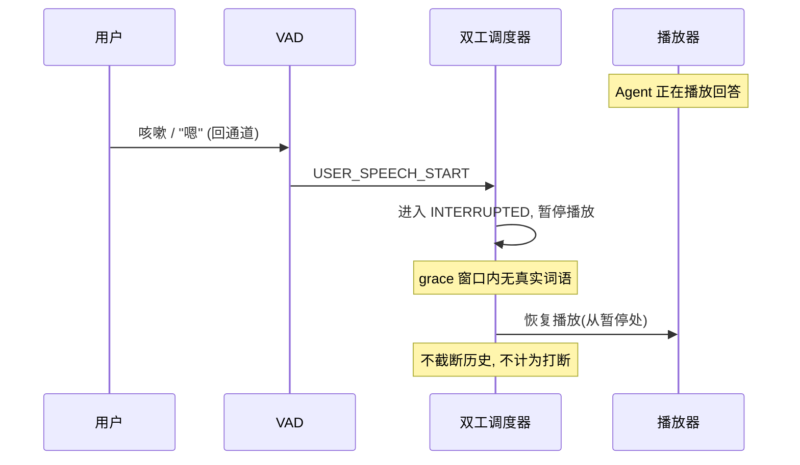
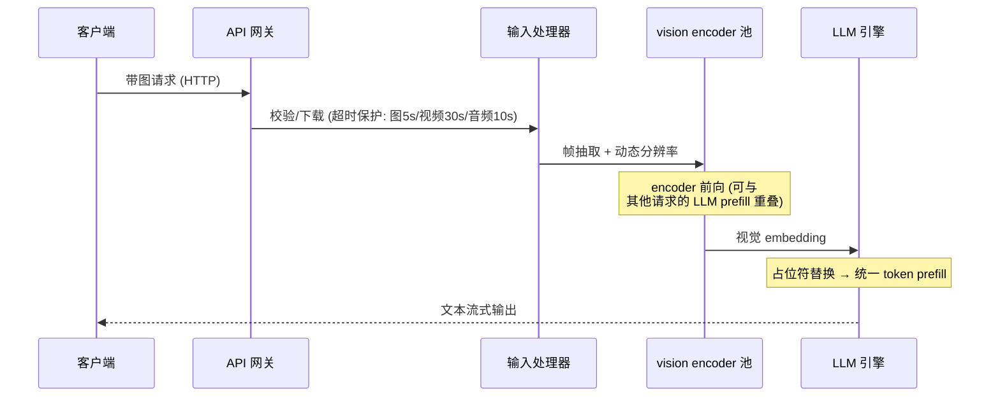

# 4. 工作流程：一次实时语音对话的端到端时序

> 一句话理解：把「用户问了一句话、Agent 开口回答、用户中途打断、Agent 接住并换答案」的完整过程摊开成时间线，每一段延迟从哪来、能被什么优化掉，就全部现形了——这就是语音基础设施工程师每天盯着的那张图。

## 4.1 正常轮次：从静音到出声

以三段式部署为例（端到端形态时序结构相同，只是中间三级折叠）：

```mermaid
sequenceDiagram
    participant U as 用户
    participant M as 麦克风/VAD
    participant S as ASR
    participant L as LLM 引擎
    participant T as TTS
    participant P as 播放器

    U->>M: "明天北京天气怎么样" (0.0s-2.4s)
    U->>M: 静音 (2.4s)
    Note over M: 端点检测: 静音 240ms 后确认说完 (t=2.64s)
    M->>S: turn 音频片段
    Note over S: 流式转写已有部分结果;<br/>定稿最后几个词 +150ms (t=2.79s)
    S->>L: 完整文本请求
    Note over L: prefill 短 prompt, TTFT +300ms (t=3.09s)
    L-->>T: token 流
    Note over T: 首帧合成 +120ms (t=3.21s)
    T->>P: 音频帧流
    Note over P: 缓冲 40ms 后开播 (t=3.25s)
    Note over U,P: first-audio ≈ 850ms —— 超出 600ms 预算
```

从用户闭嘴到听到声音约 850ms（Mini Demo 场景 3 的默认配置实测）。优化路径见 8.1：并行化（ASR 定稿与 LLM 预热重叠）、级联小模型（endpointing 用轻量模型先出、大模型精排）、以及把 TTS 首帧压到 100ms 内。

## 4.2 打断轮次：用户抢话之后

用户听到一半决定抢话（t=4.0s，Agent 已播放 1.35s）：



打断后响应的关键细节：

1. **历史截断**：LLM 上下文里旧回答只保留用户实际听到的 1.35s（转写文本），否则模型会基于自己「没说完的台词」继续推演，产生诡异对话；
2. **确认窗口**：VAD 触发后有一个 grace 窗口（几十到几百毫秒）等待真实词语，咳嗽/噪声触发则恢复播放（见 4.3）；
3. **打断代价**：VAD 触发 + 取消传播 ≈ 110ms 纯开销（Mini Demo 场景 6 实测 80 + 30），二次响应总延迟 960ms 左右——这就是为什么打断体验「总觉得慢半拍」，工程上靠预取（preemptive generation）和缓存来补。

## 4.3 误触发轮次：咳嗽不是打断



治理误触发的三个旋钮（LiveKit 实践）：VAD 门控 + 语义级 turn detector（在 VAD 之上再判一次「这话是不是说给 Agent 的」）、自适应打断（区分真打断与回通道）、`false_interruption_timeout`（误触发后自动恢复播放）。

## 4.4 多模态请求的流水线（对照）

图文请求没有打断问题，时序关注点在**编码-推理重叠**：



这条流水线的三个工程要点：输入处理必须有超时与域名白名单（媒体下载是新的 DDoS 面）；encoder 输出按内容哈希缓存（重复图片零成本）；视频帧抽取尽量用 GPU 解码（NVDEC）避免 CPU 瓶颈。

## 4.5 时序指标的观测口径

| 指标 | 定义 | 目标（2026 生产参考） |
|---|---|---|
| TTFB / first-audio | 用户闭嘴 → 首音播放 | < 600-800ms（P50） |
| 打断响应 | 用户开口 → 旧播放停止 | < 200ms |
| 打断后二次响应 | 用户闭嘴 → 新首音 | < 1.0s |
| 误打断率 | 回通道被当作打断的比例 | < 2% |
| encoder 缓存命中率 | 重复媒体请求占比 | agentic 负载 30-60% |
| 视觉请求 TTFT | 图片请求 → 首个输出 token | 与文本请求持平（缓存命中时） |

## 小结

- 正常轮次的 850ms 由五段可加延迟构成，每段都有明确的优化手段和代价。
- 打断 = VAD 触发 + 取消传播 + 历史按已播放截断 + 全链路重启，打断后二次响应必然接近 1 秒，靠预取和缓存弥补体验。
- 误触发治理与真打断同样重要：恢复播放不截断历史，grace 窗口 + 语义判定是标准做法。
- 观测上，语音系统用「毫秒级时序预算表」而不是「吞吐」作为第一指标。
