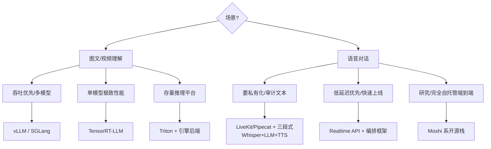

# 6. 生态与源码分析：引擎与框架的多模态支持对比

> 一句话理解：2026 年的格局是「推理引擎负责把模态变成 token，Agent 框架负责把 token 变成对话」——vLLM/SGLang 在引擎层把多模态做成了注册表 + 缓存的一等公民，LiveKit/Pipecat 在框架层把三段式与端到端抽象成同一套 turn 语义，而 TensorRT-LLM 代表编译派在图层面融合视觉塔。

## 6.1 推理引擎的多模态支持对比

| 维度 | vLLM | SGLang | TensorRT-LLM |
|---|---|---|---|
| 输入形态 | 离线 `multi_modal_data` 字典 + 在线 `image_url`/`video_url`/`input_audio` | 与 vLLM 同源的多模态数据通路 | 编译期固定的 VLM 图（encoder + LLM 融合） |
| 占位符 | prompt 内嵌模型专属占位符（OpenAI 服务自动处理） | 同左 | 图内固定槽位 |
| encoder 输出缓存 | 默认按媒体内容哈希跨请求缓存；支持 `multi_modal_uuids` 跳过媒体传输 | RadixAttention 前缀复用同样覆盖视觉 token | 由上层（如 TRT-LLM MBS/后端）管理 |
| 视频 | 可插拔解码后端（OpenCV/torchcodec/NVDEC/deepstream）；`--video-pruning-rate` token 剪枝（Qwen3-VL vidcom2） | 视频模型经 `process_vision_info` 类管线进引擎 | 编译期帧抽取策略 |
| 音频 | Whisper / Qwen-Audio / Qwen-Omni / Ultravox 类模型；`split_audio` 静音点切分 | SGLang Omni 扩展 ASR/TTS | 以多模态 embedding 为主 |
| 限额与安全 | `limit_mm_per_prompt`；媒体下载超时 5s/30s/10s；域名白名单 | 类似引擎级限额 | 部署面自己管 |
| 定位 | 通用高吞吐，多模态是运行时的动态特性 | LLM/VL/扩散统一 runtime，overlap 调度天然覆盖多模态 | 极致单模型性能，多模态是编译目标 |

读法：**vLLM 把多模态做成「运行时的注册表」（新模型 = 注册 processor），SGLang 把它做成「统一 runtime 的一种模型类型」，TensorRT-LLM 把它做成「编译期的图」**。运维视角下 vLLM/SGLang 更适合多模型混部，TRT-LLM 适合单模型大规模。

## 6.2 vLLM 多模态通路的代码解剖

vLLM 的多模态支持可以沿一条请求路径读源码：

```text
入口  LLM.chat / OpenAI server
  │   媒体引用(image_url/base64)进入 chat template
  ▼
多模态注册表  vllm.multimodal.registry / MultiModalProcessor
  │   按模型找到注册的 processor；下载+解码+缩放媒体
  ▼
输入处理器  InputPreprocessor
  │   占位符 token 计数；生成 mm_positions(mm item 在 token 序列中的区间)
  ▼
encoder 缓存  MultiModalCache: 内容哈希 → encoder 输出
  │   命中则跳过视觉前向(可用 uuid 完全跳过媒体传输)
  ▼
模型前向  SupportsMultiModal 接口: get_multimodal_embeddings() 替换占位符 embedding
  ▼
PagedAttention / KV:  替换后的统一 token 序列走标准 prefill/decode
```

三个值得记住的设计决策：

1. **缓存 key 是内容哈希而非请求 id**——同一张图跨请求、跨会话复用，命中时甚至不用传图（uuid 契约）；
2. **占位符与 mm_positions 分离**——tokenizer 只负责数 token，embedding 替换发生在模型层，调度器全程无感知；
3. **限额是引擎参数而非应用参数**——`limit_mm_per_prompt` 在引擎侧直接拒绝，防止单请求打爆显存。

## 6.3 语音 Agent 框架对比

| 维度 | LiveKit Agents | Pipecat |
|---|---|---|
| 定位 | Agent 作为 WebRTC 房间参与者 | 管道化 Agent 编排框架 |
| 传输 | 自研 SFU（LiveKit 开源/Cloud） | 客户端 SDK 全平台 + Pipecat Cloud |
| 管线抽象 | `AgentSession`：STT→LLM→TTS 或 realtime 模型，插件化 provider | pipeline/processors/transports，可编排 150+ 服务 |
| turn 检测 | 自研 turn detector（VAD + 语义）；自适应打断门控回通道 | 依赖 provider（OpenAI server VAD / 自带 VAD） |
| 打断语义 | 暂停+恢复（false interruption 自动续播） | 取消 + 事件驱动 |
| 编排能力 | 多 Agent handoff、K8s 部署、负载均衡 | 多模态 I/O、自托管/云 |
| 开源 | Apache 2.0 | BSD-2 |

两者都把「三段式 vs 端到端」抽象成同一接口：把 OpenAI Realtime / Gemini Live 当作「一个 provider」插进管线，框架层继续负责房间管理、记忆、工具编排。**基础设施的选择被压缩到：SFU/传输自己扛（LiveKit），还是框架 + 云（Pipecat Cloud）**。

## 6.4 端到端语音 API 的接口契约

OpenAI Realtime 与 Gemini Live 的共同契约（2026 GA 状态）：

- **传输**：浏览器 WebRTC（OpenAI 要求临时 client secret，密钥不落客户端）/ 服务端 WebSocket（Gemini Live 为 WSS）；
- **音频格式**：输入 16-bit PCM 16kHz（Gemini），输出 24kHz；会话建立时协商；
- **打断**：内建 server VAD + barge-in 事件；OpenAI 暴露 `threshold`/`silence_duration_ms`/`eagerness`；
- **工具**：function calling 与会话流复用同一通道；工具结果作为事件回注；
- **计费**：音频按 token（秒）计，显著高于文本——成本模型见 8.3。

## 6.5 选型决策树



## 小结

- 引擎层：vLLM（运行时注册表 + 内容哈希缓存）、SGLang（统一 runtime + overlap）、TRT-LLM（编译融合）三种范式；功能集 2025 年后已基本对齐，差异在性能曲线与运维形态。
- 框架层：LiveKit 与 Pipecat 把传输、turn 语义、打断治理沉淀为可复用组件，端到端 API 只是它们管线里的一个 provider。
- 端到端 API 的契约已经稳定（传输/音频格式/打断/工具/计费五要素），基础设施团队的剩余责任是会话接入、工具编排与记忆。
