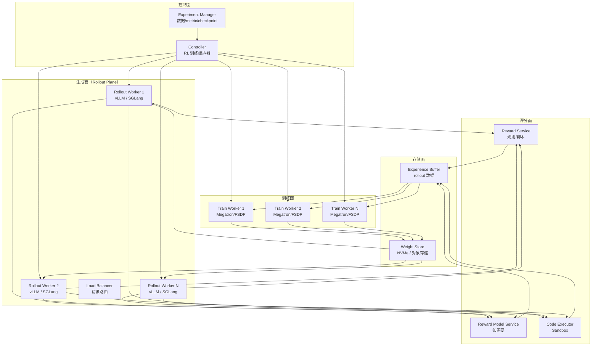

# 3. 架构设计

## 一句话理解

> RL Post-Training 系统的架构围绕一个核心矛盾展开：**Rollout 需要大 batch、长 KV Cache、低延迟；Train 需要高吞吐、梯度同步、显存复用**。架构的本质是把这两种异构负载组织到一个可控的闭环里。

## 总体架构：四大组件



## 三种主流拓扑

### 拓扑一：Co-located（同卡时分复用）

```
[GPU 0-7] Rollout (t0-t1) → Train (t1-t2) → Rollout (t2-t3) → ...
```

**代表**：veRL HybridEngine、TRL（单卡模式）。

**优点**：
- GPU 利用率理论最高（无闲置）
- 权重同步零网络开销（同一块卡）

**缺点**：
- 推理引擎和训练框架要在同一进程共存，显存需要精细管理
- 切换有开销（KV Cache 清空、CUDA graph 重建）
- 难以独立扩缩 Rollout / Train

**适用**：中小规模（单机到几十卡）、研究迭代期。

### 拓扑二：Disaggregated（分离部署）

```
[GPU 0-15]   → Rollout 专用集群（vLLM）
[GPU 16-31]  → Train 专用集群（Megatron）
                ↕ 权重同步（NCCL / RDMA / 对象存储）
```

**代表**：OpenRLHF、veRL（分离模式）、字节 Seed 生产系统。

**优点**：
- Rollout 和 Train 可独立优化与扩缩
- 推理引擎可以用 CUDA Graph、Continuous Batching 全力跑
- 故障隔离好

**缺点**：
- 权重同步是网络瓶颈（70B BF16 = 140GB / step）
- 需要专门的同步通道（NCCL over RDMA、nvlink、或共享 NVMe）

**适用**：大规模生产（百卡到万卡）。

### 拓扑三：Partial Disaggregation（部分分离 / Hybrid）

```
[GPU 0-7]   → Rollout + Train 共置
[GPU 8-15]  → Rollout 专用（应对长尾生成）
```

**代表**：AReaL、slime、阿里 ROLL。

**思路**：
- 大部分 Rollout 请求走同卡，利用时分复用。
- 长尾生成（如 32k token 的 reasoning）路由到专用 Rollout 节点，避免阻塞 Train。

这是 2025-2026 年长推理训练的主流折中。

### 拓扑四（2026 新趋势）：微服务化全异步

```
[Train Service]  ←→  [Weight Update Service]  ←→  [Inference Service]  ←→  [Agent Service]
     训练进程              权重广播/增量化                 vLLM/SGLang 服务          环境/沙箱交互
```

**代表**：AReaL 2.0（2026-07，训练/推理/Agent/权重更新四个独立微服务）、veRL v0.9 V1 trainer 的 separate_async（2026-08，训练侧空闲 GPU 可临时借给生成侧）、slime 的 Megatron/SGLang 生命周期解耦（训练挂了 rollout 集群仍可复用）。

**新特征**（相比拓扑三）：
- **Server-based rollout**：Rollout 从"SPMD 数据并行进程"变成"独立在线推理服务"（veRL v0.7 起移除 SPMD rollout 模式），天然支持动态 batching 与多轮 Agentic 请求。
- **Prefill-Decode 分离**：vLLM / SGLang 的 PD 分离进入 RL 系统，预填充与解码各自扩缩容（veRL v0.9.0 已支持 vLLM PD-disaggregated rollout）。
- **Agent 服务独立**：环境交互（沙箱、工具、浏览器）从 Rollout Worker 中拆出，与 DSec / AgentENV 这类沙箱平台对接。

## 关键数据流

### 1. Prompt 流

```
Dataset → Controller → Prompt Queue → Rollout Worker
```

- Prompt 通常按 **group** 组织：GRPO 要求每个 prompt 生成 G 个 response（G=8-64）。
- Controller 需要保证 group 内的样本路由到**同一个 Rollout Worker**（为了 prefix caching）。

### 2. Rollout 流

```
Rollout Worker → (prompt, response, logprobs, token_ids) → Experience Buffer
```

- 必须返回 **token-level logprobs**（用于 PPO ratio 计算）。
- 必须返回 **完整的 token ids**（不能只用 detokenized text，避免 retokenization 不一致）。
- vLLM V1 原生支持返回 logprobs；SGLang 用 `return_logprob=True`。

### 3. Reward 流

```
(prompt, response) → Reward Service → reward_score → Experience Buffer
```

- **可验证奖励**：直接调脚本（数学用 sympy 比对、代码用 subprocess 跑测试）。
- **Reward Model**：调用独立的推理服务（通常用 vLLM 部署）。
- **混合奖励**：加权求和，支持异步并发计算。

### 4. 权重流

```
Train Worker → save checkpoint → Weight Store → Rollout Worker reload
```

**三种同步方式**：

| 方式 | 延迟 | 网络开销 | 代表 |
|---|---|---|---|
| **NCCL 直传** | 秒级 | 高 | OpenRLHF（用 Ray Collective） |
| **共享 NVMe** | 10s 级 | 中 | veRL（NVMe over Fabrics） |
| **对象存储** | 分钟级 | 低 | 部分自建系统 |

**2026 年的演进**（截至 2026-10）：

- **增量化 checkpoint**：veRL v0.9.0 引入 `delta_sharded` checkpoint engine，只保存/广播权重增量，72B 模型实测加速至 3.1 倍；v0.9.1 起 vLLM 引擎可直接消费 delta 分片。
- **低精度权重传输**：DeepSeek-V4 GRPO 已在 veRL 上端到端跑通 Megatron-Bridge + FP8/MXFP4 权重传输；slime 方向有"无损权重同步、通信量减少约 100 倍"的工作（arXiv:2605.07330，MoE 场景）。
- **新传输后端**：veRL Checkpoint Engine 增加 NCCL / NIXL 传输；TorchTitan 后端在 Qwen3-8B / 32 卡上权重同步快 10.3 倍。
- vLLM 侧的权重热更新与 Native RL API 接口演进详见 [vLLM 主题](/04-llmops/vllm/)，本章聚焦训练侧系统。

**优化**：
- 只同步**增量**（delta weight）。
- 用 **FP8/INT8** 压缩传输，Rollout 端反量化。
- **流水线同步**：Train 一边 save，Rollout 一边 reload 旧的部分。

## 关键控制流

### Controller 的职责

Controller 是 RL 系统的"大脑"，职责包括：

1. **Step 编排**：决定何时触发 Rollout / Reward / Train。
2. **资源调度**：动态调整 Rollout / Train worker 数量。
3. **数据路由**：把 prompts 分给 Rollout，把样本分给 Train。
4. **版本管理**：记录每个样本是哪个 weight version 生成的。
5. **故障恢复**：worker 挂掉时重启 + 数据重放。
6. **Metric 收集**：reward / KL / length / throughput。

### 同步策略

| 策略 | 描述 | 收敛性 | GPU 利用率 |
|---|---|---|---|
| **同步（Sync）** | Rollout 完 → Reward 完 → Train 完 → 下一轮 | 最强 | 最低（30-50%） |
| **半异步（Semi-async）** | Rollout 用 N step 前的权重，Train 不等当前 Rollout | 强（需 ratio clip） | 中（60-75%） |
| **全异步（Full-async）** | Rollout/Train 完全独立，样本进 buffer 就训练 | 弱（off-policy） | 高（80-95%） |

**生产实践**：R1 类长推理通常用**同步或半异步**；Agentic RL 因为环境延迟长，更倾向于**全异步 + replay buffer**。

**2026 年的新变化**：三者边界正在模糊——veRL v0.9 的 V1 trainer 把 sync / colocate_async / separate_async 统一成一套配置；AReaL 2.0 用"陈旧度上界 + TIS 修正"把全异步的收敛性损失压到可用范围；OpenRLHF FlashREINFORCE（2026-09）则干脆用单样本 + KL 信任域取消 group 等待，让异步流水没有"批边界"。HuggingFace 2026-03 对 16 个开源异步 RL 框架的调研（"Keep the Tokens Flowing"）总结：生产系统的主流答案是**深度上界 + 逐样本版本拒绝，IS 修正作为可选项**。

## 资源模型与弹性

### GPU 资源划分

一个 1024 卡的 RL 集群典型划分：

```
800 卡 → Rollout（vLLM，TP=8 × 100 instances）
200 卡 → Train（Megatron，TP=8 × PP=5 × DP=5）
 16 卡 → Reward Model（如需要）
  8 卡 → Controller + 数据服务
```

### 弹性伸缩

- **Rollout 弹性**：vLLM 实例可以加减，Controller 通过 LB 调整路由。
- **Train 弹性差**：Megatron 并行度调整成本高，通常训练期间不动。
- **spot 实例利用**：Rollout 可以用 spot，Train 必须用 reserved。

## 与 Kubernetes 的映射

| RL 组件 | K8s 资源 | 调度需求 |
|---|---|---|
| Controller | Deployment（单副本 + leader election） | 普通 CPU 节点 |
| Rollout Worker | StatefulSet / RayCluster | GPU + 大 NVMe（KV Cache offload） |
| Train Worker | Job / RayCluster | GPU + RDMA（NCCL） |
| Reward Service | Deployment | 普通 CPU 或 GPU（如有 RM） |
| Sandbox | 独立沙箱平台（DSec / AgentENV / gVisor / Kata） | 高隔离 + 高密度（万级并发） |
| Weight Store | PVC（NVMe）/ 对象存储 | 高吞吐 |

**调度挑战**：
- Train 需要 **Gang Scheduling**（参考 [GPU 在 Kubernetes 上的调度](/02-cloud-native/gpu-scheduling/)）。
- Rollout 需要 **拓扑感知**（同 NUMA 的 GPU 一组 TP）。
- 权重同步需要 **NCCL over RDMA**（参考 [计算机网络](/01-foundation/computer-networks/)）。
- Agentic RL 时代，**沙箱集群**成为新的调度对象：DeepSeek DSec 单生产单元约 160 节点、日产 300 万沙箱、峰值 38 万并发；AgentENV（Kimi K3 在用）基于 Firecracker microVM，快照恢复小于 50ms、可 fork 出 16 个子环境——它们的编排与回收是独立于 GPU 的调度面。

## 本章小结

RL Post-Training 架构的核心是：

1. **四大组件**：Controller / Rollout / Reward / Train，各司其职。
2. **四种拓扑**：Co-located / Disaggregated / Hybrid / 微服务化全异步，按规模与延迟选择（2026 年新增第四种）。
3. **两条数据流**：prompt → rollout → reward → train，以及 train → weight（增量化）→ rollout。
4. **三种同步策略**：Sync / Semi-async / Full-async，在收敛性与利用率之间权衡，配合版本打标 + 深度上界 + IS 修正做陈旧性控制。

下一章我们看一次 RL step 在系统中的完整时序。
