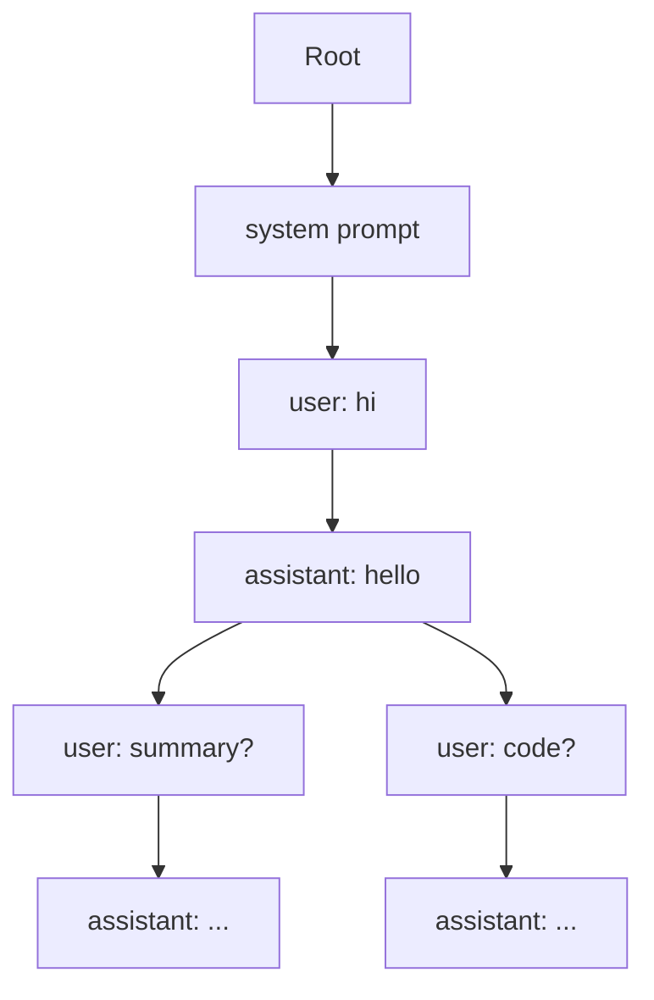
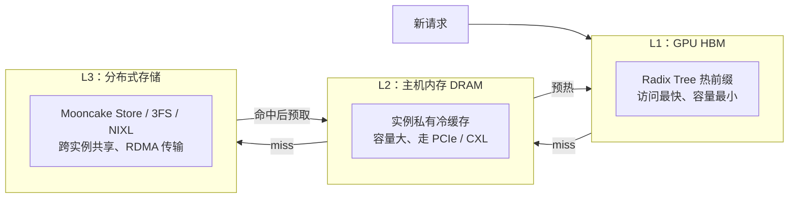

# 2. 核心思想

## 一句话理解

> SGLang 把 LLM 推理当成一段“程序”来编译和执行：程序中的调用点被调度、缓存、约束，最终变成高效 GPU 执行图。

## 核心抽象

### 1. LLM Program（LLM 程序）

SGLang 不满足于单次 `generate`。它提供了一组原语，让用户把多轮、结构化、分支化的交互表达为程序：

- `gen`：让模型生成一段文本（相当于 `completion`）。
- `select`：让模型从给定选项中选择（相当于分类 / 多选）。
- `fork`：把当前上下文复制成多个独立分支，并行执行。
- `run`：触发一次实际的模型执行，把前面累积的程序提交给 Runtime。
- `stream`：流式获取生成结果。

这些原语可以嵌套组合，例如：

```python
with sgl.assistant():
    sgl.gen("reasoning", max_tokens=256)
    sgl.select("action", ["search", "calculate", "answer"])
    with sgl.fork(num=3):
        sgl.gen("candidate", max_tokens=128)
```

### 2. RadixAttention（Radix Tree 前缀缓存）

SGLang 论文提出的核心优化。与 vLLM 的 Block-level Prefix Caching 不同，RadixAttention 使用 **Radix Tree（基数树 / 压缩前缀树）** 管理 KV Cache：

- 每个节点代表一段 token 序列的公共前缀。
- 新请求自动匹配最长公共前缀，复用已缓存 KV。
- 分支（如 `fork`、不同用户轮次）自然形成树状结构。
- 引用计数 + LRU 回收保证显存可控。



#### 演进：HiCache 三层分层缓存（2025-2026）

论文中的 RadixAttention 只管理 GPU 显存内的 KV Cache。2025 年 9 月起，SGLang 把它扩展为 **HiCache** 分层体系：Radix Tree 作为全局索引（HiRadixTree），KV 数据可以分布在三层存储上，由调度器驱动层间预取与回写。



LMSYS 的实测显示，前缀密集型负载下 HiCache 最高带来约 6 倍吞吐提升、TTFT 最多降低 80%；与 Mooncake Store 对接的多轮对话基准中，缓存命中率从 18% 提升到 78%，平均 TTFT 下降约 56%（来源：[LMSYS HiCache 博客](https://www.lmsys.org/blog/2025-09-10-sglang-hicache/)、[Mooncake HiCache 基准](https://kvcache-ai.github.io/Mooncake/performance/sglang/sglang-hicache-benchmark-results-v1.html)）。

### 3. Structured Generation（结构化生成）

通过正则表达式、JSON Schema、EBNF 或函数签名约束模型输出，使模型每一步只能生成合法的 token。实现上通常依赖：

- **FSM（有限状态机）**：把约束编译成状态转移图。
- **Token Mask**：每步根据当前 FSM 状态，把不合法的 token 的 logits 置为 `-inf`。
- **XGrammar-2**：SGLang 当前默认的结构化解码后端（v0.5.11 起），支持 JSON、EBNF、regex。

2025-2026 年的关键优化：

- **Jump-forward Decoding**：当 FSM 处于“只能输出唯一合法 token”的状态时，直接跳过模型前向，把确定性 token 注入序列，可减少约 10~30% 的前向次数。
- **Mask 计算与 GPU 推理重叠**：XGrammar 在 CPU 上增量维护语法状态，合法 token mask 的生成与 GPU forward 并行进行，约束开销可压到 6% 以内。
- **XGrammar-2 面向 Agent 动态约束**：针对工具调用等“每轮语法都在变”的场景重设计，grammar 编译从约 1000ms 降到约 10ms，mask 生成比 llguidance 快约 6 倍（来源：[XGrammar-2 论文](https://arxiv.org/abs/2601.04426)）。

### 4. Compiler + Runtime

SGLang 的 Frontend 把用户程序编译成中间表示（IR），Runtime 负责：

- 调度：决定哪些 token 在本次 forward 中计算。
- 前缀匹配：用 Radix Tree 找出可复用 KV。
- 执行：调用 Attention Backend、Sampler、Structured Decode。
- 缓存更新：把新生成的 KV 插入 Radix Tree。

## 设计哲学

| 设计选择 | 解决的问题 | Trade-off |
|---|---|---|
| LLM Program 抽象 | 复杂交互难以表达 | 增加学习成本 |
| Radix Tree 缓存 | 多轮/多分支前缀重复计算 | 树结构维护比 Block Table 复杂 |
| HiCache 分层缓存 | 显存放不下长前缀缓存 | 层间一致性、预取策略复杂 |
| 结构化生成 | 输出不可控、后校验浪费 | 约束编译可能增加延迟 |
| Compiler + Runtime | 多次调用之间缺乏全局优化 | 调试链路变长 |

## 与 vLLM 核心思想的对比

| 维度 | vLLM | SGLang |
|---|---|---|
| 缓存结构 | Block Table（分页） | Radix Tree（前缀树） |
| 复用粒度 | Block（通常 16 tokens） | 任意 token 边界 |
| 用户感知 | 配置 `enable_prefix_caching` | 自动、透明 |
| 编程模型 | 单次请求 | 程序 + 多调用 |
| 结构化 | 后端插件 | 原生集成 |

## 本章小结

SGLang 的核心思想可以概括为：**用程序抽象表达复杂交互，用 Radix Tree 自动复用前缀，用 FSM/编译器约束和优化执行**。这三个机制共同解决了 LLM 程序执行中的效率与可控性问题。
