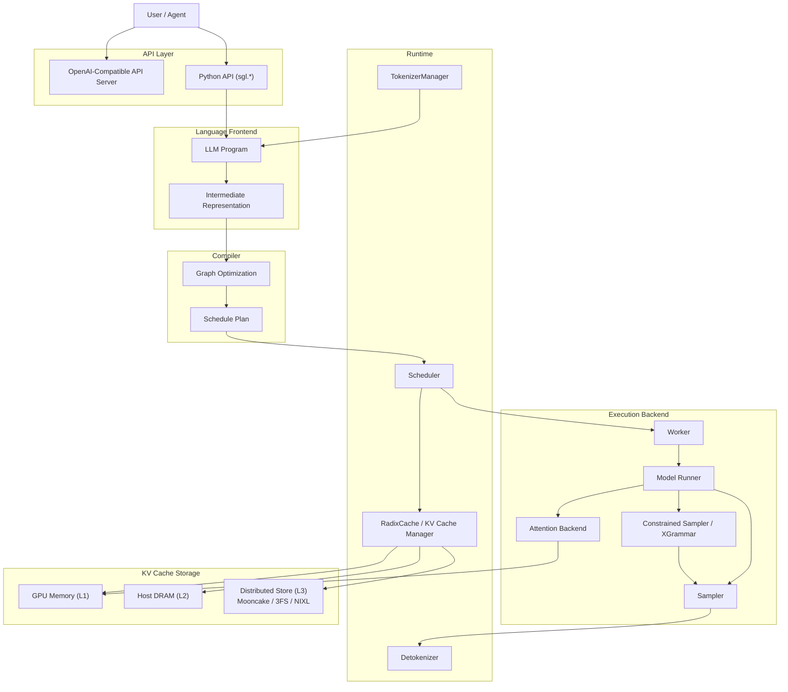

# 3. 架构设计

SGLang 的架构围绕“如何把一段 LLM 程序高效地编译、调度、执行并缓存”展开。整体可以分为语言前端、编译器、运行时和执行后端四层。

## 整体架构图



## 各组件职责

### 1. Python API / OpenAI API Server

- **Python API**：面向开发者的程序式接口，提供 `sgl.gen`、`sgl.select`、`sgl.fork` 等原语。
- **OpenAI API Server**：兼容 `/v1/completions` 和 `/v1/chat/completions`，让现有应用低迁移成本接入。

### 2. Language Frontend

把用户写的 LLM Program 解析成中间表示（IR）。IR 中记录了：

- 每个 `gen` / `select` 调用的约束、采样参数、最大长度。
- `fork` / `join` 形成的分支结构。
- 变量之间的数据依赖。

### 3. Compiler

对 IR 做图级优化：

- **调用合并**：把多个可以并行执行的 `gen` 合并到一次 forward。
- **前缀复用分析**：识别程序中可共享的上下文片段。
- **调度计划**：生成每轮需要计算的 token 集合。

### 4. Scheduler

运行时调度器，决定本轮哪些 token 需要计算。与 vLLM V1 类似，SGLang 也采用统一调度视角：

- 维护每个请求已计算的 token 数和待计算的 token 数。
- 根据 token budget 决定每轮计算量。
- 支持 chunked prefill 和 continuous batching。

### 5. RadixCache / KV Cache Manager

SGLang 的核心差异点：

- 使用 **Radix Tree** 组织 KV Cache。
- 新请求自动最长前缀匹配。
- `fork` 产生的分支共享父节点，写时复制（Copy-on-Write）。
- 引用计数 + LRU 回收。
- **v0.5.12** 引入 HiCache + UnifiedRadixTree，支持滑动窗口 attention（SWA）、SSD offload（通过 Mooncake store）和更稳定的回收策略；**v0.5.19** 起统一 Radix Tree 成为所有配置的默认缓存（含 Full-attention-only 模型，`SGLANG_ENABLE_UNIFIED_RADIX_TREE` 开关随之废弃）；**v0.5.20** 为 SWA 组件加入分叉点缓存（branching-point caching），共享 system prompt 时官方实测 token 命中率从约 43.8% 提升到约 60.8%，DeepSeek-V4-Flash 的 TTFT 从 1.57s 降到 1.07s；**v0.5.21** 起前缀缓存默认迁移到 Rust 核心实现，旧的 Python Radix Cache 实现被移除。

### 6. TokenizerManager / Detokenizer

- 负责 prompt / 输出的编解码。
- 结构化生成时，需要把 token 约束映射回文本约束（如 regex 字符类）。

### 7. Worker / Model Runner

执行实际模型推理：

- 加载模型权重。
- 执行 forward（prefill / decode）。
- 调用 Attention Backend 和 Sampler。

### 8. Constrained Sampler / XGrammar

- 把 regex / JSON Schema / EBNF 编译成 FSM 或 grammar。
- 每轮生成合法 token mask。
- 与 Sampler 结合，只从合法 token 中采样。

### 9. Attention Backend

SGLang 复用了与 vLLM 类似的 attention kernel 生态：

- FlashAttention / FlashInfer
- MLA / FlashMLA（DeepSeek 系列）
- **DSA 稀疏注意力后端**：DeepSeek-V3.2 的 Lightning Indexer + top-k 稀疏注意力带来多种后端实现——`flashmla_sparse`（Hopper FP8 稀疏 prefill）、`fa3`（Hopper decode）、`tilelang`、`trtllm`（Blackwell）等
- 自定义 kernel（如 Kimi-Linear CuteDSL prefill kernel on Blackwell）

2025 年 9 月 DeepSeek-V3.2 发布时，SGLang 即成为其[官方推荐推理部署引擎](https://www.lmsys.org/blog/2025-09-29-deepseek-V32/)，官方称在长上下文下推理成本降低 50% 以上。

## 分布式推理

SGLang 支持多种并行策略：

### Tensor Parallelism（TP）

把模型层内切分到多个 GPU。适合单节点多卡。

```bash
python -m sglang.launch_server --model-path meta-llama/Llama-3.1-8B --tp-size 2
```

### Pipeline Parallelism（PP）

把模型按层切分到多个 GPU / 节点。适合超大模型。

### Data Parallelism（DP）

每个 GPU 持有完整模型副本，服务不同请求。SGLang 支持 DP attention 等优化。

### PD 分离（Prefill-Decode Disaggregation）

把 prefill 阶段和 decode 阶段解耦到不同实例，分别优化：prefill 池做计算密集的长文本处理，decode 池做带宽密集的逐 token 生成，之间通过 **Mooncake / NIXL Transfer Engine** 以 RDMA 非阻塞传输 KV Cache。SGLang 在 2025-2026 年持续强化这一方向：

- **大规模验证**：DeepSeek-V3/R1 在 96 张 H100（12 节点）上的 PD 分离 + 大规模专家并行部署达到每节点 52.3K 输入 token/s、22.3K 输出 token/s，约 5 倍于朴素 TP，与 DeepSeek 官方公布的性能持平（来源：[LMSYS 大规模 EP 博客](https://www.lmsys.org/blog/2025-05-05-large-scale-ep/)）。
- **特性扩展**：decode 侧 Radix Tree 前缀复用（v0.5.19 起 SWA 混合模型也可在 decode 侧命中缓存）、流水线并行（PP > 1）与 PD 分离组合、与投机解码（MTP/NEXTN）和 HiCache 兼容、v0.5.20 起 DSpark 投机解码可运行在 PD + DCP 分离模式下（Kimi-Linear 等混合模型，8x B300 经 NIXL / Mooncake 验证至 256K 输入）、v0.5.21 支持 prefill / decode 实例运行时互换角色（无需重启）。
- **EPD 分离（Encoder-Prefill-Decode）**：面向多模态模型的进一步解耦，把视觉编码器独立成可水平扩展的 Encoder 池，通过 ZMQ 或 Mooncake GPU-direct 传输视觉 embedding，并支持视觉 embedding 缓存（来源：[LMSYS EPD 博客](https://www.lmsys.org/blog/2026-01-12-epd/)）。

## 本章小结

SGLang 的架构清晰分层：前端表达程序，编译器优化执行图，运行时管理调度和 Radix Tree 缓存，后端执行模型并施加结构化约束。RadixCache 和 Compiler 是 SGLang 区别于 vLLM 的核心。
