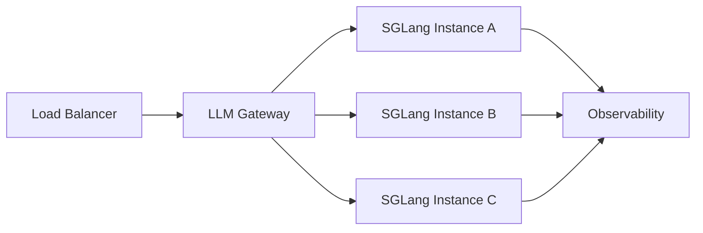

# 8. 企业生产实践

本章结合真实场景与公开资料，分析 SGLang 在生产环境中的部署方式、优化手段与踩坑经验。

## 典型生产架构

## 适用场景

SGLang 在以下场景相比通用推理引擎更具优势：

### 1. Agent / 多轮对话

- 多轮对话天然存在长 system prompt 和历史上下文重复。
- RadixAttention 自动复用这些前缀，减少重复 prefill。
- `fork` 原语支持并行尝试多个推理分支（如 ReAct 的多种候选）。

### 2. 结构化输出

- JSON mode、function calling、代码生成等场景需要输出符合 schema。
- SGLang 原生集成 XGrammar-2，约束编译与采样一体化。
- 2026 年 v0.5.11 起，XGrammar-2 成为默认结构化解码后端。

### 3. 长上下文 / 前缀重负载

- 共享 system prompt 的企业内部知识库问答。
- 长 prompt 模板 + 短用户输入的场景，Radix Tree 收益最大。

## 各公司/社区实践

### LMSYS / Chatbot Arena

SGLang 的发源地 LMSYS 在其服务后端中大量使用 SGLang，主要收益：

- RadixAttention 在多模型、多轮对话评测中显著降低 prefill 开销。
- 结构化生成用于控制模型输出格式，便于评测打分。

### Together AI / Fireworks AI

这些推理云厂商同时支持 vLLM 和 SGLang：

- 对通用高吞吐场景使用 vLLM。
- 对 Agent、结构化输出、多轮对话场景推荐 SGLang。
- 强调根据 workload 选择引擎，而不是“一刀切”。

### 月之暗面 / Mooncake

SGLang 与 Mooncake（Kimi 开源的 KVCache-centric 分离式推理架构）深度集成：

- **Mooncake Store 作为 HiCache L3**：通过 RDMA 零拷贝把 KV Cache 扩展到分布式存储，支持 write-through / write-back 策略和多种预取模式，跨实例共享缓存。
- **实测收益**：蚂蚁集团在生产环境的 DeepSeek-R1-671B PD 分离部署中，缓存命中时 TTFT 降低 84%；多轮对话基准中缓存命中率从 18% 提升到 78%，平均 TTFT 下降约 56%，输入吞吐提升约 2.3 倍（来源：[Mooncake HiCache 基准](https://kvcache-ai.github.io/Mooncake/performance/sglang/sglang-hicache-benchmark-results-v1.html)）。
- **SSD Offloading**：Mooncake 于 2026 年 4 月发布 SSD Offloading，把 KV Cache 进一步下沉到 NVMe SSD，形成 GPU HBM → 主机内存 → SSD 的完整分层体系。
- SGLang 侧需要 v0.5.13+ 才能稳定使用 Mooncake Store 后端。

### DeepSeek / 大模型推理

SGLang 是 DeepSeek 官方推荐的推理部署引擎之一，在 DeepSeek 系列模型上的优化包括：

- **Day-0 支持**：DeepSeek-V3.2 发布当天即支持其稀疏注意力（DSA），提供 Lightning Indexer 快速打分、NSA 后端（FlashMLA + FlashAttention-3 Sparse）和 128K 上下文缓存优化，官方称推理成本降低 50% 以上（来源：[LMSYS 博客](https://www.lmsys.org/blog/2025-09-29-deepseek-V32/)）。
- **大规模专家并行**：PD 分离 + DeepEP 在 96 张 H100 上达到与 DeepSeek 官方公布的性能持平（每节点 52.3K 输入 / 22.3K 输出 token/s），约 5 倍于朴素 TP。
- **MoE 优化**：负载均衡（Waterfill、LPLB）、NVFP4 MoE、FlashMLA head64 decode、FP8 量化；v0.5.21 起 DeepSeek-V4.1 长 prompt 首 token 延迟进一步降低 22%。

### RL 后训练 rollout

2025-2026 年 SGLang 的重要新定位：成为 RL 后训练（RLHF / GRPO / DAPO 等）的**事实标准 rollout 引擎**，与 veRL 等训练框架深度集成：

- **sleep / wake-up**：训练与 rollout 共存同一批 GPU 时，可把推理引擎显存（含 CUDA Graph）卸载到 CPU，训练时让出显存，rollout 时秒级唤醒。
- **权重热更新**：`/update_weights_from_tensor` 等端点支持训练侧新权重直接推送到推理进程，无需重启服务。
- **确定性推理**：保证 rollout 与训练前向的数值一致性，避免 KL 散度失真。
- 典型组合：`veRL（训练）+ SGLang（rollout）+ FSDP`，支撑 GLM-4.6、Qwen3 等模型的 RL 后训练（来源：[SGLang for RL 文档](https://docs.sglang.ai/advanced_features/sglang_for_rl.html)）。

### 国内云厂商与创业公司

- 部分国内 Agent 平台采用 SGLang 作为结构化输出和多轮对话后端。
- 与 vLLM 混合部署：通用推理走 vLLM，复杂 Agent 走 SGLang。

## 关键优化手段

### 1. RadixAttention 调优

- 保证 system prompt 和常用前缀稳定，提升复用率。
- 合理设置缓存容量，避免 LRU 把热前缀淘汰。
- 使用 HiCache + UnifiedRadixTree 时，配置 SSD offload 以扩展缓存容量。

### 2. 结构化生成

- 优先使用 XGrammar-2 后端。
- JSON schema 尽量精简，避免嵌套过深导致 FSM 状态爆炸。
- 对简单约束使用 regex，对复杂约束使用 EBNF。

### 3. 投机解码

SGLang 在 2026 年持续强化 Speculative Decoding：

- v0.5.12 引入 Speculative Decoding V2（默认开启），支持 EAGLE-3、MTP（DeepSeek 系列）、NGRAM 等多种 draft 方式。
- 官方基准：LLaMA-3.1-8B 在单张 H100 上从 158 token/s（基线）提升到 EAGLE-2 244 token/s、EAGLE-3 373 token/s（2.36 倍）。
- **自适应投机解码**（2026 年 10 月文档更新）：根据接受率和 batch 大小动态调整 draft 步数与 draft token 数，避免大 batch 下投机反而降速。
- 在延迟敏感场景可显著降低 TPOT；与 PD 分离、HiCache 兼容。

### 4. 量化

- FP8 / NVFP4 在 Blackwell（GB200/GB300）上收益明显。
- AWQ / GPTQ 可用于旧架构显存压缩。
- 量化后需要评估结构化输出的准确率（JSON 括号、字段名是否容易出错）。

### 5. 可观测性

- 监控指标：TTFT、TPOT、throughput、Radix Tree 命中率、结构化约束编译时间。
- 日志：请求生命周期、约束编译耗时、KV cache 命中长度。
- Tracing：OpenTelemetry 接入。

## 常见踩坑

| 问题 | 原因 | 解决 |
|---|---|---|
| 结构化输出吞吐低 | JSON schema 太复杂，FSM 状态多 | 简化 schema，使用更宽松的 regex |
| 首 token 延迟高 | 约束编译（尤其是复杂 EBNF）耗时 | 预编译常用约束，或启用编译缓存 |
| 缓存命中率低 | system prompt 变化频繁或缓存容量不足 | 统一 prompt 模板，增加缓存容量 |
| 多卡通信瓶颈 | TP 通信量大 | 优先 NVLink，或考虑 PP/DP |
| 版本迭代导致 API 变化 | SGLang 发展快 | 锁定版本，关注 Release Notes |

## 本章小结

SGLang 在生产环境中的成功取决于场景选择：它特别适合 Agent、多轮对话、结构化输出和长前缀复用场景。与 vLLM 混合部署、根据 workload 路由，是当前比较常见的实践。

## 参考来源

- [SGLang GitHub Releases](https://github.com/sgl-project/sglang/releases)
- [Mooncake: A KVCache-centric Disaggregated Architecture](https://github.com/kvcache-ai/Mooncake)
- [Mooncake x SGLang HiCache 系统设计](https://kvcache-ai.github.io/Mooncake/design/hicache-design.html)
- [SGLang Day-0 Support for DeepSeek-V3.2 with Sparse Attention](https://www.lmsys.org/blog/2025-09-29-deepseek-V32/)
- [SGLang HiCache: Fast Hierarchical KV Caching](https://www.lmsys.org/blog/2025-09-10-sglang-hicache/)
- [SGLang for RL Systems 官方文档](https://docs.sglang.ai/advanced_features/sglang_for_rl.html)
- LMSYS / SGLang 团队技术博客与演讲
