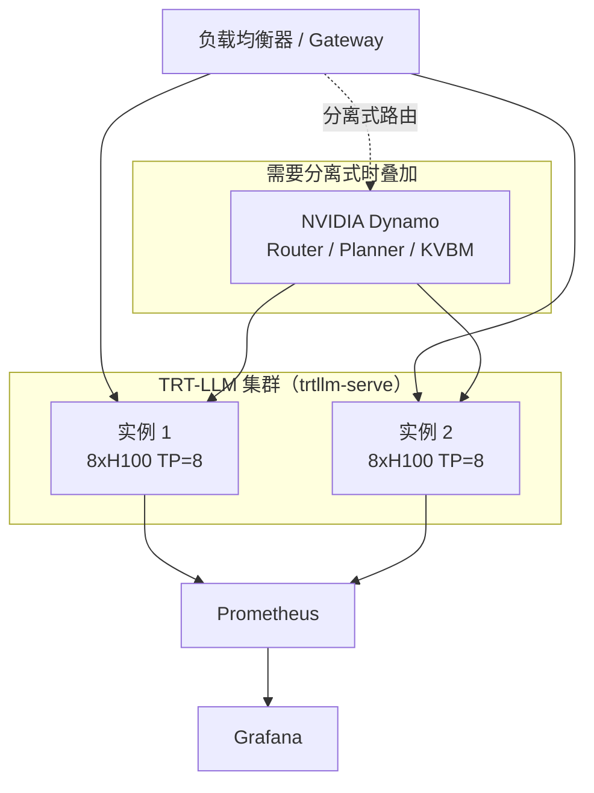
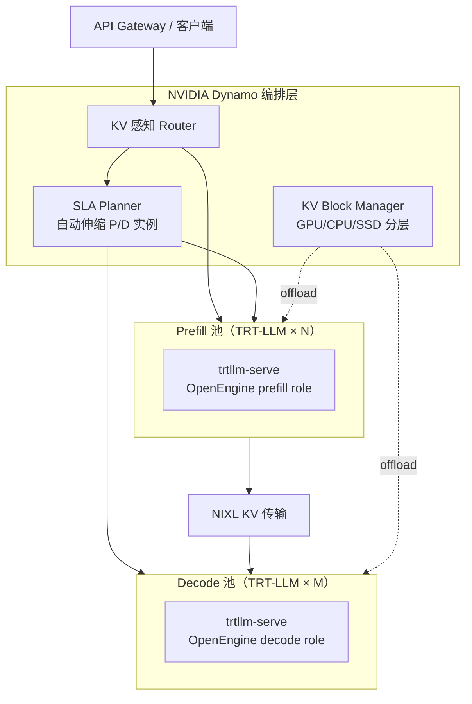

# 8. 企业生产实践

TensorRT-LLM 的生产部署形态在 1.0 之后发生了明显变化：新的推荐路径是 **`trtllm-serve`（NGC 容器或 pip 安装）+ OpenAI 兼容 API**，需要分离式服务时叠加 **NVIDIA Dynamo**；经典的 **Triton Inference Server 集成已进入弃用流程**（`*-trtllm-python-py3` 容器在 Production Branch 5.9 后不再提供，见 [NVIDIA EOL Notices](https://docs.nvidia.com/ai-enterprise/lifecycle/latest/eol-notices.html)）。本章按新路径组织，同时保留存量 Triton 部署的维护要点。

## 1. 服务化部署

### 1.1 trtllm-serve（推荐起点）

从 1.0 起，TRT-LLM 内置 OpenAI 兼容服务，不再需要 Triton：

```bash
# NGC 容器方式
docker run --rm -it --net host --shm-size=2g --gpus all \
  nvcr.io/nvidia/tritonserver:26.09-py3 \
  trtllm-serve --model meta-llama/Llama-3.1-8B-Instruct --port 8000

# 或直接 pip 安装
pip install tensorrt-llm
trtllm-serve --model meta-llama/Llama-3.1-8B-Instruct --port 8000
```

启动后暴露 `/v1/chat/completions`、`/v1/completions`（1.3 起还有 `/v1/responses` 与 Anthropic Messages API），支持流式输出、多模态与结构化输出。

### 1.2 NGC 容器

TRT-LLM 随 NGC PyTorch / Triton 容器按月发布（如 `26.09` 对应 2026 年 9 月，版本映射请查阅 [NGC](https://catalog.ngc.nvidia.com/)）。注意：

- 旧变体 `*-trtllm-python-py3` 已弃用（PB 5.9 为最后版本）
- 新部署直接使用标准 NGC PyTorch 容器内的 `tensorrt_llm` 包与 `trtllm-serve`

```bash
docker run --rm -it --net host --shm-size=2g \
  --ulimit memlock=-1 --ulimit stack=67108864 --gpus all \
  -v /path/to/engines:/engines \
  nvcr.io/nvidia/pytorch:26.09-py3
```

### 1.3 存量 Triton backend 维护

若已有 Triton + TRT-LLM 部署，模型仓库与模板仍然可用（不再有新容器），结构如下：

```bash
cp -r /app/all_models/inflight_batcher_llm/* /triton_model_repo/
```

| 模型 | 作用 |
|---|---|
| `preprocessing` | tokenization |
| `tensorrt_llm` | 推理执行 |
| `postprocessing` | detokenization |
| `tensorrt_llm_bls` | 业务逻辑编排 |
| `ensemble` | 串联 pre/post 与推理 |

使用 `/app/tools/fill_template.py` 填充 `config.pbtxt`：

```bash
python3 /app/tools/fill_template.py \
  -i /triton_model_repo/tensorrt_llm/config.pbtxt \
  triton_backend:tensorrtllm,\
  triton_max_batch_size:8,\
  engine_dir:/engines/llama-8b,\
  batching_strategy:inflight_fused_batching,\
  decoupled_mode:false,\
  max_queue_delay_microseconds:100
```

## 2. 多 GPU 并行

### Tensor Parallelism（TP）

适合单节点多 GPU：

```python
llm = LLM(model="...", tensor_parallel_size=4)
```

Triton 启动：

```bash
python3 /app/scripts/launch_triton_server.py \
  --world_size=4 \
  --model_repo=/triton_model_repo
```

### Pipeline Parallelism（PP）

适合跨节点大模型：

```python
llm = LLM(model="...", pipeline_parallel_size=2)
```

### Expert Parallelism（EP）

MoE 模型专用：

```python
llm = LLM(model="...", expert_parallel_size=4)
```

### 并行策略选择建议

| 场景 | 推荐并行 |
|---|---|
| 单节点 8xH100，70B 模型 | TP=8 |
| 双节点，405B 模型 | TP=8 + PP=2 |
| 超长上下文（>128k） | CP |
| DeepSeek / Mixtral MoE | TP + EP（1.3 可叠加 NCCL-EP 低延迟专家并行） |

### 硬件代际说明（2026-10）

- **Hopper（H100/H200）**：成熟稳定，FP8 为主力量化；注意 1.3 已弃用 TRITON MoE 后端，MoE 请迁移到 CUTLASS kernel。
- **Blackwell（B200/GB300、DGX Spark）**：FP4 / NVFP4 / MXFP4 的主场；1.1+ 提供 CuTe DSL NVFP4 grouped GEMM、DeepEP FP4 等 kernel；DGX Spark 在 1.2 中为 beta。
- **Vera Rubin（2026 H2 量产）**：TRT-LLM 已提供早期支持（1.3 rc 周期的 SM107 GEMM / MoE / CuTe DSL，1.4.0rc0 出现 SM103 测试门控）。NVIDIA 在 [MLPerf Inference v6.1](https://shattered.io/vera-rubin-nvl72-mlperf-inference-v6-1-2026/)（2026-09）基于 TRT-LLM 提交的 DeepSeek-R1 结果中，Vera Rubin NVL72 整机吞吐约为 GB300 NVL72 的 3.7 倍，288 GPU（4 机柜）离线配置达到 99% 扩展效率——Rubin 上的极限性能场景，TRT-LLM 仍是 NVIDIA 的首选栈。

## 3. 量化生产实践

### FP8（Hopper 默认）

推荐用于 H100/H200：

```python
llm = LLM(
    model="nvidia/Llama-3.1-8B-Instruct-FP8",
    kv_cache_config=KvCacheConfig(dtype='fp8'),
)
```

### FP4 / NVFP4（Blackwell）

适用于 B200/GB300 与消费级 Blackwell（SM120 支持 W4A16 NVFP4），需要离线校准：

```bash
scripts/huggingface_example.sh --model <model> --quant fp8 --kv_cache_quant nvfp4
```

kernel 侧，1.1+ 提供 CuTe DSL NVFP4 grouped GEMM 与 DeepEP FP4 MoE 通信；1.3 周期加入 Marlin NVFP4（Ada 亦可）与 MegaMoE CuTe DSL。MXFP4 则是 DGX Spark 等场景的主流格式。

### AWQ / GPTQ

适用于显存受限场景：

```python
llm = LLM(model="...", quant_config="awq")
```

### 量化校准建议

- 使用 512~1024 条与线上分布相近的样本做校准
- 评估 PPL、MMLU、业务指标，不只是看吞吐
- FP4 / INT4 需要重点关注数学/代码类任务的精度退化

## 4. Benchmark

使用官方 `trtllm-bench`：

```bash
trtllm-bench \
  --model meta-llama/Llama-3.1-8B-Instruct \
  --mode static \
  --batch_size 1,4,8,16 \
  --input_len 128,1024 \
  --output_len 128
```

关键指标：

| 指标 | 含义 | 优化方向 |
|---|---|---|
| TTFT | 首 token 延迟 | 降低 prefill 计算量、chunked prefill、CP |
| TPOT | 每输出 token 延迟 | 提高 batch size、IFB 调优、量化 |
| throughput | 总吞吐（token/s） | 提升 batch size、减少 padding、CUDA Graph |
| inter-token latency | 流式延迟 | 调度策略、decode 优先级 |

## 5. 可观测性

### Triton 指标（存量部署）

Triton 暴露 Prometheus 指标：

- `nv_inference_request_success` / `latency`
- `nv_inference_queue` / `compute_infer`
- GPU 利用率：`nv_gpu_utilization`
- 显存：`nv_gpu_memory_used_bytes`

### trtllm-serve 指标

`trtllm-serve` 内置 Prometheus exporter，覆盖 TTFT / TPOT / 吞吐 / KV cache 使用率等；1.3 周期还加入了启动耗时与逐请求投机解码接受率指标。

### TRT-LLM 内部指标

- Scheduler 每步 batch 大小、context/decode 比例
- KV cache 使用率、block reuse 命中率
- CUDA Graph 命中率

### 日志与追踪

- 开启 `executor` debug log 观察调度决策
- 使用 Nsight Systems 分析 kernel 执行时间
- 结合 OpenTelemetry 做端到端 tracing

## 6. 常见踩坑

### Engine 与 GPU 不匹配

历史 TensorRT engine 强绑定 GPU SKU。PyTorch 后端下仍建议在同代 GPU 上构建与部署，避免 SM 差异导致性能回退。

### max_num_tokens 过大

`max_num_tokens` 决定 workspace 大小，过大会挤占 KV cache 空间，反而降低吞吐。建议根据实际 prompt 长度分布调优。

### 忘记启用 IFB（存量 Triton 部署）

Triton backend 默认可能不是 IFB，需要在 `config.pbtxt` 中显式设置 `batching_strategy:inflight_fused_batching`。新部署使用 `trtllm-serve` 时默认即为持续批处理，无需此配置。

### Triton 容器停更风险

`*-trtllm-python-py3` 容器已随 PB6（2026-05）停止发布。仍在 Triton 上的存量系统应规划迁移到 `trtllm-serve` 或 NIM，避免镜像安全补丁断供（见 [EOL Notices](https://docs.nvidia.com/ai-enterprise/lifecycle/latest/eol-notices.html)）。

### KVCacheManager V2 迁移（1.3+）

升级到 1.3 后多数模型默认使用 KVCM2，`block_reuse_policy` 等旧配置项位置变化（迁移到 `block_reuse_config.policy`），Mamba 状态快照接口也被 V2 接管。升级前务必阅读对应 RC 的 Release Notes 并做回归。

### 量化精度不达标

不要只看吞吐。FP4/INT4 在长文本、代码、数学任务上可能退化，需要业务指标验证。

### 多 GPU 通信瓶颈

TP 通信量大，建议使用 NVLink + 同节点部署；跨节点 PP 注意 pipeline bubble。

### 动态 batch 与 timeout

设置合理的 `max_queue_delay_microseconds` 平衡延迟与吞吐。太小 batch 不满，太大增加排队延迟。

## 7. 典型部署拓扑



## 8. 分离式服务（Disaggregated Serving）

Prefill 与 Decode 分离部署有两种实现层次：

### 8.1 TRT-LLM 原生分离（KV Cache Connector）

1.1+ 引入 KV Cache Connector API，支持在同一 TRT-LLM 集群内分离 context / generation worker，通过 `cache_transceiver_config` 选择传输后端：

- **NIXL**：RDMA / NVLink 零拷贝传输（NIXL 2026 年中已转为 vendor-neutral，AMD 的 RIXL 于 2026-06 合入上游）
- **UCX**：支持节点动态加入/离开

1.3 的 KVCacheManager V2 进一步提供 `DisaggTransferCoordinator` 与流水线化 KV 传输（传输与计算重叠）；1.4.0rc0 还引入了 Mooncake store pool 对接。

### 8.2 Dynamo 编排的分离（推荐用于多副本集群）

当分离式服务跨多个实例、需要按 SLA 弹性伸缩时，推荐用 [NVIDIA Dynamo](https://github.com/ai-dynamo/dynamo) 编排 TRT-LLM（经 OpenEngine gRPC 接入）：



Dynamo 1.0（GTC 2026 发布）在 Blackwell 上基于 DeepSeek-R1 的 SemiAnalysis InferenceX 测试中报告了最高 7 倍吞吐提升，并被 Cursor、Perplexity、字节跳动等采用。TRT-LLM 侧的对接方式是：启动 OpenEngine gRPC server，由 Dynamo sidecar 通过 [OpenEngine 契约](https://github.com/ai-dynamo/openengine)调用。

### 适用场景

- 超长上下文（>100k）
- 对 TTFT 与 TPOT 要求差异大的业务
- 需要独立扩缩 prefill/decode 的集群

注意：1.2 的已知问题中，context 流水线并行与 generation 张量并行组合的分离式部署可能挂起，升级前请查阅对应版本的 Release Notes。

## 本章小结

TensorRT-LLM 的生产部署围绕 **`trtllm-serve` / OpenAI 兼容服务 + 多 GPU 并行 + 量化** 展开，分离式场景叠加 Dynamo 编排（Triton 路径进入维护期）。关键调优参数包括 `max_batch_size`、`max_num_tokens`、并行策略、量化 recipe 与调度延迟；1.3 起还需关注 KVCacheManager V2 的配置迁移。建议通过 `trtllm-bench` 建立基准，结合 Prometheus/Grafana 做可观测性，再根据业务指标迭代优化。
