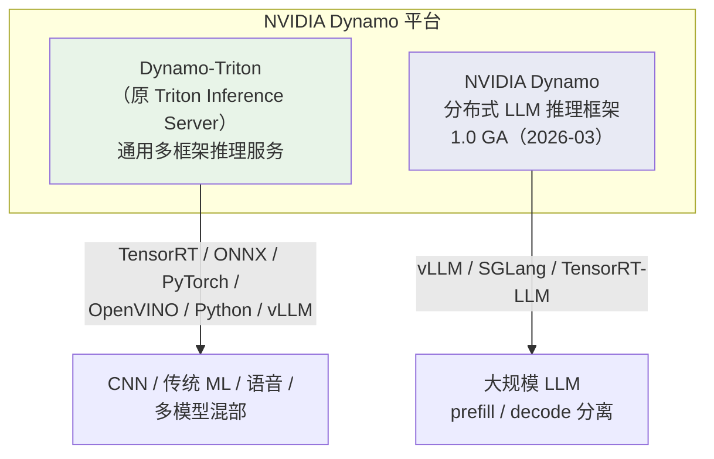

# 1. 背景

## 为什么需要 Triton Inference Server？

在 LLMOps 链路中，vLLM、SGLang、TensorRT-LLM 解决的是**“单个模型如何跑得快”**的问题；而生产环境真正要解决的是**“一堆模型、一堆框架、一堆业务方如何稳定地服务”**的问题。

一个典型的大规模推理集群往往同时存在：

1. **多种框架**：TensorRT-LLM 做极致吞吐的 LLM，ONNX Runtime 做视觉小模型，PyTorch 做实验模型，Python backend 做前后处理。
2. **多种协议**：移动端用 HTTP/REST，微服务间用 gRPC，高性能 C++ 客户端用 C API。
3. **多种调度需求**：在线请求要低延迟，离线批量要低价格，多轮对话要 sequence batching，复杂链路要 ensemble。
4. **多租户与可观测**：不同业务方共享 GPU，需要模型隔离、配额、Prometheus 指标、日志、tracing。

如果每个模型都各自暴露一个服务，运维会迅速失控：端口管理、路由规则、监控埋点、版本发布、A/B 测试、限流降级都需要重复建设。Triton Inference Server 就是 NVIDIA 为这一场景设计的**统一推理服务层**。

## Triton 的诞生

Triton 源自 NVIDIA 的 GPU 推理服务实践，目标是提供一个**与框架无关、与协议无关、可扩展、可观测**的模型服务入口。其设计深受以下生产痛点驱动：

- **框架碎片化**：TensorRT、ONNX、PyTorch、TensorFlow、Python、vLLM 各有自己的 serving 方式，无法统一运维。
- **Batching 调优困难**：动态 batching、序列 batching、ensemble 需要在服务层实现，而不是让每个 backend 自己重复做。
- **多 GPU / 多节点部署**：需要 instance group、模型并行、device placement 的声明式配置。
- **生命周期管理**：模型热更新、版本回滚、A/B 测试、金丝雀发布需要在服务层统一支持。

Triton 通过 **model repository + `config.pbtxt` + backend abstraction** 的三层抽象，把这些能力集中到一个进程中，从而让业务方只需要关心“把模型放进仓库、写好配置、调通调度”。

## Triton 的版本演进（2025–2026）

截至 2026 年 10 月，Triton 已发布到 **26.09（GitHub Release 2.73.0）**，版本号跟随 NGC 容器标签的 `YY.MM` 格式。近两年值得关注的方向：

| 时间 | 版本/事件 | 关键变化 |
|---|---|---|
| 2025-03 | PB 25h1（Production Branch） | 面向 NVIDIA AI Enterprise 用户的 9 个月长期支持分支 |
| 2025-08 | PB 25h2 | 第二个生产分支，提供 API 稳定的月度安全修复 |
| 2025-12 | 25.12 / 2.64.0 | **OpenAI-compatible frontend 从 beta 进入 stable**；TensorRT-LLM 支持 multi-LoRA |
| 2026-02 | 26.02 / 2.66.0 | **最后一个 Jetson GitHub release** |
| 2026-04 | 26.04 / 2.68.0 | PyTorch backend 支持 AOT Inductor / PT2；ONNX backend 支持 bfloat16；Python backend 新增 `is_ready()` |
| 2026-05 | 26.05 / 2.69.0 | Azure Managed Identity 访问存储；新增 Rust gRPC client；vLLM backend 支持 `GPU_DEVICE_IDS` |
| 2026-06 | 26.06 / 2.70.0 | TensorRT backend 支持多 GPU 推理；PyTorch backend 支持 PyTorch 2 dynamic batching；**正式移除 Windows 支持**；修复多个高危安全漏洞（含 CVE-2026-47627 路径穿越） |
| 2026-07 | 26.07 / 2.71.0 | PyTorch backend 支持 NV Embedding 与 HSTU 生成式推荐模型（AOTI 路径）；OpenAI 前端增加流式 tool-call 缓冲限制；容器内含 TRT-LLM release/1.2.1 与 vLLM 0.24.0 |
| 2026-08 | 26.08 / 2.72.0 | 修复 dynamic batcher 饥饿（`waiting_consumer_count` 漂移）与 `preserve_ordering` 顺序问题；新增 C/Python 日志回调 API；升级 CUDA 13.4.1 / TensorRT 11.2；**起不再附带 TensorRT-LLM backend 容器** |
| 2026-09 | 26.09 / 2.73.0 | DLFW 容器**初步支持 NVIDIA Rubin GPU 架构**；构建迁移至 C++20；OpenAI 前端改进流式取消；TensorRT 11.3 / vLLM 0.29.0；废弃 developer_tools C API wrapper |

近两年 Triton 的演进主线非常清晰：

1. **品牌并入 Dynamo 平台**：2026 年起 NVIDIA 将 Triton Inference Server 更名为 **NVIDIA Dynamo-Triton**，作为 Dynamo 平台下的通用推理服务组件；面向大规模 LLM 的多节点分布式推理则由 **NVIDIA Dynamo**（2026 年 3 月发布 1.0）承接。详见下文「Triton 在 LLM 时代的定位变化」。
2. **LLM serving 深化**：持续加大对 vLLM 与 TensorRT-LLM backend 的投入，包括 OpenAI 兼容前端、embeddings 端点、tool calling、LoRA、GPU 设备绑定等。
3. **OpenAI-compatible API 成熟**：从 beta 到 stable，增加了认证、请求大小限制、错误码对齐、流式取消等生产级能力。
4. **安全加固**：修复多个 CVE，hardened Python backend 环境解压与文件路径处理，支持 Azure Managed Identity。2026 年 8 月 NVIDIA 发布安全公告，修复了包括 CVE-2026-47627（路径穿越，CVSS 9.8）在内的多个漏洞，**强烈建议升级到 26.06 及以上版本**。
5. **平台收敛**：Windows 支持被废弃并移除，Jetson 的 GitHub release 终止，企业级部署更聚焦 Linux + 数据中心 GPU；**从 26.08 起 NGC 不再随月度发布提供 TensorRT-LLM backend 容器镜像**，TRT-LLM 用户需自行构建或转向 NVIDIA Dynamo。

## Triton 在 LLM 时代的定位变化：Dynamo-Triton 与 NVIDIA Dynamo

2026 年 Triton 最重要的变化不是某个功能，而是**它在 NVIDIA 推理版图中的位置**：

- **Dynamo-Triton（原 Triton）**：继续承担**通用、多框架、单节点为主**的推理服务——视觉、语音、传统 ML、embedding、reranker 以及中小规模 LLM。API、model repository、`config.pbtxt` 基本不变，存量部署不受影响。
- **NVIDIA Dynamo**：面向 **AI Factory 级的大规模 LLM 推理**，核心能力是 Triton 没有的：**disaggregated serving**（prefill / decode 分离部署、独立扩缩）、**KV-cache 感知路由**（把请求路由到已缓存上下文的 GPU）、**NIXL**（NVLink / InfiniBand 上的低延迟 KV 传输）、**分层 KV cache 卸载**（GPU → CPU → SSD）。Dynamo 1.0 于 2026 年 3 月 GA，引擎无关，可编排 vLLM、SGLang、TensorRT-LLM。

对团队的实际含义：

| 你的场景 | 推荐 |
|---|---|
| 一台或几台服务器，服务多个模型 / 多种框架 | Dynamo-Triton（原 Triton） |
| 单一大 LLM，单机部署 | vLLM / SGLang 裸部署，或 Triton vLLM backend |
| 数十到数百张 GPU 的 LLM 集群，需要 prefill/decode 分离 | NVIDIA Dynamo |
| Kubernetes 上的统一发布与扩缩 | KServe（Triton runtime 或 vLLM runtime）+ 上述引擎 |

> 一句话：Triton 没有被废弃，但 NVIDIA 的 LLM 投入重心已经转移到 Dynamo；Triton 退守“通用推理服务层”这个它最擅长的位置。

## 没有 Triton 会怎样？

在没有 Triton 之前，团队通常面临三种选择：

| 方案 | 优点 | 缺点 |
|---|---|---|
| **裸部署 vLLM / TRT-LLM / SGLang** | 简单直接，性能最优 | 每个模型一个入口，缺少统一路由、调度、监控、版本管理 |
| **自研网关** | 完全可控，可定制 | 需要重复实现 batching、backend 加载、协议转换、热更新，维护成本高 |
| **KServe / Seldon / BentoML** | 云原生、自动扩缩、多框架 | 通常以 Kubernetes 为中心，对 NVIDIA backend 的深度优化和 GPU 显存调度不如 Triton 直接 |

Triton 的价值在于：它介于“裸 backend”与“完整 MLOps 平台”之间——比裸 backend 多了服务层能力，比完整平台更轻量、更贴近 GPU 推理优化。

## Triton 与替代方案的对比

| 维度 | Triton / Dynamo-Triton | 裸部署 vLLM / TRT-LLM | NVIDIA Dynamo | KServe | 自研网关 |
|---|---|---|---|---|---|
| 核心定位 | 多框架推理服务入口 | 单模型高性能推理 | 分布式 LLM 推理框架（AI Factory 级） | Kubernetes 上的模型服务框架 | 自定义请求路由与治理 |
| 支持后端 | TensorRT、TRT-LLM、ONNX、PyTorch、Python、vLLM、TensorFlow 等 | 自身引擎 | vLLM、SGLang、TensorRT-LLM | 多种 runtime（可通过 Triton 集成） | 取决于实现 |
| 调度能力 | Dynamic Batching、Sequence Batching、Ensemble、Rate Limiter | Continuous / In-flight Batching | Disaggregated serving、KV 感知路由、GPU Planner | 依赖底层 runtime | 需自行实现 |
| 协议支持 | HTTP/REST、gRPC、C API、OpenAI 兼容、Vertex AI / SageMaker 兼容 | 通常 HTTP / 内部 API | OpenAI 兼容 | HTTP/gRPC | 自定义 |
| 可观测性 | Prometheus 指标、Tracing、日志 | 部分自带 | Prometheus + 推理感知指标 | 依赖 Istio / 平台层 | 需自行实现 |
| 模型版本与热更新 | 原生支持 | 不支持或需 wrapper | 依赖底层引擎 | 支持 | 需自行实现 |
| 学习曲线 | 中（config.pbtxt 细节多） | 低 | 中高（分布式组件多） | 中 | 高 |

> 一句话：如果你已经在用 NVIDIA GPU，并且需要在一个集群里服务多种模型、多种框架，Triton 通常是最省力的统一服务层。

## 本章小结

Triton Inference Server 不是又一个推理引擎，而是**模型与业务之间的服务层**。它把“模型放哪里、用什么后端、怎么组 batch、怎么监控”这些工程问题收敛到 model repository 与 `config.pbtxt` 中，从而让 vLLM、TensorRT-LLM、ONNX Runtime 等引擎能够以统一的方式对外服务。

**参考来源**

- [Triton Inference Server User Guide — Architecture](https://docs.nvidia.com/deeplearning/triton-inference-server/user-guide/docs/user_guide/architecture.html)
- [triton-inference-server/server GitHub Releases](https://github.com/triton-inference-server/server/releases)
- [Triton Inference Server Release 26.08 — NVIDIA Docs](https://docs.nvidia.com/deeplearning/triton-inference-server/release-notes/rel-26-08.html)
- [Triton Inference Server Release 26.09 — NVIDIA Docs](https://docs.nvidia.com/deeplearning/triton-inference-server/release-notes/rel-26-09.html)
- [Security Bulletin: NVIDIA Triton Inference Server — August 2026](https://nvidia.custhelp.com/app/answers/detail/a_id/5860/~/security-bulletin%3A-nvidia-triton-inference-server---august-2026)
- [Triton Inference Server PB October 2025 (PB 25h2) — NVIDIA NGC](https://catalog.ngc.nvidia.com/orgs/nvidia/containers/tritonserver-pb25h2)
- [Triton vLLM Backend](https://github.com/triton-inference-server/vllm_backend)
- [Triton TensorRT-LLM Backend](https://github.com/triton-inference-server/tensorrtllm_backend)
- [NVIDIA Dynamo-Triton 官方主页](https://developer.nvidia.com/dynamo-triton)
- [NVIDIA Dynamo 官方主页](https://developer.nvidia.com/dynamo)
- [NVIDIA DYNAMO FAQ（含 Dynamo-Triton 更名说明）](https://forums.developer.nvidia.com/t/nvidia-dynamo-faq/327484)
- [KServe 官方文档](https://kserve.github.io/website/)
