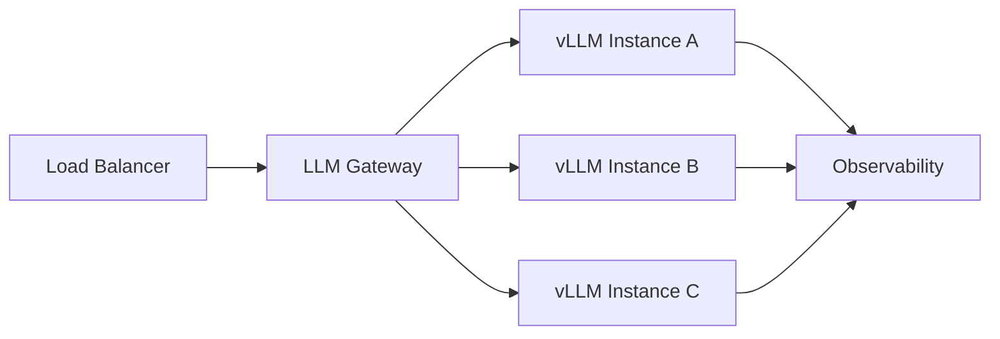

# 8. 企业生产实践

本章结合真实公司与场景，分析 vLLM 在生产环境中的部署方式、优化手段与踩坑经验。

## 典型生产架构

## 各公司实践

### Together AI / Fireworks AI

这两家是 vLLM 的早期采用者与积极推动者，主要经验：

- 使用 vLLM 的 PagedAttention 提升多租户场景下的显存利用率
- 结合自定义调度策略优化长尾延迟
- 强调 prefix caching 在长 system prompt 场景下的收益
- 针对自家硬件和负载定制 Attention Kernel 与调度器

### AWS SageMaker

AWS 在 SageMaker 中支持 vLLM 作为推理后端：

- 与 EC2 GPU 实例（如 g5/p4d）集成
- 通过 SageMaker Endpoint 暴露模型服务
- 利用 CloudWatch 进行可观测性

### 腾讯

腾讯基于 vLLM 构建了 **Prefill-Decode（PD）分离推理框架**，并已在多个业务场景中大规模部署。PD 分离的核心思想是把计算密集的 prefill 阶段与内存带宽密集的 decode 阶段解耦到不同实例，从而分别优化资源利用率。

### 蚂蚁集团

蚂蚁集团的基础设施团队在 DeepSeek 推理优化中，通过 GPU 内存优化、延迟降低、单节点多模型部署以及 PD 分离架构，基于 vLLM 实现了 **10 倍的推理性能提升**。

### 字节跳动

字节跳动的 **AIBrix** 控制平面与 vLLM 紧密集成，基于字节内部大量在线 workload 实践，解决大规模模型推理中效率与成本的平衡问题。AIBrix 提供了自动扩缩容、LoRA 管理、KV cache 转移等能力。

### Moonshot AI / 小米

- **Moonshot AI**：在生产环境中运行 Kimi K2/K3 模型，面临高并发在线推理与 RL 训练需求的双重压力。其开源的 **Mooncake**（FAST 2025 最佳论文）以 KVCache 为中心实现了 PD 分离与分布式 KV 池，Kimi K2 上线即基于 Mooncake + vLLM 的架构；vLLM 官方博客（2026-05-06）介绍了 vLLM x Mooncake 支撑大规模 Agentic 负载的实践，vLLM 博客（2026-09-13）进一步披露 Kimi K3 在 vLLM 上的吞吐优化达到 2.8×。
- **小米**：在 vLLM 内部实现了原生的 PD 分离方案，使用点对点 NCCL 通信，并在真实部署中取得了显著性能提升。

## 2025–2026 年生产实践新趋势

### 1. Prefill-Decode 分离成为大集群标配

PD 分离从论文与内部系统走向 vLLM 原生能力，主流组合是：

- **传输层**：`NixlConnector`（GPU 显存 P2P/RDMA）、`MooncakeStoreConnector`（分布式 KV 池）、`LMCacheConnector`（跨层缓存）；
- **路由层**：llm-d、AIBrix 等 Kubernetes 原生路由器，消费 vLLM 的 KV Events 做缓存感知调度；
- **收益**：prefill 的突发计算与 decode 的稳定带宽需求分别扩缩容，整体 GPU 利用率与 TTFT 同时改善。vLLM 官方博客《Taking vLLM Apart: A Practical Guide to Disaggregated Serving》（2026-09-29）给出了完整的拆分指南；2026-10-14 的博客进一步介绍了 push 式 KV 传输对 TTFT/TPOT 的优化。

### 2. 分层 KV Cache Offloading 支撑长上下文与 Agentic 负载

多轮 Agent 会话的上下文反复增长，把被驱逐的 KV 保留到低速层比丢弃重算便宜得多。vLLM 自 v0.22 起提供原生分层 offloading（官方博客 2026-09-10）：

- GPU → CPU（LRU/ARC 主机缓存）→ 文件系统 / S3 / P2P 远端；
- 官方基准（Qwen MoE 模型，2×H100，多轮 12K+4K/轮负载）：当并发会话超过 HBM 容量后，无 offloading 吞吐急剧下降，开启存储分层后命中率保持高位，吞吐相比丢弃重算提升一倍以上；
- 同一请求的不同 chunk 可由不同层服务，reload 与调度解耦（异步 DMA）。

### 3. MoE 模型的宽 EP 部署

超大 MoE（DeepSeek-V3/R1 类）的生产部署从 TP 为主转向 **EP + EPLB**（专家负载均衡）+ DP Attention。vLLM 官方博客（2025-12-17）报告了 DeepSeek 宽 EP 部署达到单 H200 2.2k tok/s 的大规模 serving；v0.31.0 引入 MoonEP 均衡 EP all2all 后端进一步压低通信开销。

### 4. 快速重启与 Sleep Mode

- **`vllm preload`**（v0.30.0）：权重缓存守护进程让量化后权重常驻显存，引擎重启时经 CUDA IPC 直接映射，把分钟级冷启动压缩到秒级，对高频发版与多模型轮转的平台很关键。
- **Sleep Mode**（vLLM 博客 2025-10-26）：把模型权重卸载到 CPU 内存/磁盘再零重载唤醒，适合波谷缩容与多模型时间片复用。

### 5. vLLM 作为 RL Rollout 引擎

随着 RL Post-Training 规模扩大，vLLM 从"推理引擎"变成"训推一体"的一环：

- **Native RL API**（vLLM 博客 2026-05-28）简化 rollout 集成；
- **Bitwise 训推一致性**（vLLM 博客 2025-11-10）：推理与训练 kernel 对齐，消除 rollout 与训练之间的数值漂移；
- **`sharded_rdt` P2P 权重同步**（v0.29.0）：训练侧更新权重后，每个推理 worker 只拉取自己的 TP/EP 分片，大幅缩短权重热更新时间；
- 与 Mooncake checkpoint-engine 配合，可实现超大规模 MoE（万亿参数级）的分钟级权重分发。

### 阿里云 / 腾讯云

国内云厂商通常的做法：

- 将 vLLM 封装为 PaaS 推理服务
- 结合自研 LLM Gateway 做流量调度与配额管理
- 针对国内模型（如 Qwen、Baichuan）做适配与优化

## 关键优化手段

### 1. Tensor Parallelism / Pipeline Parallelism

- TP：适合单节点多 GPU，通信 overhead 在 NVLink 下可接受
- PP：适合超大模型跨节点部署，但会增加 bubble

### 2. Quantization

vLLM 当前支持的量化格式非常丰富：FP8、MXFP8/MXFP4、NVFP4、INT8、INT4、GPTQ、AWQ、GGUF、compressed-tensors、ModelOpt、TorchAO 等。

生产中最常用的选择：

- **FP8**：在 H100/H200 等 Hopper/Blackwell 架构上性能最好，推荐使用 `llm-compressor` 做校准
- **AWQ / GPTQ**：4-bit 权重量化，显著降低显存占用
- **compressed-tensors / GGUF**：适合直接部署社区预量化模型

注意：量化可能带来精度损失，需要在业务指标和 perplexity 上评估容忍度。MXFP4 activations 尚未完全支持，MXFP8 仍处于实验阶段，NVFP4 主要面向 Blackwell。

### 3. Prefix Caching

对共享系统 prompt 或长前缀的请求，缓存其 KV Cache，避免重复计算。2025–2026 年的增强点：

- 支持 hybrid 模型（full attention + sliding window + Mamba）的前缀复用；
- 与 KV Connector 联动，缓存不再局限于单实例（跨实例/跨层复用）；
- 上层路由器（llm-d）可基于 KV Events 做缓存亲和路由。

### 4. Speculative Decoding

用小模型（draft model）或模型自带 MTP 头快速生成候选 token，再用大模型验证，可显著降低 TPOT。2025–2026 年趋势：

- **EAGLE-3** 与 MTP 成为主流草稿来源，接受率显著高于独立小模型；
- **Adaptive Speculative Decoding** 按在线接受率动态调整草稿长度（v0.29.0 起 API 返回逐请求接受率统计）；
- 注意与异步 KV offloading 等特性的组合兼容性，以对应版本 release notes 为准。

### 5. Structured Output

Agent / Function Calling 场景下，用 xgrammar 后端做结构化输出，把文法编译为 token 掩码，增量开销接近零，是 2025 年后生产 Agent 服务的标准配置。

### 6. 可观测性

- 监控指标：TTFT（Time To First Token）、TPOT（Time Per Output Token）、throughput、KV Cache 利用率
- 日志：请求生命周期、调度决策、错误堆栈
- 追踪：OpenTelemetry 接入

## 常见踩坑

| 问题 | 原因 | 解决 |
|---|---|---|
| CUDA OOM | KV Cache 增长超过预期 | 调整 max_num_seqs、max_model_len、block_size |
| 尾延迟高 | 长序列阻塞短序列 | 调整调度策略、启用抢占/swapping |
| 吞吐不达预期 | batch size 不够大 | 优化 Continuous Batching、降低 pad 开销 |
| 分布式卡死 | NCCL 通信问题 | 检查网络拓扑、CUDA_VISIBLE_DEVICES、RDMA 配置 |
| 模型输出异常 | 量化精度损失 | 评估 AWQ/GPTQ/FP8 的 perplexity 变化 |
| PD 分离 TTFT 恶化 | KV 传输未与计算重叠 / 路由未感知缓存 | 启用流式 KV 传输，接入 KV Events 做缓存亲和路由 |
| 长会话吞吐骤降 | KV 驱逐后重算 | 启用分层 KV cache offloading（CPU/文件系统/S3） |
| 权重热更新慢 | 全量权重广播 | RL 场景使用 `sharded_rdt` P2P 分片同步（v0.29.0+） |

## 本章小结

vLLM 在生产环境中的成功不仅取决于软件本身，还取决于硬件选型、分布式并行、量化策略、调度调优和可观测性的系统工程能力。
