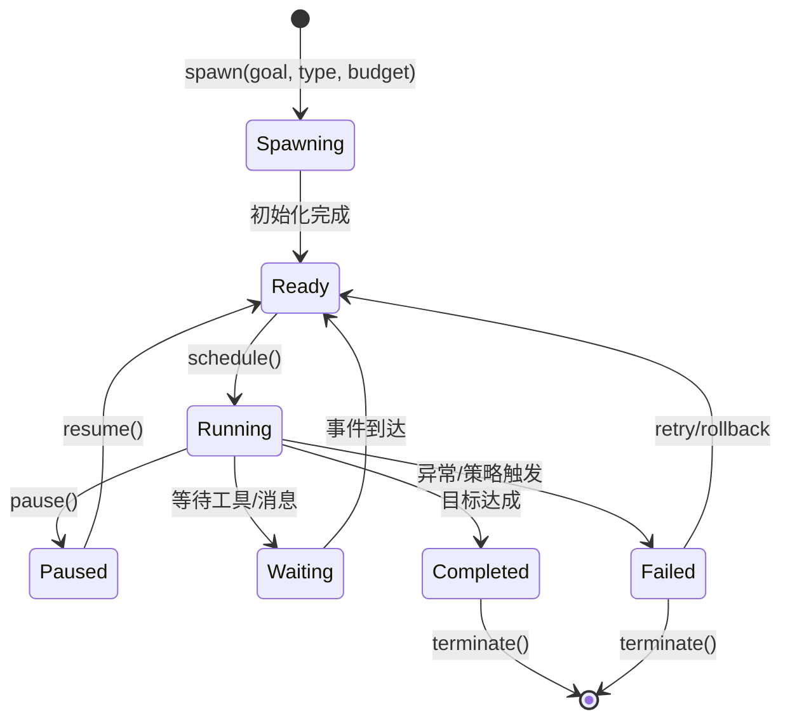
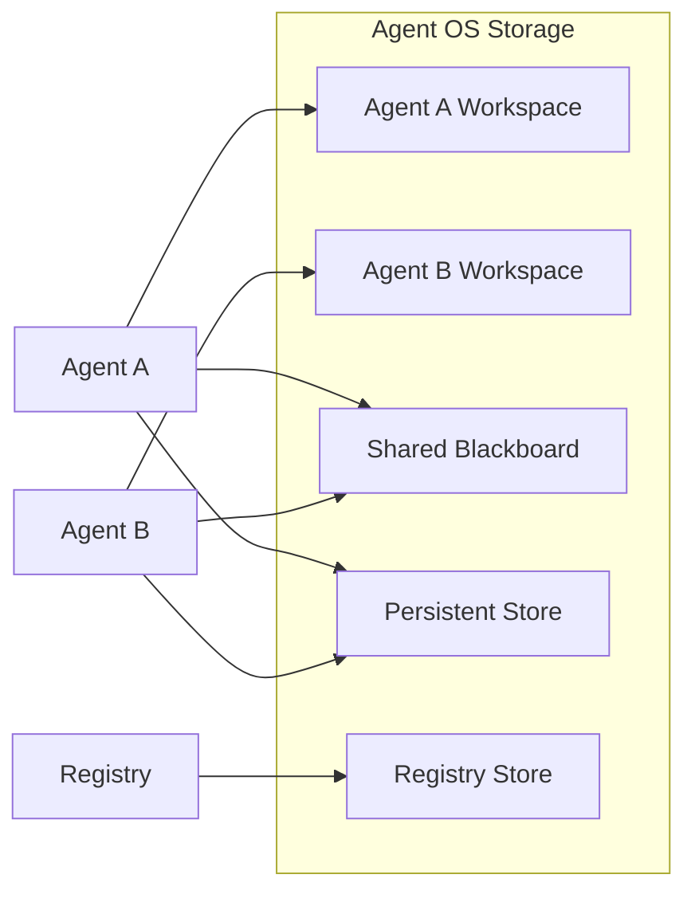
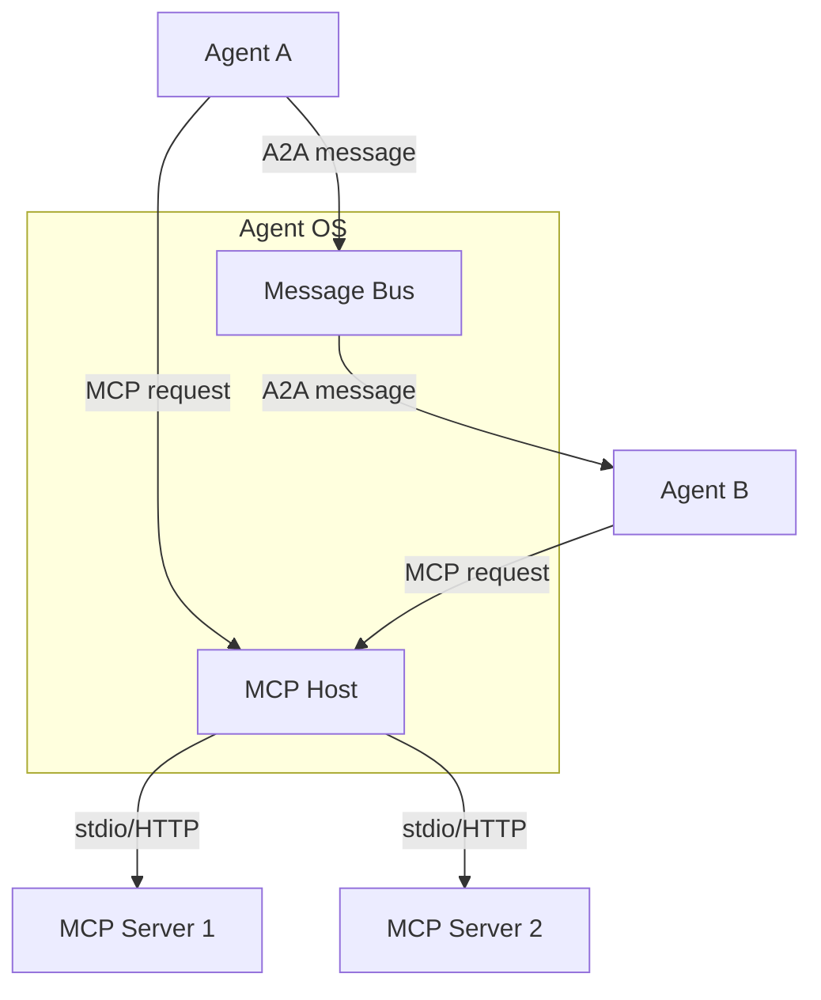
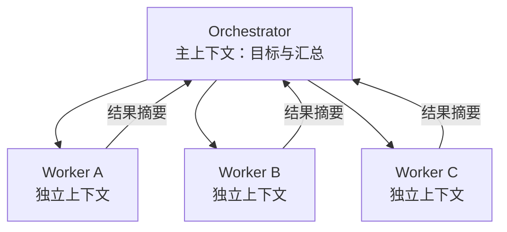

# 核心思想

> 一句话理解：**Agent OS 的核心思想是把 Agent 抽象为“进程”，并围绕进程构建调度、隔离、存储、通信、治理与恢复六大能力。**

## 1. Agent as Process：Agent 即进程

传统操作系统通过进程抽象程序的执行。Agent OS 把 Agent 也抽象为进程：

- **Spawn**：根据 Agent 类型创建实例，分配 PID（或 Agent ID）、命名空间、初始预算。
- **Run**：把 Agent 放入调度队列，分配 CPU/Token/时间片。
- **Pause / Resume**：长程任务可以中断，状态持久化后恢复。
- **Terminate**：任务完成、失败或策略触发时结束进程，回收资源。

把 Agent 当作进程的好处：

- 可以复用操作系统成熟的资源隔离、调度、审计概念。
- 多 Agent 之间的边界清晰，避免状态污染。
- 支持抢占、配额、优先级等高级调度策略。

## 2. Scheduler：调度器

Agent OS 的调度器决定“哪个 Agent 在什么时候获得多少资源”。

### 协作式 vs 抢占式

- **协作式（Cooperative）**：Agent 主动让出控制权，适合工具调用型任务，实现简单但容易被恶意/异常 Agent 霸占资源。
- **抢占式（Preemptive）**：OS 强制中断 Agent，按时间片/Token 预算重新分配，适合多租户与长程任务，但实现复杂。

### MLFQ 与 AgentRM

AgentRM（arXiv:2603.13110）提出多级反馈队列（MLFQ）风格的 Agent 调度：

- 新 Agent 进入高优先级队列。
- 如果 Agent 频繁失败或超预算，降低优先级。
- 如果 Agent 稳定完成，可获得更多时间片或提升优先级。

### Token 预算与 HiveMind

HiveMind（arXiv:2604.17111）把 Token 作为核心资源进行调度与预算控制：

- 每个 Agent/任务有 Token 预算。
- 调度器在 Token 消耗接近上限时触发减速、暂停或终止。
- 支持跨任务的 Token 配额分配与抢占。

### Admission Control

调度器还需要做准入控制：

- 检查当前系统负载、租户配额、依赖服务可用性。
- 拒绝或排队无法满足 SLO 的请求。

### KV Cache TTL：把 GPU 上下文变成可调度资源

Continuum（arXiv:2511.02230，ICLR 2026）发现：多轮 Agent 在工具调用间隙，其 KV Cache 常被推理引擎立即驱逐，下一轮被迫重新 prefill 并重新排队。它提出 **KV Cache TTL** 调度：

- Agent 发出工具调用后，调度器把该请求的 KV Cache 在 GPU 内存中"钉住"一段预测时长。
- 工具按时返回 → 下一轮直接续算，免去 re-prefill 与排队；超时未返回 → 自动驱逐，保证健壮性。
- 配合 program 级 FCFS 保持多轮顺序，在 SWE-Bench / BFCL 类负载上取得约 1.12×–3.66× 的延迟下降与 1.10×–3.22× 的吞吐提升。

这带来一个重要认知：**Agent 调度资源不止 Token 与调用次数，还包括 GPU 上的上下文缓存**；"抢占"在 LLM 推理不可中断的前提下，粒度只能是"单次推理调用"（request-level preemption），而非线程级时间片。

来源：
- [AgentRM: A Resource Management Framework for LLM Agents](https://arxiv.org/abs/2603.13110)
- [HiveMind: Token-Centric Scheduling for LLM Agents](https://arxiv.org/abs/2604.17111)
- [Continuum: Efficient and Robust Multi-Turn LLM Agent Scheduling with KV Cache Time-to-Live](https://arxiv.org/abs/2511.02230)

## 3. Sandbox & Isolation：沙箱与隔离

Agent 调用外部工具时具有潜在破坏力，必须隔离。

### 能力模型（Capability Model）

借鉴操作系统的能力模型：

- 每个 Agent 拥有有限的能力集合，例如 `[read_file, search_web, send_email]`。
- Agent 不能获得超出其能力集合的权限。
- 能力可以按命名空间、版本、租户进行划分。

### 权限边界

- **Allowed Tool List**：明确允许调用的工具白名单。
- **Resource Limits**：最大调用次数、最大执行时间、最大 Token 消耗、最大网络请求次数。
- **Workspace Isolation**：每个 Agent 只能访问自己的工作目录。
- **Process Isolation**：AgentSys（arXiv:2602.07398）提出 worker agent 运行在独立进程中，避免一个 Agent 的崩溃影响其他 Agent。

### Checkpoint / Rollback

DeltaBox（arXiv:2605.22781）提出对 Agent 执行状态进行 checkpoint，并在失败时回滚到上一个稳定状态：

- 在关键步骤前保存状态快照。
- 失败时回滚，避免副作用累积。
- 支持分支执行与对比不同路径。

2026 年这一能力进一步工程化：**Firecracker 快照让 checkpoint/rollback 进入毫秒级**，pause/resume/fork 成为 Agent 沙箱的标准操作（Perplexity SPACE 支持 fork 出并行 Agent 并保留长达一周的会话快照；E2B 基于快照实现 5–30ms 冷启动）。配合 DeltaBox 的 fork 模板池，"保存 Agent 状态 → 复制出 N 个分支并行探索 → 回收最优分支"成为长程 Agent 的主流执行模式。

### 沙箱标准：microVM 与 Wasm 两极

2026 年业界对沙箱隔离强度形成共识：

- **不可信的 LLM 生成代码必须跑在 microVM 里**（Firecracker/Kata，独立内核，约 125ms 冷启动，接近容器性能）；共享内核的 Docker 容器只适用于可信代码——OWASP ASI:2026 的 ASI05（Unexpected Code Execution）已把沙箱列为强制控制。
- **轻量/边缘场景用 Wasm 沙箱**（Wasmtime 等）：启动微秒级、跨平台，但系统能力受限，适合纯计算型工具。
- 中间地带是 gVisor：用户态内核拦截系统调用，无需 KVM，系统调用密集型负载有 5–15% 开销。

来源：
- [AgentSys: Building Efficient Multi-Agent Systems with Worker Agents](https://arxiv.org/abs/2602.07398)
- [DeltaBox: Checkpoint and Rollback for LLM Agents](https://arxiv.org/abs/2605.22781)
- [Best microVM Sandboxes for AI Code Execution in 2026（Modal）](https://modal.com/resources/best-microvm-sandboxes-ai-code-execution)
- [OWASP Top 10 for Agentic Applications（ASI:2026）](https://www.promptfoo.dev/docs/red-team/owasp-agentic-ai/)

## 4. Workspace / Storage：工作区与存储

Agent OS 提供类似文件系统的存储抽象：

- **Per-Agent Working Memory**：每个 Agent 私有的临时工作空间。
- **Shared Blackboard**：多个 Agent 可协作读写的共享空间。
- **Persistent Store**：长程任务的状态持久化。
- **Registry Store**：Agent 类型、技能、工具的元数据。

Workspace 与 Memory 主题的区别：

- **Agent OS Workspace**：关注“在哪里存、谁能访问、生命周期如何”。
- **Memory 主题**：关注“存什么、怎么检索、怎么向量化、怎么压缩”。

## 5. Registry：注册表

Registry 是 Agent OS 的“元数据中心”：

- **Agent Types**：可创建的 Agent 类型定义（角色、能力、默认工具、默认策略）。
- **Skills / Tools**：可用技能的 schema、版本、命名空间、依赖。
- **Versions**：Agent 类型与技能的版本管理，支持灰度升级。
- **Namespaces**：按团队/租户/项目划分命名空间。
- **Entitlements**：谁能创建哪种 Agent、谁能使用哪个工具。

Registry 与 MCP 的关系：

- MCP Server 提供工具实现与能力描述。
- Agent OS Registry 管理这些能力在组织内的注册、授权与版本。

## 6. Messaging / IPC：消息与进程间通信

Agent 之间需要通信协作。Agent OS 提供消息总线：

- **Agent-to-Agent**：直接消息、发布/订阅、请求/响应。
- **MCP as Syscall**：Agent 到工具的调用被抽象为”系统调用”。
- **A2A as IPC Bus**：Google 的 A2A 协议（2025-06 捐给 Linux Foundation，**2026 年发布 v1.0**，150+ 组织支持；IBM 的 ACP 于 2025-08 并入）可作为 Agent 之间的 IPC 总线，标准化 Agent 之间的能力发现与协作。
- **AGNTCY as Discovery Plane**：Cisco 发起的 AGNTCY 项目定位互补层，提供 Agent 目录（OASF 模式 + 内容寻址发现）、身份与消息基础设施；其自有的 Agent Connect Protocol 已于 2026-04 归档，社区统一收敛到 A2A 作为 Agent 调用标准。

来源：
- [A2A Protocol（Linux Foundation）](https://a2a-protocol.org/)
- [MCP, A2A and AGNTCY: understanding the interoperability of AI agents in 2026](https://www.partitech.com/en/technical-blog-article/mcp-a2a-and-agntcy-understanding-the-interoperability-of-ai-agents-in-2026)

## 7. Security & Governance：安全与治理

Agent OS 是安全策略的强制执行点（Policy Enforcement Point，PEP）。

### Host 作为策略执行点

MCP Host 位于 Agent 与工具之间，天然适合执行策略：

- 校验每次工具调用是否在允许列表内。
- 检查参数是否符合安全策略。
- 记录审计日志。
- 对敏感操作触发人工审批（HITL）。

### Governed MCP 与 ProbeLogits

- **Governed MCP**（arXiv:2604.16870）提出把治理规则嵌入 MCP Host，实现能力注册、授权、审计、consent 管理。
- **ProbeLogits**（arXiv:2604.11943）提出通过探测 LLM 的 logits 来识别潜在的有害输出或越权行为，在生成阶段进行干预。

来源：
- [Governed MCP: From Technical Specifications to Multi-Agent Governance](https://arxiv.org/abs/2604.16870)
- [ProbeLogits: Probing LLM Logits for Safety and Governance](https://arxiv.org/abs/2604.11943)

### OWASP ASI:2026 与 Intent Gate

OWASP Agentic AI Top 10（ASI:2026，2025-12-09 发布）给出十大 Agentic 风险：目标劫持（ASI01）、工具误用（ASI02，实测占开源 Agent 项目安全发现的 64%）、身份与权限滥用（ASI03）、供应链投毒（ASI04）、意外代码执行（ASI05）、记忆与上下文投毒（ASI06）、Agent 间通信不安全（ASI07）、级联故障（ASI08）、人机信任剥削（ASI09）、流氓 Agent（ASI10）。它建议的核心控制与 Agent OS 模块一一对应：

- **Intent Gate**（意图门）：在每次工具调用真正执行前的策略执行点（PEP），做参数校验、权限判定与风险分级——与 MCP Host 的治理位置天然重合。
- **JIT 临时凭证**：Agent 不持有长期 Secret，由 OS 在调用前按需发放短时令牌。
- **记忆内容校验与回滚**：对应 Workspace/Recovery 模块。
- **Agent 间密码学认证（PKI/mTLS）**：对应 Message Bus 的身份层。

### Agent 身份：两层模型与多跳委托难题

2026 年 Agent 身份的标准化方向逐渐收敛为**两层模型**：

- **"Agent 是谁"**：工作负载身份。SPIFFE/SPIRE 发放 SVID，IETF WIMSE 工作组（含 WIT/WPT 双身份凭证草案）把 Agent 视为短寿命、被委托的工作负载。
- **"Agent 能做什么、代表谁"**：授权委托。MCP 2026-07-28 采用 OAuth 2.1；跨多跳调用链使用 OAuth Token Exchange（RFC 8693）与 Transaction Tokens（draft-ietf-oauth-transaction-tokens）传播上下文。

2026 年的 IETF 草案（AIMS 组合 WIMSE+SPIFFE+OAuth；draft-ietf-oauth-spiffe-client-auth）与学术方案 AIP（arXiv:2603.24775，Invocation-Bound Capability Token + Biscuit 多跳委托链）都在攻坚同一个开放问题：**多跳委托链的细粒度授权与权限衰减**——Agent A 代表用户调用 Agent B 再调用工具 C 时，如何证明"B 只被允许做 A 当时被授权的子集"。NIST NCCoE（2026-02 概念论文）也明确把多跳委托列为未解问题。

来源：
- [OWASP Top 10 for Agentic Applications（ASI:2026）](https://www.promptfoo.dev/docs/red-team/owasp-agentic-ai/)
- [State of Agentic AI Security and Governance v2.01](https://letsdatascience.com/news/owasp-releases-agentic-ai-security-report-v201-b6926a1d)
- [AIP: Agent Identity Protocol for Verifiable Delegation Across MCP and A2A](https://arxiv.org/abs/2603.24775)
- [MCP Authorization: OAuth 2.1, PKCE, and Agent Identity](https://aembit.io/blog/mcp-oauth-2-1-pkce-and-the-future-of-ai-authorization/)

### Consent 与审计

- **Consent**：用户对 Agent 能力的授权需要显式记录，支持撤销。
- **Audit Log**：记录 Agent 的全生命周期事件、工具调用、策略决策、人工干预。

## 8. Human-in-the-Loop（HITL）

Agent OS 在关键节点引入人类：

- 创建高权限 Agent 时的人工审批。
- 敏感工具调用前的人工确认。
- 失败/异常时的人工接管。
- 长程任务中断后的人工恢复决策。

HITL 不是阻碍，而是让 Agent 系统在安全边界内自治的关键机制。

## 9. Observability：可观测性

Agent OS 需要完整的可观测能力：

- **Spans / Traces**：跨 Agent、跨工具调用的请求链路。
- **Metrics**：调度延迟、Token 消耗、工具调用成功率、Agent 状态分布。
- **Reasoning Traceability**：记录 Agent 的思考路径，支持事后审计与调试。
- **Logs**：结构化日志，支持按 Agent ID、工具、租户、策略事件检索。

## 10. Recovery：恢复

Agent OS 需要面对 Agent 失败后的恢复：

- **Retry**：对可恢复错误进行指数退避重试。
- **Checkpoint/Rollback**：保存状态快照，失败后回滚。
- **Escalation**：失败无法自动恢复时升级给人类或其他 Agent。
- **Circuit Breaker**：对连续失败的工具/服务熔断，避免级联故障。

## 11. Context Engineering：上下文工程与 Agent 层级

2026 年"context engineering（上下文工程）"从 prompt 技巧升级为 Agent OS 的**一等公民**：上下文窗口是和 Token、KV Cache 并列的第三类稀缺资源，需要预算、隔离、压缩、淘汰一整套机制。

### 上下文作为 per-process 资源

类比进程的独立地址空间：**每个 Agent 进程应拥有私有上下文，互相隔离**——这正是 sub-agent（Claude Code 的 Task 工具、Agent SDK 的并行 agent）的设计动机：lead agent 派生并行子 Agent 时，子 Agent 携带自己的上下文窗口执行任务，只把最终结果回传主上下文，避免主上下文被中间过程撑爆。OS 层需要负责：

- **上下文预算**：为每个进程设置 token 上限，写入前校验（类比内存配额）。
- **上下文生命周期**：spawn 时初始化、pause 时序列化到 checkpoint、terminate 时按策略归档或销毁。
- **上下文压缩（compaction）**：接近上限时触发压缩，而非硬性截断。

### 系统控制 vs Agent 控制的压缩

2026 年的研究把压缩按"谁来决策"分为两类（见 EMNLP 2026 接收的 [上下文压缩综述](https://github.com/YerbaPage/Awesome-Agent-Context-Compression)及其整理的 failure modes）：

- **系统控制（system-controlled）**：框架在后台做截断/摘要/检索外置（externalization），Agent 无感知；实现简单但容易丢掉 Agent 后续需要的细节。
- **Agent 控制（agent-controlled）**：Agent 自主决定读写、删除、归档哪些上下文（如 MEMENTO、Active Context Compression），token 可省约 20%+，但要求模型具备自我管理能力，且失败模式更隐蔽。

工程上的共识是混合式：OS 层保底（预算硬约束、溢出保护），Agent 层优化（自主外置低价值中间结果）。[长程 Agent 上下文压缩优化](https://arxiv.org/abs/2510.00615)与[自主记忆管理](https://arxiv.org/abs/2601.07190)代表了后一路线的近期进展。

### Agent 层级（Agent Hierarchy）与 orchestrator-worker

sub-agent 普及之后，Agent 系统自然形成层级：

- **Orchestrator-worker 模式**：orchestrator 只做分解、派发、合并，worker 在隔离上下文里干脏活；这是 2026 年并行 Agent 编排的主流范式（Anthropic 工程博客称之为"dynamic workflows"，用动态工作流同时编排数十个 subagent）。
- **OS 视角**：层级就是**进程树**。派生 sub-agent = fork（共享环境快照、独立地址空间）；回收 = 子进程 terminate 并把退出码（结果摘要）传给父进程。因此 OS 层的进程管理、预算继承（子进程预算从父进程配额中扣除）、trace 父子关联，都要按进程树语义设计。

本主题的 Mini Demo 已包含最小实现：每个进程有私有上下文缓冲（`context.py`），写入受 token 预算约束、溢出时确定性压缩，见 [工程实践章节](07-mini-demo)。

## 本章小结

- Agent OS 的十大核心思想：Agent as Process、Scheduler、Sandbox、Capability Model、Workspace、Registry、Messaging/IPC、Security/Governance、HITL、Observability、Recovery。
- 2026 年新增第 11 条：Context Engineering——上下文是 per-process 稀缺资源，需要预算、隔离与压缩；orchestrator-worker 的 Agent 层级本质上是进程树，sub-agent 独立上下文就是进程的独立地址空间。
- 这些思想借鉴传统 OS，但针对 LLM Agent 的 Token 预算、工具调用、长程执行、安全治理等特点做了适配；2026 年起调度资源进一步扩展到 KV Cache，沙箱收敛到 Firecracker microVM 标准，身份治理收敛到"SPIFFE/WIMSE + OAuth"两层模型。
- 下一章将把这些思想组织成具体的分层架构。

**参考来源**
- [AIOS: LLM Agent Operating System](https://arxiv.org/abs/2403.16971)
- [AgentRM: A Resource Management Framework for LLM Agents](https://arxiv.org/abs/2603.13110)
- [HiveMind: Token-Centric Scheduling for LLM Agents](https://arxiv.org/abs/2604.17111)
- [Continuum: Multi-Turn LLM Agent Scheduling with KV Cache Time-to-Live](https://arxiv.org/abs/2511.02230)
- [AgentSys: Building Efficient Multi-Agent Systems with Worker Agents](https://arxiv.org/abs/2602.07398)
- [DeltaBox: Checkpoint and Rollback for LLM Agents](https://arxiv.org/abs/2605.22781)
- [Governed MCP: From Technical Specifications to Multi-Agent Governance](https://arxiv.org/abs/2604.16870)
- [ProbeLogits: Probing LLM Logits for Safety and Governance](https://arxiv.org/abs/2604.11943)
- [AIP: Agent Identity Protocol for Verifiable Delegation Across MCP and A2A](https://arxiv.org/abs/2603.24775)
- [Awesome-Agent-Context-Compression（EMNLP 2026 综述配套）](https://github.com/YerbaPage/Awesome-Agent-Context-Compression)
- [Optimizing Context Compression for Long-horizon LLM Agents](https://arxiv.org/abs/2510.00615)
- [Autonomous Memory Management in LLM Agents](https://arxiv.org/abs/2601.07190)
- [A harness for every task: dynamic workflows in Claude Code](https://claude.com/blog/a-harness-for-every-task-dynamic-workflows-in-claude-code)
- [OWASP Top 10 for Agentic Applications（ASI:2026）](https://www.promptfoo.dev/docs/red-team/owasp-agentic-ai/)
- [MCP Specification（2026-07-28）](https://modelcontextprotocol.io/specification/2026-07-28/architecture)
