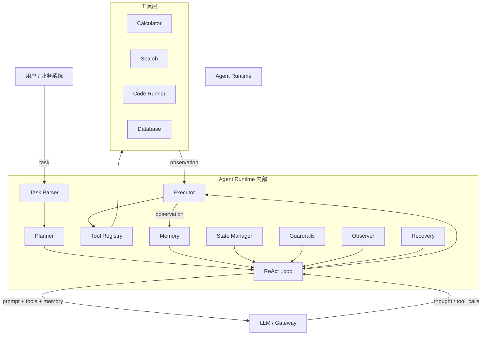
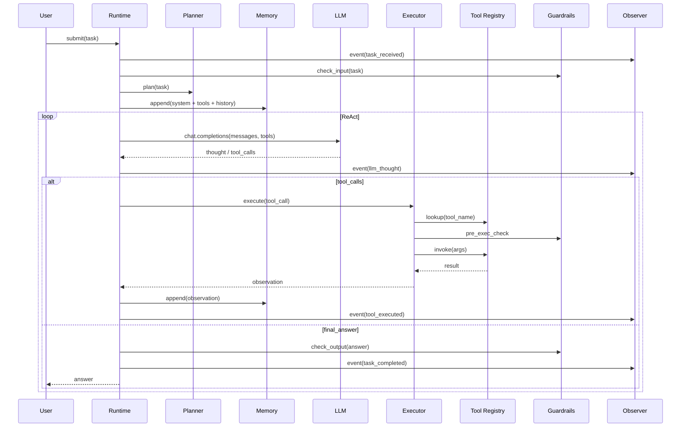

# 3. 架构设计

> 一句话理解：Agent Runtime 的架构可以概括为“**一个中心循环 + 多个能力插件**”——Runtime 负责 ReAct 主循环，工具、记忆、规划、护栏、观测等能力以插件形式围绕其工作。

## 整体架构



## 分层职责

| 层级 | 职责 | 典型组件 |
|---|---|---|
| **接入层** | 接收任务、鉴权、路由 | API Gateway / LLM Gateway / SDK |
| **Runtime 控制面** | 配置、session 管理、权限、审计 | Admin API、Policy Store、Secret Manager |
| **Runtime 数据面** | ReAct 循环、工具调用、状态流转 | Runtime Core、Planner、Executor |
| **能力插件** | 工具、记忆、规划、护栏、观测 | Tool Registry、Memory、Guardrails、Observer |
| **工具层** | 实际执行动作 | 数据库、搜索、代码执行、浏览器、内部 API |
| **可观测层** | trace、metrics、logs | OpenTelemetry、LangSmith、Prometheus |

## 核心模块协作



## 控制面 vs 数据面

| 维度 | 控制面 | 数据面 |
|---|---|---|
| 职责 | 配置、策略、密钥、审计、生命周期 | 执行任务循环、调用工具、更新状态 |
| 状态 | 长期、可持久化 | 会话级、可 checkpoint |
| 扩展 | 管理员/API | 水平扩展 worker 池 |
| 示例 | Tool policy、Rate limit、User quota | ReAct loop、Tool execution、Memory update |

控制面决定“能做什么”，数据面决定“正在怎么做”。

## 部署形态

### 形态 1：库 / SDK

```text
业务进程直接 import agent_runtime 并调用 runtime.run(task)
```

优点：低延迟、易集成。
缺点：状态与观测分散在各业务进程中。

### 形态 2：独立服务

```text
Client → Agent Runtime Service → LLM Gateway → Tools
```

优点：集中管理、可扩展、可观测统一。
缺点：多一跳网络延迟。

### 形态 3：Serverless / 云托管

例如 AWS Bedrock AgentCore、Azure AI Agent Service、Vertex AI Agent Engine。

优点：按需计费、自动扩缩、托管持久化。
缺点：供应商锁定、自定义能力受限。

2026 下半年起，这一形态进入“托管 harness 竞争”阶段：

| 托管 Runtime | 上线时间 | 计费/特点 |
|---|---|---|
| **OpenAI Agents API**（托管 Codex harness） | 2026-09-10 public beta（DevDay 2026） | durable sessions、自动上下文压缩、tool search、并行 subagents；沙箱可选 OpenAI 托管 / 自托管 / 第三方 |
| **Anthropic Claude Managed Agents** | 2026-04 public beta；2026-10-09 dynamic workflows beta | 按 $0.08/session-hour 计费（仅 `running` 状态计费）；dynamic workflows 单 run 最多 64 并发线程、1,000 agents、24h 生命周期，经 `workflow_run.*` 事件流回报进度 |
| **AWS Bedrock AgentCore Managed Harness** | 2026-07 GA | 模型 + prompt + 工具一站式托管；2026-07 起 Runtime 配额提升最高 5 倍（美东/美西 5,000 并发会话）；AgentCore Payments 于 2026-08-18 GA |
| **Azure Functions Serverless Agents Runtime** | Build 2026 发布 | Serverless 原生 Agent 运行时，MCP GA、durable 调度、microVM 沙箱 |

### 形态 4：Sidecar

与业务容器一起部署，适合高隔离场景。

## 与 LLM Gateway 的关系

Agent Runtime 通常位于 LLM Gateway 之上：

```text
Agent Runtime → LLM Gateway → vLLM / OpenAI / Triton
```

Gateway 解决“调哪家模型”，Runtime 解决“怎么循环调用模型和工具”。两者边界清晰，不应混为一谈。

## 状态持久化设计

生产 Runtime 需要把会话状态持久化，常见选择：

| 存储 | 适用场景 |
|---|---|
| 内存 | 单进程 Demo、无状态 worker |
| Redis | 分布式会话、快速恢复 |
| Postgres | 强一致性、审计、长时任务 |
| 对象存储 | checkpoint 快照、大 trace |

2026 年的新选项是把持久化整体外包给 **durable execution 引擎**：

| 引擎 | 特点 | 与 Agent 的结合 |
|---|---|---|
| Temporal | 事件溯源 + 重放恢复，多语言 SDK，生态最成熟 | Agent 循环 = workflow，每个 LLM/工具调用 = activity；OpenAI Agents SDK 的 Temporal 集成 2026-03 GA |
| Inngest | Serverless 原生，自带 AgentKit 多 Agent 框架 | `step.ai.infer` 让 LLM 调用不占 serverless 计费时钟 |
| Restate | 单二进制/sidecar 部署，journal 持久化 | 与 Vercel AI SDK、PydanticAI 有一等集成（2025-11） |
| DBOS | 数据库即运行时（Postgres 后端，MIT） | 函数即 durable，适合轻量接入 |

架构上它们是“**Agent 框架之下、存储之上**”的一层：

```text
Agent Runtime（LangGraph / Agents SDK / 自研循环）
        ↓ 每一步作为 activity / step 提交
Durable Execution Engine（Temporal / Inngest / Restate / DBOS）
        ↓ journal / checkpoint
Postgres / Redis / 对象存储
```

选型经验（2026 年社区共识）：

- **分钟级以内、无外部副作用的任务**：进程内状态机 + Redis checkpoint 足够。
- **长时任务（小时~天）、有外部副作用、审计要求高**：Temporal 这类成熟引擎；代价是学习曲线与运维成本。
- **小团队、想快速上线**：Inngest / DBOS 这类轻量方案；注意 per-step 计费在“话多”的 Agent 循环里会被放大。
- 引擎本身的费用通常不到 LLM token 账单的 1%，**真正的选型依据是架构匹配度，不是价格**。

## 本章小结

Agent Runtime 架构的核心是“一个中心循环 + 多个能力插件”。Runtime 主循环负责调度，工具、记忆、规划、护栏、观测等模块以插件方式协同。控制面管理策略与生命周期，数据面负责执行。部署形态可以是库、服务、Serverless 或 Sidecar，选择取决于延迟、隔离和可观测需求。

**参考来源**

- [LangGraph Architecture](https://langchain-ai.github.io/langgraph/concepts/high_level/)
- [OpenAI Agents SDK — Agents](https://platform.openai.com/docs/guides/agents)
- [Temporal Durable AI Agents Docs](https://docs.temporal.io/ai)
- [LangGraph vs Temporal: AI Agent Orchestration Compared](https://www.langchain.com/resources/langgraph-vs-temporal)
- [Which Durable Execution Engine for AI Agents in 2026: Temporal vs Restate vs Inngest](https://startupik.com/durable-execution-engine-ai-agents/)
- [OpenAI Agents API: Do You Still Need to Build an Agent Harness? — ODSC](https://opendatascience.com/openai-agents-api-do-you-still-need-to-build-an-agent-harness/)
- [Claude Managed Agents dynamic workflows (beta), 2026-10-09](https://claude-for.com/guides/claude-managed-agents-dynamic-workflows-2026-10-09)
- [AWS raises AgentCore runtime quotas by up to 5x — InfoWorld](https://www.infoworld.com/article/4192220/aws-raises-agentcore-runtime-quotas-by-up-to-5x-to-help-enterprises-scale-ai-agents.html)
- [AWS Bedrock AgentCore](https://docs.aws.amazon.com/bedrock/)
