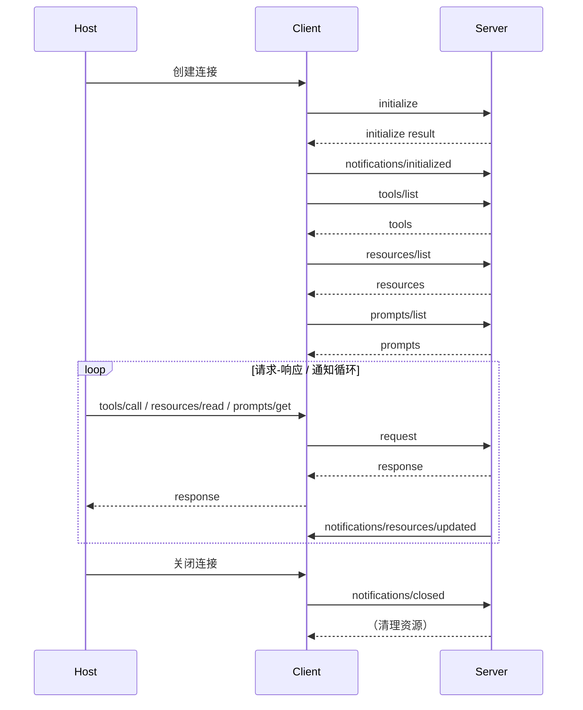
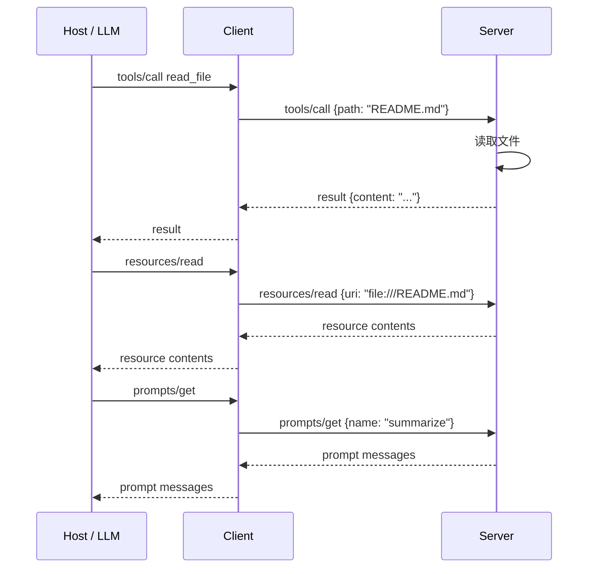
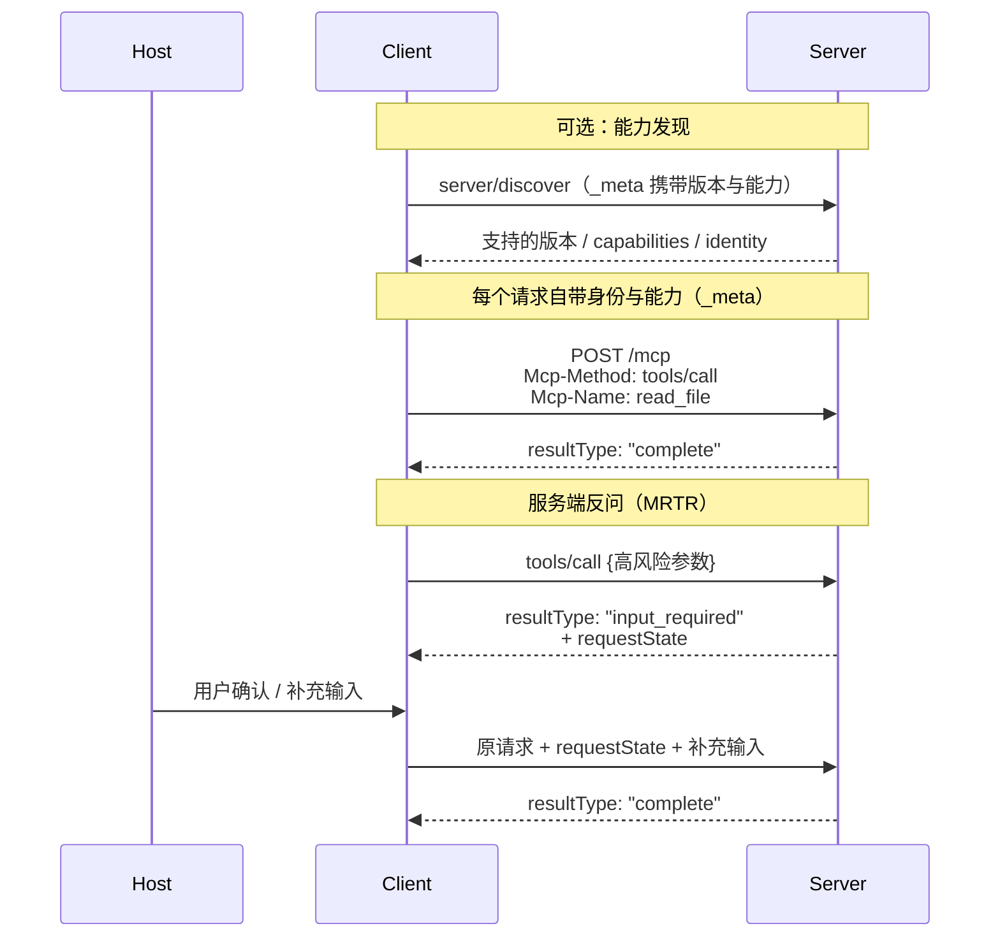

# 4. 协议工作流程

> 一句话理解：2025 时代 MCP 会话从 `initialize` 握手开始，经过能力交换、工具/资源/提示发现，最终进入请求-响应或通知循环，直到 `notifications/closed`；2026-07-28 起协议彻底无状态化，握手与会话被移除（见第 8 节）。

> 版本说明：第 1–7 节描述 2025 时代协议生命周期——它是本主题 Mini Demo 的实现基础，也是排查存量 Host 连接问题的必备知识；第 8 节描述 2026-07-28 无状态工作流程，是新部署应遵循的基线。

## 1. 连接生命周期



一个完整生命周期包含四个阶段：

1. **连接建立**：Transport 层建立通道（stdio 启动子进程、SSE/HTTP 建立连接）。
2. **初始化握手**：`initialize` → `initialize result` → `notifications/initialized`。
3. **能力发现**：`tools/list`、`resources/list`、`prompts/list` 获取可用能力。
4. **运行与关闭**：请求-响应循环 + 通知循环，最后 `notifications/closed` 清理。

## 2. initialize / initialized

`initialize` 是 MCP 会话的第一个请求，Client 发送自身支持的 protocolVersion 与 capabilities：

```json
{
  "jsonrpc": "2.0",
  "id": 1,
  "method": "initialize",
  "params": {
    "protocolVersion": "2025-06-18",
    "capabilities": {
      "roots": { "listChanged": true },
      "sampling": {}
    },
    "clientInfo": {
      "name": "ai-infra-handbook-client",
      "version": "0.1.0"
    }
  }
}
```

Server 回复自身能力：

```json
{
  "jsonrpc": "2.0",
  "id": 1,
  "result": {
    "protocolVersion": "2025-06-18",
    "capabilities": {
      "tools": { "listChanged": true },
      "resources": { "subscribe": true, "listChanged": true },
      "prompts": { "listChanged": true },
      "logging": {}
    },
    "serverInfo": {
      "name": "mini-mcp-server",
      "version": "0.1.0"
    }
  }
}
```

Client 收到 initialize result 后，必须发送 `notifications/initialized`，Server 在此之前不会处理其他请求。

```json
{
  "jsonrpc": "2.0",
  "method": "notifications/initialized"
}
```

## 3. tools/list、resources/list、prompts/list

发现阶段让 Client 知道 Server 提供哪些能力：

```json
// Client 请求
{
  "jsonrpc": "2.0",
  "id": 2,
  "method": "tools/list"
}

// Server 回复
{
  "jsonrpc": "2.0",
  "id": 2,
  "result": {
    "tools": [
      {
        "name": "read_file",
        "description": "读取本地文件内容",
        "inputSchema": {
          "type": "object",
          "properties": {
            "path": { "type": "string" }
          },
          "required": ["path"]
        }
      }
    ]
  }
}
```

`resources/list` 返回 URI、name、MIME type；`prompts/list` 返回 name、description、参数 schema。Host 通常会把这些 schema 缓存，并决定是否展示给用户/模型。

## 4. tools/call、resources/read、prompts/get

发现完成后进入调用阶段：



- **tools/call**：执行动作，可能有副作用，需要 Host 审批。
- **resources/read**：读取数据，默认只读，用于给模型提供上下文。
- **prompts/get**：获取提示模板，帮助模型/用户构造高质量输入。

`tools/call` 响应示例：

```json
{
  "jsonrpc": "2.0",
  "id": 3,
  "result": {
    "content": [
      {
        "type": "text",
        "text": "文件内容 ..."
      }
    ],
    "isError": false
  }
}
```

## 5. Notification 与 Subscription

Notification 是 MCP 的事件驱动机制。Client 不需要回复 Notification，但可以主动订阅 Resource 变更：

```json
// Client 订阅
{
  "jsonrpc": "2.0",
  "id": 4,
  "method": "resources/subscribe",
  "params": {
    "uri": "file:///project/config.json"
  }
}

// Server 后续主动推送
{
  "jsonrpc": "2.0",
  "method": "notifications/resources/updated",
  "params": {
    "uri": "file:///project/config.json"
  }
}
```

常用 Notification：

| Notification | 方向 | 含义 |
|---|---|---|
| `notifications/initialized` | C→S | Client 已完成初始化 |
| `notifications/cancelled` | C→S | 取消某个请求 |
| `notifications/progress` | 双向 | 报告长请求进度 |
| `notifications/tools/list_changed` | S→C | Tool 列表变化 |
| `notifications/resources/updated` | S→C | Resource 内容更新 |
| `notifications/resources/list_changed` | S→C | Resource 列表变化 |
| `notifications/prompts/list_changed` | S→C | Prompt 列表变化 |
| `notifications/roots/list_changed` | C→S | Roots 变化 |
| `notifications/closed` | C→S | 连接即将关闭 |

## 6. 错误码与 JSON-RPC 2.0 映射

MCP 基于 JSON-RPC 2.0，错误响应格式如下：

```json
{
  "jsonrpc": "2.0",
  "id": 3,
  "error": {
    "code": -32602,
    "message": "Invalid params",
    "data": {
      "details": "缺少必填参数 path"
    }
  }
}
```

常用错误码：

| 错误码 | 含义 | 场景 |
|---|---|---|
| `-32700` | Parse error | JSON 解析失败 |
| `-32600` | Invalid Request | 请求格式非法 |
| `-32601` | Method not found | Server 不支持该方法 |
| `-32602` | Invalid params | 参数校验失败 |
| `-32603` | Internal error | Server 内部错误 |
| `-32000` | Server error | 自定义 Server 错误 |

MCP 还定义了协议级错误码，例如：

- `InvalidRequest`：请求本身非法。
- `MethodNotFound`：方法不存在。
- `InvalidParams`：参数错误。
- `InternalError`：Server 内部错误。

生产建议：

- 不要把业务错误直接映射成 JSON-RPC error，而是放在 `tools/call` 的 `isError=true` 结果里返回，让模型自己决定下一步。
- JSON-RPC error 保留给协议级错误（连接、解析、方法不存在等）。

## 7. 关闭与清理

MCP 连接关闭时应发送 `notifications/closed`，让 Server 有机会释放资源：

```json
{
  "jsonrpc": "2.0",
  "method": "notifications/closed"
}
```

对于 stdio Server，Client 关闭 stdin/stdout 后通常应等待子进程退出；对于 SSE/HTTP Server，Client 应正常关闭连接。

关闭阶段注意：

- 未完成的长请求应通过 `notifications/cancelled` 取消。
- Server 收到 closed 后应停止执行中的任务、关闭文件句柄、释放数据库连接。
- Host 应记录会话关闭事件，用于审计与调试。

## 8. 2026-07-28 无状态工作流程（新基线）

2026-07-28 规范把工作流程压缩成“**发现（可选）→ 调用 → 完成或反问**”三步，不再有握手、不再有会话：



### 8.1 请求自带身份：_meta

无状态化后，每个请求的 `params._meta` 携带协议版本、Client 身份与能力，Server 据此决定如何响应，无需任何前置握手：

```json
{
  "jsonrpc": "2.0",
  "id": 1,
  "method": "tools/call",
  "params": {
    "_meta": {
      "protocolVersion": "2026-07-28",
      "clientInfo": { "name": "my-client", "version": "2.0.0" },
      "capabilities": { "elicitations": {} }
    },
    "name": "read_file",
    "arguments": { "path": "README.md" }
  }
}
```

配套地，Streamable HTTP 请求强制携带三个头，让网关无需解析 body 即可路由与授权：

```text
MCP-Protocol-Version: 2026-07-28
Mcp-Method: tools/call
Mcp-Name: read_file
```

其中 `Mcp-Name` 对 `tools/call`、`resources/read`、`prompts/get` 是必填的。

### 8.2 server/discover：可选的能力发现

`server/discover` 是 Server **必须实现**、Client **可以调用**的方法，返回支持的协议版本、capabilities 与 Server 身份信息。Client 可以用它在做任何调用前确认兼容性，也可以跳过直接发请求。

### 8.3 MRTR：多轮往返请求

2025 时代里 Server 反向请求 Client（Sampling、Roots、`elicitation/create`）需要保持长连接。2026-07-28 用 MRTR 取代了这一模式：

1. Server 处理 `tools/call` 时发现信息不足或需要用户批准，返回 `resultType: "input_required"`、一份说明和一个 `requestState` 令牌。
2. 双方都可以关闭连接。
3. Client（Host）收集输入后，重新发起**同一个请求**，带上 `requestState` 与补充参数。
4. Server 校验令牌后继续执行，返回 `resultType: "complete"`。

这带来两个工程红利：Server 彻底无状态（反问状态编码进令牌而不是保存在内存），且反问天然穿过网关与防火墙（只是普通重试请求）。

### 8.4 可缓存的能力目录

`tools/list`、`prompts/list`、`resources/list`、`resources/read` 的结果可以携带缓存提示，且列表按确定性顺序返回：

```json
{
  "jsonrpc": "2.0",
  "id": 2,
  "result": {
    "tools": [ ... ],
    "ttlMs": 300000,
    "cacheScope": "client"
  }
}
```

Client 与中间网关可以据此安全缓存能力目录，显著降低高频 `tools/list` 的开销。

### 8.5 两代协议的兼容窗口

- Roots、Sampling、Logging、旧 HTTP+SSE 传输进入弃用期，规范保证 **至少 12 个月**（约至 2027-07）可用。
- 动态客户端注册（DCR）计划于 2027 年夏之后移除。
- 官方 SDK（v2）支持同一端点同时服务两代客户端：2025 时代客户端走握手 + 会话路径，2026 时代客户端走无状态路径。

## 本章小结

MCP 协议工作流程经历了两代演进：2025 时代是“先握手（initialize），再发现（list），后调用（call/read/get），期间通过 Notification 处理事件与变更，最后通过 closed 安全收尾”的有状态会话模型；2026-07-28 起是“可选发现（server/discover），每个请求自带身份（_meta），调用结果区分 complete / input_required（MRTR），能力目录可缓存”的无状态模型。理解两代流程，是读懂 SDK、实现 Server、调试连接问题的基础。

**参考来源**

- [MCP Specification: Lifecycle（2025-06-18）](https://modelcontextprotocol.io/specification/2025-06-18/basic/lifecycle)
- [MCP Specification: Messages（2025-06-18）](https://modelcontextprotocol.io/specification/2025-06-18/basic/messages)
- [MCP Specification（2026-07-28）](https://modelcontextprotocol.io/specification/2026-07-28)
- [JSON-RPC 2.0 Specification](https://www.jsonrpc.org/specification)
- [MCP Specification: Errors（2025-06-18）](https://modelcontextprotocol.io/specification/2025-06-18/server/utilities/errors)
- [Cloudflare: The next generation of MCP](https://blog.cloudflare.com/mcp-v2)
