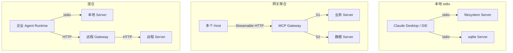
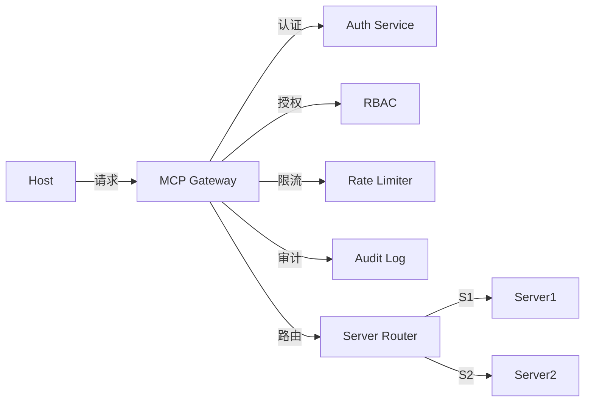
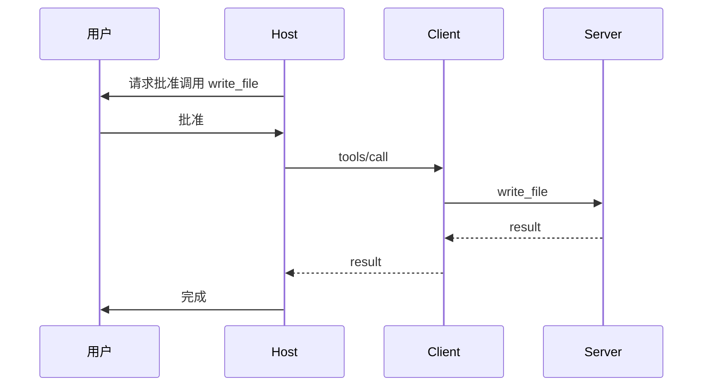

# 8. 企业生产实践

> 一句话理解：企业落地 MCP 需要 Server 注册中心、Transport 选型、认证授权、网关、限流、多租户、版本兼容、审计与可观测、供应链安全十件事协同运转。

## 1. 部署拓扑

企业 MCP 部署通常有三种形态：

选型建议：

- **本地 stdio**：适合个人开发者、本地文件/脚本工具，部署简单，权限依赖 OS。
- **网关聚合**：适合企业内多 Host 复用同一套能力，便于集中治理。
- **混合**：最贴近生产实际，本地能力 + 远程共享能力并存。

## 2. 本地 stdio vs 远程 Streamable HTTP

| 维度 | stdio | Streamable HTTP |
|---|---|---|
| 启动方式 | Host 启动子进程 | 独立服务或容器 |
| 隔离性 | 进程级 | 网络/容器级 |
| 延迟 | 低 | 中/高 |
| 部署复杂度 | 低 | 中/高 |
| 共享能力 | 仅当前 Host | 多 Host 复用 |
| 认证 | OS 用户权限 | OAuth 2.1 / API Key / mTLS |
| 状态模型 | 天然按进程隔离 | 2026-07-28 起无状态，无需会话存储 |
| 适用 | 本地工具、敏感数据 | 共享服务、SaaS 集成 |

生产建议：

- 敏感数据（本地文件、内网数据库）优先用 stdio，限定运行用户与目录。
- 共享服务（搜索、知识库、公共 API）优先用 Streamable HTTP，便于版本管理与限流。
- 旧 HTTP+SSE 双端点已弃用（2025-03-26 起标记，最早移除时间为 SEP-2596 达到 Final 后三个月，早于 Roots/Sampling 的 2027-07-28 窗口），存量应优先规划迁移到单端点 Streamable HTTP。
- 同一个 Host 可以同时连接 stdio 和远程 Server，根据数据敏感度选择 Transport。

## 3. MCP Gateway 设计

MCP Gateway 是企业落地的核心组件，职责包括：

- **认证**：验证 Host/用户身份，支持 API Key、OAuth 2.1、JWT、mTLS。
- **授权**：根据身份决定能访问哪些 Server、Tool、Resource。
- **限流**：按 Host、Server、Tool 维度限流，防止单用户打爆服务。
- **审计**：记录所有请求/响应、审批事件、错误事件。
- **路由**：2026-07-28 起可直接基于 `Mcp-Method` / `Mcp-Name` 头路由，无需解析 body。
- **协议转换**：必要时在 stdio 与 HTTP 之间做桥接，或承接 2025 时代会话客户端的兼容流量。

> **无状态化的部署红利**：2026-07-28 之后网关不再需要 sticky session 与集中会话存储，可以水平扩展任意实例；GitHub 官方 MCP Server 在迁移后甚至直接下线了 Redis 会话层。

开源参照实现：Stacklok 的 **ToolHive**（Apache-2.0，2026-10 已迭代至 v0.54）把“网关 + Registry Server + 运行时”做成一体化平台——每个 Server 跑在隔离容器中、按请求执行身份与访问策略、自带 Kubernetes Operator 与 OTel 观测，并支持语义化工具搜索以降低 token 开销；企业可以把它作为自建 MCP 网关的起点，而不是从零造轮子。

## 4. 认证授权

MCP 早期规范把授权列为可选，实践中大量远程 Server 裸奔：2025 年 7 月的互联网扫描发现 **1,862 个无需认证即可调用的公开 MCP 实例**，只有 **8.5% 的公共 Server 启用 OAuth**。2026 年安全事件密集爆发后，2026-07-28 规范把授权从附录升级为**独立成篇的规范章节**：授权整体仍为 OPTIONAL，但只要你做了远程 HTTP Server，规范就说你 **SHOULD 遵循**这套授权流程——“可选”不再是裸奔的借口。

| 层级 | 方案 | 适用场景 |
|---|---|---|
| stdio | OS 用户、环境变量、启动参数 | 本地 Server |
| Streamable HTTP | OAuth 2.1（PKCE 强制）、API Key、JWT、mTLS | 远程共享 Server |
| Gateway | 统一认证 + 细粒度 RBAC | 企业集中治理 |

远程 Server 的 OAuth 2.1 基线（2026-10 口径）：

- 规范锚定 **OAuth 2.1 IETF 草案 draft-ietf-oauth-v2-1-13** 与一组配套 RFC（6750/8414/8707/9207/9728）；**PKCE 强制开启**，state 必须与用户会话绑定——2025 年 Obsidian Security 披露的一键账号接管漏洞，根因正是远程 Server 兼任授权服务器 + 单一静态 `client_id` + 未绑定 state。
- **RFC 9207**：授权响应携带 `iss`，Client 必须校验 issuer，防授权服务器冒充。
- **RFC 8707 / RFC 9728**：令牌绑定 `resource`（Server canonical URI，配合 Protected Resource Metadata 发现），实现 audience 隔离，防 confused deputy（拿 A Server 的令牌调 B Server）。
- **客户端注册优先级**：预注册客户端 > Client ID Metadata Documents（CIMD，draft-ietf-oauth-client-id-metadata-document-00）> DCR（动态注册，RFC 7591）；DCR 最早于 2027-07-28 之后移除，企业内网不应在网关后暴露 DCR 端点。
- **机器对机器场景**走官方 **OAuth Client Credentials 扩展**（`io.modelcontextprotocol/oauth-client-credentials`），无需交互式登录；企业集中授权场景走 **Enterprise-Managed Authorization 扩展**，经企业 IdP 统一签发策略。
- **审计**：谁（用户/Agent 身份）、何时、对哪个 Server 的哪个 Tool、带了什么参数、结果如何——五要素缺一不可。

Tool/Resource 级别的授权建议：

- 给每个 Tool/Resource 打标签，例如 `read-only`、`write`、`sensitive`、`external-saas`。
- Host 在调用前检查用户/Agent 是否拥有对应标签权限。
- 写操作、删除操作、外部 API 调用默认需要二次确认或 HITL。

## 5. Tool Approval 与 HITL

高风险 Tool 必须引入人机协同（Human-in-the-Loop）：

需要 HITL 的场景：

- 写文件、删除文件、执行代码。
- 访问敏感数据库、修改配置、调用支付/转账 API。
- 首次调用某个 Server 或首次访问某个 Resource。

生产建议：

- HITL 不应阻塞整个 UI，可以异步等待用户确认。
- 审批记录应进入审计日志，包含时间、用户、Tool、参数、结果。
- 支持“本次会话允许”或“永久允许”等粒度，避免频繁打扰。

## 6. Server 版本与 Capability 演进

企业内 MCP Server 会不断迭代，需要管理版本兼容：

- **语义化版本**：Server 使用 `major.minor.patch`，capability 变更在 minor/major 中体现。
- **Capability 声明**：新 capability 默认不启用，只有协商成功才启用。
- **Schema 版本化**：Tool/Resource/Prompt 的 schema 增加 `version` 字段或命名空间。
- **灰度发布**：Gateway 按 Host/用户维度灰度路由到新版本 Server。
- **弃用通知**：Server 通过 `logging/message` 或 capability 变更通知 Client。

> **2026-07-28 变化**：规范引入正式的**生命周期管理**——特性分为 Active / Deprecated / Removed，Deprecated 最早在弃用满 12 个月后、由 Core Maintainer 在发版时决定移除。Roots、Sampling、Logging、DCR 于 2026-07-28 进入弃用期（最早移除：2027-07-28 或之后发布的第一个修订版）；HTTP+SSE 更早（2025-03-26）已弃用，窗口更短。新能力一律通过**扩展框架**发布（反向 DNS 命名、独立版本、capabilities `extensions` 字段双向声明），截至 2026-10 官方扩展已包括 MCP Apps、Tasks、OAuth Client Credentials、企业托管授权与 Skills over MCP。企业 Registry 应记录每个 Server 支持的规范版本与扩展清单。

## 7. 限流与配额

限流维度建议：

| 维度 | 示例 | 目的 |
|---|---|---|
| Host | 每个 Host 每秒 100 请求 | 防止单 Host 滥用 |
| Server | 每个 Server 每秒 1000 请求 | 保护后端服务 |
| Tool | `write_file` 每分钟 10 次 | 控制高风险操作 |
| User | 每个用户每日 10,000 tokens | 成本控制 |
| Resource | 每个 URI 每秒 1 次读取 | 防止数据刷取 |

限流策略：

- 控制面（initialize/list）与数据面（call/read）应分别限流。
- 长请求应支持 progress notification，并设置独立的并发配额。
- 超限响应应返回明确的错误信息，而不是直接断开连接。

## 8. 多租户

多租户场景下，MCP Gateway 需要隔离不同租户的数据与能力：

- **租户识别**：通过 Header、JWT claim、子域名识别租户。
- **Server 隔离**：不同租户看到不同的 Server 列表与 schema。
- **Resource 隔离**：Resource URI 中嵌入租户标识，例如 `file:///tenant-123/data/`。
- **配额隔离**：每个租户独立计算 QPS、token、存储配额。
- **审计隔离**：审计日志按租户分区存储，避免跨租户泄露。

## 9. 审计与可观测

生产级 MCP 系统必须记录：

- **Trace**：一次完整会话的调用链，包含 initialize、list、call、read、get、close。
- **Span**：每个请求的耗时、状态码、Server 名称、Tool 名称。
- **Event**：capability 变更、HITL 审批、限流触发、连接断开。
- **Metrics**：连接数、QPS、错误率、平均延迟、Tool 调用分布。
- **Logs**：结构化日志，包含 session_id、request_id、method、arguments_hash、status。

集成建议：

- Trace 使用 OpenTelemetry，span 名称使用 MCP method。
- Metrics 使用 Prometheus，标签包含 server、tool、transport、status。
- Logs 使用 JSON 格式，便于检索与聚合。

## 10. 供应链安全与工具投毒防护

2026 年是 MCP 安全的“觉醒年”：仅 2026 年就披露了 40+ 个 CVE，云安全联盟（CSA）直指 MCP 存在**系统性设计缺陷**——协议对工具投毒（tool poisoning）、rug pull、跨 Server 工具影子化没有原生防御。企业必须把供应链安全当作 MCP 落地的一等公民。

主要威胁面：

| 威胁 | 手法 | 2026 年实证 |
|---|---|---|
| **工具投毒** | 在工具描述/参数说明里注入恶意指令，模型读到后照做 | 抽样 1,899 个公共 Server，**5.5% 含有投毒描述**；基准测试中主流 Agent 对投毒攻击成功率超 60%（OWASP MCP Top 10 之 MCP03） |
| **Rug pull** | Server 获批后静默替换工具定义，不触发重新授权 | 工具定义指纹比对可检测 |
| **跨 Server 影子化** | 一个恶意 Server 伪造同名工具，劫持相邻可信 Server 的调用 | Invariant Labs 演示；CVE-2026-30856（工具命名冲突） |
| **STDIO 命令注入** | 在 Server 配置里注入任意命令，Host 启动子进程时直接执行 | 2026 年 4 月起密集爆发：CVE-2026-30623（LiteLLM）、CVE-2026-105697（LangFlow）、CVE-2026-30617 等 |
| **OAuth 实现缺陷** | state 未绑定会话、令牌跨服务重用 | Obsidian 一键接管；CVE-2026-16496（Terraform MCP 授权绕过）、CVE-2026-33032“MCPwn”（CVSS 9.8，在野利用） |
| **恶意包** | npm/PyPI 上发布同名恶意 Server | 2025-09 `postmark-mcp` 事件：外发邮件被静默 BCC 给攻击者，潜伏数周 |

纵深防御清单：

1. **把每个 MCP Server 当作不可信第三方**：来源审查、版本锁定（lockfile + `--save-exact`）、SBOM  diff。
2. **安装前扫描**：用 mcp-scan（Apache-2.0）/ Snyk Agent Scan 静态扫描 Server 包；注意扫描要在沙箱里跑——加载不可信 Server 本身就可能触发代码执行。
3. **工具定义指纹基线**：对完整工具定义（名称 + 描述 + inputSchema）做 SHA-256，每次 `tools/list` 比对，不一致即阻断并人工复核。这是防 rug pull 最可靠的手段。
4. **网关代理一切运行时流量**：assume-deny 注册、按 Agent 身份限流、SIEM 对接；Gartner 建议企业统一经 MCP 网关而非直连。
5. **凭证保险库**：签发窄权限、短时效令牌（Vault / 1Password 等），Agent 永不持有原始长期密钥。
6. **HITL 审批门**：基准数据显示引入人工审批后攻击成功率从 84% 降至 5% 以下；生产环境关闭工具自动批准。
7. **容器隔离 STDIO Server**：本地 Server 跑在无网络、只读文件系统的容器中，防止配置注入后直接拿 shell。
8. **治理框架**：参照 **OWASP MCP Top 10** 建立 MCP 治理台账——全量清点 Server、标注 owner、审批状态、权限标签、最近扫描结果。

## 本章小结

企业 MCP 生产落地不是简单地把官方 SDK 跑起来，而是需要在部署拓扑、Transport 选型、认证授权、网关、HITL、版本管理、限流、多租户、审计与可观测、供应链安全等方面做系统设计。2026-07-28 无状态规范降低了部署与扩展成本，但工具投毒、rug pull 与 STDIO 命令注入证明：协议层不替你做安全，只有把协议能力与企业治理需求结合起来，MCP 才能从“好用的本地工具”变成“可信赖的企业基础设施”。

**参考来源**

- [MCP Specification（2026-07-28）](https://modelcontextprotocol.io/specification/2026-07-28)
- [MCP Specification: Authorization（2025-06-18）](https://modelcontextprotocol.io/specification/2025-06-18/basic/authorization)
- [Cloudflare: The next generation of MCP](https://blog.cloudflare.com/mcp-v2)
- [Obsidian Security: When MCP Meets OAuth](https://www.obsidiansecurity.com/blog/when-mcp-meets-oauth-common-pitfalls-leading-to-one-click-account-takeover)
- [CSA: MCP Security Crisis — Systemic Design Flaws](https://labs.cloudsecurityalliance.org/research/csa-research-note-mcp-security-crisis-20260504-csa-styled/)
- [CSA: MCP Tool Poisoning — Adversarial Hijacking of AI Agent Workflows](https://labs.cloudsecurityalliance.org/research/csa-research-note-mcp-tool-poisoning-ai-agent-exfiltration-2/)
- [OX Security: MCP STDIO Command Injection Advisory](https://www.ox.security/blog/mcp-supply-chain-advisory-rce-vulnerabilities-across-the-ai-ecosystem/)
- [CSA: Agentic MCP Security Best Practices](https://labs.cloudsecurityalliance.org/agentic/agentic-mcp-security-best-practices-v1/)
- [MCP Python SDK](https://github.com/modelcontextprotocol/python-sdk)
- [Claude Code MCP Docs](https://docs.anthropic.com/en/docs/claude-code/mcp)
