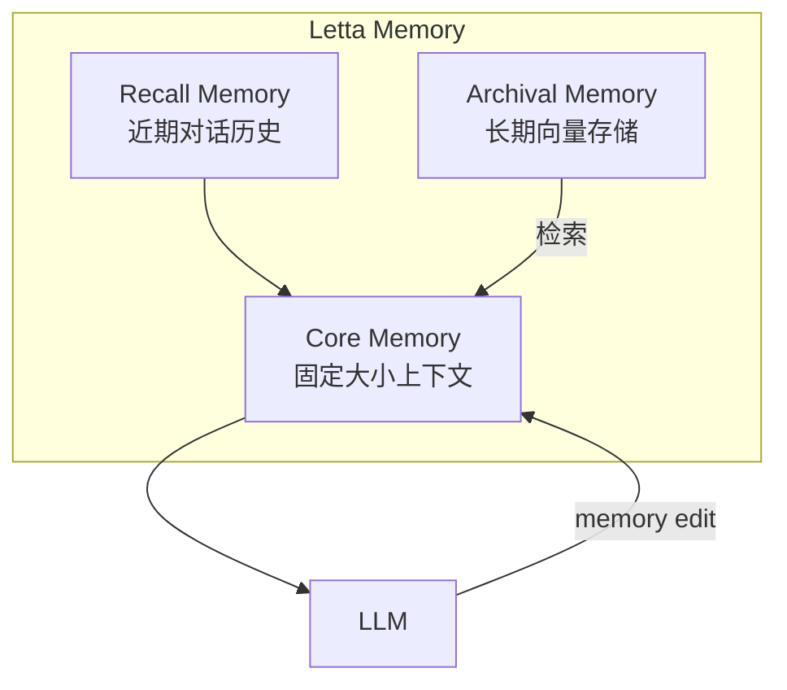
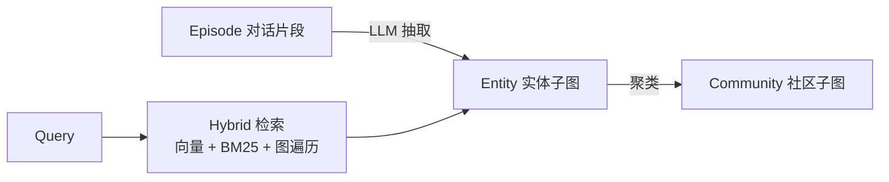

# 6. 源码分析

> 一句话理解：**现代 Agent Memory 的源码核心可以概括为“分层记忆抽象 + 统一存储接口 + 面向 Runtime 的 recall/remember 契约”；本节以 Letta（MemGPT）、Mem0、Zep/Graphiti、MemOS、LangGraph、OpenAI Agents SDK Sessions 为主，结合主流向量数据库，说明关键代码组织与扩展点**。

## 分析对象选择

| 项目 | 仓库/文档 | 定位 | 分析重点 |
|---|---|---|---|
| **Letta（原 MemGPT）** | [docs.letta.com](https://docs.letta.com) / [github.com/letta-ai/letta](https://github.com/letta-ai/letta) | 面向 Agent 的分层记忆系统与有状态 Agent Runtime | core / recall / archival memory、memory 编辑、sleep-time compute |
| **Mem0** | [docs.mem0.ai](https://docs.mem0.ai) / [github.com/mem0ai/mem0](https://github.com/mem0ai/mem0) | 面向 AI 助手的记忆中间件 | user/session/memory 抽象、四操作事实更新、混合存储 |
| **Zep / Graphiti** | [github.com/getzep/graphiti](https://github.com/getzep/graphiti) | 时序知识图谱记忆引擎 | 双时序图谱、episode/entity/community 三层子图、混合检索 |
| **MemOS（MemTensor）** | [github.com/MemTensor/MemOS](https://github.com/MemTensor/MemOS) | “记忆操作系统” | MemCube 抽象、三层 OS 式架构、记忆调度与生命周期 |
| **LangGraph Persistence / Store** | [docs.langchain.com/oss/python/langgraph/persistence](https://docs.langchain.com/oss/python/langgraph/persistence) / [add-memory](https://docs.langchain.com/oss/python/langgraph/add-memory) | 生产级状态与记忆持久化 | checkpoint、store、cross-thread memory |
| **OpenAI Agents SDK Sessions** | [openai.github.io/openai-agents-python/sessions/](https://openai.github.io/openai-agents-python/sessions/) | OpenAI 生态会话管理 | session state、memory、handoffs |
| **Chroma / Weaviate / Milvus / pgvector** | 各官方文档 | 向量数据库 | 索引、过滤、扩展性、运维 |

> 注：开源项目迭代较快，本节基于 2026 年 10 月前后的主流分支与公开资料进行分析，具体类名与 API 可能随版本微调。

## Letta（原 MemGPT）

Letta 是 Agent Memory 领域最具代表性的开源项目之一，其前身 MemGPT 论文首次系统地把 OS 中的虚拟内存思想引入 LLM Agent。

### 核心抽象

Letta 把 Agent 记忆分为三层：



| 类型 | 说明 | 特点 |
|---|---|---|
| **Core Memory** | 固定 token 预算的记忆区，直接拼进 prompt | 可编辑、分 `human` / `persona` 区 |
| **Recall Memory** | 当前会话的完整 messages | 按时间顺序，超出部分归档 |
| **Archival Memory** | 长期向量存储 | embedding + 检索 |

### Memory 编辑机制

Letta 的一个重要设计是把记忆管理也暴露为工具：

```python
# 概念伪代码
functions.core_memory_append:0{"section": "human", "content": "用户喜欢 Markdown 格式"}
functions.archival_memory_insert:1{"content": "项目 Phoenix 使用 Python 3.11"}
functions.conversation_search:2{"query": "上次的周报模板"}
```

这样，Agent 可以主动决定：

- 什么信息值得写入 core memory。
- 什么信息应该归档到 archival memory。
- 什么时候从 archive 中搜索。

### Sleep-time Compute：后台记忆整理

2025 年 4 月，Letta（与 UC Berkeley）发表 *Sleep-time Compute*（arXiv:2504.13171），核心思想是：让 Agent 在“睡眠”（空闲）时用后台 LLM 调用预处理和整理记忆，可以把测试时（请求路径）的计算量降低约 5 倍，且随睡眠时算力增加，有状态推理任务的准确率反而提升。随后 Letta 将其产品化：

```text
┌─────────────────┐      空闲时        ┌──────────────────┐
│  primary agent  │ ◄────────────────► │ sleep-time agent │
│  （服务用户请求） │   读写 core/archive │ （后台整理记忆）  │
└─────────────────┘                    └──────────────────┘
```

sleep-time agent 会扫描对话历史，把重要信息提升（promote）到 core memory、把过期信息降级（demote）到 archival memory，相当于把“记忆整理”从请求路径挪到了离线路径。这成为 Letta 后续版本记忆架构的默认组成部分。

### 2025–2026 架构演进

Letta 在 2025–2026 年迭代非常快，记忆相关的重要变化包括：

- **letta_v1_agent**：2026 年初的新默认 Agent 架构，原生支持 Responses API 风格的推理，适配 GPT-5 / Claude 4.5 Sonnet 等主流模型；ADE（Agent Development Environment）创建的 Agent 默认使用该架构。
- **ADE（Agent Development Environment）**：Web 端的 Agent 开发环境，可在浏览器中查看和编辑 Agent 的 core memory、消息历史与工具调用，是调试记忆行为的利器。
- **Letta Code（2025 年 12 月）**：记忆优先的编码 Agent，把“跨会话记住项目上下文”作为核心卖点。
- **架构精简与迁移**：letta_v1_agent 废弃了早期 MemGPT 时代的 send_message 工具、heartbeats、prompted reasoning tokens 等遗留设计；2026 年 Letta 进一步把部分服务端能力（模板、identities、服务端 MCP 等）迁移为客户端的 context repository（MemFS）、skills 与 subagents 体系，细节见其官方博客 *Letta's Next Phase*。

### 优点与局限

| 优点 | 局限 |
|---|---|
| 显式分层，概念清晰 | 自托管部署相对复杂 |
| Agent 可主动管理记忆 | 需要模型具备较强的 memory edit 能力 |
| sleep-time compute 把记忆整理移出请求路径 | 深度绑定 Letta 自身的 Agent Runtime，不是即插即用的记忆 SDK |
| ADE 提供可视化的记忆调试能力 | 架构迭代快，版本间 API 变动较大 |
| 有深厚学术研究背景 | 与外部 Runtime 集成需要适配 |

## LangGraph Persistence / Store

LangGraph 是生产级 Agent Runtime，其 Persistence 与 Store 机制也代表了 Memory 的一种工程化实现。

### Checkpoint：状态持久化

LangGraph 的 `checkpoint` 把每次图执行的状态保存下来：

```python
from langgraph.checkpoint.memory import MemorySaver
from langgraph.graph import StateGraph

graph = StateGraph(State)
# ... 添加节点与边 ...
app = graph.compile(checkpointer=MemorySaver())

config = {"configurable": {"thread_id": "session-1"}}
app.invoke({"messages": [user_message]}, config=config)
```

Checkpoint 保存的内容包括：

- 图的完整 State。
- 所有消息历史。
- 当前节点位置。
- 中断/恢复所需信息。

这意味着 LangGraph 的 checkpoint 本身就承担了“工作记忆 + 短期记忆 + 可恢复状态”的角色。

### Store：跨会话长期记忆

LangGraph 的 `Store` 提供了跨 thread/session 的长期记忆能力：

```python
from langgraph.store.memory import InMemoryStore

store = InMemoryStore()
store.put(("user", "alice"), "preferences", {"theme": "dark", "language": "zh"})
value = store.get(("user", "alice"), "preferences")
```

Store 的特点：

- 按 namespace 组织，例如 `("user", "alice")`。
- 支持向量搜索（配合 embedding）。
- 可被多个 thread 共享，实现跨会话记忆。

### 优点与局限

| 优点 | 局限 |
|---|---|
| 与图执行深度集成 | 学习曲线较陡 |
| checkpoint 支持断点续跑 | 默认 memory store 不适合大规模生产 |
| store 支持跨会话记忆 | 需要自行选择 Postgres/Redis 等外部后端 |

## OpenAI Agents SDK Sessions

OpenAI Agents SDK 的 Sessions 机制代表了厂商生态中的记忆方案。

### 核心抽象

```python
from agents import Agent, Runner

agent = Agent(name="Assistant", instructions="你是一个 helpful 助手。")
result = await Runner.run(agent, "你好", session_id="session-1")
```

Sessions 负责：

- 维护当前会话的 messages。
- 在多次 `Runner.run` 调用之间保持上下文。
- 支持状态、记忆与 handoffs。

### 与 Memory 的关系

OpenAI Agents SDK 的 Sessions 更偏向“工作记忆 + 短期记忆”，长期记忆通常需要开发者自己集成外部 store。SDK 提供的 `memory` 扩展点允许开发者插入自定义记忆后端。

### 优点与局限

| 优点 | 局限 |
|---|---|
| 与 OpenAI 模型生态无缝集成 | 深度绑定 OpenAI |
| API 极简，快速落地 | 长期记忆能力不如 Letta/LangGraph 显式 |
| session 管理开箱即用 | 多租户、审计、隐私需要自行实现 |

## Mem0

Mem0 是记忆中间件（memory middleware）路线的代表：对上层 Agent 透明，LLM 管道自动把对话蒸馏成事实与偏好。

### 核心抽象

```python
from mem0 import Memory

m = Memory()

# 添加记忆
result = m.add("我喜欢简洁的 Markdown 周报", user_id="alice")

# 检索记忆
memories = m.search("周报格式", user_id="alice")
```

Mem0 的核心抽象包括：

- **User**：记忆归属的用户。
- **Session**：一次交互会话。
- **Memory**：一条记忆记录，包含文本、metadata、embedding。

### 设计特点

1. **以用户为中心**：所有记忆都围绕 `user_id` 组织，天然适合个性化助手。
2. **四操作事实更新**：写入时 LLM 判定每条新事实对现有记忆执行 ADD / UPDATE / DELETE / NOOP，而不是无脑追加——这解决了记忆库无限膨胀与事实矛盾的两大痛点。
3. **多层级混合存储**：向量库 + 知识图谱 + KV，覆盖 user / session / agent 多个作用域；mem0g 变体在向量层上叠加 Neo4j 图谱，利用实体关系换取少量准确率提升。
4. **云端与本地**：提供托管云服务（Mem0 Platform）和可自托管的开源版本（Apache 2.0，GitHub 星数约 5 万，是该路线最受欢迎的开源项目）。

### 2026 年的重要更新

- **Token-efficient memory algorithm（2026 年 4 月）**：单遍分层抽取 + 多信号检索，官方报告 LoCoMo 从 71.4 提升到 92.5、LongMemEval 从 67.8 提升到 94.4，且每次查询仅注入约 6.9K token（全量上下文方案往往需要 25K+）。开源 SDK 同步支持。
- **成为 AWS Agent SDK 的独家记忆提供方**：标志着记忆中间件路线进入主流云厂商的默认技术栈。
- **基准争议**：2025 年 Zep 曾公开质疑 Mem0 在 LoCoMo 上的评测配置；厂商自报基准分数普遍应谨慎对待，选型时应自行做 bake-off。

### 优点与局限

| 优点 | 局限 |
|---|---|
| API 非常简洁，接入成本最低 | 复杂企业级场景需要扩展 |
| 用户-centric 设计 | 记忆编辑逻辑黑盒，可控性不如 Letta |
| 自动事实提取 + 冲突消解算子 | 提取质量依赖模型，存在幻觉入记忆风险 |
| 与云平台深度集成 | 与 LangGraph 等 Runtime 集成需要适配 |

## Zep / Graphiti：时序知识图谱记忆

Zep 是时序知识图谱路线的代表。2025 年 4 月 Zep 宣布停用旧的 Zep Community Edition，把开源重心转移到 Graphiti（Apache-2.0，GitHub 约 2.4 万星），自身转为商业化的 Zep Cloud（SOC 2 Type II、HIPAA 合规、BYOC 部署）。

### 核心抽象：双时序知识图谱

Graphiti 维护一张**双时序（bi-temporal）知识图谱**，论文（[Rasmussen et al., 2025, arXiv:2501.13956](https://arxiv.org/abs/2501.13956)）报告了三个关键设计：

- **Episode 子图**：原始对话片段作为 episode 节点入图，是写入的入口。
- **Entity 子图**：LLM 从 episode 中抽取实体与关系，过时的事实被“失效”（invalidation，打上失效时间戳）而不是删除。
- **Community 子图**：实体聚合成社区，支持宏观主题导航。



双时序模型的价值在于：**“用户以前住在北京”这类历史事实不会因新事实写入而丢失**，检索时可以区分“当前为真”与“历史上为真”。Graphiti 官方报告的指标：Deep Memory Retrieval 94.8%（对比 MemGPT 93.4%）、LongMemEval 提升 18.5%、相对全量上下文延迟降低约 90%（115K token 压缩到约 1.6K token），且查询路径无需调用 LLM。

### 工程要点

- **写入重、查询轻**：写入路径包含 LLM 实体/关系抽取，延迟和成本集中在写侧；检索是“向量 + BM25 + 图遍历”的纯计算过程。
- **MCP Server**：Graphiti 提供一等公民 MCP Server（2025 年 Q1 发布 1.0），Cursor 等 MCP 客户端可以直接挂载持久记忆；这也是 Thoughtworks 技术雷达在 2026 年 4 月把 Graphiti 从“评估”上调为“试验”的因素之一（同时提示了写入 LLM 成本和 pre-1.0 版本需要锁定依赖）。
- **多图后端**：Neo4j、FalkorDB、Kuzu、Amazon Neptune。

### 优点与局限

| 优点 | 局限 |
|---|---|
| 时序推理与事实演进表达力最强 | 写入路径依赖 LLM 抽取，写入成本高 |
| 更新不丢历史，审计友好 | 自托管需额外维护图数据库 |
| 查询路径无 LLM，延迟稳定 | 对一次性简单偏好记忆偏重 |
| MCP 原生，Agent 框架无关 | 版本尚未 1.0，API 可能有变动 |

## MemOS（MemTensor）：记忆操作系统

MemOS（arXiv:2505.22101，上海交通大学等机构）代表了“把记忆提升为第一类操作系统资源”的探索方向。

### 核心抽象：MemCube

MemOS 把三类记忆统一封装为 **MemCube**：

- **参数记忆（parametric）**：模型权重本身。
- **激活记忆（activation）**：瞬时的上下文状态。
- **明文记忆（plaintext）**：外部知识、用户偏好、任务经验等，即传统 Memory 系统处理的部分。

### 三层 OS 式架构

| 层级 | 组件 | 职责 |
|---|---|---|
| **Interface 层** | Memory API、MemReader、pipeline | 对上层暴露统一的记忆读写接口 |
| **Operation 层** | MemScheduler、MemLifecycle、MemOperator | 记忆动态选择（调度）、版本控制（生命周期）、结构化加工 |
| **Infrastructure 层** | MemVault、MemGovernance、MemStore、MemLoader/MemDumper | 存储、合规治理、跨 Agent 共享、跨平台迁移 |

GitHub 上的 MemOS 2.0（TypeScript 实现）提供统一 CRUD 记忆 API、可检查（非黑盒）的图结构记忆、多模态记忆（文本、图片、工具 trace、persona）、异步摄入，支持 Neo4j + Qdrant 或本地 SQLite 部署，官方宣称可节省约 35% 的 token 消耗。

### 优点与局限

| 优点 | 局限 |
|---|---|
| 统一抽象覆盖三类记忆，视野完整 | 学术项目，生产验证相对少 |
| 调度 + 生命周期 + 治理的完整 OS 式分层 | 参数记忆/激活记忆的纳管在通用场景落地困难 |
| 图结构记忆可检查、可审计 | 基准 claim 多基于小模型测试 |

## 向量数据库对比

Agent Memory 的长期语义记忆和情景记忆通常依赖向量数据库。以下是四款主流向量数据库的对比。

### Chroma

Chroma 是一个面向开发者的轻量向量数据库，强调易用性。

特点：

- 本地/内存/服务端多种模式。
- Python-first API，学习成本低。
- 支持 metadata 过滤与 embedding 自动计算。

适用：原型、中小型应用、本地 Demo。

### Weaviate

Weaviate 是一个云原生向量数据库，支持 GraphQL 与 REST 接口。

特点：

- 内置模块化 pipeline（embedding、rerank、生成）。
- 支持 hybrid search。
- 强调多模态与知识图谱集成。

适用：需要 hybrid search 和模块化能力的生产系统。

### Milvus / Zilliz Cloud

Milvus 是面向大规模向量检索的数据库，Zilliz Cloud 是其托管版本。

特点：

- 支持十亿级向量。
- 多种索引类型（HNSW、IVF_FLAT、DISKANN 等）。
- 分布式架构，云原生设计。

适用：大规模、高并发、需要水平扩展的场景。

### pgvector

pgvector 是 PostgreSQL 的向量扩展，把向量检索能力带入关系型数据库。

特点：

- 与 Postgres 事务、权限、生态完全兼容。
- 支持 HNSW、IVF 索引。
- 适合已有 Postgres 基础设施的团队。

适用：需要强一致性、关系型元数据与向量检索共存的场景。

### 向量数据库能力矩阵

| 维度 | Chroma | Weaviate | Milvus | pgvector |
|---|---|---|---|---|
| 部署模式 | 本地/服务端/云 | 自托管/云 | 自托管/云 | Postgres 扩展 |
| 索引类型 | HNSW | HNSW、BM25 | HNSW、IVF、DISKANN 等 | HNSW、IVF |
| Hybrid Search | 支持 | 原生支持 | 支持 | 需配合全文检索 |
| 扩展性 | 中小规模 | 大规模 | 超大规模 | 依赖 Postgres 扩展 |
| 学习曲线 | 低 | 中 | 中高 | 低（会 Postgres） |
| 最佳场景 | 原型/Demo | 模块化生产 | 大规模向量检索 | 已有 Postgres 的团队 |

## 共同模式总结

| 能力 | Letta | Mem0 | Zep/Graphiti | LangGraph | OpenAI SDK |
|---|---|---|---|---|---|
| 核心抽象 | Core / Recall / Archival | User / Session / Memory + 四操作 | 双时序知识图谱 | Checkpoint / Store | Session |
| 设计哲学 | Agent 主动管理 + 后台整理 | 自动抽取中间件 | 时序图谱平台 | Runtime 深度集成 | 会话管理 |
| 状态持久化 | 强 | 中 | 强 | 极强 | 中 |
| 长期记忆 | 显式 archival memory | 原生支持 | 原生支持（图谱） | Store + 向量 | 需扩展 |
| 跨会话记忆 | 支持 | 支持 | 支持 | Store | 需扩展 |
| Agent 主动管理记忆 | 是 | 否（自动抽取） | 否（自动建图） | 可扩展 | 可扩展 |
| 时序推理 | 弱 | 弱 | 强（一等公民） | 弱 | 弱 |
| 接入方式 | Letta Runtime 或 ADE | SDK / API / MCP | MCP Server / SDK | Python 库 | OpenAI SDK |
| 最佳场景 | 长时运行的有状态 Agent | 个性化助手快速落地 | 事实演进、企业治理 | 生产级工作流 | OpenAI 快速落地 |

## 本章小结

Letta（MemGPT）把 OS 虚拟内存思想引入 Agent，提出 Core / Recall / Archival 三层记忆，Agent 主动编辑记忆，并在 2025 年后用 sleep-time compute 把记忆整理移出请求路径；Mem0 走自动抽取中间件路线，以 ADD/UPDATE/DELETE/NOOP 四操作解决记忆冲突，2026 年凭借 token-efficient 算法与 AWS Agent SDK 集成成为个性化记忆的事实标杆之一；Zep/Graphiti 以双时序知识图谱为核心，把“事实何时为真”做成一等公民，并通过 MCP Server 成为 Agent 框架无关的记忆服务；MemOS 则探索了“记忆操作系统”的统一抽象。LangGraph 通过 Checkpoint 与 Store 把状态持久化和跨会话记忆深度集成到图执行中；OpenAI Agents SDK Sessions 提供开箱即用的会话管理，但长期记忆需要自行扩展。向量数据库方面，Chroma 适合原型，Weaviate 适合模块化生产，Milvus 适合大规模，pgvector 适合已有 Postgres 的团队。选型时应认识到三条路线（Agent 管理型 / 中间件型 / 时序图谱型）的哲学差异，并结合厂商基准争议保持独立验证。

**参考来源**

- [Letta Documentation](https://docs.letta.com)
- [Letta GitHub](https://github.com/letta-ai/letta)
- [Letta — Sleep-time Compute 论文（arXiv:2504.13171）](https://arxiv.org/abs/2504.13171)
- [Letta — Sleep-time Compute 产品博客](https://www.letta.com/blog/sleep-time-compute/)
- [Letta — Our Next Phase](https://www.letta.com/blog/our-next-phase/)
- [Mem0 GitHub](https://github.com/mem0ai/mem0)
- [Mem0 Documentation](https://docs.mem0.ai)
- [Mem0 Blog — State of AI Agent Memory 2026](https://mem0.ai/blog/state-of-ai-agent-memory-2026)
- [Graphiti GitHub（Zep 开源引擎）](https://github.com/getzep/graphiti)
- [Thoughtworks Technology Radar — Graphiti](https://www.thoughtworks.com/en-gb/radar/platforms/graphiti)
- [MemOS GitHub（MemTensor）](https://github.com/MemTensor/MemOS)
- [MemOS 论文（arXiv:2505.22101）](https://arxiv.org/abs/2505.22101)
- [LangGraph Persistence](https://docs.langchain.com/oss/python/langgraph/persistence)
- [LangGraph Add Memory](https://docs.langchain.com/oss/python/langgraph/add-memory)
- [OpenAI Agents SDK Sessions](https://openai.github.io/openai-agents-python/sessions/)
- [Chroma Documentation](https://docs.trychroma.com)
- [Weaviate Documentation](https://weaviate.io/developers/weaviate)
- [Milvus Documentation](https://milvus.io/docs)
- [pgvector GitHub](https://github.com/pgvector/pgvector)
- [MemGPT Paper](https://arxiv.org/abs/2310.08560)
- [Steve Kinney — Agent Memory Systems](https://stevekinney.com/writing/agent-memory-systems)
