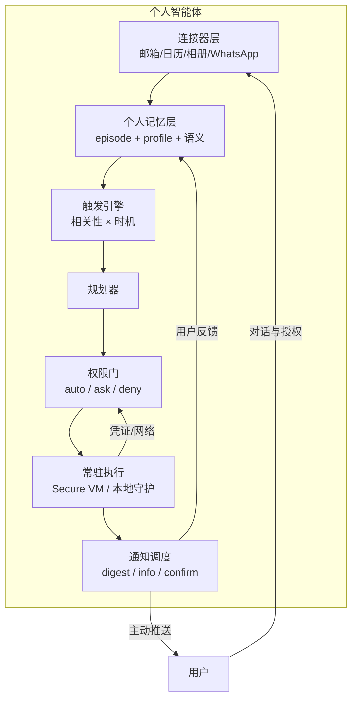

# 核心思想：个人智能体的六个设计公理

> 一句话理解：**个人智能体 = 个人数据连接器 × 个人记忆层 × 主动性 × 常驻执行 × 权限信任模型 × 注意力经济学**；六个要素缺一个，产品就会退化成"会记住几件事的聊天机器人"。

本章把 2026 年各家产品的设计拆解成六条公理。它们彼此咬合：没有连接器，记忆就是无源之水；没有权限门，主动性就是灾难；没有通知模型，主动性再好用户也感知不到。

## 公理一：以"一个人的完整数字生活"为数据域

通用 Agent 的数据域是"任务"，个人智能体的数据域是"人生"。两者差别巨大：

| 维度 | 通用/企业 Agent | 个人智能体 |
|---|---|---|
| 数据来源 | 企业系统、API、数据库 | 邮箱、日历、相册、聊天记录、健康数据、浏览历史、支付记录 |
| 数据质量 | 结构化、干净 | 半结构化、噪声大、隐私敏感 |
| 数据时效 | 以季度为单位的报表 | 分钟级：航班改签邮件、老板的微信、家人的位置 |
| 授权方式 | 企业级 Service Account | 逐用户 OAuth，细粒度 scope，随时可撤 |

Google Personal Intelligence 是这一公理的极端诠释：它默认从你的 Gmail、日历、文档与**全部历史对话**中学习；Gemini Live 在 2026 年 6 月起能直接访问这些记忆做语音个性化应答。Muse 则走"连接器外交"路线：原生接入 WhatsApp，并对接 Google Workspace、Ticketmaster、Spotify、Apple Health 等第三方服务。

来源：[How Gemini Memory Works（2026）](https://blog.memoryplugin.com/how-gemini-memory-works/)、[Gemini Live can now access your past chats Memory（9to5Google，2026-06-18）](https://9to5google.com/2026/06/18/gemini-live-memory/)、[Official Muse Breakdown（Vellum）](https://www.vellum.ai/blog/official-muse-breakdown)

## 公理二：记忆分层——episode、profile、语义知识

"记得你"不是一个功能，是一组存储系统的组合。综合 Mem0 的 PASK 三层模型与 2026 年学术界的工作（VitaBench 2.0、User as Code），成熟的个人记忆层至少分三层：

1. **Episode（情景记忆）**：带时间戳的事件流。"2026-10-14 你说周末去了杭州，在西湖边的咖啡馆工作了一下午。"——可检索、可回放、可按天聚合。
2. **Profile（用户画像）**：从 episode 中蒸馏出的事实，带出处链。"咖啡偏好 = 燕麦拿铁（来自 ep3）"。画像必须可解释、可编辑、可删除——这是"记忆主权"的底线。
3. **Semantic（语义知识）**：与个人无关的通用知识，走常规 RAG（参见 [RAG 主题](/06-rag/01-background)）。

关键洞察：**profile 不是 episode 的简单缓存，而是"对用户的在线建模"**。2026 年的研究（Beyond Static Summarization, arXiv:2601.04463）指出，好的记忆系统应该主动提取（proactive extraction）而不是被动记录；User as Code（arXiv:2606.16707）则尝试把用户画像编译成可执行代码，让 Agent 能"程序化地推理你是谁"。

来源：[Proactive Memory in AI Agents（Mem0）](https://mem0.ai/library/agent-memory/proactive-memory)、[Beyond Static Summarization（arXiv:2601.04463）](https://arxiv.org/pdf/2601.04463)、[User as Code（arXiv:2606.16707）](https://arxiv.org/pdf/2607.20972)

## 公理三：主动性——从 pull 到 push

传统助手是 pull 模式：用户来问，系统才答。个人智能体的本质是 **push 模式**：系统持续感知、判断"这件事值不值得打扰用户"，然后主动出手。这引入了一个全新的组件——**相关性/触发引擎**（Trigger Engine），它要回答三个问题：

- **该不该动？**（relevance）：老板邮件 +5 分，营销邮件 -∞。Muse 的做法是相关性判断 + 敏感性分级；评测研究则称之为 proactivity gap——多数 Agent"记得很多，却从不在对的时机主动用"（Ask Now, Use Later；π-Bench）。
- **该不该现在动？**（timing）：用户在开会时推送"你的外卖到了"是打扰，散会后推送是体贴。通知调度要结合日历状态、勿扰模式与时区。
- **该怎么动？**（actionability）：主动性的输出分三档——只做不说（默默把会议纪要归档）、说完就做（"我发现日程冲突，已帮你改到周六"）、先问再做（高风险动作必须确认）。

来源：[Personal AI Agents at Work（Sentra，2026）](https://www.sentra.app/articles/personal-ai-agents-at-work)、[VitaBench 2.0（arXiv:2605.27141）](https://arxiv.org/html/2605.27141v1)

## 公理四：常驻执行——Agent 有自己的"住处"

个人智能体必须能在用户不在场时工作，因此它需要一个**持续运行的执行环境**。2026 年形成了三种形态：

1. **Per-user 云 VM（Muse / Dots）**：每个用户一台独立虚拟机（Muse Secure VM：Linux + 完整 Chromium + Debian 容器 + 本地存储），应用关闭后任务继续跑，到里程碑或需要确认时再推送。
2. **Per-user 本地常驻进程（OpenClaw）**：跑在你自己的硬件上，Node.js Gateway 守护进程 + heartbeat 定时调度 + Markdown/SQLite 本地记忆，通过消息软件（WhatsApp/Telegram/iMessage……20–50+ 渠道）与你交互。
3. **OS 级集成（Apple / Google）**：不下发 VM，而是把 Agent 能力织入操作系统——Siri AI 基于端侧 AFM + Private Cloud Compute，跨 App 执行任务，对话历史经 iCloud 同步。

三种形态对应三种信任假设：云 VM 信任厂商的运维操守（Muse 正在筹备"用户自持密钥的 Confidential VM"对冲这一点）；本地进程信任你自己的安全能力（OpenClaw 因此爆出了 CVE-2026-25253 与恶意技能事件）；OS 集成信任平台厂商的隐私架构。

来源：[Official Muse Breakdown（Vellum）](https://www.vellum.ai/blog/official-muse-breakdown)、[What Is OpenClaw?（TechJack Solutions）](https://techjacksolutions.com/ai-tools/openclaw/what-is-openclaw/)、[Apple Siri AI 2026: 12 Confirmed Facts（Tokenmix）](https://tokenmix.ai/blog/apple-siri-ai-wwdc-2026)

## 公理五：权限与信任——每次副作用都要过门

个人智能体能做的事越有用，能造成的伤害越大（发错邮件、下错单、泄露隐私）。2026 年产品的共同答案是：**把权限门做成执行管道的一部分，而不是产品设置里的一页开关**。

- **Muse**：Sentinel 作为宿主机侧的唯一网络出口与连接器守门人；eBPF 内核级"污染追踪"——一旦被判定为 tainted 的 Agent 进程会失去自主联网权限；凭证存放在独立守护进程 authd 中，模型只见"代理凭证"（surrogate credentials）不见明文；发邮件、高风险表单、金融交易强制人工确认；支付走 Stripe Link 单次虚拟卡。Meta 还挂出 30 万美元漏洞赏金。
- **Dots**：用户可给主 Dot 命名、设定规则与权限（含"某些动作前必须确认"），企业侧接入 Microsoft Agent 365 治理。
- **Apple**：端侧处理 + Private Cloud Compute，数据不出生态是架构级承诺而非策略承诺。
- **OpenClaw 的教训**：技能市场 ClawHub 被 Koi Security 审计出 341 个恶意技能，CVE-2026-25253 CVSS 8.8——开源生态的权限门靠社区，而社区会被投毒。

来源：[Official Muse Breakdown（Vellum）](https://www.vellum.ai/blog/official-muse-breakdown)、[OpenAI DevDay 2026: Dots（Teamday）](https://www.teamday.ai/ai/openai-devday-2026-dots-always-on-agents)、[OpenClaw Ecosystem 2026（Presenc）](https://presenc.ai/research/openclaw-ecosystem-2026)

### 三态权限模型

把各家实践收敛成一个最小模型，每个动作类型落在三态之一：

| 态 | 语义 | 例子 |
|---|---|---|
| auto（自动） | 只读或零副作用，直接执行 | 读邮件、查日历、检索记忆 |
| ask（需确认） | 有外部副作用，先问再做 | 发邮件、建日程、提交表单 |
| deny（拒绝） | 超出能力边界，任何情况下不做 | 直接支付、删除数据、绕过确认 |

本主题的 [Mini Demo](07-mini-demo) 就实现了这个三态门。

## 公理六：注意力经济学——通知即产品

个人智能体最大的产品风险不是"不够聪明"，而是"太爱表现"。每一屏主动推送都在向用户征收注意力税，税重了用户就会关掉通知——然后整个主动性闭环报废。设计要点：

- **分级投递**： digest（每日摘要，低打扰）→ info（重要事件，立即推送）→ confirm（等待人工确认，必须可达）。
- **可解释**：每条主动通知都应附带"我为什么知道这件事"（Muse 的记忆展示、Claude memory 的 Topics 视图都在做这件事）。
- **可纠错**：一键"别再提醒我这类事"应同时反馈给相关性引擎与记忆系统（"忘记这件事"）。

Google 在这方面最为保守：Personal Intelligence 对工作/学校账户、EEA/UK/瑞士/尼日利亚以及 18 岁以下用户默认不开放——主动个性化在欧洲监管环境下被刻意收敛。

来源：[How Gemini Memory Works（2026）](https://blog.memoryplugin.com/how-gemini-memory-works/)、[Claude Memory: What It Stores & How to Delete It（2026）](https://lumichats.com/blog/claude-memory-2026-complete-guide-how-to-use)

## 六公理之间的关系

连接器喂记忆，记忆驱动触发，触发经规划到权限门，门后执行，执行结果通知用户，用户反馈再写回记忆——这就是个人智能体的完整飞轮。

## 本章小结

- 个人智能体的数据域是"一个人的完整数字生活"，授权是逐用户、可撤销的。
- 记忆必须分层：episode（可回放）+ profile（可编辑、带出处）+ 语义知识。
- 主动性需要触发引擎回答"该不该动、何时动、怎么动"，proactivity gap 是当前最大能力缺口。
- 常驻执行有云 VM、本地守护、OS 集成三种形态，对应三种信任假设。
- 权限门必须内置于执行管道：auto/ask/deny 三态 + 凭证代理 + 污染追踪。
- 通知是产品而非附属功能，分级投递、可解释、可纠错是底线。

**参考来源**
- [Official Muse Breakdown（Vellum）](https://www.vellum.ai/blog/official-muse-breakdown)
- [How Gemini Memory Works in 2026](https://blog.memoryplugin.com/how-gemini-memory-works/)
- [Proactive Memory in AI Agents（Mem0）](https://mem0.ai/library/agent-memory/proactive-memory)
- [Personal AI Agents at Work（Sentra）](https://www.sentra.app/articles/personal-ai-agents-at-work)
- [What Is OpenClaw?（TechJack Solutions）](https://techjacksolutions.com/ai-tools/openclaw/what-is-openclaw/)
- [OpenClaw Ecosystem 2026（Presenc）](https://presenc.ai/research/openclaw-ecosystem-2026)
- [Claude Memory 2026 完全指南](https://lumichats.com/blog/claude-memory-2026-complete-guide-how-to-use)
