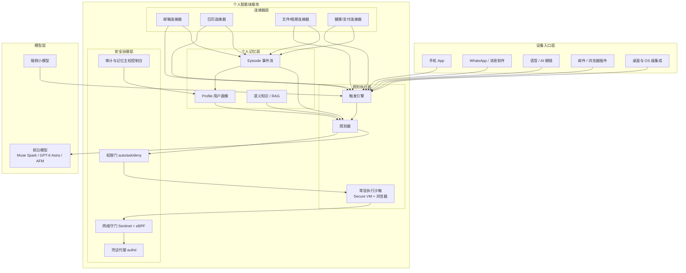
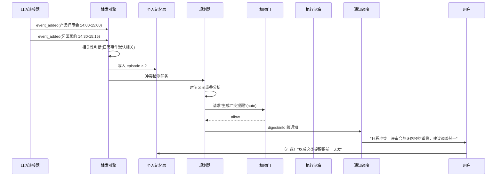
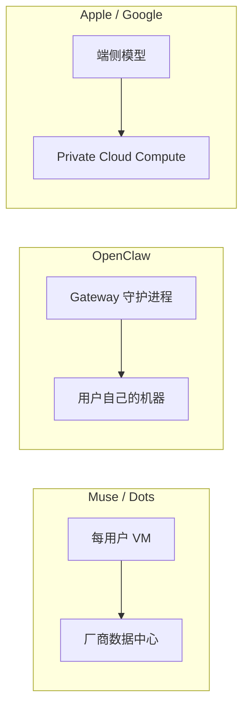

# 架构设计：六层参考架构

> 一句话理解：**把 2026 年 Muse、Dots、OpenClaw、Siri AI 的实现横向对比，可以抽出一套六层参考架构——设备入口层、连接器层、个人记忆层、规划执行层、安全治理层、模型层；各家的差异本质是"层放在云端还是端侧、由谁守门"的不同回答。**

## 六层参考架构

## 各层职责

### 1. 设备入口层（Device Surface）

用户与 Agent 的接触面。2026 年的共识是：**入口必须长在用户已经常驻的地方**，而不是一个新的 App。

| 产品 | 入口策略 |
|---|---|
| Muse | 独立 App（iOS/Android/Web/Mac）+ **WhatsApp 原生集成** + 预告 AI 眼镜 |
| Dots | ChatGPT App + **Slack/Teams/邮件/SMS** 多 Surface，上下文跨端延续 |
| OpenClaw | 不建入口，**寄生在 20–50+ 消息软件**里（WhatsApp/Telegram/Signal/iMessage……） |
| Siri AI | **OS 级**：Dynamic Island、Spotlight、专用 Siri App，iCloud 同步对话历史 |
| 豆包 | 独立 App + 抖音/飞书/头条生态渗透 |

### 2. 连接器层（Personal Data Connectors）

把个人数据变成事件流。设计要点：

- **事件驱动而非轮询**：连接器输出增量事件（新邮件、日程变更），而不是让 Agent 定期全量扫描。
- **OAuth scope 最小化**：每个连接器只拿必要的权限，可单点撤销（Google PI 以 Gmail/Calendar/Docs 为边界）。
- **读路径与写路径分离**：读事件自由流入记忆层；写操作必须经权限门。

实现上大量复用 MCP 与 Connector 生态——Claude Cowork 的连接器（Google Workspace、Slack、Notion、Jira、DocuSign 等）与 Dots 的"4000+ 应用"本质都是这一层的资产。

### 3. 个人记忆层（Personal Memory Layer）

见[核心思想·公理二](02-core-ideas)。架构上注意三点：

- **写路径**：每条 episode 带来源连接器与时间戳；profile 的每次更新保留出处链（哪个 episode 蒸馏出什么事实）。
- **读路径**：触发引擎与规划器按相关性召回；用户控制台按主题/时间浏览（Claude memory 2026-08 改为 Topics 视图）。
- **删除路径**： forget 一个事实要同时处理 profile、索引与原始 episode——"被遗忘权"在 Agent 时代变成了级联删除问题。

### 4. 规划执行层（Planning & Execution）

个人智能体的执行环境是**有状态的常驻沙箱**，这与 [Agent Runtime](/05-agent/agent-runtime/) 里的"无状态单任务循环"不同：

- Muse Secure VM：每用户一台，unprivileged systemd-nspawn 容器，完整 Chromium，浏览器自动化基于 **accessibility tree 快照**而非原始 DOM（更抗页面噪声、更像人）。
- Dots 云电脑：每 Dot 一台，可委派 sub-agent，支持命名、规则定制与语音。
- OpenClaw Gateway：本地 Node.js 守护进程，heartbeat 定时调度 + ReAct 循环，任务可以跨天续跑。
- 规划器消费记忆层：plan 的输入不仅是当前指令，还有"这个人此刻的上下文"（日历空档、通勤中、勿扰模式）。

### 5. 安全治理层（Security & Governance）

这一层是个人智能体区别于普通 Agent 框架的关键增量，详见[核心思想·公理五](02-core-ideas)。架构组件：

- **权限门**：每个动作类型有 auto/ask/deny 策略，且策略本身可被用户与自然语言改写（"以后订机票不用问我，酒店要问"）。
- **凭证代理**（authd 模式）：真实密钥存于隔离守护进程，模型只见 surrogate credential；泄漏面从"模型上下文"收缩到"专用进程"。
- **网络守门**（Sentinel 模式）：所有出口流量经宿主机侧代理，eBPF 做内核级污染追踪——被注入提示词攻击的进程会被降权。
- **审计控制台**：每一次工具调用可回放；记忆可查看、可纠正、可删除。

### 6. 模型层（Model Layer）

- **云侧前沿模型**负责长程规划与困难推理：Muse Spark（长程工具调用特化）、GPT-6 Astra（Dots）、Gemini（Siri AI 的云端合作方，AFM Cloud Pro  reportedly 跑在 Google Cloud 的 Nvidia GPU 上）。
- **端侧小模型**负责感知与会话：Apple 的新 Foundation Models framework 向 Swift 开发者免费开放端侧模型；OpenClaw 则通过 Ollama 支持完全本地推理。
- 趋势是**端云路由**：敏感感知在端侧，重规划在云侧，中间按隐私与成本动态调度（Siri AI 的 AFM on-device + Private Cloud Compute 是范本）。

## 数据流：一条主动服务的旅程

以"检测到日程冲突并主动提醒"为例（本主题 Mini Demo 的场景 1）：

## 与相邻主题的边界

| 主题 | 边界划分 |
|---|---|
| [Agent OS](/05-agent/agent-os/) | Agent OS 管"多进程、多租户、调度治理"；个人智能体是它的单雇主特例。Muse Secure VM 之于个人 Agent，相当于容器之于企业 Agent OS——只是隔离粒度=用户。 |
| [Memory](/05-agent/memory/) | Memory 主题讲存储引擎与检索算法（向量库、分层缓存）；本主题讲"C 端记忆的产品语义"：出处链、可编辑、被遗忘权、画像蒸馏。 |
| [Planning](/05-agent/planning/) | Planning 讲任务分解算法；本主题消费它，额外关注"计划输入里注入个人上下文"与"长程任务跨会话续跑"。 |
| [MCP](/05-agent/mcp/) | MCP 是能力接入协议；连接器层可以（且越来越多地）用 MCP Server 实现，但个人连接器还要处理 OAuth 授权生命周期与增量同步。 |
| [Tool Use](/05-agent/tool-use/) | Tool Use 保证单次调用正确；本主题要求**每次调用过权限门**并留下可回放审计。 |

## 部署形态对比

| 形态 | 代表 | 优势 | 代价 |
|---|---|---|---|
| 云 VM | Muse、Dots、Grok Bot | 算力无上限、任务可长跑、跨设备一致 | 信任厂商运维；单用户成本高；离线不可用 |
| 本地常驻 | OpenClaw | 数据不出门、模型任选、极客可控 | 安全责任在用户；24/7 依赖个人设备 |
| OS 集成 | Siri AI、Google PI | 端侧隐私架构、系统级上下文（屏幕感知） | 能力受平台节奏约束；生态封闭 |

## 本章小结

- 六层参考架构：设备入口、连接器、个人记忆、规划执行、安全治理、模型；各家产品的差异是各层"放云端还是端侧、谁守门"的不同答案。
- 连接器事件驱动、scope 最小化、读写分离；记忆层要有写/读/删三条路径；执行层是有状态常驻沙箱（a11y tree 浏览器自动化是抗噪关键）。
- 安全治理层是最大增量：权限门、凭证代理、网络守门、审计控制台四个组件。
- 三种部署形态对应三种信任假设，选型本质是信任模型选型。

**参考来源**
- [Official Muse Breakdown（Vellum）](https://www.vellum.ai/blog/official-muse-breakdown)
- [OpenAI DevDay 2026: Dots（Teamday）](https://www.teamday.ai/ai/openai-devday-2026-dots-always-on-agents)
- [Apple Siri AI 2026: 12 Confirmed Facts（Tokenmix）](https://tokenmix.ai/blog/apple-siri-ai-wwdc-2026)
- [What Is OpenClaw?（TechJack Solutions）](https://techjacksolutions.com/ai-tools/openclaw/what-is-openclaw/)
- [Claude Cowork AI Assistant Review 2026（Vellum）](https://www.vellum.ai/llm-leaderboard/ai-assistants/claude-cowork)
