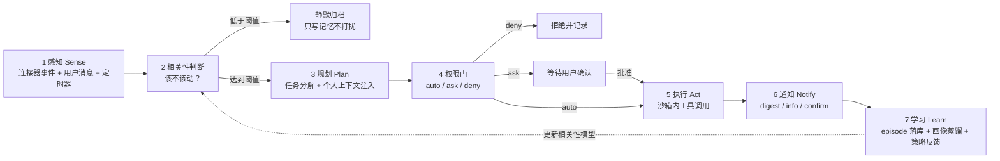
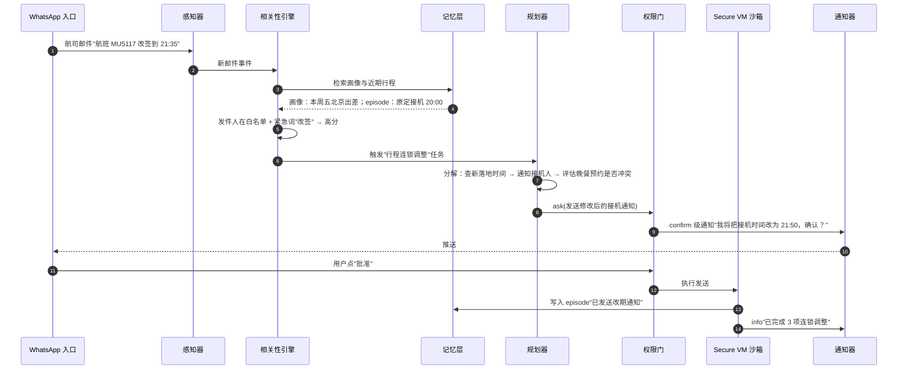

# 工作流程：主动服务闭环

> 一句话理解：**个人智能体的主循环不是"等一句话、回一句话"，而是一个七段流水线——感知、相关性判断、规划、权限门、执行、通知、学习；用户消息只是众多触发源中的一种。**

## 七段流水线



### 段 1：感知（Sense）

三种触发源在入口汇合：

1. **连接器事件**：新邮件、日程变更、文件修改（Muse 的第三方连接器、Google PI 的全家桶监听）。
2. **用户消息**：App 对话、WhatsApp 消息、语音（Dots 支持语音交互）。
3. **定时器**：OpenClaw 的 heartbeat、cron 式例行任务（Grok Bot 的 routines、Microsoft AutoPilot 的 recurring tasks）。

### 段 2：相关性判断（Relevance Gate）

这是个人智能体独有的段——通用 Agent 收到任务即执行，个人智能体必须先决定**值不值得消耗用户注意力**。判断依据：

- 与**用户画像**的关系（发件人是否重要联系人）；
- **紧急信号**（关键词、截止时间 proximity）；
- **来源权重**（日历事件天然高相关，营销邮件天然低相关）。

Mini Demo 的规则版实现：画像联系人 +3、紧急词 +2、日历 +2、文件 +1，阈值 2.0。生产系统用 LLM 做判断，但保留同样的可解释输出（score + reasons）——通知必须能回答"你为什么打扰我"。

### 段 3：规划（Plan）

规划器与普通 Agent 的差别在**输入**：除了任务描述，还要注入个人上下文——"他今晚 7 点有饭局""他偏好直飞""他对坚果过敏"。这就是[Memory 主题](/05-agent/memory/)的检索结果在这里的消费点。长任务还会拆出 sub-agent（Dots 支持委派）并在里程碑处挂起等待确认（Muse 的"里程碑汇报"模式）。

### 段 4：权限门（Permission Gate）

每个外部副作用动作带着类型与参数过门。三态语义见[核心思想](02-core-ideas)：

```text
act("send_email", to=..., subject=...)
  → gate.check("send_email") → ask → 挂起为 pending + 推送 confirm 级通知
act("external_payment", ...)
  → gate.check("external_payment") → deny → 记录拒绝，不做
read 类动作 → auto → 直接放行
```

Muse 在此段还有两个生产级组件：Sentinel 网络守门（所有出口流量经审核）与 authd 凭证代理（模型只见代理凭证）。

### 段 5：执行（Act）

在常驻沙箱内跑工具：浏览器自动化（Muse 用 accessibility tree 快照）、API 调用、文件操作。执行是**可中断的**——长任务在里程碑处 checkpoint，等待确认或新事件触发重规划。

### 段 6：通知（Notify）

按打扰等级投递：

| 等级 | 语义 | 通道 | 例子 |
|---|---|---|---|
| digest | 低打扰汇总 | 每日一封/一栏 | "今天 3 封邮件值得关注" |
| info | 重要事件即时推送 | 锁屏/WhatsApp | "日程冲突，已给出改期建议" |
| confirm | 等待人工决策 | 强提醒 + 一键批准/拒绝 | "替你在 Ticketmaster 锁了两张票，确认付款？" |

### 段 7：学习（Learn）

每次闭环的沉淀分三路：

- episode 落库（发生了什么）；
- 画像蒸馏（"记住：咖啡偏好=燕麦拿铁"→ profile 更新，带出处）；
- 策略反馈（用户关掉某类通知 → 相关性阈值上调；用户批准了某类操作 → 未来可降级为 auto，但需在控制台可见）。

## 端到端时序：主动改期



## 与 Mini Demo 的对应关系

本主题 Mini Demo（`docs/05-agent/personal-agent/mini-demo/`，包名 `personal_agent_mini`）用纯 Python 复现了这条流水线的最小骨架：

| 流水线段 | Mini Demo 组件 |
|---|---|
| 感知 | `connectors.py` 三个假连接器的 `poll()` |
| 相关性判断 | `agent.py` 的 `RelevanceScorer` + 阈值 2.0 |
| 规划 | 场景内置的最小任务分解（冲突检测、摘要生成） |
| 权限门 | `agent.py` 的 `PermissionGate`（auto/ask/deny） |
| 执行 | `PersonalAgent._execute`（发邮件、建日程） |
| 通知 | `Notification` 三级（info/digest/confirm） |
| 学习 | `memory.py` 的 episode 落库 + "记住："画像蒸馏 |

四个端到端场景：日程冲突主动提醒、重要邮件摘要推送（营销邮件被相关性门过滤）、跨天记忆召回、权限拒绝与人工确认。详见[工程实践](07-mini-demo)。

## 失败模式：流水线上哪里会出事

| 段 | 典型失败 | 后果 |
|---|---|---|
| 感知 | 连接器 scope 过期未刷新 | Agent"失明"，用户以为它在偷懒 |
| 相关性 | 阈值过低 | 通知轰炸 → 用户关闭推送 → 主动性报废 |
| 规划 | 个人上下文注入错误（记错偏好） | 贴心变冒犯："你不是对坚果过敏吗？"——用户从没说过 |
| 权限门 | ask 级动作自动放行 | 一封错发的邮件摧毁整个产品的信任 |
| 执行 | 沙箱逃逸/提示词注入 | 2026 年多家厂商 Agent 安全事件的共同根因（见[生产实践](08-production-practice)） |
| 通知 | confirm 通知被系统折叠 | 任务永远卡在等待确认 |
| 学习 | 错误画像固化且不可见 | "它一直以为我是素食者"，且用户找不到在哪改 |

## 本章小结

- 主动服务闭环七段：感知、相关性、规划、权限门、执行、通知、学习；用户消息只是三种触发源之一。
- 相关性判断与权限门是个人智能体相对通用 Agent 的两个新增段；通知分级与学习反馈是产品成败的细节所在。
- Mini Demo 用 40 个确定性测试复现了流水线骨架，可在本机直接运行。

**参考来源**
- [Official Muse Breakdown（Vellum）](https://www.vellum.ai/blog/official-muse-breakdown)
- [Grok Bot: xAI's AI Teammates（AgileIT）](https://agileitt.com/blog/xai-grok-bot-explained)
- [Personal AI Agents at Work（Sentra）](https://www.sentra.app/articles/personal-ai-agents-at-work)
