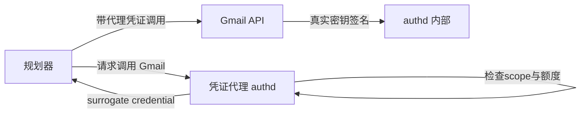
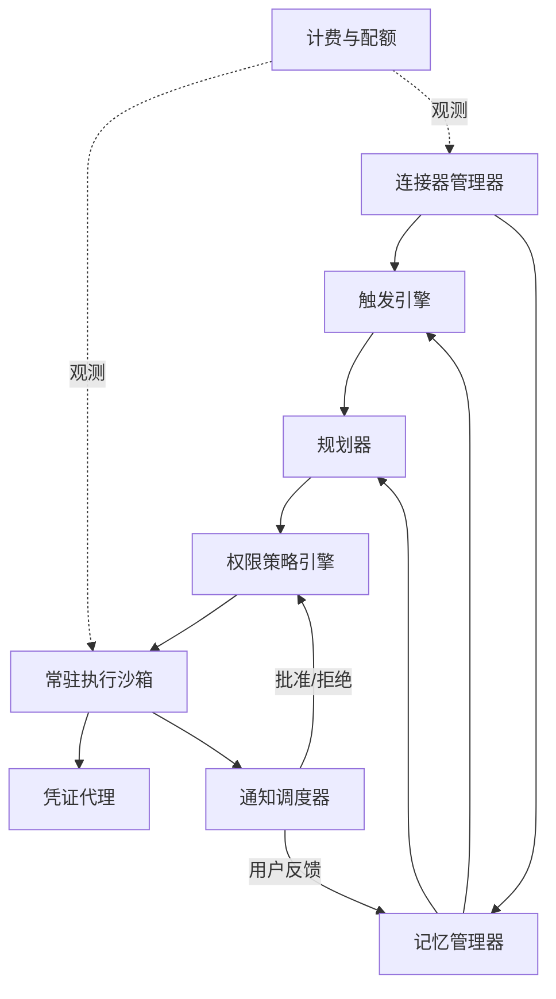

# 核心模块

> 一句话理解：**把六层架构落到代码层面，个人智能体由九个可独立演进的模块构成——连接器管理器、记忆管理器、触发引擎、规划器、常驻执行沙箱、凭证代理、通知调度器、权限策略引擎、计费与配额；其中记忆与权限两个模块决定了产品的生死。**

## 1. 连接器管理器（Connector Manager）

负责个人数据源的接入、授权生命周期与事件流标准化。

```python
class ConnectorManager:
    def __init__(self):
        self._connectors = {}

    def register(self, connector):
        # 每个连接器声明: name / scopes / event_kinds / write_actions
        self._connectors[connector.name] = connector

    def poll_all(self):
        events = []
        for conn in self._connectors.values():
            try:
                events.extend(conn.poll())          # 增量事件
            except OAuthExpired:
                self._mark_reconnect_required(conn)  # 感知段第一失败模式
        return events
```

生产要点：

- **授权生命周期**：OAuth token 会过期、会被用户撤销；连接器管理器必须维护"健康/需重授权/已撤销"三态，并把状态暴露给 Agent（否则 Agent 会对着失效日历做错误推断）。
- **scope 最小化**：Google PI 只读 Gmail/Calendar/Docs；Muse 的第三方连接器（Ticketmaster、Spotify、Apple Health）各自独立授权、单点可撤。
- **写操作注册表**：连接器声明自己支持哪些写动作，权限门按动作类型而非连接器整体授权。

## 2. 记忆管理器（Memory Manager）

个人智能体的心脏。接口上需要四条独立路径：

```python
class MemoryManager:
    # 写路径
    def add_episode(self, kind, content, source, ts, tags): ...
    def distill_profile(self, episode) -> list[ProfileFact]: ...  # 画像蒸馏,带出处

    # 读路径
    def recall(self, query, limit, filters) -> list[Episode]: ...
    def profile(self) -> dict[str, ProfileFact]: ...

    # 主权路径(个人智能体特有)
    def forget(self, fact_key): ...        # 级联:画像、索引、原始episode
    def export(self) -> PersonalDataDump: ...  # GDPR/个保法数据可携带
```

设计要点：

- **出处链不可丢**：每个 profile 事实必须能回答"你从哪条记录得出这个结论"（Mini Demo 中 `ProfileFact.source` 即 episode id）。没有出处的画像在纠错场景下是灾难。
- **蒸馏是持续过程**：不是每天跑一次批处理，而是每次 episode 落库时增量评估"这条信息是否改变了用户画像"（Beyond Static Summarization, arXiv:2601.04463）。
- **冲突处理**：用户说"我不再喝咖啡了"要能让旧的"咖啡偏好"事实失效而不是并存两个值——需要事实的 validity 区间。
- **被遗忘权的级联**：`forget("咖啡偏好")` 应同时删除画像条目、向量索引条目，并标记来源 episode 为"已匿名化"（原始事件流往往受审计要求保留，但要做去关联化）。

来源：[Claude Memory: What It Stores & How to Delete It（2026）](https://lumichats.com/blog/claude-memory-2026-complete-guide-how-to-use)、[A Survey on the Security of Long-Term Memory in LLM Agents（arXiv:2604.16548）](https://arxiv.org/html/2604.16548v1)

## 3. 触发引擎（Trigger Engine）

主动性的大脑，回答"该不该动、何时动"。生产实现是 LLM + 规则混合：

```python
class TriggerEngine:
    def evaluate(self, event) -> TriggerDecision:
        context = self.memory.recall(event.summary, limit=5)
        decision = self.llm.judge(
            system="你是个人助理的相关性过滤器",
            input={"event": event, "user_context": context,
                   "current_state": self.user_state()},  # 会议中/勿扰/时区
            output_schema=TriggerDecision,  # {action: ignore|defer|act, score, reasons, notify_level}
        )
        return decision
```

要点：

- **可解释输出**：score + reasons 随通知一起展示（"因为发件人是你的重要联系人，且包含紧急词"）。
- **状态感知**：勿扰模式、日历忙闲、时区参与决策——同一条消息，开会时是 defer，散会后是 act。
- **反馈闭环**：用户对通知的"以后少发点这个"要直接改写该用户的相关性策略。

## 4. 规划器（Planner）

消费触发引擎的决策与个人上下文，产出可执行计划：

- 输入注入：profile（偏好、禁忌、重要联系人）+ 近期 episode（进行中的事）+ 当前用户状态。
- 长任务挂起：在里程碑处 checkpoint，等待 confirm 级通知的批准后继续（Muse 的"应用关闭仍工作，关键节点找用户"模式）。
- sub-agent 委派：Dots 明确支持主 Dot 委派子任务；拆分时同样要继承权限策略（子 agent 不得拥有比父 agent 更宽的权限）。

参见 [Planning 主题](/05-agent/planning/) 的任务分解算法与 [Agent OS 主题](/05-agent/agent-os/) 的调度与 checkpoint 机制。

## 5. 常驻执行沙箱（Persistent Sandbox）

个人任务的执行环境，需要四个生产级特性：

| 特性 | 说明 | 参考实现 |
|---|---|---|
| 强隔离 | 不可信网页/代码在 unprivileged 容器中运行 | Muse: systemd-nspawn unprivileged 容器 |
| 浏览器自动化 | 基于 accessibility tree 快照而非原始 DOM，抗页面噪声、行为更像人 | Muse Secure VM 内完整 Chromium |
| 状态持久化 | 会话可跨天续跑、可 fork | OpenClaw 本地 SQLite；Dots 云电脑持久盘 |
| 可中断 | 里程碑挂起 / 用户随时叫停 | Grok Bot routines 的人工检查点 |

成本维度：per-user 常驻沙箱是个人智能体最难看的成本项——一台闲置 VM 也是钱。工程上的对策是**休眠与快照**（空闲时 checkpoint 到磁盘，事件到达时秒级恢复），这与 [Agent OS 主题](/05-agent/agent-os/06-source-analysis) 中 Perplexity SPACE 的 pause/resume/fork 思路一致。

## 6. 凭证代理（Credential Proxy / authd 模式）

个人智能体握着用户的邮箱、支付、日历凭证，凭证管理必须是独立模块：



- **模型不见明文**：LLM 上下文里只有 surrogate credential（一次性、限 scope、限额度）。
- **单点撤销**：用户在控制台一键撤掉"Spotify"，authd 立刻让对应代理凭证失效。
- **滥用检测**：authd 记录每个代理凭证的调用模式，异常频率触发降权（与 Sentinel 联动）。

来源：[Official Muse Breakdown（Vellum）](https://www.vellum.ai/blog/official-muse-breakdown)

## 7. 通知调度器（Notification Scheduler）

把决策翻译成正确的打扰：

- **投递通道选择**：confirm 走强提醒（WhatsApp/锁屏），digest 走邮件/汇总栏。
- **批处理窗口**：digest 级通知按用户作息聚批（早晨通勤时间一次投递）。
- **退避与熔断**：同一任务重复 confirm 未响应时升级通道（邮件 → 短信），连续未响应自动挂起任务并告知。
- **每条通知可解释、可行动**：附"为什么"与"别再提醒我这类事"入口。

## 8. 权限策略引擎（Policy Engine）

三态门（auto/ask/deny）的用户可编程层：

- **默认拒绝**：未声明策略的动作类型一律 ask。
- **自然语言策略**：用户说"订机票不用问我，酒店超过 500 要问"→ 编译为策略规则（这本身就是个小 Agent 任务，且策略变更要进审计日志）。
- **降级不可逆性**：ask 可经多次批准后降为 auto，但降级记录必须在控制台永久可见——"它什么时候获得了自动发邮件的权利"是信任审计的关键问题。
- **子 agent 继承**：委派出去的 sub-agent 权限是父权限的交集，不能扩权。

## 9. 计费与配额（Metering）

消费级产品的隐形战场：

- **成本归集**：每用户沙箱时长、LLM token、连接器调用、网络出口流量分别计量。
- **套餐设计**：Muse 据报道采用基础免费 + 约 20 美元/月与 100 美元/月付费档（国内媒体报道口径；Vellum 的拆解未给出具体数字）；Dots 面向 Pro/Business Premium/Enterprise 订阅者推出，会话 reportedly 不计入常规用量。
- **免费档的经济学**：免费用户是成本控制压力测试——休眠/快照、本地小模型预过滤、digest 批处理都是为免费档设计的。

## 模块依赖关系



## 本章小结

- 九大模块中，记忆管理器与权限策略引擎决定产品生死；凭证代理与执行沙箱决定信任上限；通知调度与计费决定商业可持续性。
- 出处链、级联遗忘、可解释通知、策略降级可见性，是个人智能体模块设计的四个"不做就会出事"的细节。

**参考来源**
- [Official Muse Breakdown（Vellum）](https://www.vellum.ai/blog/official-muse-breakdown)
- [OpenAI DevDay 2026: Dots（Teamday）](https://www.teamday.ai/ai/openai-devday-2026-dots-always-on-agents)
- [A Survey on the Security of Long-Term Memory in LLM Agents（arXiv:2604.16548）](https://arxiv.org/html/2604.16548v1)
- [Beyond Static Summarization（arXiv:2601.04463）](https://arxiv.org/pdf/2601.04463)
