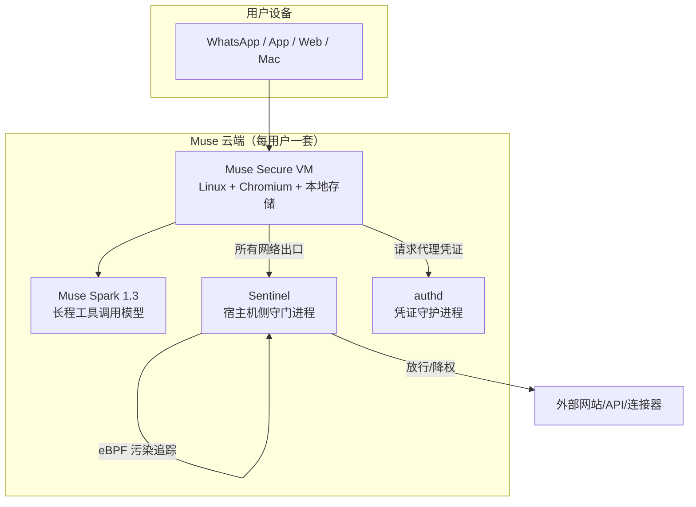
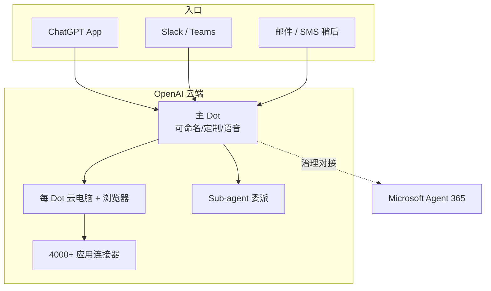
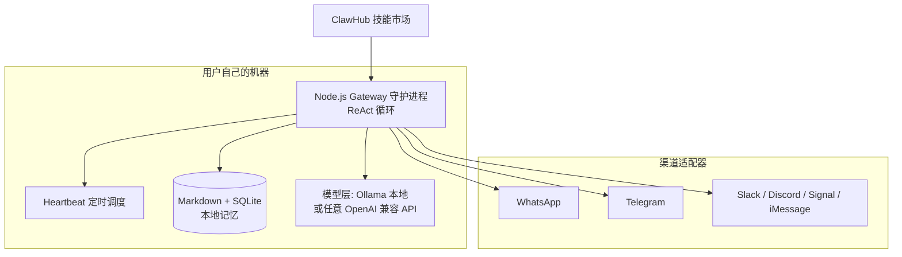
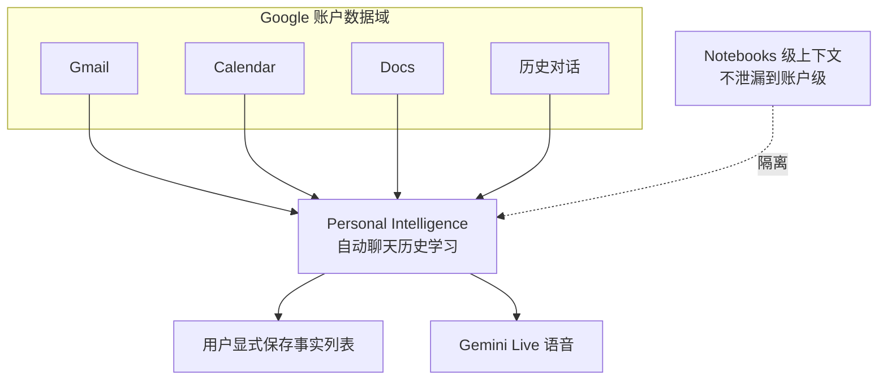
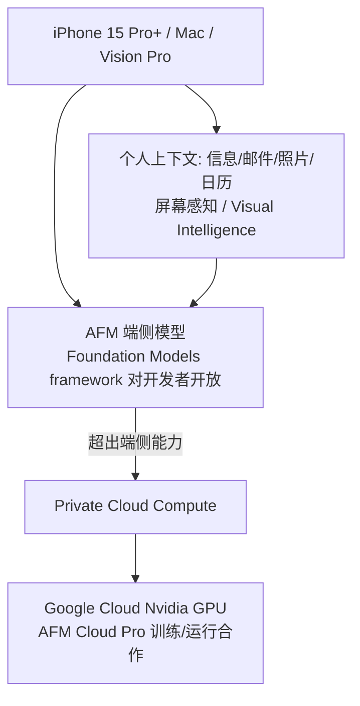

# 源码分析：拆解六家实现

> 一句话理解：**Muse 的 Secure VM、Dots 的云电脑、OpenClaw 的 Gateway、Google PI 的双层记忆、Siri AI 的端云协同、Claude Cowork 的连接器体系——六家实现六个答案，但把它们叠在一起看，每条架构决策都是"信任假设 × 成本约束 × 生态位"的函数。**

## 1. Meta Muse：Per-user Secure VM + Sentinel 守门

来源：[Official Muse Breakdown（Vellum，2026-09）](https://www.vellum.ai/blog/official-muse-breakdown)、[GEO 日报 2026-09-10](https://www.fengyangai.com/blog/article-2806.html)、[Meta Connect 2026 报道](https://chenqiyuan.cn/article/intel-55b7e3d7cffdeebeaca2fbec)

### 架构

### 关键设计

- **隔离**：每个用户的 Agent 跑在独立 Secure VM 内，Agent 进程本身处于 unprivileged systemd-nspawn 容器，无宿主机 root。浏览器自动化基于 **accessibility tree 快照**——不是解析原始 DOM，而是像读屏软件一样读页面语义，对反爬与页面噪声更鲁棒。
- **Sentinel**：宿主机侧进程，是"所有网络出口与连接器操作的唯一守门人"。即使 Agent 被提示词注入攻陷，Sentinel 仍然挡在模型与真实网络之间。
- **污染追踪（tainted egress）**：eBPF 内核级监控；一旦被判定受污染的 Agent 进程会失去自主联网权限——把"检测"从应用层下沉到内核层。
- **凭证代理**：真实密钥存在 authd，模型上下文里只有 surrogate credentials，支付走 Stripe Link 单次虚拟卡。
- **HITL 清单**：发邮件、高风险表单、金融交易强制人工确认。
- **记忆**：面向"长期生活习惯与事务档案"优化；VM 数据与对话不与 Meta 广告网络共享，可退出训练；**目前没有对抗 Meta 员工访问的密码学屏障**——"Muse Confidential VM（用户自持密钥）"已在筹备中。
- **商业模式**：基础免费 + 付费档（国内报道为约 20 美元/月与 100 美元/月；Vellum 拆解未确认具体数字）。上线 10 天登顶美区免费榜，截至 2026-09-21 约 250 万下载。

### 点评

Muse 的设计把"信任"当作第一性约束：模型不可信 → 隔离在 VM；进程不可信 → nspawn 降权；网络不可信 → Sentinel 守门；凭证不可信（会被上下文泄漏）→ authd 代理。这套纵深防御是消费级 Agent 目前公开资料中最完整的。短板同样明显：单用户 VM 成本、闭源闭权重、仅限美加，以及"用户数据对厂商运维透明"这一结构性信任缺口。

## 2. OpenAI Dots：Cloud Computer × 4000 应用

来源：[OpenAI DevDay 2026 综述（人人都是产品经理）](https://www.woshipm.com/ai/6472410.html)、[Teamday 报道](https://www.teamday.ai/ai/openai-devday-2026-dots-always-on-agents)、[Business Standard](https://www.business-standard.com/technology/tech-news/openai-devday-2026-dots-gpt-6-1-sol-codex-developer-tools-126093000396_1.html)

### 架构

### 关键设计

- **Always-on**：初始指令之后 Dots 持续在后台工作；用户可命名主 Dot、设定规则与权限（含动作前确认）、语音交互。
- **上下文跨端**：ChatGPT、Slack、Teams、邮件、SMS（SMS 为后续推出）之间保持上下文，可 handoff 与委派 sub-agent。
- **Specialist Dots**：角色化数字员工预览版；企业侧计划接入 Microsoft Agent 365 获得治理。
- **发布策略**：先向 ChatGPT Pro / Business Premium / Enterprise 订阅者推出，媒体报道 Dot 会话不计入常规用量。

### 点评

Dots 的架构押注在**生态位**上：4000+ 应用连接器是 OpenAI 的独特资产，跨端上下文让它在企业与个人之间无缝滑动。相比 Muse 的纵深防御，公开资料中 Dots 的安全细节较少——其信任主张更多是"企业级治理（Agent 365 对接）+ 订阅门槛"，而非内核级隔离。这种"治理优先于隔离"的路线在 to B 混合场景更现实，在纯 C 端则可能面对 Muse 式安全叙事的竞争压力。

## 3. OpenClaw：本地常驻 Gateway + 消息渠道寄生

来源：[What Is OpenClaw?（TechJack Solutions）](https://techjacksolutions.com/ai-tools/openclaw/what-is-openclaw/)、[OpenClaw Ecosystem 2026（Presenc）](https://presenc.ai/research/openclaw-ecosystem-2026)、[Nexe 的三个月实测](https://nexe.ad/en/blog/openclaw-why-it-matters/)

### 架构

### 关键设计

- **历史**：Peter Steinberger（PSPDFKit 创始人）创建，命名从 Clawdbot（2025-11-24）→ Moltbot（2026-01-27）→ OpenClaw（2026-01-30，因 Anthropic 商标投诉改名）。约 37.2 万 GitHub stars、7.7 万 forks（2026-05 中），2026-03 星数超过 React；Steinberger 于 2026-02 加入 OpenAI Personal Agents 部门，项目转入独立开源基金会（OpenAI、GitHub、NVIDIA、Vercel 背书）。
- **模型无关**：不捆绑 LLM，Ollama 跑本地模型或接任意商业 API。
- **渠道即入口**：不建 App，寄生在用户已有的消息软件里；技能市场 ClawHub 提供社区扩展。

### 点评

OpenClaw 是"个人智能体的 Linux 发行版"：把云厂商替你做的事（常驻、调度、记忆）交还给用户自己的硬件。它的爆发证明了两件事：个人智能体的需求真实且急切，以及大量用户**宁愿自己运维也不愿把人生数据交给云厂商**。但同一篇实测也指出安全短板：Koi Security 审计在 ClawHub 发现 341 个恶意技能，CVE-2026-25253 CVSS 8.8——本地优先意味着安全责任也本地化，而大多数用户并没有 Steinberger 级别的安全能力。这是 OpenClaw 路线最深的结构性矛盾。

## 4. Google Personal Intelligence：全家桶数据上的双层记忆

来源：[How Gemini Memory Works（2026）](https://blog.memoryplugin.com/how-gemini-memory-works/)、[Gemini Live Memory（9to5Google，2026-06-18）](https://9to5google.com/2026/06/18/gemini-live-memory/)、[Sentra: Assistant Memory Explained](https://www.sentra.app/articles/assistant-memory-explained)

### 架构

### 关键设计

- **两层记忆**：自动学习层（从聊天历史与全家桶数据蒸馏）+ 显式事实层（用户主动保存的事实列表）；账户级默认开启。
- **边界清晰**：Notebooks（2026-04 合并 NotebookLM 后）提供 notebook 级上下文，刻意不泄漏进账户级个性化——工作资料与生活记忆的隔离是产品设计的一部分。
- **保守的可用域**：不面向工作/学校账户、EEA/UK/瑞士/尼日利亚、18 岁以下用户——主动个性化在欧洲监管环境下主动收敛。
- **评测口碑**：上下文覆盖最宽（整个 Google 账户），但可审计性最弱——用户最难搞清楚"它到底记住了我什么"。

### 点评

Google 的优势与风险同源：全家桶数据深度是别人无法复制的护城河，也是监管与舆论的靶心。PI 的"默认开启 + 弱可审计"策略在便利性上激进、在透明度上保守，与 Claude 的"Topics 视图 + 敏感主题 opt-in"形成鲜明对照。长期看，可审计性可能取代数据广度成为个性化产品的差异化战场。

## 5. Apple Siri AI：端云协同的 OS 级集成

来源：[Apple Siri AI 2026: 12 Confirmed Facts（Tokenmix）](https://tokenmix.ai/blog/apple-siri-ai-wwdc-2026)、[itwire: Apple reinvents Siri](https://itwire.com/your-it-news/home-it/apple-reinvents-siri-as-siri-ai-at-wwdc26-powered-by-a-deep-collaboration-with-googles-gemini)、[CGTN WWDC26 报道](https://news.cgtn.com/news/2026-06-09/Apple-highlights-AI-ambitions-at-WWDC26-as-Siri-takes-center-stage-1NPuA9HRxsc/p.html)

### 架构

### 关键设计

- **与 Google 的深合作**：AFM 与 Gemini 深度合作（据报道约 10 亿美元/年），最先进的 AFM Cloud Pro reportedly 跑在 Google Cloud 的 Nvidia GPU 上——竞争对手的云托着自己的隐私叙事，是 2026 年最戏剧性的产业格局注脚。
- **端侧优先的隐私架构**：能做的不上云；必须上云的走 Private Cloud Compute（无状态、可验证、不持久化）。
- **OS 级入口**：Dynamic Island、Spotlight、专用 Siri App（对话历史经 iCloud 同步）、跨 App 任务执行、屏幕感知。
- **节奏**：开发者 beta 2026-06-08，公测 2026-07，随 iOS 27 于 2026-09-14 正式版，英文首发，需 iPhone 15 Pro 及以上，欧盟与中国大陆暂不可用；发布后股价跌约 2%——市场对"分阶段推出"的耐心有限。

### 点评

Apple 路线的本质是把个人智能体做成**平台能力而非产品**：不养 VM、不建连接器市场，一切寄生在 OS 权限上。这让它的隐私叙事最强（端侧 + PCC 是架构承诺而非政策承诺），也让它的进度最受制于硬件换代与监管区域。中国大陆不可用这一点，给国内厂商留出了整整一个生态位的时间窗。

## 6. Anthropic Claude Cowork：连接器优先的办公分身

来源：[Claude Cowork Review（Vellum）](https://www.vellum.ai/llm-leaderboard/ai-assistants/claude-cowork)、[Claude Cowork Connectors 指南（SiteGPT）](https://sitegpt.ai/claude-cowork)、[Claude as a Personal Assistant（2026）](https://www.usecarly.com/blog/claude-personal-assistant/)、[Claude Memory 2026（Lumichats）](https://lumichats.com/blog/claude-memory-2026-complete-guide-how-to-use)

### 架构要点

- **桌面 Agent 工作区**：继承 Claude Code 的 skills、MCP connectors、hooks、settings.json，系统提示词偏向文件与办公任务；默认 Opus 4.5。
- **连接器矩阵**：Google Workspace（Gmail/Drive/Calendar/Docs/Sheets）、Slack、Microsoft 365、DocuSign、Salesforce、HubSpot、Jira、Notion、Confluence、Box、Dropbox、GitHub；发送邮件默认需用户批准。
- **记忆**：2026-03 向所有用户（含免费）推出持久记忆；2026-08 改版为按 Topics 组织、跨 Claude 聊天与 Cowork 统一、敏感主题存储 opt-in。注意：部分评测（Vellum）认为 Cowork 的跨会话记忆仍有限，来源间存在分歧。
- **明确的边界**：无原生事件触发、无定时器，计划任务按固定时钟运行——"Claude 建议，但不自主行动"。

### 点评

Cowork 代表了"个人智能体的保守派"：把执行环境限定在桌面文件与办公连接器内，主动性让位于可控性。在 2026 年 10 月这个时间点，这是刻意的产品定位而非技术短板——Anthropic 的企业采用率据报道已超过 OpenAI（Ramp 数据，2026-04：约 34.4% 对 32.3%），高价值 Agent 产品驱动其 2026 年 Token 消耗量预计增长 10 倍（虎嗅）。当竞品在 C 端冒险时，Anthropic 在 B 端收租。

## 六家实现横向对比

| 维度 | Muse | Dots | OpenClaw | Google PI | Siri AI | Cowork |
|---|---|---|---|---|---|---|
| 执行环境 | 每用户 Secure VM | 每 Dot 云电脑 | 用户本机守护进程 | 无（云服务内） | 端侧 + PCC | 用户桌面 |
| 核心入口 | WhatsApp + App | ChatGPT + Slack/Teams | 20–50+ 消息软件 | Gemini App | OS 级 | 桌面 App |
| 记忆架构 | 生活/事务档案（闭源细节） | 跨端上下文 | 本地 Markdown+SQLite | 双层（自动+显式） | 端侧个人上下文 | Topics 统一记忆 |
| 权限亮点 | Sentinel+eBPF+authd | 用户规则 + Agent 365 | 自管（含已知风险） | 账户级 scope | PCC 可验证计算 | 连接器级批准 |
| 商业模式 | 免费+约$20/约$100档 | 订阅捆绑 | 开源免费 | 订阅（全家桶捆绑） | 硬件驱动 | 订阅（Pro/Team/Enterprise） |
| 主要短板 | 成本、闭源、区域限美加 | 安全细节披露少 | 恶意技能、CVE | 可审计性弱 | 区域与硬件受限 | 无主动性 |

## 本章小结

- Muse 贡献"纵深防御"范式（VM→nspawn→Sentinel→authd），Dots 贡献"生态位"范式（4000+ 应用 × 跨端上下文），OpenClaw 贡献"本地优先"范式（及惨痛的安全教训），Google/Apple 贡献"数据/OS 内生"范式，Cowork 贡献"可控性优先"范式。
- 六家没有谁是终局答案；每个架构决策都是信任假设、成本约束与生态位的函数。
- 对工程师最重要的启示：个人智能体模块的复杂度不在模型调用，而在凭证、通知、记忆主权与审计这些"围绕模型的基础设施"。

**参考来源**
- [Official Muse Breakdown（Vellum）](https://www.vellum.ai/blog/official-muse-breakdown)
- [OpenAI DevDay 2026 回顾（人人都是产品经理）](https://www.woshipm.com/ai/6472410.html)
- [OpenClaw Ecosystem 2026（Presenc）](https://presenc.ai/research/openclaw-ecosystem-2026)
- [I've tested OpenClaw for three months（Nexe）](https://nexe.ad/en/blog/openclaw-why-it-matters/)
- [How Gemini Memory Works in 2026](https://blog.memoryplugin.com/how-gemini-memory-works/)
- [Apple Siri AI 2026: 12 Confirmed Facts（Tokenmix）](https://tokenmix.ai/blog/apple-siri-ai-wwdc-2026)
- [Claude Cowork Review（Vellum）](https://www.vellum.ai/llm-leaderboard/ai-assistants/claude-cowork)
- [Anthropic 高价值 Agent 产品推动 2026 年 Token 消耗量预计增长 10 倍（虎嗅）](https://www.huxiu.com/article/4832872.html)
