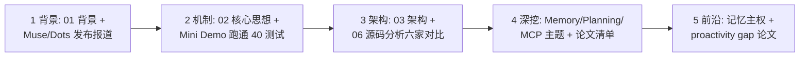

# 延伸阅读

> 一句话理解：**个人智能体是"Agent 基础设施 × 个人数据 × 信任工程"的交叉点；延伸阅读按学术论文、官方资料、产业报道、开源项目、本手册相关主题五条线组织，按"背景 → 深挖 → 前沿"的顺序阅读效果最好。**

## 学术论文（2026）

### 个性化与主动 Agent

- [VitaBench 2.0: Evaluating Personalized and Proactive Agents in Long-Term User Interactions（arXiv:2605.27141）](https://arxiv.org/html/2605.27141v1) — 长期交互中个性化 + 主动性的基准测试。
- [MemoryCD: Benchmarking Long-Context User Memory of LLM Agents for Lifelong Cross-Domain Personalization（arXiv:2603.25973）](https://arxiv.org/pdf/2606.13174) — 终身跨领域用户记忆基准。
- [User as Code: Executable Memory for Personalized Agents（arXiv:2606.16707）](https://arxiv.org/pdf/2607.20972) — 把用户画像编译为可执行代码。
- [PersonaAgent: Personalization at Test Time（arXiv:2506.06254）](https://arxiv.org/pdf/2606.17328) — 测试时个性化方法。
- [Chronos: Temporal-Aware Conversational Agents（arXiv:2603.16862）](https://aclanthology.org/2026.acl-long.684.pdf) — 结构化事件检索的时间感知会话 Agent。

### 记忆提取与安全

- [Beyond Static Summarization: Proactive Memory Extraction for LLM Agents（arXiv:2601.04463）](https://arxiv.org/pdf/2601.04463) — 主动记忆提取。
- [A Survey on the Security of Long-Term Memory in LLM Agents: Toward Mnemonic Sovereignty（arXiv:2604.16548）](https://arxiv.org/html/2604.16548v1) — 记忆安全与"记忆主权"。
- [Proactive Memory in AI Agents: A Developer's Guide（Mem0）](https://mem0.ai/library/agent-memory/proactive-memory) — PASK 三层记忆模型的工程实践。

### Agent 安全

- [From Reactive Containment to Proactive Assurance: Lessons from the 2026 OpenAI, Anthropic, and Google Agent Security Incidents（arXiv:2610.12463）](https://arxiv.org/html/2610.12463v1) — 2026 年 Agent 安全事件复盘。
- [Governed MCP: From Technical Specifications to Multi-Agent Governance（arXiv:2604.16870）](https://arxiv.org/abs/2604.16870) — 治理型 MCP（本手册 [MCP 主题](/05-agent/mcp/) 相关）。

### 相关早期工作

- [MemGPT: Towards LLMs as Operating Systems（arXiv:2310.08560）](https://arxiv.org/abs/2310.08560) — 记忆分层管理的奠基工作（本手册 [Memory 主题](/05-agent/memory/) 核心参考）。
- [Mem0: Building Production-Ready AI Agents with Scalable Long-Term Memory](https://arxiv.org/abs/2504.19413) — 生产级 Agent 记忆系统。

## 官方资料与产业报道

### Meta Muse

- [Official Muse Breakdown（Vellum，2026-09）](https://www.vellum.ai/blog/official-muse-breakdown) — 目前最完整的第三方架构拆解（Secure VM / Sentinel / authd / eBPF）。
- [GEO 日报 2026-09-10：Meta 发布个人智能体 Muse](https://www.fengyangai.com/blog/article-2806.html)、[GEO 日报 2026-09-19：Muse 引爆消费级智能体](https://www.fengyangai.com/blog/article-2966.html) — 中文发布报道。
- [Meta 智能体 Muse 登顶美区免费榜（同花顺，2026-09-22）](https://fund.10jqka.com.cn/20260922/c680158818.shtml) — 市场数据。
- [Meta Connect 2026：Muse 个人智能体、AI 眼镜与实时虚拟形象](https://www.everytik.com/content/articles%3Auaph2esvpr4ui2mhh9uujckg)、[Muse Mail 与 Mac 控制更新报道](https://chenqiyuan.cn/article/intel-55b7e3d7cffdeebeaca2fbec)。

### OpenAI / xAI / Manus

- [OpenAI DevDay 2026 回顾（人人都是产品经理）](https://www.woshipm.com/ai/6472410.html)、[Business Standard 报道](https://www.business-standard.com/technology/tech-news/openai-devday-2026-dots-gpt-6-1-sol-codex-developer-tools-126093000396_1.html)、[Teamday: Dots, Always-On Agents](https://www.teamday.ai/ai/openai-devday-2026-dots-always-on-agents)。
- [Grok Bot 官方安全文档解读（note.com，2026-09）](https://note.com/taichi_endoh/n/n2bd64e79351e)、[DataPhoenix: xAI and Cursor launch Grok Bot](https://dataphoenix.info/news/xai-cursor-grok-bot-launch)、[Grok Bot 多模型路由（2026-10）](https://aiwiki.clawcaff.com/grok-bot/)。

### Google / Apple / Microsoft / Anthropic

- [How Gemini Memory Works in 2026](https://blog.memoryplugin.com/how-gemini-memory-works/)、[Gemini Live Memory（9to5Google，2026-06-18）](https://9to5google.com/2026/06/18/gemini-live-memory/)、[Assistant Memory Explained（Sentra）](https://www.sentra.app/articles/assistant-memory-explained)。
- [Apple Siri AI 2026: 12 Confirmed Facts（Tokenmix）](https://tokenmix.ai/blog/apple-siri-ai-wwdc-2026)、[itwire: Apple reinvents Siri as Siri AI](https://itwire.com/your-it-news/home-it/apple-reinvents-siri-as-siri-ai-at-wwdc26-powered-by-a-deep-collaboration-with-googles-gemini)、[CGTN WWDC26 报道](https://news.cgtn.com/news/2026-06-09/Apple-highlights-AI-ambitions-at-WWDC26-as-Siri-takes-center-stage-1NPuA9HRxsc/p.html)。
- [Microsoft Copilot Tasks（Thurrott）](https://www.thurrott.com/a-i/333118/microsoft-brings-agentic-ai-to-its-consumer-chatbot-with-new-copilot-tasks)、[Microsoft Confirms Copilot Super App（EnterpriseDNA）](https://enterprisedna.co/resources/news/microsoft-copilot-super-app-unified-autopilot-enterprise-2026/)。
- [Claude Cowork Review（Vellum）](https://www.vellum.ai/llm-leaderboard/ai-assistants/claude-cowork)、[Claude Memory 2026 完全指南（Lumichats）](https://lumichats.com/blog/claude-memory-2026-complete-guide-how-to-use)、[Claude as a Personal Assistant（2026）](https://www.usecarly.com/blog/claude-personal-assistant/)、[Anthropic Token 消耗增长 10 倍（虎嗅）](https://www.huxiu.com/article/4832872.html)。

### 国内

- [2026 年豆包使用详解（深度评测）](https://db-zhineng.cn/)、[字节发布 Seedance 2.0 接入豆包（科技日报）](https://www.stdaily.com/web/gdxw/2026-02/12/content_473735.html)。
- [阿里正式推出 AI 旗舰应用：新夸克发布 AI 超级框（新华网）](http://www.xinhuanet.com/tech/20250313/810707e9161f4cb5bec95a2cae1d963c/c.html)、[夸克战略地位升级，阿里巴巴加速入局 AI Agent（钛媒体）](https://www.tmtpost.com/7492560.html)。
- [2026 消费级个人智能体实测：Meta Muse 与 GPT-Live-1 重构私人助手体验](https://ai.chain51.cn/topic/agent/852074259177541.shtml) — 中文实测视角。

## 开源项目

- [OpenClaw](https://github.com/openclaw/openclaw) — 本地常驻个人 Agent 的事实标准；另见 [Ecosystem 调研（Presenc）](https://presenc.ai/research/openclaw-ecosystem-2026)、[三个月实测（Nexe）](https://nexe.ad/en/blog/openclaw-why-it-matters/)。
- [Hermes Agent（Nous Research）](https://www.explainx.ai/blog/hermes-agent-vs-openclaw-comparison-2026) — 自我改进技能循环的竞品路线。
- [NanoClaw](https://www.onemancrew.dev/blog/openclaw-nanoclaw-secure-ai-agents-messaging) — 容器隔离的极简分支。
- [Local-First AI Assistant Landscape 2026（Presenc）](https://presenc.ai/research/local-first-ai-assistant-landscape-2026) — 本地优先助手全景。
- [Awesome-Personalized-LLMs](https://github.com/VanillaCreamer/Awesome-Personalized-LLMs) — 个性化 LLM 论文与 benchmark 索引。

## 本手册相关主题

- [Agent OS](/05-agent/agent-os/) — per-user VM 即"单租户 Agent OS"；沙箱与调度细节。
- [Agent Runtime](/05-agent/agent-runtime/) — ReAct 执行循环，个人智能体的执行内核。
- [Memory](/05-agent/memory/) — 记忆存储引擎与检索算法的深水区。
- [Planning](/05-agent/planning/) — 长程任务分解与个人上下文注入。
- [Tool Use](/05-agent/tool-use/) 与 [MCP](/05-agent/mcp/) — 连接器与工具的标准化接入。
- [Multi-Agent](/05-agent/multi-agent/) — sub-agent 委派与权限继承。
- [Reflection](/05-agent/reflection/) — 从"反思任务"到"持续建模用户"。
- [RAG](/06-rag/) — 个人文档/相册的语义检索。
- [AI SRE](/07-ai-sre/) — 海量常驻 Agent 的可用性与成本运维。

## 学习路径建议

1. **第一周**：读[背景](01-background)与[核心思想](02-core-ideas)，把 Mini Demo 跑通并改一个自己的场景（如"快递到达主动提醒"）。
2. **第二周**：精读[架构](03-architecture)与[源码分析](06-source-analysis)，对照 Vellum 的 Muse 拆解做一张自己的"信任边界图"。
3. **第三周**：回到 [Memory](/05-agent/memory/)、[Planning](/05-agent/planning/)、[MCP](/05-agent/mcp/) 三个主题补课，重点理解本主题"消费而非重写"的部分。
4. **第四周**：读记忆主权与 proactivity gap 论文，尝试回答[面试题](10-interview-questions)的高级部分。

## 信息核实声明

本章引用的事实均来自上述公开来源并注明日期；以下信息各来源存在分歧或无法完全核实，读者应注意：

- Muse 付费档具体价格（20/100 美元每月）来自国内媒体报道，Vellum 的官方拆解未确认数字。
- Claude Cowork 的跨会话记忆能力：Lumichats 称 2026-08 已统一 Topics 记忆，Vellum 评测仍认为有限。
- Siri AI 与 Google 合作的金额（约 10 亿美元/年）与 AFM Cloud Pro 的运行位置来自媒体报道口径。
- 腾讯元宝、百度文心 2026 年的个人智能体形态缺少权威公开资料，本主题未做展开。
