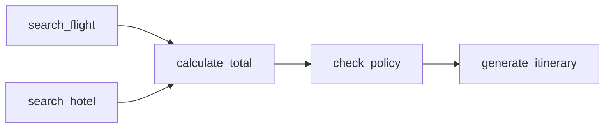

# 工程实践：Mini Planning Agent

> 一句话理解：**`planning_mini` 是一个纯 Python、零外部 API 的最小 Planning Agent，演示任务分解、DAG 感知执行、观测追踪与动态重规划。**

本章通过一个可运行的最小 Demo，把前面讲的架构与循环落地。Demo 位于 `docs/05-agent/planning/mini-demo/`，包名为 `planning_mini`。

## 场景

用户任务：

```text
"帮我规划一次 北京→东京 3 天旅行，预算 8000 元"
```

系统把任务分解为 5 个工具调用步骤，按依赖关系构成 DAG：



执行时 `search_flight` 返回"航班售罄"，Observer 记录失败事件，Replan Trigger 判定可恢复并触发重规划，Mock LLM 给出改用替代航班的新计划，最终生成行程。这正是 Plan → Execute → Observe → Replan 闭环的最小完整演示。

## 目录结构

```
docs/05-agent/planning/mini-demo/
├── planning_mini/
│   ├── __init__.py
│   ├── llm_client.py      # MockLLMClient：按关键词返回确定性计划/重规划 JSON
│   ├── plan.py            # Step/Plan 数据模型、拓扑排序、就绪步骤选择
│   ├── planner.py         # TaskPlanner：把 LLM 输出校验为 Plan
│   ├── tool_registry.py   # ToolRegistry：注册并执行 mock 工具
│   ├── executor.py        # PlanExecutor：调度就绪步骤、解析参数引用、驱动重规划
│   ├── observer.py        # Observer：记录执行事件 trace
│   ├── replan_trigger.py  # ReplanTrigger：决定继续 / 重规划 / 终止
│   ├── policy.py          # Policy：步数、工具白名单、预算、重规划次数上限
│   └── demo.py            # run_demo() 入口，打印计划、trace 与结果
├── tests/
│   ├── test_plan.py
│   ├── test_planner.py
│   ├── test_llm_client.py
│   ├── test_executor.py
│   ├── test_replan_trigger.py
│   └── test_demo.py
├── pyproject.toml
└── README.md
```

## 运行方式

```bash
cd docs/05-agent/planning/mini-demo
pip install -e ".[dev]"
planning-demo
```

`pyproject.toml` 中定义了 console script（也可以用 `python3 -m planning_mini.demo` 直接运行）：

```toml
[project.scripts]
planning-demo = "planning_mini.demo:run_demo"
```

## 关键代码片段

### plan.py：DAG 计划模型

`Plan` 负责拓扑排序与就绪步骤检测——这是 Scheduler 语义的最小实现：

```python
@dataclass
class Step:
    id: str
    tool: str
    args: Dict[str, Any] = field(default_factory=dict)
    deps: List[str] = field(default_factory=list)
    status: str = "pending"      # pending / running / completed / failed
    result: Any = None
    observations: List[str] = field(default_factory=list)

@dataclass
class Plan:
    task: str
    steps: List[Step]

    def topological_order(self) -> List[Step]:
        # Kahn 算法；依赖未知或有环时抛 ValueError
        ...

    def ready_steps(self) -> List[Step]:
        # 返回所有依赖已完成、自身仍 pending 的步骤（可并行批）
        completed = {s.id for s in self.steps if s.status == "completed"}
        return [s for s in self.steps
                if s.status == "pending" and all(d in completed for d in s.deps)]
```

### planner.py：LLM 输出的校验与解析

Planner 不只解析 JSON，还校验工具名是否存在、DAG 是否合法——对应生产中的 Plan Validator：

```python
class TaskPlanner:
    def create_plan(self, task: str) -> Plan:
        raw = self.llm_client.generate_plan(task, list(self.tool_registry.tools))
        if "steps" not in raw:
            raise ValueError("LLM plan is missing the 'steps' key")
        steps = []
        for item in raw["steps"]:
            if item["tool"] not in self.tool_registry.tools:
                raise ValueError(f"Unknown tool '{item['tool']}' in plan")
            steps.append(Step(id=item["id"], tool=item["tool"],
                              args=item.get("args", {}), deps=item.get("deps", [])))
        plan = Plan(task=task, steps=steps)
        plan.topological_order()   # 构造时即做 DAG 合法性检查
        return plan
```

### executor.py：执行循环 + 参数引用解析

执行器反复选取就绪步骤执行，并在每轮结束后询问 Replan Trigger。亮点是**参数引用解析**：步骤参数里字符串值如果等于某个已完成步骤的 id，就自动替换为该步骤的产出（ReWOO 占位符思路的最小版）：

```python
def _resolve_args(self, args, plan):
    """{"flight_price": "search_flight"} 会被替换为 search_flight 步骤的 result。"""
    mapping = plan.step_map()

    def resolve(value):
        if isinstance(value, str) and value in mapping:
            dep = mapping[value]
            if dep.status == "completed":
                return dep.result
            raise ValueError(f"Dependency '{value}' is not completed")
        if isinstance(value, dict):
            return {k: resolve(v) for k, v in value.items()}
        if isinstance(value, list):
            return [resolve(v) for v in value]
        return value

    return {k: resolve(v) for k, v in args.items()}
```

重规划时，执行器把失败步骤的观测传给 LLM 客户端生成新计划，并先经 `policy.validate()` 校验再切换：

```python
def _replan(self, plan, replan_count):
    failed_step = plan.failed_steps()[0]
    observation = failed_step.observations[-1]
    raw = self.planner.llm_client.replan(plan, failed_step.id, observation)
    new_plan = self.planner.create_plan_from_raw(plan.task, raw)
    self.policy.validate(new_plan)   # 步数/工具白名单校验，不通过直接拒绝
    return new_plan
```

### replan_trigger.py 与 policy.py：克制的触发器

```python
class ReplanTrigger:
    def decide(self, plan, observer, replan_count) -> str:
        # 返回 "continue" / "replan" / "fail"
        for step in plan.failed_steps():
            if step.tool == "search_flight" and step.result.get("status") == "sold_out":
                return "replan" if self.policy.can_replan(replan_count) else "fail"
        for step in plan.steps:
            if step.tool == "check_policy" and step.result.get("approved") is False:
                return "replan" if self.policy.can_replan(replan_count) else "fail"
        return "continue"

@dataclass
class Policy:
    max_steps: int = 10
    max_replans: int = 2
    budget_ceiling: float = 8000.0
    allowed_tools: Optional[Set[str]] = None

    def can_replan(self, replan_count: int) -> bool:
        return replan_count < self.max_replans   # 硬上限，防重规划风暴
```

### demo.py：入口装配

```python
def run_demo():
    task = "帮我规划一次 北京→东京 3 天旅行，预算 8000 元"
    registry = ToolRegistry()
    registry.sold_out = True          # 故意让首班航班售罄，触发 replan 路径

    llm_client = MockLLMClient()
    planner = TaskPlanner(llm_client, registry)
    policy = Policy(max_steps=10, max_replans=2, budget_ceiling=8000.0,
                    allowed_tools=set(registry.tools.keys()))
    executor = PlanExecutor(registry, Observer(), ReplanTrigger(policy), policy, llm_client)

    plan = planner.create_plan(task)
    result = executor.run(plan)       # success=True, replan_count=1
    print(plan.steps[-1].result)
```

## 测试结果

运行 `pytest tests/`（6 个测试文件，共 14 个用例，全部通过）：

- `test_plan.py`：Step/Plan 模型、拓扑排序、环检测、就绪步骤选择。
- `test_planner.py`：计划解析与未知工具拒绝。
- `test_llm_client.py`：Mock LLM 的确定性计划输出。
- `test_executor.py`：DAG 执行、参数引用解析、失败传播。
- `test_replan_trigger.py`：继续/重规划/终止三分支决策。
- `test_demo.py`：端到端 demo 成功完成且恰好触发 1 次 replan。

示例输出：

```text
$ planning-demo
[search_flight] step_failed: 航班 北京->东京 已售罄
[search_flight] replan_decision: 航班售罄，触发 replan
replan_executed: 第 1 次 replan，生成 5 步
...
plan_completed: 计划在 5 次迭代后完成
北京>东京 3天行程：入住东京商务酒店，乘坐北京->东京直达航班，总花费5000元。
```

## 与生产系统的差异

这个 Demo 刻意保持最小化，生产落地时至少需要补齐：

| 方面 | Demo | 生产 |
|---|---|---|
| LLM 调用 | `MockLLMClient` 返回硬编码 JSON | 真实模型 + structured output、prompt 版本管理、缓存 |
| 工具 | 内存 Python 函数、固定输出 | 外部 API（航班/酒店/支付），带重试、超时、熔断 |
| 观测 | Observer 是内存事件列表 | 持久化 telemetry（OpenTelemetry、结构化日志、trace） |
| 重规划 | 基于关键词规则 | 基于 LLM 的根因分析与计划修复，并做成本估算 |
| 执行 | 单进程串行执行就绪批 | 分布式 worker、并行分支、并发限额 |
| 策略 | 小 dataclass | 集中式 guardrails、RBAC、预算追踪、审计 |
| 安全 | 无网络无鉴权 | 鉴权、密钥管理、限流、沙箱 |

## 本章小结

- `planning_mini` 通过 9 个模块演示了 Planning Agent 的最小闭环：Planner 校验生成 DAG → Executor 调度就绪批并解析参数引用 → Observer 记录事件 → Replan Trigger 决定继续/重规划/终止 → Policy 守住步数、工具、预算、重规划次数四道上限。
- Demo 特意演示了"失败 → 结构化观测 → 重规划 → 成功"的完整路径，这是 Planning 层相对单次 prompt 的核心价值。
- 与生产系统的差距主要在真实 LLM 集成、分布式调度、持久化观测、根因分析型重规划与安全审计。

**参考来源**
- [Planning for Agents - LangChain Blog](https://blog.langchain.dev/planning-for-agents/)
- [LangGraph Plans](https://langchain-ai.github.io/langgraph/concepts/plans/)
- [ReWOO: Efficient Agentic Workflow with World Model-Based Sequential Planning](https://arxiv.org/abs/2305.18323)
- [OpenAI Agents SDK Handoffs](https://openai.github.io/openai-agents-python/handoffs/)
- [AutoGen Planning Tutorial](https://microsoft.github.io/autogen/stable/user-guide/agentchat-user-guide/tutorial/planning.html)
