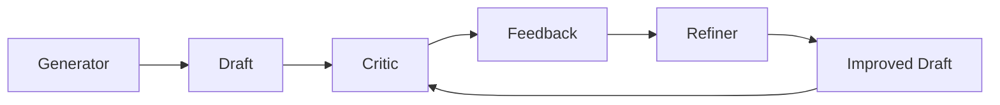
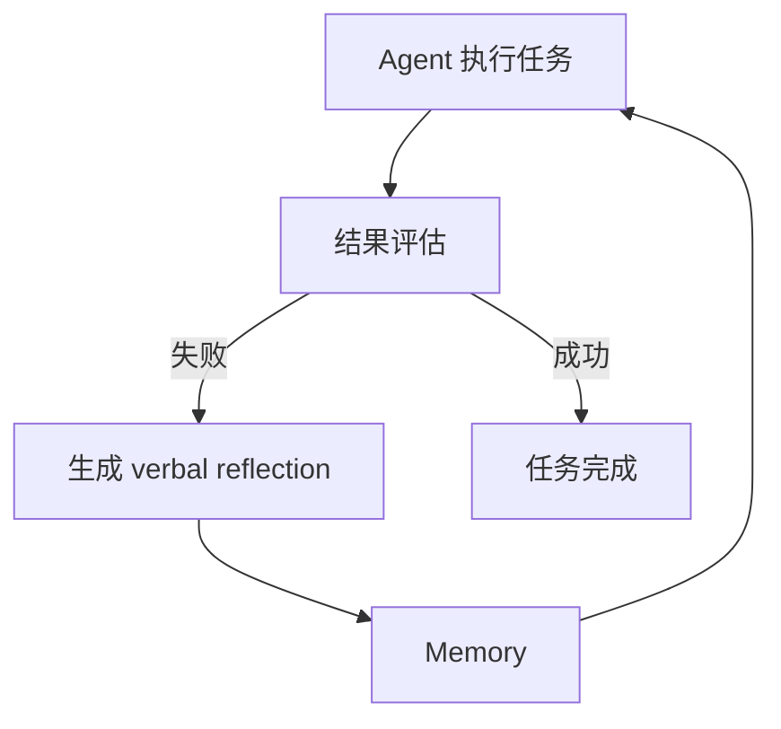
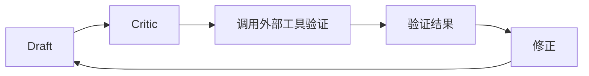
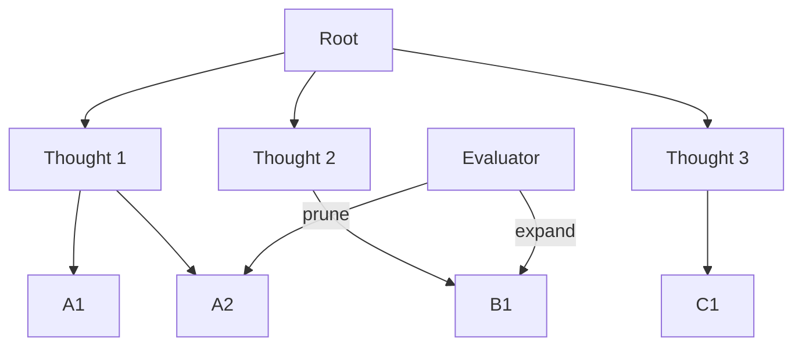
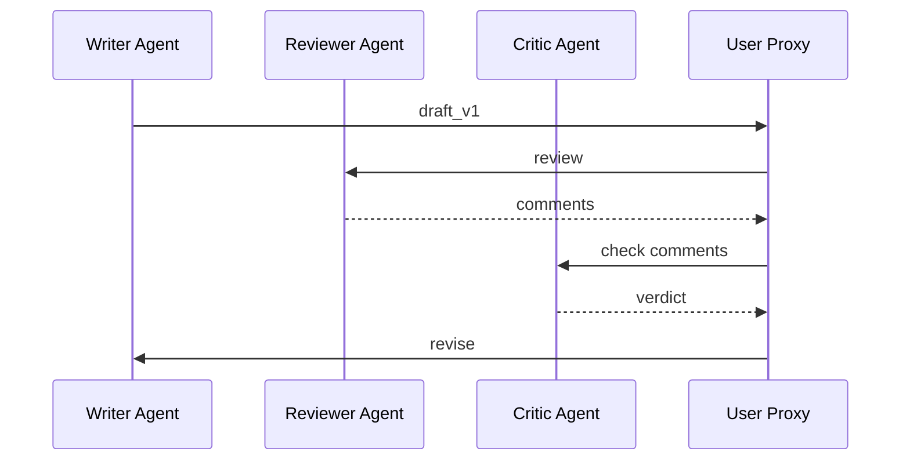
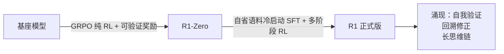
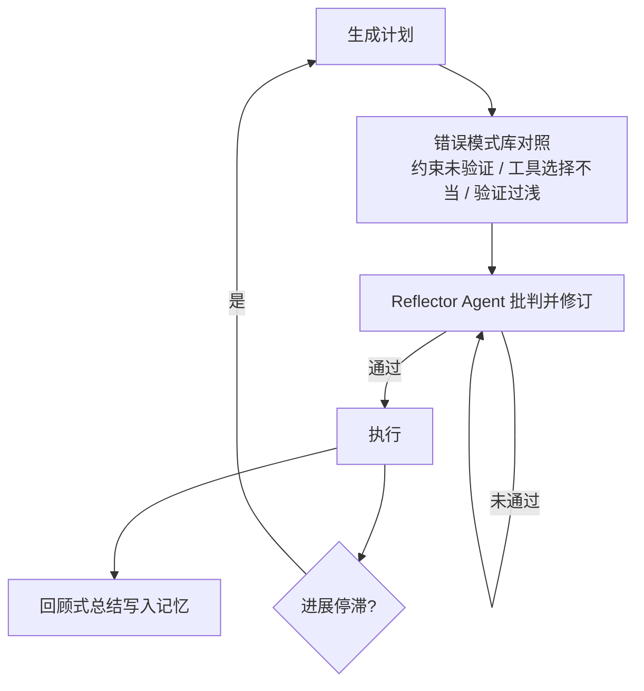

# 6. 源码分析

> 一句话理解：**主流 Reflection 实现各有侧重：Self-Refine 强调单模型自迭代，Reflexion 把反思写入记忆，CRITIC 引入外部工具验证，Tree of Thoughts 用搜索拓展解空间，LangGraph 与 AutoGen 提供工程化编排，o1/DeepSeek-R1 把反思内隐或训练进模型，A-Mem/ACE 让反思记忆自主演化，PreFlect 则把反思前移到执行之前**。

## 主流方案对比

| 方案 | 核心思想 | 反馈来源 | 是否写 Memory | 典型场景 |
|---|---|---|---|---|
| **Self-Refine** | 同一个模型轮流生成与批判 | 内部反馈 | 否 | 文本润色、简单推理 |
| **Reflexion** | 把 verbal reinforcement 写入记忆 | 内部反馈 + 任务结果 | 是 | 长期任务、连续学习 |
| **CRITIC** | 调用外部工具验证并修正 | 外部反馈 | 否 | 代码、事实、数学 |
| **Tree of Thoughts** | 在思维树上搜索并剪枝 | 内部/外部评估 | 否 | 数学、规划、组合优化 |
| **LangGraph Reflection** | 用图节点编排生成—反思循环 | 内部/外部均可 | 可选 | 生产级 Agent 工作流 |
| **AutoGen Reflection** | 多 Agent 互相批判 | 内部/外部均可 | 可选 | 多角色审稿、代码审查 |
| **OpenAI o1 / Reasoning Models** | 模型内部长链推理与自我修正 | 内部（训练习得） | 否（模型内隐） | 复杂推理、数学、代码 |
| **DeepSeek-R1** | 纯 RL 在可验证奖励上训练，反思行为涌现 | 内部（RL 习得） | 否（模型内隐） | 数学、代码、开放推理 |
| **SCoRe** | 用多轮 RL 显式训练自纠错能力 | 内部（RL 习得） | 否 | 让模型“学会”改错而非 prompt 改错 |
| **PreFlect** | 执行前对计划做前瞻式批判修订 | 错误模式库 + Critic | 否（执行后沉淀） | 高风险长链路任务 |
| **A-Mem / ACE** | 反思记忆/上下文自主生长演化 | 执行反馈 | 是（演化式） | 长期 agent、持续学习 |

## Self-Refine

Self-Refine 是最早系统化的单模型 Reflection 方案之一。

### 核心流程



### 设计要点

- **同一模型担任多角色**：通过不同 prompt 让模型在 Generator、Critic、Refiner 之间切换。
- **无外部依赖**：完全依赖模型自身的批判能力。
- **零记忆**：每次任务独立，不累积经验。

### 优点与局限

| 优点 | 局限 |
|---|---|
| 实现简单 | Critic 容易与 Generator 共享偏见 |
| 无需外部工具 | 对需要客观验证的任务效果有限 |
| 适合文本生成类任务 | 不积累经验 |

### 工程启示

Self-Refine 证明了“生成—批判—修订”闭环的有效性，但生产环境通常需要外部验证和记忆沉淀。

## Reflexion

Reflexion 在 Self-Refine 基础上增加了**记忆机制**，让 Agent 能从失败中学习。

### 核心流程



### 设计要点

- **Verbal Reinforcement Learning**：用语言形式的反思替代传统强化学习的数值奖励。
- **Memory 分两类**：
  - **Short-term Memory**：当前 episode 的近期经验。
  - **Long-term Memory**：跨 episode 累积的经验教训。
- **Self-reflection model**：专门负责生成反思文本。

### 优点与局限

| 优点 | 局限 |
|---|---|
| 经验可跨任务复用 | 反思文本质量直接影响效果 |
| 适合长期连续任务 | 记忆膨胀需要管理 |
| 可解释性强 | 对需要外部验证的任务仍需扩展 |

### 工程启示

Reflexion 告诉我们：Reflection 的价值不仅在于“改好这一次”，更在于“让下一次更好”。

## CRITIC

CRITIC 强调**外部工具验证**，是代码生成和事实校验场景的重要参考。

### 核心流程



### 设计要点

- **Tool-interactive critiquing**：Critic 不只做文本检查，还会主动调用工具。
- **Verify-then-correct**：先验证，再基于验证结果修正。
- 支持的工具包括：搜索引擎、代码解释器、计算器、数据库等。

### 优点与局限

| 优点 | 局限 |
|---|---|
| 反馈客观可验证 | 工具调用增加延迟和成本 |
| 适合代码、事实、数学 | 工具覆盖范围决定上限 |
| 能打破模型幻觉 | 工具本身也可能出错 |

### 工程启示

CRITIC 是生产系统的关键参考：对于可客观验证的任务，内部 Critic 必须叠加外部工具验证。

## Tree of Thoughts

Tree of Thoughts（ToT）不是严格意义上的 Reflection，但它与 Reflection 高度互补：ToT 负责**在解空间中搜索**，Reflection 负责**评估和修正每个节点**。

### 核心流程



### 设计要点

- **思维作为节点**：每个节点是一个中间推理步骤。
- **搜索策略**：BFS、DFS、Beam Search。
- **Evaluator 打分**：对每个节点进行价值评估，决定剪枝或扩展。

### 与 Reflection 的关系

| ToT | Reflection |
|---|---|
| 在多个候选中搜索 | 对单个候选迭代改进 |
| 节点级评估 | 整稿级评估 |
| 适合解空间大的问题 | 适合需要精细打磨的问题 |

工程上可以把两者结合：ToT 生成多个候选，Reflection 对每个候选精细打磨，最后选最优。

## LangGraph Reflection

LangGraph 把 Reflection 表达为**状态图（StateGraph）**，适合生产级编排。

### 典型结构


### 设计要点

- **状态驱动**：整个循环的状态（draft、critique、iteration）显式保存在 State 中。
- **节点即函数**：Generate、Reflect 都是普通 Python 函数，便于测试和复用。
- **边即条件**：通过条件边决定继续循环还是终止。
- **可持久化**：支持 checkpoint，任务中断后可恢复。

### 生产优势

| 优势 | 说明 |
|---|---|
| 可视化 | 图结构清晰，便于理解和调试 |
| 可扩展 | 节点可独立升级、替换 |
| 可观测 | 每个节点的输入输出都能被 trace |
| 可恢复 | checkpoint 支持失败恢复 |

### 关键代码模式

```python
from langgraph.graph import StateGraph, END

graph = StateGraph(State)
graph.add_node("generate", generate_node)
graph.add_node("reflect", reflect_node)
graph.set_entry_point("generate")
graph.add_edge("generate", "reflect")
graph.add_conditional_edges("reflect", should_continue, {"continue": "generate", "end": END})
```

## AutoGen Reflection

AutoGen 的 Reflection 主要体现在**多 Agent 对话**中，一个 Agent 可以专门扮演 Critic 或 Reviewer。

### 典型模式



### 设计要点

- **ConversableAgent**：每个 Agent 都能发送和接收消息。
- **GroupChat**：多个 Agent 在群聊中协作。
- **Reflect 模式**：可以在对话中插入反思轮次。

### 生产优势

| 优势 | 说明 |
|---|---|
| 角色分离 | Generator 与 Critic 可以是不同模型或不同配置 |
| 群体智慧 | 多个 Critic 提供多角度反馈 |
| 灵活 | 可嵌入到复杂多 Agent 工作流 |

## OpenAI o1 / Reasoning Models

OpenAI o1 系列把 Reflection 内隐到模型内部，通过**长链推理（long internal reasoning）**实现自我修正。

### 特点

- 模型在内部生成大量 reasoning tokens，不对外暴露。
- 能够识别并修正自己推理链中的错误。
- 在数学、代码、科学推理任务上表现突出。

### 与显式 Reflection 的关系

| OpenAI o1 | 显式 Reflection 系统 |
|---|---|
| 反思过程在模型内部 | 反思过程在外部系统编排 |
| 不可控、不可观测 | 可控、可观测、可定制 |
| 适合通用推理 | 适合业务规则明确的任务 |

### 工程启示

Reasoning models 可以作为 Generator 或 Critic 的底层模型，但不应完全替代显式 Reflection 系统，因为后者提供可控性、记忆沉淀和外部验证能力。

## DeepSeek-R1：RL 催生的内隐反思

DeepSeek-R1（2025-01）给出了“反思能力可以训练出来”的强证据，路线与 o1 不同：**纯强化学习直接作用于基座模型**。

### 核心机制



- **可验证奖励**：奖励来自答案对错等客观信号，而非人类偏好。
- **aha moment**：训练中模型自发学会“多花时间重新评估初始思路”，思维链长度与准确率同步增长（R1-Zero 在 AIME 2024 上从 15.6% 一路涨到 71% pass@1）。
- **反思成为权重**：自我验证、回溯不再是 prompt 技巧，而是模型参数中的行为。

### 对 Reflection 工程的含义

| 之前 | 之后 |
|---|---|
| 反思靠外部系统编排 | 反思部分内化为模型能力 |
| Critic 每轮必跑 | 只在工具验证失败时触发外部反思 |
| Reflection 是应用层模式 | Reflection 同时是训练目标（RL reward 设计） |

## SCoRe：用 RL 训练“会改错”的模型

SCoRe（Kumar et al., Google DeepMind, ICLR 2025）系统回答了“能不能让模型自己学会纠错”的问题，答案是：可以，但**必须训，不能靠 prompt**。

### 核心发现

- **Prompt 自纠错基本失效**：不给外部反馈，让模型自我纠正，性能提升微乎其微，甚至会把对的改错。
- **SFT 纠偏失败**：在离线收集的“首次错误 → 修正”轨迹上做 SFT 会导致行为坍缩——模型学会了“修正”却不再产生多样的一答，分布失配严重。
- **两阶段 on-policy 多轮 RL 有效**：全部用模型自己生成的数据，加 KL 正则防止跑偏，并对“第二次尝试优于第一次”给予奖励加成。结果：MATH 自纠错 +15.6%，HumanEval +9.1%。

### 工程启示

如果业务需要稳定的自我纠错能力（如代码助手、数学辅导），长远方案是把 Reflection 从 prompt 工程升级为**训练工程**：用外部验证器构造可验证奖励，把“反思—修订”行为训进模型，而不是在生产循环里无限叠加 prompt。

## PreFlect：前瞻式反思的代表实现

PreFlect（Penn State, 2026-02）是“回顾式 → 前瞻式”转向的代表工作，目标是让反思发生在不可逆错误之前。

### 核心流程



### 设计要点

- **错误模式库**：从历史失败轨迹蒸馏出三类通用计划错误（约束验证不足、工具选择无效、内容验证过浅），作为前瞻批判的对照清单。
- **执行前批判**：Reflector 对计划做批判—修订循环，通过后才执行。
- **动态重规划**：执行中监控轨迹，停滞时触发重规划，新计划同样过前瞻批判。

### 效果

在 GAIA 基准上，PreFlect + GPT-4.1 达 58.18%、+ Gemini-2.5-Pro 达 59.39%，超过 AutoAgent、OWL 等多个更复杂的框架，且 token 成本更低（约 54 美元 vs HAL 的 74 美元）；最难的 Level 3 任务提升约 14%。

## A-Mem 与 ACE：会生长的反思记忆

这两篇 2025 年的工作把 Reflexion 的“反思写入记忆”升级为“记忆本身 agentic 化”。

### A-Mem（NeurIPS 2025）

- **Zettelkasten 式记忆**：每条记忆是一张“笔记”，带上下文、关键词、标签。
- **动态链接**：新记忆写入时自主建立与旧记忆的链接，支持多跳检索。
- **记忆演化**：后续反思会更新旧笔记的摘要与链接，记忆库随经验持续重组。
- 效果：在长期对话 benchmark 上超过固定记忆方案，多跳推理场景收益最大。

### ACE —— Agentic Context Engineering（2025-10）

- **上下文即 playbook**：不压缩历史，而是维护一份结构化、可执行的“经验手册”。
- **生成 → 反思 → 精选**循环：对 playbook 做增量更新（grow-and-refine），避免传统摘要的上下文坍缩与“简短偏好”。
- 效果：agent 基准约 +10.6%；DeepSeek-V3.1 + ACE 在 AppWorld 上追平 IBM-CUGA（GPT-4.1 级）生产 agent，适应延迟大幅降低。

### 工程启示

| Reflexion 式记忆 | A-Mem / ACE 式记忆 |
|---|---|
| 追加式写入，只增不改 | 写入 + 更新 + 链接 + 合并淘汰 |
| 检索靠向量相似度 | 检索靠结构化的笔记/手册 + 链接 |
| 噪声随时间累积 | 有演化机制控制质量 |
| 经验是“文本” | 经验是“状态” |

生产 Reflection 系统的 Memory 模块值得向这个方向演进，但要配套记忆卫生机制（质量分、版本、衰减），防止错误经验自我强化。

## Search-R1：反思与检索在训练时融合

Search-R1（2025-03）代表了 agentic 搜索方向的反思形态：用 RL 训练模型在推理过程中自主决定何时调用搜索引擎。

- **推理与检索交错**：模型学会自发插入“先检索再下结论”的步骤，甚至涌现出“结论前多检索一轮做自我验证”的行为。
- **检索 token 掩码**：训练时只计算推理 token 的损失，保证 RL 稳定。
- 效果：Qwen2.5-7B 在 QA 任务上比 RAG 基线提升约 41%。

启示：反思不一定以“Critic 模块”的形态存在——当外部工具（检索）参与训练时，验证行为可以直接长在模型的推理策略里。

## 如何选择

| 需求 | 推荐方案 |
|---|---|
| 快速原型、文本润色 | Self-Refine |
| 长期学习、跨任务改进 | Reflexion，或演进到 A-Mem / ACE |
| 代码生成、事实校验 | CRITIC（工具验证） |
| 复杂规划、解空间大 | Tree of Thoughts + Reflection |
| 生产级工作流 | LangGraph Reflection（checkpoint + HITL） |
| 多角色审稿 | AutoGen Reflection |
| 底层推理能力 | OpenAI o1 / DeepSeek-R1 等 reasoning models |
| 稳定自纠错能力（训练侧） | SCoRe 式 RL 训练，而非叠加 prompt |
| 高风险、失败不可逆的任务 | PreFlect 式前瞻式反思 + 动态重规划 |
| 长期 agent 的经验沉淀 | A-Mem / ACE 式演化记忆 |

## 本章小结

Self-Refine 奠定了单模型自迭代的基础，Reflexion 增加了记忆让经验可复用，CRITIC 引入外部工具实现客观验证，Tree of Thoughts 在解空间层面与 Reflection 互补，LangGraph 和 AutoGen 提供了工程化的编排能力。2025-2026 年的新变量是：DeepSeek-R1 与 SCoRe 证明反思能力可以通过 RL 直接训练进模型，prompt 级自批判的收益收窄；PreFlect 把反思前移到执行之前；A-Mem 与 ACE 让反思记忆从“追加的文本”变成“会生长的状态”；Search-R1 展示了反思与外部工具在训练时融合的路线。生产系统通常需要组合使用：显式 Reflection 负责可控性与记忆沉淀，外部工具负责客观验证，reasoning models 提供底层推理与内隐自检。

**参考来源**

- [Self-Refine: Iterative Refinement with Self-Feedback](https://arxiv.org/abs/2303.17651)
- [Reflexion: Self-Reflective Agents with Verbal Reinforcement Learning](https://arxiv.org/abs/2303.11366)
- [CRITIC: Large Language Models Can Self-Correct with Tool-Interactive Critiquing](https://arxiv.org/abs/2305.11738)
- [Tree of Thoughts: Deliberate Problem Solving with Large Language Models](https://arxiv.org/abs/2305.10601)
- [LangGraph Reflection Tutorial](https://langchain-ai.github.io/langgraph/tutorials/reflection/reflection/)
- [AutoGen Reflection](https://microsoft.github.io/autogen/stable/user-guide/agentchat-user-guide/tutorial/reflection.html)
- [OpenAI o1 / Reasoning Models](https://openai.com/index/learning-to-reason-with-llms/)
- [DeepSeek-R1: Incentivizing Reasoning Capability in LLMs via RL](https://arxiv.org/abs/2501.12948)
- [SCoRe: Training Language Models to Self-Correct via RL](https://arxiv.org/abs/2409.12917)
- [PreFlect: From Retrospective to Prospective Reflection in LLM Agents](https://arxiv.org/abs/2602.07187)
- [A-Mem: Agentic Memory for LLM Agents](https://arxiv.org/abs/2502.12110)
- [Agentic Context Engineering: Evolving Contexts for Self-Improving LMs](https://arxiv.org/abs/2510.04618)
- [Search-R1: Training LLMs to Reason and Leverage Search Engines with RL](https://arxiv.org/abs/2503.09516)
- [Revisiting the Role of Reflection in Reasoning Models](https://arxiv.org/abs/2510.08308)
- [LangGraph Blog — Reflection Agents](https://blog.langchain.dev/reflection-agents/)
