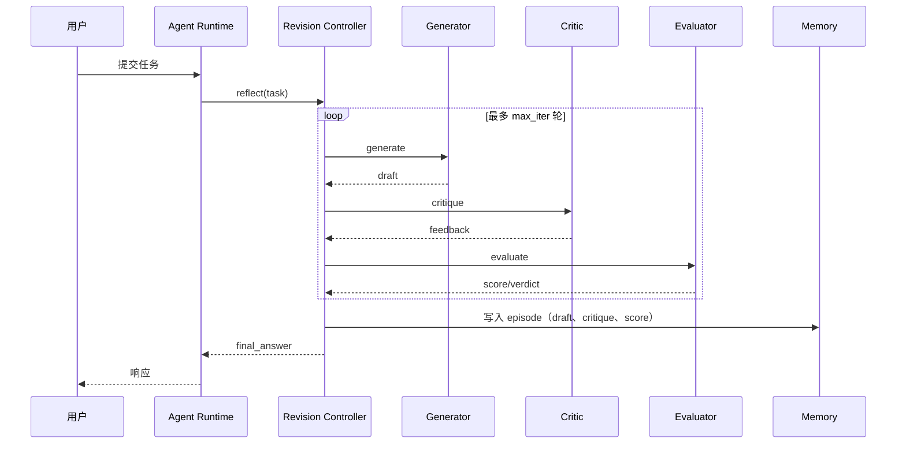

# 8. 企业生产实践

> 一句话理解：**生产级 Reflection 不是把 Generator 和 Critic 简单串起来，而是一套涉及模型选型、评分校准、在线/离线闭环、Runtime/Memory 集成、评测基准和人工兜底的系统工程**。

## 何时启用 Reflection

不是所有任务都值得反思。启用 Reflection 的典型信号：

| 信号 | 说明 |
|---|---|
| 单轮 LLM 错误率明显偏高 | 如代码生成、复杂规划、长文本写作 |
| 错误成本较高 | 如金融、法律、医疗、安全相关输出 |
| 有明确的评估标准 | 如代码可编译、测试通过、格式固定 |
| 允许额外延迟 | 反思通常增加 1~3 倍延迟，实时性强的场景慎用 |
| 有高质量 Critic 或验证工具 | 如单元测试、编译器、检索系统、专家规则 |

不建议开启的场景：

- 低延迟要求的对话补全（如客服首句回复）。
- 创意发散任务，过度反思会扼杀多样性。
- 评估标准模糊、人工都难以判断好坏的任务。

## Critic 模型选型

Critic 是 Reflection 系统的“质量守门人”，其选型直接影响反思效果。

| 选型 | 适用场景 | 优点 | 缺点 |
|---|---|---|---|
| **主模型自身兼任 Critic** | 资源受限、通用任务 | 无需额外部署，上下文一致 | 容易陷入自我偏好，批判不够独立 |
| **独立同尺寸模型** | 需要客观批判 | 视角独立，评估更公正 | 成本翻倍 |
| **小尺寸专用 Critic** | 高频调用、规则明确 | 成本低、延迟低 | 通用性差，需要微调 |
| **多 Critic 投票** | 高风险、复杂任务 | 降低单一 Critic 偏差 | 成本与延迟显著增加 |
| **外部验证工具** | 代码、事实、约束 | 客观、可解释 | 只覆盖可验证维度 |
| **Reasoning model 兼任** | 底层模型已具备内隐自检 | 无需额外 Critic 轮次，延迟低 | 不可观测、不可定制，无法替代工具验证 |

工程建议：

1. **先工具，后模型**：能用编译器、单元测试、检索验证的问题，优先用外部工具。
2. **Critic 比 Generator 更“保守”**：Critic 的温度应偏低，提示词要求明确、严格。
3. **小模型 Critic 需要微调**：用人工标注的 critique 数据微调 7B~13B 模型，可在低成本下获得不错效果。
4. **多 Critic 用于高风险场景**：如代码安全审查、医疗建议，可使用 3 个 Critic 投票。
5. **Reasoning model 时代重排优先级**：如果底层已是 o1/R1 级模型，其内隐自检已覆盖大量表面问题，外部 Critic 应聚焦工具验证和业务规则，而不是重复“通读检查”。注意内隐反思不可观测，关键链路仍需外部验证兜底。
6. **用“外部角色”呈现被审对象**：2026 年的《The Self-Correction Illusion》（arXiv:2606.05976）发现，模型标记自己推理链中的错误很难，但把同一条错误主张改标为用户消息、工具返回或记忆块后，显式纠错率提升 23~93 个百分点。即便 Critic 与 Generator 是同一个模型，给 Critic 独立角色与独立上下文（不沿用生成时的推理痕迹）也是零成本的可靠性提升。

## 评分校准

Evaluator 的 score 必须与人感知的质量一致，否则 Reflection Loop 会陷入“自说自话”。

### 校准步骤

1. **定义评分维度**
   - 文本任务：准确性、完整性、连贯性、风格符合度。
   - 代码任务：编译通过、测试通过、性能、安全性、可读性。
   - 规划任务：可行性、资源效率、风险覆盖。

2. **人工标注评测集**
   - 收集 100~500 条 (draft, critique, score) 样本。
   - 由领域专家打分，作为 golden label。

3. **拟合 Evaluator**
   - 调整 prompt、权重，使 Evaluator 输出与人工打分的 Pearson/Spearman 相关系数达到 0.8 以上。
   - 对离散型 verdict，要求与人工一致率 ≥ 85%。

4. **持续监控**
   - 在线收集人工反馈，定期回灌到评测集。
   - 监控 score 分布漂移，发现异常及时调整。

### 常见校准问题

| 问题 | 现象 | 解决 |
|---|---|---|
| score 膨胀 | 大多数输出都在 0.9 以上 | 收紧 prompt、增加区分度维度、重新标注 |
| score 与人工不一致 | Evaluator 给高分但人工觉得差 | 增加反例样本、细化 rubric |
| 维度间权重失衡 | 某一项主导总分 | 用加权平均或几何平均，定期 A/B 测试 |

## 在线反思 vs 离线反思

| 模式 | 触发时机 | 适用 | 实现 |
|---|---|---|---|
| **在线反思** | 请求处理过程中同步执行 | 延迟可接受、错误成本高 | 把 Revision Loop 接入 Agent Runtime 的主循环 |
| **离线反思** | 请求结束后异步执行，或批量处理 | 日志分析、对话复盘、经验沉淀 | 消费运行日志，生成 critique 与改进建议，写入 Memory |
| **混合反思** | 在线轻量反思 + 离线深度反思 | 大多数生产系统 | 在线做 1~2 轮快速修订，离线做 episode 级总结 |

在线反思适合“当前回答必须更好”，离线反思适合“长期积累经验”。

## 反思预算与提前终止

2025-2026 年的生产实践把“反思预算”明确为一级工程对象——反思不再是“每轮必跑”，而是受预算约束的稀缺资源：

- **critique budget 惯例为 1~3 轮**：LangGraph 生态的生产 runbook 普遍把批判/自愈预算设为最多 3 次迭代，超出即降级或升级人工，避免“过度自愈掩盖真实 bug”。
- **确认性反思可提前截断**：arXiv:2510.08308 显示 reasoning models 的反思多为确认性、很少改变答案，提前截断可省约 24.5% token、精度损失不足 2.9%。
- **收益按领域分配**：NeurIPS 2025 Efficient Reasoning Workshop 的《Finding the Sweet Spot》表明反思收益强依赖领域与模型——数学推理收益明显，翻译、本地化等任务收益不稳定，应按领域配置预算而非全局统一。
- **token 硬顶**：除 max_iter 外再设每任务反思 token 上限，防止 reasoning model 的长链内隐反思失控拉高成本。
- **给 Critic 一个“停”的出口**：EvoResearcher（2026-08，arXiv:2608.18884）用 "CONFIRMED" 哨兵实现训练无关的提前终止，82~88% 的样本在等精度（95% Wilson 区间内）提前结束、平均每题约 2.1 次生成——生产循环里“Critic 有权宣布收敛”优于“跑满固定轮数”。

## 记忆卫生（Memory Hygiene）

Reflection 写 Memory 是双刃剑：错误反思一旦沉淀，会被后续任务反复检索、放大、自我强化。2025-2026 年的实践要求：

- **写入有门槛**：只有带外部验证信号（测试通过、人工确认）的反思才允许写入长期 Memory；纯模型自评的反思标记为“未证实”。
- **条目带质量分与版本**：可演化记忆（A-Mem/ACE 式）每次更新保留版本历史，支持回滚。
- **衰减与淘汰**：低命中率、被后续经验证伪的条目要降权或废弃，防止记忆膨胀与噪声累积。
- **污染监控**：定期抽样审计 Memory 命中效果，发现“学了坏经验”及时清理。

## 与 Runtime 集成



集成要点：

- **timeout 必须覆盖 Reflection 循环**：设置 `timeout = generator_timeout + max_iter * (critique_timeout + evaluate_timeout + revise_timeout)`。
- **错误隔离**：Critic 或 Evaluator 失败时，应降级为“无反思直接返回 Generator 输出”，而非整体失败。
- **流式输出**：如果 Runtime 支持流式，反思阶段可以隐藏，只把最终 draft 流给用户。

## 与 Memory 集成

Reflection 产生的数据是 Memory 的宝贵输入：

- **短期 Memory**：当前 loop 的 draft、critique、score 保存在 Workspace，供下一轮使用。
- **长期 Memory**：把 (task, final_draft, best_critique, score) 作为 episode 写入，支持后续检索相似任务的经验。
- **策略 Memory**：记录“哪些 critique 类型最常出现”，用于优化 Critic prompt 或训练数据。

写入结构建议：

```json
{
  "episode_id": "...",
  "task_type": "code_generation",
  "request_summary": "Implement a Redis cache wrapper",
  "iterations": 3,
  "final_score": 0.95,
  "critique_categories": ["missing_error_handling", "typing_issue"],
  "lesson": "Always add type hints and retry logic for Redis connections."
}
```

## 评测基准

生产环境需要为 Reflection 建立评测基准（benchmark）：

| 层级 | 指标 | 说明 |
|---|---|---|
| **模块级** | Critic 准确率、Evaluator 与人工一致性 | 单独评估 Critic 和 Evaluator |
| **Loop 级** | 通过率、平均迭代次数、首次通过时间 | 评估整个反思循环的效率 |
| **端到端** | 任务成功率、人工满意度、延迟、成本 | 评估 Reflection 对最终用户体验的贡献 |
| **轨迹级** | 单步决策正确率、轨迹与最优路径偏离度 | 2025 年后 agent 评测标配，避免只看最终答案 |
| **长期** | 重复错误率、Memory 命中率、坏经验污染率 | 评估反思经验是否真正被复用且未被污染 |

2025 年后生产 agent 评测的通行做法是**三层评测**（最终回答、完整轨迹、单步决策分别建 eval）配合 **Pass^k 可靠性指标**（同一任务跑 k 次要求全部通过，而非 Pass@k 只看最好一次），并接入 OpenTelemetry/LangSmith 做轨迹追踪。建议用离线数据集定期回归，避免线上 A/B 测试才能发现问题。

## 人工兜底（Human-in-the-Loop）

生产 Reflection 系统必须有人工兜底机制：

| 触发条件 | 处理方式 |
|---|---|
| 连续 N 轮未通过 | 暂停循环，把当前最佳版本 + 问题清单提交人工 |
| 涉及安全/合规/伦理 | 直接升级人工审核，不自动输出 |
| Evaluator 分数波动剧烈 | 标记为不确定，请求人工确认 |
| 高风险领域（医疗/法律/金融） | 默认需要人工批准后才能输出 |
| 用户投诉或反馈差 | 人工介入复盘并修正策略 |

人工反馈应回流到训练数据或 prompt 优化中，形成“机器反思 + 人工校正”的飞轮。

## 成本与延迟优化

| 策略 | 效果 |
|---|---|
| 按任务启用 Reflection | 避免所有请求都走反思流程 |
| Critic 使用小模型 | 显著降低 token 成本 |
| 缓存 critique | 相似 draft 直接复用历史批判 |
| 提前终止 | score 已达 threshold 立即停止 |
| 异步离线反思 | 把重计算放到请求结束后 |
| 限制输入长度 | 过长的 draft/critique 增加成本和延迟 |

## 生产踩坑清单

| 坑 | 原因 | 应对 |
|---|---|---|
| 反思后反而更差 | Generator 过度迎合 Critic，破坏原意 | 保留历史最佳版本，允许回滚 |
| 无限循环 | 终止条件配置不当 | 强制 max_iter + 收敛检测 |
| Critic 与 Evaluator 不一致 | prompt 定义冲突 | 统一 rubric，联合校准 |
| 延迟超出预期 | 未考虑多轮调用 | timeout 与重试策略需覆盖整个 loop |
| 反思结果未沉淀 | 缺少 Memory 集成 | 每轮结束后写入 episode |
| 人工介入太频繁 | threshold 过严或 Critic 过敏感 | 调整 threshold、优化 Critic prompt |

## 本章小结

生产级 Agent Reflection 需要综合考虑 Critic 模型选型、评分校准、在线/离线模式、与 Runtime 和 Memory 的集成、评测基准、人工兜底和成本延迟优化。它不是万能药，应在错误成本较高、评估标准明确、延迟可接受的场景启用，并通过持续监控和校准保证反思结果真正提升输出质量。2025-2026 年的增量共识：给反思设预算（critique budget 1~3 轮 + token 硬顶 + Critic 哨兵式提前终止）、做记忆卫生（写入门槛、版本、衰减、污染监控）、评测补轨迹级与 Pass^k 可靠性指标，并在 reasoning model 之上把外部 Critic 聚焦到工具验证与业务规则——同时用“外部角色”呈现被审对象，把角色设计本身当作免费校准手段。

**参考来源**

- [Self-Refine: Iterative Refinement with Self-Feedback](https://arxiv.org/abs/2303.17651)
- [Reflexion: Self-Reflective Agents](https://arxiv.org/abs/2303.11366)
- [CRITIC: Large Language Models Can Self-Correct with Tool-Interactive Critiquing](https://arxiv.org/abs/2305.11738)
- [Revisiting the Role of Reflection in Reasoning Models](https://arxiv.org/abs/2510.08308)
- [The Self-Correction Illusion: Role Relabeling Gates Explicit Error Flagging in LLMs](https://arxiv.org/abs/2606.05976)
- [Training-Free Inference-Time Self-Reflection and Cost-Bounded Early Stopping (EvoResearcher)](https://arxiv.org/abs/2608.18884)
- [A-Mem: Agentic Memory for LLM Agents](https://arxiv.org/abs/2502.12110)
- [LangGraph Reflection Tutorial](https://langchain-ai.github.io/langgraph/tutorials/reflection/reflection/)
- [AutoGen Reflection](https://microsoft.github.io/autogen/stable/user-guide/agentchat-user-guide/tutorial/reflection.html)
