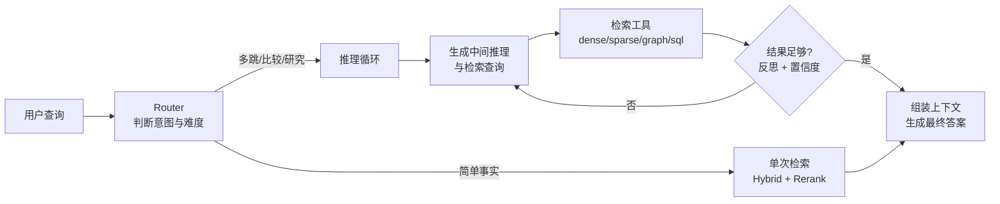

# 架构设计

RAG 系统可以拆分为两条主线：**数据平面**负责把原始知识加工成可检索的索引；**控制平面**负责在线查询的调度、策略、治理与可观测。两条线共同支撑可扩展、可迭代的企业级 RAG。

## 系统边界

```text
┌─────────────────────────────────────────────────────────────┐
│                      RAG Service                             │
│  ┌─────────────┐  ┌─────────────┐  ┌─────────────────────┐  │
│  │ Query API   │  │ Retriever   │  │ Generator Client    │  │
│  │ (HTTP/gRPC) │  │ (Dense/     │  │ (LLM Gateway /      │  │
│  │             │  │  Hybrid)    │  │  Direct Model)      │  │
│  └──────┬──────┘  └──────┬──────┘  └─────────────────────┘  │
│         │                │                                    │
│  ┌──────▼────────────────▼──────┐  ┌─────────────────────┐  │
│  │     RAG Orchestrator         │  │ Observer / Metrics  │  │
│  │  (rewrite → retrieve → rerank│  │                     │  │
│  │   → assemble → generate)     │  │                     │  │
│  └──────────────┬───────────────┘  └─────────────────────┘  │
└─────────────────┼────────────────────────────────────────────┘
                  │
┌─────────────────▼────────────────────────────────────────────┐
│                     Data Plane                               │
│  Loader → Parser → Chunker → Embedder → Vector Store          │
│                ↓                                             │
│         Metadata Store / Document Registry                    │
└─────────────────────────────────────────────────────────────┘
```

## 数据平面（Data Plane）

数据平面负责“把文档变成索引”。

1. **Document Loader**
   - 从对象存储（S3/OSS）、CMS、数据库、API、文件系统拉取原始文档。
   - 记录文档版本、来源、权限、更新时间。

2. **Parser / Extractor**
   - PDF、DOCX、PPTX、HTML、Markdown、代码文件解析。
   - 提取正文、标题层级、表格、图片占位符、链接。

3. **Chunker**
   - 按长度、结构、语义把文档切分为 chunk。
   - 输出带 metadata 的 chunk（source、section、page、tenant、updated_at）。

4. **Embedder**
   - 调用 embedding 模型把 chunk 编码为向量。
   - 支持批量、异步、失败重试与缓存。

5. **Vector Store & Metadata Store**
   - 存储向量与 metadata，支持 ANN 检索、过滤、增量更新。
   - metadata store 保存文档级信息，便于版本回滚与审计。

## 控制平面（Control Plane）

控制平面负责“让每次查询都高效、准确、可控”。

1. **Query API**
   - 接收用户查询，返回带引用的答案。
   - 支持同步、流式、批量三种模式。

2. **Query Preprocessor**
   - 查询重写、扩展、澄清、意图识别。
   - 过滤敏感词、注入用户/租户上下文。

3. **Retriever**
   - 执行 dense / sparse / hybrid 检索。
   - 与权限层协作，先按 tenant/source 过滤再召回。

4. **Reranker**
   - 对 Top-K 候选重排。
   - 可配置为可选阶段，低延迟场景可跳过。

5. **Context Assembler**
   - 把 chunks 按相关性排序、去重、截断，拼装成 prompt。
   - 处理 token 预算，避免超出模型上下文窗口。

6. **Generator Client**
   - 调用 LLM Gateway 或直接调用模型服务。
   - 处理流式输出、后处理、引用校验。

7. **Observer / Evaluator**
   - 记录每次查询的 trace、latency、token 成本、检索结果、生成结果。
   - 支持在线评估与离线评估闭环。

## 2025–2026 的架构演进：从线性流水线到 Agentic 检索

上面描述的是经典的“单轮线性”架构。2025 年后，推理模型与 RL 训练（Search-R1、ReSearch 等）把检索推入了 Agentic 范式，控制平面多出一个**检索决策循环**；到 2026 年，这一循环已成为生产 RAG 的默认形态：



三种典型模式（可按查询路由混合使用，来源：[Agentic RAG 综述](https://arxiv.org/abs/2501.09136)）：

| 模式 | 机制 | 优势 | 代价 |
|---|---|---|---|
| 单次 RAG（Single-shot） | 一次检索直接生成 | 延迟低、便宜 | 多跳问题效果差 |
| Router Agent | 先分类路由：闲聊直答、事实走单次、复杂走迭代 | 性价比均衡 | 路由本身有误差 |
| Iterative Agent | 推理—检索交替，自主决定何时停 | 多跳/比较类问题大幅提升 | 延迟 4 倍、token 3 倍 |

工程上必须配套三件事：

- **预算控制**：最大迭代次数、最大检索次数、token/延迟预算熔断，防止 Agent 循环失控。
- **工具化检索**：把 dense / BM25 / GraphRAG / SQL 查询都包装成工具（Tool Use 或 MCP Server），由 Agent 统一调度——2026 年 MCP 已迭代到 2.x 协议，主流框架的检索工具适配随之更新。
- **轨迹可观测**：每一步的检索查询、结果、反思都要进 trace（LangSmith、Langfuse、OpenTelemetry），否则线上无法定位是“没查到”还是“没想清楚”。

2026 年的两个新增标配：

- **grader / critique 节点**：用轻量模型或 LLM-as-judge 对每轮检索结果打分，作为“继续循环还是停止”的依据——这是 CRAG 思路（[arXiv:2401.15884](https://arxiv.org/abs/2401.15884)）的工程化，LangGraph、LlamaIndex 等框架均已提供现成的 grading/evaluator 组件。
- **编排框架模板化**：LangGraph（图状态机）、LlamaIndex Workflows（事件驱动，2026 年已 2.x）把 router / 迭代循环做成开箱节点，自研成本大幅下降；商业平台（Dify 等）也在 Agent 节点中内置“检索—反思”循环。

## 多租户与扩展性

| 维度 | 策略 |
|---|---|
| 数据隔离 | namespace/collection per tenant；或 metadata 字段 + 过滤器 |
| 索引分片 | 按 tenant、source、时间分片，降低单索引规模 |
| 查询并发 | 无状态 API 层横向扩展；向量库分片/副本 |
|  Embedding 吞吐 | 异步队列 + 批量编码 + GPU embedding 服务 |
| 缓存 | 查询结果缓存、embedding 缓存、检索结果缓存 |

## 与相邻系统的集成

- **LLM Gateway**：RAG 在线服务通过 Gateway 路由生成请求，统一限流、兜底、计费。
- **Agent Runtime / Tool Use**：Retriever 注册为工具，`search_knowledge_base(query)` 返回文档片段。
- **MCP**：把 Vector Store 包装成 MCP Server，任何兼容 Host 都能调用。
- **Memory**：长期记忆本身可以是向量存储；RAG 检索即“记忆读取”。

## 小结

一个可落地的 RAG 架构必须同时回答三个问题：

1. 知识如何**持续、可控地进入索引**？
2. 查询如何**快速、准确地命中知识**？
3. 答案如何**可追溯、可评估、可改进**？

下一章将围绕“查询生命周期”把这些模块串成完整的工作流程。
