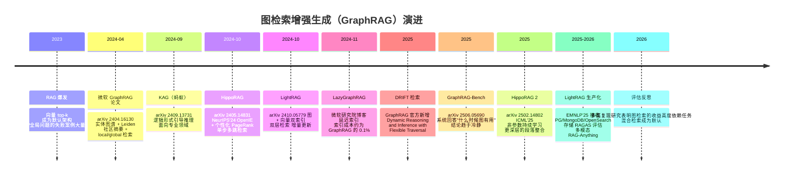
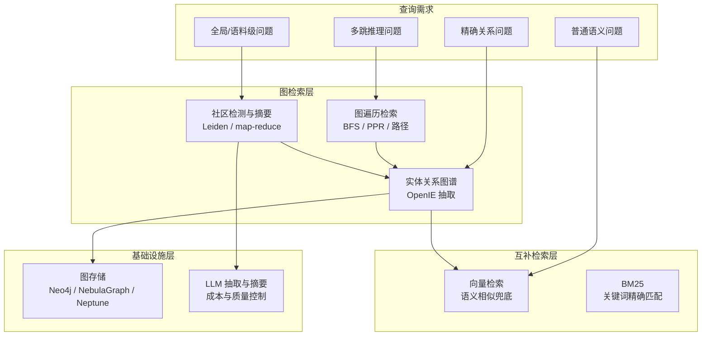

# 背景与动机：向量检索的两个盲区

2023 年 RAG 爆发之后，"切chunk、embedding、top-k、塞prompt" 成了标准动作。这条路在大多数单跳事实型问题上表现很好，但很快就撞上了两类结构性失败：一类是多跳推理问题，另一类是面向整个语料库的全局问题。GraphRAG 正是从这两个盲区里长出来的。

## 1.1 盲区一：多跳推理——答案不在任何一段里

考虑一个问题："由加州大学伯克利分校开发的推理引擎，其核心技术启发了 SGLang 的哪个组件？"

语料库里的相关事实分散在不同段落：

- 段落 C1：vLLM 是伯克利开发的，PagedAttention 是 vLLM 的核心技术；
- 段落 C3：RadixAttention 是 SGLang 的核心技术，且受 PagedAttention 启发。

向量检索的问题是：**没有任何一段能独立回答这个问题**。top-k 语义检索会把 C1 和 C3 都召回（它们都和问题字面相关），但"拼接这些事实得到答案"这一步被完全推给了 LLM——而 LLM 的上下文窗口里堆着 top-k 段原文时，往往找不到这条跨段的推理链。随着跳数增加（2 跳、3 跳……），召回的段各自相关但整体稀释，失败率迅速上升。

根本原因是：向量检索的检索单元是**段落**（chunk），而这类问题的检索单元应该是**事实之间的连接**。"A 的核心技术是 B，B 启发了 C" 是一条三节点的链，链的信息在切chunk时就被切断了。

## 1.2 盲区二：全局问题——"检索 top-k" 与"总结全部"的矛盾

再看一类完全不同的问题："这几千份研究文档整体上反映了哪些主题脉络？"、"我们所有客户投诉中最常见的根因类别是什么？"

这类**查询聚焦摘要（Query-Focused Summarization, QFS）**问题的特点是：相关文本不是几段，而是**语料库的大部分**。朴素 RAG 的 top-k 机制在这里有两个矛盾：

- 无论 k 取多大，都只覆盖语料的一个零头，答案以偏概全；
- 相关性打分对"全局概览"类问题几乎没有区分度——几乎每段都"有点相关"。

2024 年微软 GraphRAG 论文（arXiv 2404.16130）把这类问题明确建模为 QFS，并指出传统 RAG 的失败是结构性的：全局问题需要在**索引阶段**就对语料做过预消化（社区摘要），而不是查询时临时翻书。

## 1.3 知识图谱：把"连接"变成一等公民

知识图谱的基本单元是三元组（实体， 关系， 实体）：

```text
(PagedAttention, 核心技术, vLLM)
(PagedAttention, 启发, RadixAttention)
(RadixAttention, 核心技术, SGLang)
```

有了这张显式的图：

- **多跳问题**变成图上的路径查找——BFS、带权遍历、Personalized PageRank，都是成熟算法；
- **全局问题**变成图上的聚合——对图做社区检测，每个社区的实体关系天然是一个"主题簇"，对社区做摘要就得到了分主题的语料地图；
- **精确关系**（"谁提出了 GraphRAG"）从"相似度猜测"变成"边的精确匹配"。

历史上知识图谱的构建依赖大量人工标注与规则，只在搜索巨头手里玩得转。LLM 让这件事的成本掉了一个数量级：**用 LLM 从原始文本中自由抽取实体和关系（OpenIE）**，schema-free、不需要预定义本体，GraphRAG 由此具备了通用性。这也带来代价——抽取有噪声、有遗漏（本主题第 5 章展开）。

## 1.4 技术演进时间线



几个趋势值得记住：

1. **2024 年是范式确立年**：GraphRAG 论文给出了"图谱索引 + 社区摘要"的完整配方，LightRAG / HippoRAG 分别给出轻量化和多跳特化的替代路线。
2. **2025 年是成本优化年**：LazyGraphRAG 把昂贵的社区摘要延迟到查询时按需计算；LightRAG 持续补齐存储、评估、可观测性等生产短板。
3. **2025-2026 是评估冷静期**：GraphRAG-Bench 等系统研究指出，图检索的收益高度依赖任务类型——简单事实检索上它经常打不过纯向量检索。生产默认从"用图替代向量"转向"图 + 向量 + BM25 混合"。

## 1.5 本主题的问题域



与 [RAG 主题](/06-rag/)的分工：RAG 讲检索增强生成的通用流水线；本主题聚焦"图索引"这一专门化路线——它的构建成本、查询模式、适用边界都与向量 RAG 有本质差异。

## 小结

- 向量检索的单元是段落，多跳问题的单元是事实连接，全局问题的单元是整个语料——两类问题的失败都是结构性的，不是调参能解决的。
- LLM 让 schema-free 的知识图谱抽取成本变得可接受，图检索因此从搜索巨头的专利变成通用 RAG 选项。
- 2024 年确立范式，2025 年解决成本，2026 年的共识是混合：图、向量、BM25 各司其职。
