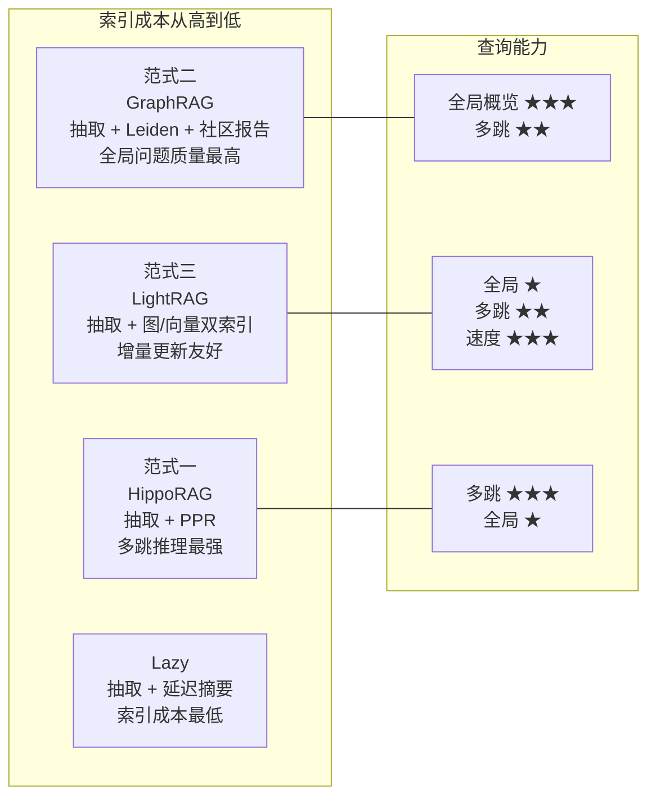

# 核心思想：局部 vs 全局检索，图索引三范式

GraphRAG 家族的所有实现都在回答同一个问题：**图的哪一部分结构、以什么预计算粒度，服务哪一类查询**。本章建立两个贯穿性的区分——局部 vs 全局检索、三种图索引范式——后续所有实现都是这两个维度的不同取舍。

## 2.1 局部检索与全局检索

GraphRAG 论文把查询显式分为两类：

| 维度 | 局部检索（Local Search） | 全局检索（Global Search） |
|---|---|---|
| 典型问题 | "GraphRAG 是谁提出的？" | "整个语料库有哪些研究主题？" |
| 检索单元 | 问题中的实体 + 一跳/两跳邻域 | 预计算的社区摘要（Community Reports） |
| 图上的动作 | 实体链接 → 邻域展开 → 取原文 chunk | 对所有社区报告 map-reduce |
| 类似传统 RAG 的 | 是（只是用图做召回增强） | 否（top-k 机制在结构上做不到） |
| 成本特征 | 低（一次实体匹配 + 一次子图查询） | 高（社区数 × LLM 调用） |

这个区分是整个范式最重要的概念工具：**局部检索可以被向量检索近似替代（甚至打不过），全局检索才是图索引的不可替代价值**。这也是后来评估研究（如 GraphRAG-Bench）反复验证的结论——很多"GraphRAG 不如朴素 RAG"的案例，实际上是在局部问题上拿昂贵的全局机制做错位的比较。

## 2.2 图索引的三种范式

同样是"LLM 抽图"，社区里演化出了三种不同的索引范式：

### 范式一：KG + 图遍历（HippoRAG 路线）

只做最便宜的索引：LLM 抽取三元组建图，**不预计算任何摘要**。查询时把问题中的实体当种子，在图上跑 Personalized PageRank（PPR）或 beam search，把与种子"图距离近且重要"的节点关联的原文段落取回来。

- 核心价值：**单步完成多跳检索**。PPR 的一次迭代本质上就是"从种子出发按边权扩散"，传统向量检索需要多轮"检索-再检索"才能完成的 2-3 跳推理，PPR 一轮完成（HippoRAG 论文的关键论点）。
- 代表：HippoRAG（NeurIPS 2024）、HippoRAG 2（ICML 2025）。
- 代价：全局概览类问题没有社区摘要可用，回答不了"语料库整体主题"类问题。

### 范式二：KG + 社区摘要（GraphRAG 路线）

索引时做最重的预计算：抽图之后跑层次化社区检测（Leiden），然后**对每个社区用 LLM 生成社区报告**（map-reduce：先逐条关系描述，再汇总成报告；社区之上还有超级社区报告）。

- 核心价值：**全局检索质量**。查询时对所有社区报告做 map-reduce，语料级的概览、对比、总结类问题第一次变得可回答。
- 代表：微软 GraphRAG（arXiv 2404.16130）。
- 代价：索引成本高（社区报告 = 大量 LLM 调用），且是离线批处理思维——文档更新意味着社区结构与报告的重新计算。

### 范式三：KG + 向量双索引（LightRAG 路线）

折中路线：抽图后，**实体、关系各自再做 embedding 存进向量库**，不预计算社区摘要。查询时做"双层检索"：低层用关键词/向量在图上定位实体，高层沿图边扩展取关系上下文，最终拼出混合上下文。

- 核心价值：**速度与增量更新**。没有社区摘要这个昂贵产物，索引快一个数量级；新文档只需增量抽图 + 增量向量插入（LightRAG 论文的标题就是 "Simple and Fast"）。
- 代表：LightRAG（EMNLP 2025 Findings）。
- 代价：全局概览能力弱于范式二，社区结构被显式放弃。

### 延迟索引：LazyGraphRAG 的第四选项

微软 2024 年 11 月的 LazyGraphRAG 提出了一个反直觉的观察：**社区摘要的价值可以延迟到查询时兑现**。索引阶段只做抽取 + 最便宜的社区结构计算（甚至不完全跑 Leiden），社区摘要在查询时被相关性问题触发、按需生成。

- 宣称收益：索引成本约为完整 GraphRAG 的 0.1%（约 1000 倍降低，官方示例：1 万篇文档从约 1 万美元降到约 10 美元）；全局查询成本约降为 1/700。
- 官方基准（5590 篇 AP 新闻、100 个合成全局问题）中，LazyGraphRAG 对向量 RAG、GraphRAG local/global/DRIFT、RAPTOR、LightRAG、TREX 取得 96 场全胜（95 场统计显著）。
- 注意：这是微软研究院博客发布的结果，未经独立大规模复现；后续研究对其优势范围有更冷静的描述。但"延迟计算"作为降本思路，已经实质影响了 2025 年后的系统设计。

## 2.3 三种范式的取舍光谱

一句话记忆：**范式二花钱买全局质量，范式三省钱换增量友好，范式一专攻多跳，Lazy 把花钱的决定推迟到查询那一刻**。

## 2.4 符号精确与语义近似的互补

最后一个核心思想：图检索与向量检索不是替代关系，而是**精确符号 vs 语义近似**的互补。

- 知识图谱的边是**离散符号**："GraphRAG -提出者-> 微软研究院"是精确的、可枚举的、可遍历的。适合：关系型、多跳、聚合类问题。
- 向量检索是**连续语义**："和这个问题意思相近的段落"。适合：表述多变、无明确实体、开放式问题。

生产系统的默认答案是把两者缝起来：LightRAG 的实体/关系本身就是向量索引的；向量库（Neo4j 的 vector index、NebulaGraph 的向量检索、或外挂 Milvus/Qdrant）与图库共存；混合排序用 RRF（Reciprocal Rank Fusion）合并。本主题 Mini Demo 的 `hybrid_search` 就是这个思路的最小实现。

## 小结

- 局部检索与全局检索是 GraphRAG 的第一性区分：前者向量检索可近似，后者才是图索引的不可替代价值。
- 三种图索引范式按预计算粒度排列：社区摘要（重，全局强）→ 图+向量双索引（中，增量友好）→ 纯图遍历（轻，多跳强）；LazyGraphRAG 证明预计算可以延迟到查询时。
- 图与向量是精确符号与语义近似的互补，混合检索是 2026 年的生产默认。
