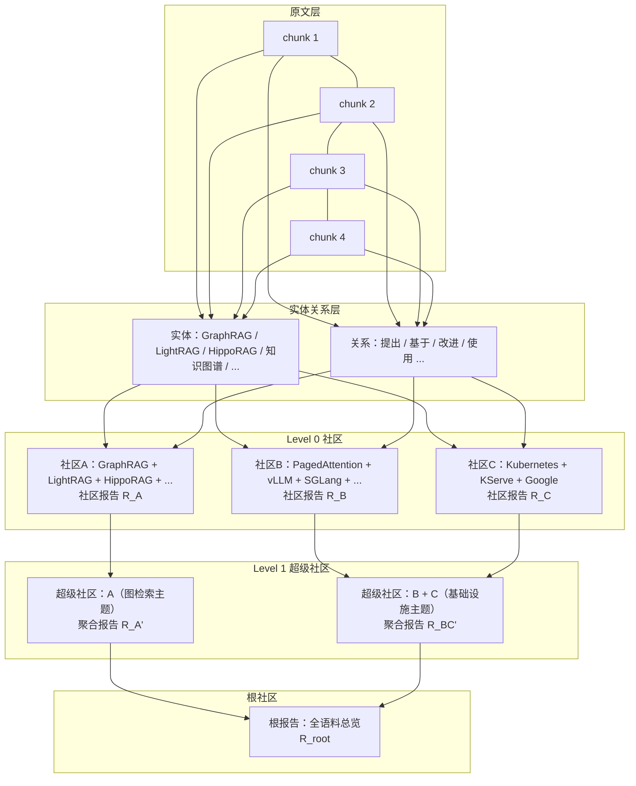
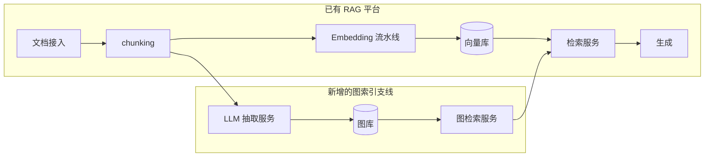

# 架构设计：GraphRAG 分层索引架构

一个 GraphRAG 系统不是一个单一组件，而是"抽取流水线 + 图存储 + 社区计算 + 摘要存储 + 查询路由"的组合。本章先给通用分层模型，再解剖 GraphRAG 的分层索引架构，最后讨论图存储选型。

## 3.1 通用分层模型

```mermaid
flowchart TB
    subgraph 接入层
        DOC[文档接入<br/>PDF / HTML / Markdown / 数据库]
        CHUNK[切分 chunking<br/>固定窗口 / 语义切分]
    end
    subgraph 索引构建（离线，资源大户）
        EXTRACT[LLM 抽取<br/>实体 / 关系 / 声明<br/>schema-free OpenIE]
        RESOLVE[实体解析<br/>同义归并 / 指代消解]
        GSTORE[(图存储<br/>实体节点 + 关系边)]
        VSTORE[(向量存储<br/>chunk / 实体 / 关系 embedding)]
        COMM[社区检测<br/>Leiden 层次化]
        CSUM[社区摘要<br/>map-reduce 生成报告]
        RSTORE[(报告存储<br/>分层社区报告)]
    end
    subgraph 查询服务（在线）
        ROUTER[查询路由<br/>local / global / DRIFT / 混合]
        LSEARCH[局部检索<br/>实体链接 + 邻域展开]
        GSEARCH[全局检索<br/>报告 map-reduce]
        HOP[多跳遍历<br/>BFS / PPR]
        HYBRID[混合排序<br/>RRF 合并图/向量/BM25]
    end
    subgraph LLM 层
        LLM[抽取 / 摘要 / 回答模型<br/>可分级配置]
    end
    DOC --> CHUNK --> EXTRACT
    EXTRACT --> RESOLVE --> GSTORE
    CHUNK --> VSTORE
    EXTRACT --> VSTORE
    RESOLVE --> COMM --> CSUM --> RSTORE
    CSUM --> LLM
    EXTRACT --> LLM
    ROUTER --> LSEARCH --> GSTORE
    ROUTER --> GSEARCH --> RSTORE
    ROUTER --> HOP --> GSTORE
    LSEARCH --> HYBRID
    HOP --> HYBRID
    ROUTER --> HYBRID
```

各层职责与设计要点：

| 层 | 职责 | 关键设计点 |
|---|---|---|
| 接入/切分 | 文档解析与 chunking | 切分粒度影响抽取质量：太短丢上下文，太长超抽取窗口 |
| LLM 抽取 | 实体、关系、声明的 OpenIE | 最贵的索引环节；prompt 质量决定图谱上限；支持 gleaning（多轮追问补抽） |
| 实体解析 | 同名归并、别名合并 | 抽取是局部的，"OpenAI"与"openai"不合并会撕裂图结构 |
| 图存储 | 实体/关系的持久化与遍历 | 选型见 3.3；写吞吐（建索引）与读延迟（遍历）是两大指标 |
| 向量存储 | chunk/实体/关系的语义索引 | 与图存储并存，服务混合检索 |
| 社区检测 | 层次化社区划分 | Leiden 优于 Louvain 的连通性保证；层数与粒度是调参对象 |
| 社区摘要 | map-reduce 生成报告 | 成本第二大户；Lazy 路线可整体延迟到查询时 |
| 查询路由 | 问题分类与模式选择 | 路由错误代价不对称：该 local 的走 global 只是浪费钱，该 global 的走 local 是答非所问 |

## 3.2 GraphRAG 的分层索引架构

GraphRAG 论文与开源实现的标志性设计是**分层社区索引**：社区检测不是只出一层，而是自底向上形成多级社区，每一级都有摘要。



设计意图：

- **多粒度预消化**：Level 0 报告细（一个研究小组的工作），Level 1 报告中（一个主题方向），根报告粗（整个语料库）。全局查询按问题的广度选择进入层级——问题越宏观，越往上层走，需要 map-reduce 的报告数越少、单份报告信息密度越高。
- **报告的合成性**：上级报告由下级报告聚合而成（对报告做摘要，而不是重读原文），成本逐级递减。
- **查询成本的层级结构**：官方经验是多数全局查询落在 Level 0-1 就能获得足够好的答案；根报告只在"一句话总结整个语料库"时使用。

在微软开源实现中，这一架构落地为一条索引流水线（`graphrag index`）：文本单元 → 图抽取（多轮 gleaning）→ 图增强（社群检测、图谱嵌入）→ 社区报告生成 → 实体/关系/报告 sinking 到存储。流水线是 verb 化的数据变换管线（详见第 6 章源码分析）。

## 3.3 图存储选型

图检索的存储层有几条路线：

| 存储 | 类型 | 优势 | 短板 | 适用 |
|---|---|---|---|---|
| Neo4j | 属性图数据库（CP） | 生态最成熟；Cypher + 原生向量索引（单库混排） | 大规模写入建索引时成本高 | 生产默认选项之一，尤其混排场景 |
| NebulaGraph | 分布式属性图（AP 倾向） |  shared-nothing 分布式，写入扩展好 | 生态小于 Neo4j | 超大规模图谱、已有运维经验 |
| AWS Neptune | 托管图（属性图 + RDF） | 免运维；Analytics 引擎支持图算法（PageRank、聚类开箱即用） | 云锁定 | AWS 体系内 |
| Memgraph | 内存属性图 | 内存性能；兼容 Cypher | 持久化形态相对年轻 | 低延迟遍历、流式场景 |
| FalkorDB | Redis 系图（RedisGraph 继任） | 基于 Redis，轻量快 | 功能集小于前两者 | 中小图谱、已有 Redis 体系 |
| PostgreSQL + AGE / 递归 CTE | 关系库上的图扩展 | 无新组件；PG 生态 | 深度遍历性能差（递归 CTE 无索引加速） | 原型与中小规模 |
| 内存 NetworkX + 快照 | 进程内图 | 零依赖（nano-graphrag 默认） | 重启重算；无并发 | demo、单次批处理 |

两个架构决策点：

1. **图与向量是否同库**：Neo4j（向量索引内建）、NebulaGraph（向量检索能力）、Neptune Analytics 支持单库混排；也可图库 + 专用向量库（Milvus/Qdrant，见[向量数据库主题](/06-rag/vector-db/)）分离部署。同库简化事务与混排查询，分库各自优化扩展。
2. **写模型**：GraphRAG 索引是批量重建思维（文档集更新 → 重跑流水线），图库写入压力集中在索引窗口；LightRAG 类增量架构则要求图库支持持续小事务写入与删除（2025.08 起 LightRAG 支持文档删除并重建受影响 KG 子图）。

## 3.4 与现有 RAG 平台的集成位置



集成时的关键认识：**图索引是检索服务的并行支线，不是替换**。chunking、embedding、向量库全部保留；新增一条"抽取 → 图库 → 图检索"的支线，在检索服务层做混合排序。这样图支线的试错成本被隔离——效果不达标时下线支线即可，不动主链路。

## 小结

- GraphRAG 系统的通用架构是"抽取流水线 + 图存储 + 社区计算 + 摘要存储 + 查询路由"五件套，其中 LLM 抽取与社区摘要占据成本大头。
- 分层社区索引（Leiden 多级社区 + 逐级报告）是 GraphRAG 的标志性设计：查询按问题广度进入不同层级，报告成本逐级递减。
- 图存储选型围绕"写吞吐（建索引）与读延迟（遍历）"展开；图与向量同库混排 vs 分库部署是首要架构决策。
