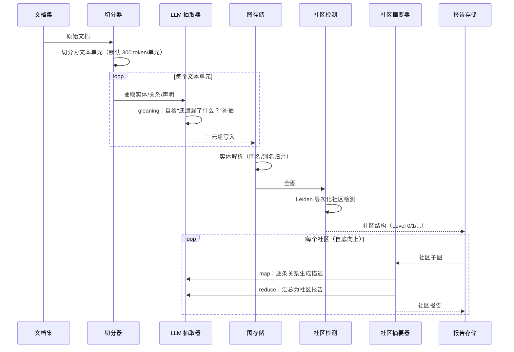
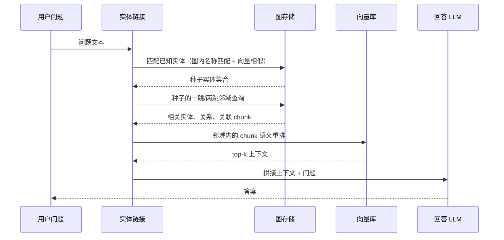
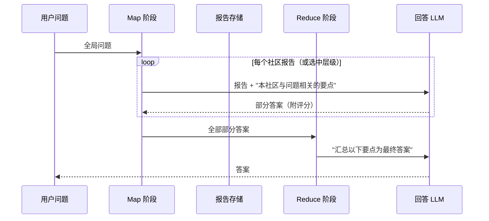
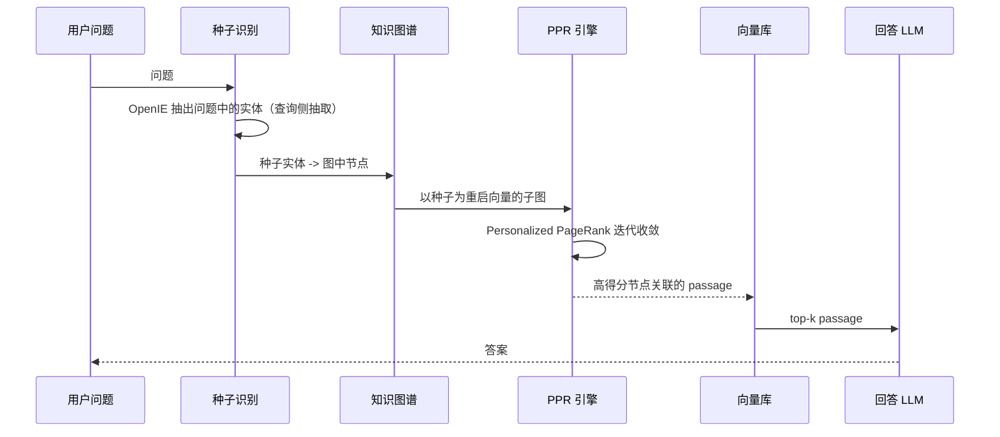

# 工作流程：索引与查询的两阶段流水线

GraphRAG 把系统明确地分成两个阶段：**索引构建**（离线、贵、慢、批式）与**查询服务**（在线、按模式计费）。理解这两个阶段各自的数据流与失败模式，是排查生产问题的基础。本章以微软 GraphRAG 为参照系描述完整流水线，并标注 LightRAG / HippoRAG 的差异点。

## 4.1 索引构建流水线

各步骤的工程要点：

1. **切分（Text Unit）**：GraphRAG 默认 300 token 一个文本单元，抽取在这个粒度上进行。单元太小，跨句关系丢失；太大，抽取遗漏率上升且 prompt 成本线性增长。
2. **LLM 抽取（最贵的一步）**：对每个文本单元，prompt LLM 输出实体（名称、类型、描述）与关系（源、目标、谓词、描述）。**gleaning** 是官方的重要技巧：抽取完成后追加一轮"上面的抽取遗漏了什么？"的追问，通常能补回 10%-30% 的关系。成本也因此接近翻倍——抽取环节的 token 消耗要按"轮数 × 单元数"估算。
3. **实体解析**：抽取是逐单元独立进行的，同一个实体的不同表述（"OpenAI"、"openai"、"Open AI"）会被建成多个节点。解析步骤做归并与别名映射；解析质量差，图会碎成互相不通的小岛，社区检测随之退化。
4. **社区检测**：Leiden 算法（GraphRAG 论文选择）在模块度优化之外保证社区的内部连通性，避免 Louvain 常见的"社区内部不连通"伪簇。输出是层次化的社区树。
5. **社区摘要（第二贵的步骤）**：对每个社区，先 map（LLM 读社区子图，输出逐条关系/实体的要点），再 reduce（把要点汇总为一份有字数预算的报告）。层级越高，输入是下级报告的聚合而非原始关系，成本逐级下降。

**LightRAG 的差异**：砍掉社区检测与社区摘要两步，改为对实体与关系直接生成 description 并做 embedding，写入向量库；索引成本约为 GraphRAG 风格的一个数量级以内。

**HippoRAG 的差异**：同样无社区摘要；额外要求抽取时保留三元组与原文 passage 的映射（PPR 检索后要回取原文）。

## 4.2 查询阶段：三种模式

### Local Search：实体驱动的邻域展开

适合：具体的事实型问题（"谁提出了 X"、"A 和 B 是什么关系"）。失败模式：问题中的实体不在图上（实体链接失败）——此时应回退纯向量检索。

### Global Search：社区报告的 map-reduce

适合：语料级概览、对比、趋势（"这个领域的研究脉络"、"各方案的优缺点对比"）。成本 = 社区数（或选中层级的报告数）+ 1 次 reduce，**与语料规模弱相关**——这是社区摘要机制的核心红利。失败模式：问题本身是局部的却走了 global（纯浪费）；社区报告质量差（抽取噪声的上游传导）。

### DRIFT Search：全局与局部之间的动态折中

DRIFT（Dynamic Reasoning and Inference with Flexible Traversal，GraphRAG 2025 年新增的官方模式）把两种模式串成迭代回路：

1. **Primer 阶段**：把问题与语义最相关的 top-K 份社区报告比对，生成一个宽泛的初步答案 + 若干跟进问题；
2. **扩展阶段**：对每个跟进问题跑 local search 求精，得到中间答案并可能产生新的跟进问题；置信度指标决定是否继续扩展；
3. 输出按相关度排序的"问题-答案"层级树。

定位：比 local 覆盖广、比 global 便宜且能下钻细节。LazyGraphRAG 官方评测中，DRIFT 被归入与 Lazy 同代际的"成本-质量折中"方案。

### 多跳检索（HippoRAG 路线）

与传统"迭代式检索-生成"多跳方案的本质区别：**一跳完成**。PPR 的随机游走从种子出发、以跳数衰减，天然把 2-3 跳内与种子关联紧密的节点排到前面，避免了多轮 LLM 中间推理的误差累积与延迟叠加。

## 4.3 增量更新流程

索引的批式本质与文档的持续更新之间存在张力，各实现的应对：

| 实现 | 增量策略 | 代价 |
|---|---|---|
| GraphRAG | 批式重跑；版本迁移 notebook 尽量复用已有索引 | 更新延迟高；官方建议小语料起步 |
| LightRAG | 增量抽图 + 增量向量插入；删除文档时重建受影响 KG 子图（2025.08 起） | 更新便宜；删除需级联维护 |
| HippoRAG 2 | 非参数持续学习定位：新文档持续并入 KG 与 passage 库 | 图谱持续增长，需周期性的图谱维护（去重、合并） |

通用的增量不变量：**新增文档只应引起局部图修改**（新实体接入 + 已有实体的新边），社区与摘要是全局结构，需要分层处理——Level 0 社区可能只需局部重算，上层报告则按受影响分支刷新。这正是"图索引批式思维"与"向量库增量思维"的工程文化差异所在。

## 4.4 失败模式速查

| 症状 | 可能原因 | 排查方向 |
|---|---|---|
| 局部问题答非所问 | 实体链接失败 / 抽取遗漏该实体 | 查抽取输出；给问题实体加别名表 |
| 全局问题空泛 | 社区报告质量差 / 层级选错 | 抽查 Level 0 报告；调社区粒度参数 |
| 多跳答案断裂 | 中间关系未抽出 / 实体解析未合并 | 查 gleans 轮数；查同义节点 |
| 索引成本爆炸 | 文本单元过多 / gleans 失控 / 社区过碎 | 看 token 账单按环节归因 |
| 更新后结果回退 | 增量路径 bug（旧边未失效） | 对更新文档做前后图 diff |

## 小结

- 索引流水线的主线：切分 → LLM 抽取（含 gleaning）→ 实体解析 → Leiden 社区检测 → map-reduce 社区报告；成本集中在抽取与摘要两个 LLM 环节。
- 查询三种模式各有明确的适用域：local 管事实、global 管概览、DRIFT 管折中、PPR 管多跳；路由错误是最常见的自伤。
- 增量更新是范式分野点：LightRAG 把增量当一等公民，GraphRAG 仍是批式重跑思维，混合系统通常按更新频率做取舍。
