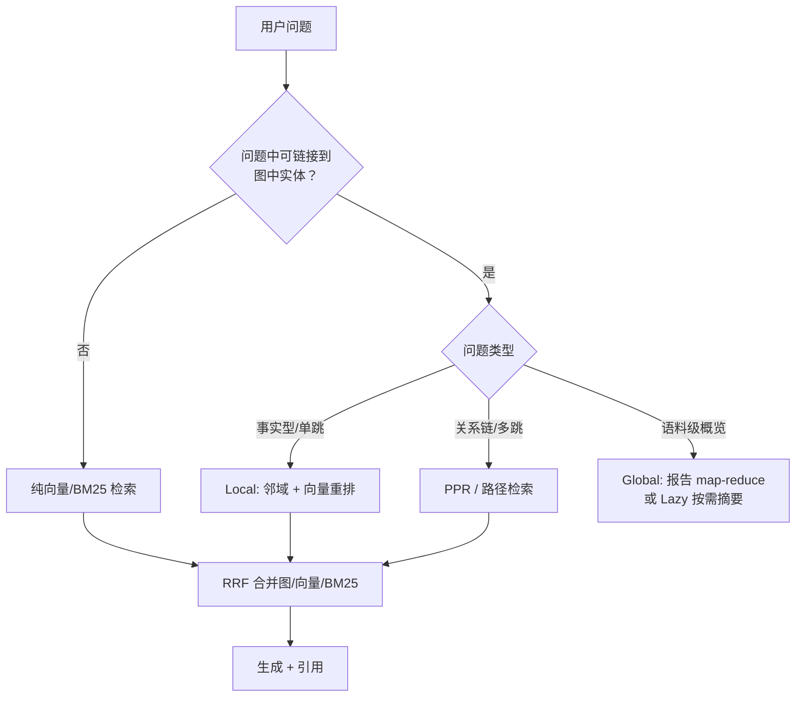

# 核心模块：抽取、社区检测、摘要、图存储与查询路由

本章把架构图中每个核心模块拆开，讲清其机制、关键参数与工程陷阱。

## 5.1 LLM 实体/关系抽取（OpenIE）

抽取 prompt 的典型结构（GraphRAG 官方模板大意）：

```text
给定以下文本，识别所有实体及其类型（person/organization/location/...），
以及实体之间的关系。输出 JSON：
- entities: [{name, type, description}]
- relationships: [{source, target, description, weight}]
如有多个关系，全部列出。不要遗漏任何实体。
```

**Gleaning（补抽）**：首轮抽取后追加追问——"以上抽取是否遗漏了任何实体或关系？特别检查上一轮明确排除或忽略的内容。"LLM 的召回有明显的"一轮遗漏、二轮找回"现象，gleaning 是官方对抽取召回率最大的单一改进；代价是抽取 token 接近翻倍。生产上把它做成可配置轮数（0/1/2），按语料价值权衡。

**Schema-free vs Schema-constrained**：

- GraphRAG / LightRAG / HippoRAG 走 **schema-free**：LLM 自由决定实体类型与谓词。优点：零前期投入，任意领域可用。缺点：谓词爆炸（同一关系抽出十几种措辞）、类型漂移。
- KAG（蚂蚁）走 **schema 约束**：领域专家预定义本体（概念层级、属性、关系类型），LLM 在约束下抽取，并做"概念语义对齐"。优点：噪声低、可推理（逻辑形式可查）。缺点：本体工程成本高，只适合法务、医疗、政务等强专业域。

工程经验：谓词失控时先做**谓词归一化**（同义词表映射到规范谓词），比换模型便宜得多。

**抽取质量上限**：GraphRAG 的一切下游（社区、报告、检索）都建立在抽取之上。论文复现经验是：抽取召回率（而非关系精度）是系统效果的第一决定因素——漏掉的边在多跳检索中是不可恢复的。

## 5.2 实体解析（Entity Resolution）

逐单元独立抽取必然产生重复节点："微软研究院" vs "Microsoft Research" vs "微软"。实体解析的任务是把它们归并：

1. **名称归一**：大小写、全半角、别名字典；
2. **描述相似归并**：对同名候选节点的 description 做 embedding 相似度，超阈值合并（GraphRAG 的 `entity resolution` 配置项）；
3. **人工审核队列**：相似度处于灰区的候选对进人工队列——KG 场景下人工一次性标注的杠杆极高（合并 10 对节点可能打通两大社区）。

不做的后果：图碎片化 → 社区检测碎成小簇 → 全局报告质量崩塌。这是 GraphRAG 生产部署最常见的隐性坑。

## 5.3 社区检测：Leiden 与层次化

**为什么不用 Louvain**：Louvain 优化的模块度存在分辨率极限与"不连通社区"问题——算法可能宣布一个社区，但其内部节点并不连通。Leiden（Traag et al., 2019）在 Louvain 之上加了 refinement 阶段，保证社区内部良连通，且通常更快、模块度更高。GraphRAG 论文选择 Leiden 作为默认。

**层次化**：Leiden 通过分辨率参数 γ 的不同取值，自底向上产出社区树：

```text
Level 0：最细粒度社区（3-20 个实体）—— 每份报告描述一个具体研究组/产品线
Level 1：中等社区（多个 Level 0 合并）—— 每份报告描述一个方向/主题
Root：全图一个社区 —— 语料库总览
```

关键参数：

| 参数 | 作用 | 调参方向 |
|---|---|---|
| 分辨率 γ | γ 越大社区越碎 | 语料主题多而杂 → 调大；追求宏观概览 → 调小 |
| max_cluster_size | 单社区实体数上限 | 防止巨型社区稀释报告 |
| seed | 随机种子 | Leiden 仍有随机性，报告结果需固定种子保证可复现 |

层次化的工程价值：全局查询不必扫描全部 Level 0 报告，可在 Level 1 上做初步 map-reduce，需要细节时再下钻——用报告的层级结构换查询 token。

## 5.4 社区摘要（map-reduce 报告生成）

单个社区的报告生成是两阶段：

- **Map**：LLM 读社区子图（实体列表 + 关系列表），输出结构化的要点（每个实体的角色、关系的关键事实）；
- **Reduce**：把要点汇总成一份有字数预算的自然语言报告，附"关键实体"清单。

工程要点：

- **字数预算**：官方报告约 500-2000 token。太短丢信息，太长浪费查询 token（全局检索要把多份报告塞进 map 阶段）。
- **来源可追溯**：报告应回链实体/关系 ID，查询响应才能给出引用（LightRAG 2025.02 起支持引用输出）。
- **层级报告的合成性**：上级报告 = 对下级报告再 reduce。不要重读原文，成本是下级报告的线性函数而非原文的。
- **延迟替代**（LazyGraphRAG 路线）：不预计算，查询时只对问题命中的社区即时生成摘要。适合语料更新频繁、全局查询低频的场景。

## 5.5 图存储与 Cypher

属性图模型：节点与边都带属性（类型、描述、来源 chunk、置信度）。查询语言以 Cypher 为主（ISO 于 2024 年将 GQL 定为标准图查询语言，Cypher 是其最主要方言）：

```cypher
// 找出与 'GraphRAG' 一跳内的所有关系
MATCH (e:Entity {name: 'GraphRAG'})-[r]-(other)
RETURN e.name, type(r), other.name, r.description
LIMIT 25

// 两跳路径：什么技术启发了谁
MATCH path = (a:Entity {name: 'PagedAttention'})-[*1..2]-(b)
RETURN path
LIMIT 10
```

多跳场景推荐把路径查询下推到存储层（上例第二条），而不是在应用层逐跳往返——网络往返次数从 O（跳数×邻居数） 降到 1。

存储层的工程指标：建索引期的**写吞吐**（百万三元组的导入速度）、查询期的**遍历延迟**（一跳邻居查询的 P99）、以及**混排能力**（图 + 向量同库检索）。

## 5.6 查询路由与混合检索

生产查询路由的典型决策树：



混合排序用 RRF 是稳妥默认：每路检索独立给出 top-k，按 1/(k+rank) 累加得分。它比"分别归一化相似度再加权"更抗各路分数分布差异，也更容易排障（每路可独立调试）。

## 5.7 多跳检索：Personalized PageRank

PPR 把"与种子实体相关"定义为图上的随机游走稳态分布：

```text
PR(i) = (1 - α) · e_i + α · Σ_j PR(j) / d_out(j)
```

e 是种子分布（问题实体的 one-hot 或加权分布），α 是继续游走的概率（常用 0.85）。直观读法：α 越大概率越"走远"，多跳覆盖越广、噪声越大。

HippoRAG 的工程选择：PPR 之后**不按节点得分直接取**，而是把得分传播到节点关联的 passage，与向量检索的 passage 得分融合排序——图上得分解决"哪些事实相关"，passage 融合解决"拿哪段原文给 LLM"。

## 小结

- 抽取模块决定系统上限：gleaning 轮数、谓词归一化、实体解析是三件性价比最高的质量投资。
- 社区检测用 Leiden 不用 Louvain，拿的是连通性保证；分辨率与层级是全局检索质量的主调参对象。
- 社区摘要按 map-reduce 生成、按层级合成、按预算截断；Lazy 化是 2025 年后最重要的成本杠杆。
- 查询侧的核心工程是路由：实体可链接性是第一道闸门，多跳走 PPR/路径下推，混合排序用 RRF。
