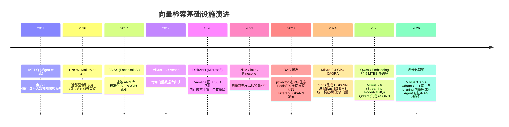
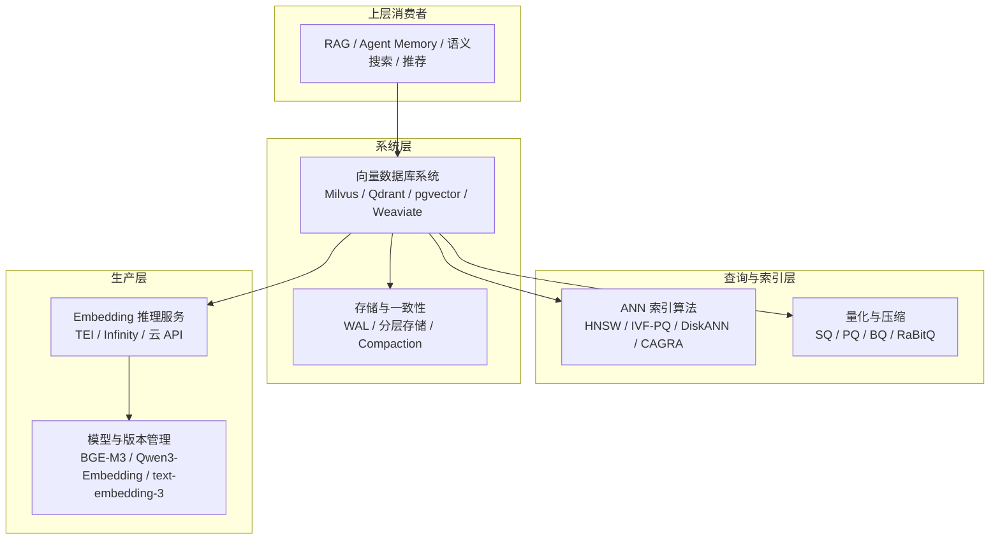

# 背景与动机：从 BM25 到稠密向量检索

搜索引擎和数据库做了几十年"精确匹配"的生意：关键词等于关键词，主键等于主键。但人的语言不是精确匹配——"怎么退货"和"退款政策"没有共同关键词，意思却完全相同。向量检索（Vector Search）解决的正是这个裂缝，而支撑它的基础设施在过去十年里从零长成了一个完整的产业。

## 1.1 传统检索的天花板

经典信息检索的代表是 BM25：基于词频（TF）与逆文档频率（IDF）的稀疏打分。它高效、可解释、几十年久经考验，但有两个结构性缺陷：

- **词汇失配（Vocabulary Mismatch）**：query 与文档用词不同即检索失败。同义词、上下位词、跨语言、口语 vs 书面语，全是失配的重灾区。
- **无语义聚合**：词袋模型把文本看成独立词的集合，"苹果发布了新手机"和"水果店里苹果涨价"在 BM25 眼中高度相似，在人眼中毫不相关。

在搜索、推荐、问答等场景里，这两个缺陷直接转化为召回率的硬上限。

## 1.2 Embedding：把语义变成向量

Embedding 模型（如 Word2Vec、BERT 以及 2023 年后的 BGE、E5、Qwen3-Embedding 等）把一段文本映射为一个高维稠密向量（常见 768~4096 维），训练目标决定了语义相近的文本在向量空间中距离也相近。于是：

> **语义相似 ⇔ 向量距离近（近似）**

"找相似内容"这个无法写成 SQL 的问题，变成了"在 d 维空间里找 query 向量的 k 个最近邻"——一个可以精确表述、可以度量、可以加速的数学问题。

这一步的关键意义在于：**embedding 成为了新的数据类型**。就像时间戳催生了时序数据库、JSON 催生了文档数据库，"向量 + 相似度查询"催生了向量数据库这个新品类。

## 1.3 规模压力：百万、千万、十亿

RAG 的爆发（2023 年起）把向量库的规模推上了新数量级：一个企业知识库轻松达到千万级 chunk，互联网级推荐/搜索场景直接面对十亿级向量。此时精确最近邻（暴力扫描）的代价是线性增长的：

- 100 万条 1024 维 float32 向量 ≈ 4 GB 原始数据，暴力扫一遍 ≈ 数十毫秒；
- 10 亿条同样向量 ≈ 4 TB，暴力扫描需要数十秒——完全无法接受。

更重要的是高维几何的冷酷事实：**维数灾难（Curse of Dimensionality）**让一切基于空间划分做剪枝的精确算法（kd-tree、R-tree 等）在维度超过几十之后退化得比暴力扫描还慢。想在十亿级规模上做到毫秒级，唯一的出路是**近似最近邻（ANN）**：接受 95%~99% 的召回率，换取 100~10000 倍的加速。

## 1.4 为什么需要专门的向量数据库

一个自然的疑问是：PostgreSQL 加了个 pgvector 扩展，Redis、Elasticsearch 也都能存向量，为什么还要 Milvus、Qdrant 这类专用系统？

小规模下确实不需要。专用系统的价值在规模与负载特征出现后才显现：

| 需求 | 通用系统 | 专用向量数据库 |
|---|---|---|
| 数据量 | 百万级以内 | 亿级~十亿级 |
| 查询 | 低 QPS、对 P99 不敏感 | 高 QPS、P99 毫秒级 SLO |
| 索引构建 | 偶尔全量重建 | 持续增量写入 + 在线构建 |
| 资源 | 跟着现有数据库走 | 需要独立的内存/SSD/GPU 预算 |
| 运维 | DBA 现有体系 | 分片、Compaction、GPU 池等新对象 |

向量负载有三个让通用系统吃力的特征：**内存密集**（索引常驻内存）、**计算密集**（距离计算是 SIMD/GPU 友好型）、**更新密集**（ embedding 随文档持续写入，索引必须增量维护）。专用向量数据库就是把这三件事做到极致的系统。

## 1.5 技术演进时间线

几个趋势值得记住：

1. **索引算法收敛于"图 + 量化"**：HNSW 系（内存图）与 Vamana 系（磁盘图）成为绝对主流，树与哈希方法退居 niche。
2. **成本驱动架构创新**：内存太贵，于是有了 SSD 上的 DiskANN、1-bit 的 RaBitQ、冷热分层存储。
3. **数据库化**：向量库从"索引 + API"进化为有 WAL、事务一致性、分片、多租户、云原生的完整数据库系统。
4. **Embedding 服务基础设施化**：模型迭代加速（BGE-M3 → Qwen3-Embedding → 多模态），推理服务（TEI、Infinity）与网关、限流、版本管理成为独立工程领域。

## 1.6 本主题的问题域

本主题覆盖这条链路的"基础设施层"，自底向上分为四块：

与 [RAG 主题](/06-rag/)的分工：RAG 讲 chunking、检索策略、rerank、生成质量；本主题讲索引怎么构建、查询怎么执行、系统怎么选型与运维。

## 小结

- 向量检索把"语义相似"转化为"距离相近"，使不可计算的模糊查询变成可加速的数学问题。
- 高维 + 大规模让精确最近邻不可行，ANN 以可控的召回率损失换取数量级加速，这是整个品类存在的技术根基。
- Embedding 成为新的数据类型，向量数据库围绕"内存密集、计算密集、更新密集"三个特征构建专用系统。
