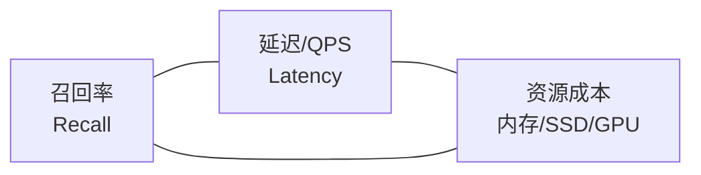

# 核心概念：ANN、不可能三角与量化

向量数据库的全部设计，都是在回答三个相互纠缠的问题：**搜得多准（召回率）、搜得多快（延迟/QPS）、花多少钱（内存/SSD/GPU）**。本章建立讨论这些问题所需的核心概念体系。

## 2.1 最近邻问题的形式化

给定数据集 `X = {x_1, x_2, ..., x_n}`，每个 `x_i` 是 d 维实数向量，距离度量记为 `dist(q, x)`，查询向量为 `q`。k-NN 查询要求返回 X 中距离 q 最近的 k 个向量：

```text
kNN(q, k) = argmin over S (|S| = k):  sum of dist(q, x) for x in S
```

常用距离度量：

| 度量 | 定义（伪代码） | 适用场景 |
|---|---|---|
| L2（欧氏距离） | `dist = ||q - x||₂`（差向量的 L2 范数） | 未归一化向量、图像特征 |
| IP（内积） | `dist = -⟨q, x⟩`（取负让"越大越近"统一为"越小越近"） | 最大化点积即最近邻（部分推荐模型） |
| Cosine（余弦距离） | `dist = 1 - ⟨q,x⟩ / (||q||·||x||)` | 文本 embedding 的默认选择 |

一个重要等价关系：**当所有向量都 L2 归一化后，cosine 距离与 L2 距离单调等价**——此时 `||q - x||² = 2 - 2·cos(q, x)`，两者只差仿射变换，排序结果一致。因此归一化向量上只需实现一种度量——这是工程上普遍支持 cosine 的方式。

## 2.2 精确 NN 为什么失效

低维空间（d ≤ 20）中，kd-tree、R-tree 等空间划分结构可以把最近邻搜索做到 O(log n)。但在高维空间，这些结构全部失效，这就是**维数灾难（Curse of Dimensionality）**：

- 在高维空间中，点到点之间的距离趋于集中（concentration of distances）：任意两点距离的相对差异越来越小，"最近"与"第十近"的距离比值趋近 1，基于划分的剪枝几乎剪不掉任何分支。
- 对 d=1000 的均匀分布数据，kd-tree 的查询需要访问几乎全部分支，比暴力扫描更慢。

结论：**高维 + 大规模下，精确最近邻没有可扩展算法**。这不是工程不够努力，而是几何性质决定的。

## 2.3 近似最近邻（ANN）与召回率

ANN 允许返回"足够近"的 k 个邻居。其质量用**召回率（Recall）**度量：

```text
Recall@k = |ANN 返回的 top-k ∩ 真实 top-k| / k
```

RAG 场景通常要求 Recall@10 ≥ 95%，因为漏掉的正确文档会直接漏进生成的答案里。注意两个工程要点：

- 召回率是对**查询分布**的统计量，必须用真实的查询集评测，不能用训练集自测。
- Recall@k 与下游指标（RAG 答案质量）不是线性关系：召回从 99% 掉到 90%，RAG 端到端质量可能掉得更多，因为漏掉的是最难检索的那部分。

## 2.4 不可能三角：召回、延迟、资源



三个目标互相拉扯，任何一个索引算法都是这个三角上的一个取舍点：

- 提高图索引的 ef（搜索宽度）→ 召回上升、延迟上升；
- 量化更狠（PQ 8× 压缩 → 1-bit BQ 64× 压缩）→ 成本下降、召回下降；
- IVF 的 nprobe 增大 → 召回上升、延迟上升；
- GPU 索引 → 用更多的钱（GPU HBM）同时买召回与延迟。

生产调优的本质，就是在给定 SLO（如 P99 < 50ms、QPS 1k）和资源预算下，把召回推到最高。

## 2.5 三大索引家族

### 近邻图（Graph-based）：HNSW / Vamana

把每个向量看作图上的一个节点，边连接空间中的近邻。查询时从入口点出发**贪心遍历**：每一步走向离 query 最近的邻居，直到局部最优。图方法的特性：

- **召回/延迟比最好**： greedy + beam search 的访问节点数极少（十万级图每次查询只访问几百个节点）。
- **构建成本高**：插入节点要找邻居、连边、必要时断边重连。
- **内存昂贵**：图 + 原始向量都要常驻内存（DiskANN 把图放到 SSD 上解决这一点）。

### 倒排量化（IVF-PQ 系）

先用 k-means 把向量空间粗分为 nlist 个簇，查询时只探测 nprobe 个最近簇（IVF，倒排文件）；簇内向量用 PQ 码表示（见 2.6），距离通过查表累加（ADC）。特性：

- **内存极省**：PQ 压缩 8~32 倍，FAISS IVF-PQ 曾支撑起十亿级图像检索。
- **构建便宜**：k-means 训练 + 编码，可并行。
- **召回上限低于图**：簇边界处的邻居会被整个漏掉（除非 nprobe 接近 nlist）。

### 树 / 哈希（KD-tree / LSH 等）

- LSH（局部敏感哈希）用哈希桶把相似向量聚在一起，理论保证好但实践召回/内存比差。
- 乘性哈希、随机投影树等在特定维度（低维、特殊分布）有用。

2026 年的现状：**图方法统治内存索引，IVF 量化统治极致压缩场景，树/哈希退居教学与 niche**。

## 2.6 量化：用精度换内存

原始 float32 向量每个维度 4 字节；1024 维 = 4 KB/向量，10 亿条 = 4 TB。**量化（Quantization）**用更少的 bit 表达向量：

| 方案 | 原理 | 压缩比（相对 fp32） | 召回影响 |
|---|---|---|---|
| SQ8（标量量化） | 每维线性映射到 256 级 | 4× | 极小（配合 refine 可忽略） |
| SQ4 / int8 向量 | 每维 4 bit / 8 bit | 8× | 小，需实测 |
| PQ（乘积量化） | 维度切 m 段，每段 k 个质心 | 8~32× | 中，ADC 部分补偿 |
| BQ（二值量化） | 每维 1 bit 符号 | 32× | 大，靠 refine 恢复 |
| RaBitQ | 随机旋转 + 1-bit + 残差 refine | 32×+ | 小（Milvus 2.6 实测约 94.9% recall） |

两个关键机制：

- **ADC（非对称距离计算）**：查询向量保持 float32，只量化数据库向量。查询→质心距离查表累加，避免"量化误差平方"问题。
- **Refine**：先用粗量化码召回候选，再对候选读取原始向量或高精度码精排。RaBitQ 的"1-bit 粗排 + SQ8 refine"是 2025 年后生产系统的主流配方。

## 2.7 内存层级与索引选型

索引的物理位置决定了延迟与成本：

| 层级 | 容量/成本量级 | 对应索引 | 单次查询延迟量级 |
|---|---|---|---|
| CPU 内存 (DRAM) | 数百 GB，贵 | HNSW（原始/量化向量） | 亚毫秒~数毫秒 |
| SSD | 数 TB，中 | DiskANN / Vamana（图 + 量化向量） | 数毫秒~数十毫秒 |
| GPU HBM | 数十 GB~数百 GB，最贵 | CAGRA / brute-force | 微秒~亚毫秒 |
| 对象存储 | 无限，最便宜 | 冷数据 + 分层加载 | 百毫秒+（仅冷启动） |

工程直觉：**先估算"热集大小"，再选索引**。热集装得下内存就上 HNSW；装不下就 DiskANN 上 SSD；QPS 极高且热集小，GPU 暴力扫描有时比 CPU 图索引还快。

## 2.8 动态更新：被低估的硬问题

静态数据集上建索引很容易，生产系统难在**持续写入**：新向量不断到来、旧向量被删除。图索引的增量插入天然可行（HNSW 就是在线插入设计的），但删除是逻辑删除（tombstone），积累多了图质量退化，需要后台 Compaction/重建；IVF 的簇中心漂移需要周期性重训练。

微软的两篇工作代表了"磁盘索引 + 实时更新"的演进：

- **FreshDiskANN**（2021）：内存 buffer 吸收新插入，周期性 merge 进 SSD 图，局部重连边，支撑 10 万+ 插入/秒；
- **SPFresh**（2023，arXiv 2410.14452）：放弃全局图，改用"分区分裂 + 局部重平衡"（LIRE 协议），单盘 10GB 内存 2 核做到 4K QPS 查询 + 2K QPS 更新，P99.9 比 DiskANN 方案低 2.41 倍。

Milvus 2.6 的 Streaming Node 把"流（实时段）/批（历史段）分离"做成了一等架构，正是这一问题的工业级答案（详见[架构设计](03-architecture)）。

## 小结

- 高维空间的距离集中效应使精确 NN 不可扩展，ANN + 召回率度量是唯一的规模化路径。
- 所有索引算法都在"召回—延迟—资源"三角上取点：图取召回/延迟，IVF-PQ 取资源，GPU 用成本同时买两者。
- 量化（SQ/PQ/BQ/RaBitQ + refine）是成本工程的核心杠杆；ADC 与 refine 决定了量化方案的真实召回。
- 持续写入场景下，动态更新能力（tombstone、compaction、流批分离）往往比静态 benchmark 排名更能决定生产体验。
