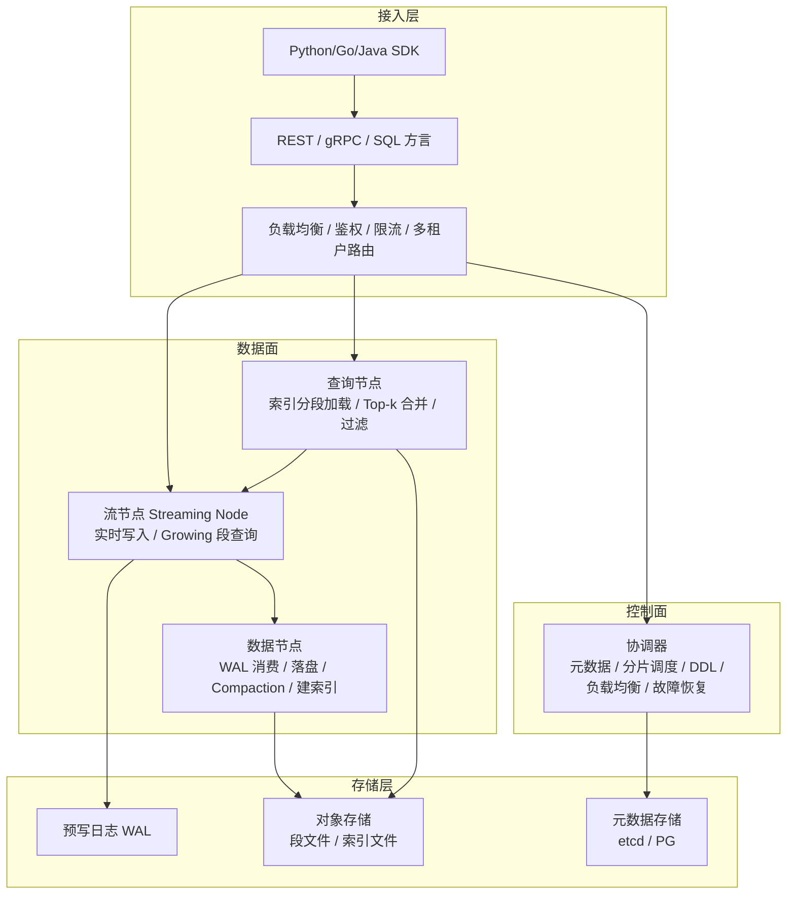

# 架构设计：向量数据库系统分层

一个生产级向量数据库不是"一个索引 + 一个 API"，而是一套完整的数据系统：接入层、协调器、索引构建、查询执行、WAL、分层存储、Compaction。本章先给出通用分层模型，再以 Milvus 2.6 为例解剖一个真实系统的架构演进。

## 3.1 通用分层模型



各层职责：

| 层 | 职责 | 关键设计点 |
|---|---|---|
| 接入层 | 协议、鉴权、租户路由 | 无状态，可水平扩展；查询下推 vs 结果聚合的位置 |
| 控制面 | 元数据、分片（shard）放置、DDL、扩缩容 | 本身是一个分布式共识问题（Milvus 用 etcd） |
| 查询执行 | 段（segment）级检索、Top-k 归并、过滤 | 分段并行，结果树形归并 |
| 流处理 | 吸收实时写入、对未建索引数据提供"暴力+小索引"查询 | 流批分离是 2025 年后架构分水岭 |
| 数据/索引构建 | 刷盘、compaction、为 sealed 段构建 ANN 索引 | 资源大户，通常与查询资源池隔离 |
| 存储 | WAL（可靠性）、对象存储（持久化+冷数据） | 存算分离降低成本 |

## 3.2 Milvus 架构详解（以 2.6 为例）

Milvus 是分布式向量数据库的代表，其架构在 2.x 时代持续演进，2.6（2025 年 6 月发布）是一次以"降本"为主轴的大改版。

### 写入与存储组件

```mermaid
flowchart LR
    subgraph 客户端
        C1[insert / upsert / delete]
    end
    subgraph 接入
        P[Proxy<br/>校验/路由/DML 转发]
    end
    subgraph 实时链路
        SN[Streaming Node<br/>Woodpecker WAL<br/>Growing Segments<br/>增量索引]
    end
    subgraph 离线链路
        DN[DataNode<br/>flush / compaction<br/>索引构建 (Knowhere)]
    end
    subgraph 查询
        QN[QueryNode<br/>Sealed Segment<br/>加载索引/暴力扫描<br/>Top-k 归并]
    end
    OS[(对象存储<br/>S3/MinIO/OSS<br/>段文件+索引文件)]
    MC[MixCoord<br/>元数据/调度/DDL]

    C1 --> P --> SN
    SN -- 落盘 --> OS
    SN -- 封存 --> DN
    DN -- 索引 --> OS
    QN -- 加载 --> OS
    P --> QN
    MC -. 调度 .- SN
    MC -. 调度 .- DN
    MC -. 调度 .- QN
```

关键组件：

- **Proxy**：无状态接入层，负责请求校验、鉴权、把 DML 路由到 Streaming Node、把查询 fan-out 到 QueryNode 并归并结果。
- **Streaming Node（2.6 新增，核心变化）**：把"实时写入"从 QueryNode/DataNode 中独立出来。它基于自研的 **Woodpecker WAL**（可替换 Kafka/Pulsar 的轻量云原生 WAL，官方基准 S3 模式吞吐约为 Kafka 的 5.8 倍），承担三项职责：WAL 写入与回放、维护内存中的 growing segment、为 growing 数据提供增量查询（growing 段查询走 brute-force 或轻量 interim 索引）。
- **DataNode**：消费 WAL 中的封存（sealed）段，做 flush、compaction、以及通过 Knowhere 库构建 ANN 索引（HNSW、IVF、GPU_CAGRA、DiskANN 等）。2.6 中 IndexNode 被合并进 DataNode，减少组件数。
- **QueryNode**：加载 sealed segment 及其索引，执行查询；只读历史数据，不再被实时写入打断——这就是**流批分离**：写路径与读路径的资源互不争抢。
- **MixCoord**：2.6 将 RootCoord、DataCoord、QueryCoord 等合并为混合协调器，管理元数据（存在 etcd）、分片放置、负载均衡、DDL。
- **对象存储**：所有段文件与索引文件落对象存储，节点本地盘只做缓存——这是 Milvus 存算分离、弹性扩缩容的基础。

### 2.6 的降本三件套

| 特性 | 机制 | 官方宣称收益 |
|---|---|---|
| RaBitQ 1-bit 量化 | 随机旋转后每维 1 bit + SQ8 refine | 内存降低约 72%，查询快 4 倍；1M/768d 测试 recall 94.9%（refine 后） |
| 冷热分层存储 | 热数据内存/SSD、冷数据对象存储、按需加载 | 本地资源成本最高降约 80% |
| Woodpecker WAL | 轻量 WAL 替代 Kafka/Pulsar | 吞吐最高约为 Kafka 的 5.8 倍，去掉消息队列依赖 |

另有：INT8 向量类型、在线 schema 变更、JSON Path 索引（过滤延迟官方称从 140ms 降到 1.5ms）、增强 BM25 全文检索（官方称比 Elasticsearch 快 4 倍）、单集群 10 万+ collection 的多租户能力。GPU 方面，Milvus 通过 Knowhere 集成 NVIDIA cuVS，支持 GPU_CAGRA 索引（GPU 建图）与 GPU brute-force，2.6.x 补丁持续修复 GPU 索引正确性问题——生产使用 GPU 索引应锁定经过验证的补丁版本。

### 演进方向：湖仓一体

Milvus 3.0（2026 年 7 月 GA）进一步走向 **lake-native**：段文件格式升级（Storage V3 / Loon）、支持外部表（external collection）直接对接数据湖。这与整个数据库行业"向湖仓收敛"的趋势一致：向量数据不再孤岛，而是数据湖中的一种列类型。截至 2026-10，2.6.x 仍是被广泛验证的生产版本线，3.0 适合评估新上项目。

## 3.3 Qdrant：单进程 Rust 架构的另一条路

与 Milvus 的"分布式大集群"路线不同，Qdrant 选择了**嵌入式内核 + 云托管**路线：

- **单进程 Rust 引擎**：一个 Qdrant 进程承载所有功能（写入、索引、查询、持久化），没有外部组件依赖——部署就是起一个二进制。
- **Collection / Shard / Segment 三级切分**：数据在 collection 内按 shard 分片（可跨节点），shard 内部分为若干 segment（类似 LSM 的段思想）。新写入进可变 segment， sealed 后转为不可变 segment 并建 HNSW 索引。
- **mmap 优先**：向量数据默认 mmap 到磁盘，依靠页缓存工作；量化向量内联在图里（inline storage），磁盘场景也能保持低延迟。2026 年版本进一步启用单文件 mmap 不可变段与 io_uring 批量读，减少小 IO。
- **2025-2026 特性**：Score-Boosting Reranking（向量分 + 业务信号融合排序）、原生全文过滤（多语分词/词干/短语匹配）、**ACORN 过滤 HNSW**（解决低选择率过滤下图遍历失效，见第 5 章）、MMR 多样性排序、分层多租户、SSO/RBAC；云端提供 GPU 加速索引（官方称建索引快一个数量级）、Multi-AZ、审计日志。

架构取舍：Qdrant 用"简单内核 + 横向 shard"换取运维简单性，十亿级规模靠 Qdrant Cloud 的托管分片与多 AZ；Milvus 用"专职组件"换取单集群极限规模与写入吞吐。两者都在 2025 年后补上了对方的强项。

## 3.4 "插件派"与"专用系统派"

第三条路线：把向量索引做成现有数据库的扩展。

- **pgvector**：PostgreSQL 扩展，提供 `vector` / `halfvec` / `sparsevec` 类型与 HNSW、IVFFlat 索引。胜在生态：事务、备份、Join、权限全部继承 PG。适合千万级以内的向量，且团队已有 PG 运维能力。
- **pgvecto.rs**：Rust 实现的 PG 扩展，设计上更贴近现代向量索引（流式构建、更少的锁竞争），作为 pgvector 的高性能替代。
- **Lantern**：PG 扩展，主打"索引构建更快、运维更简单"，生态成熟度小于前两者。
- **Redis Vector / Elasticsearch / OpenSearch**：在既有检索/缓存系统里加 HNSW kNN，适合"向量是现有系统的附加查询维度"而非主角的场景。

取舍规律：**向量是主负载（千万级以上、延迟敏感、持续写入）→ 专用系统；向量是辅助维度（百万级、跟着业务数据走）→ 插件派**。

## 3.5 架构趋势总结

1. **流批分离成为标配**：Milvus Streaming Node、Qdrant 可变/不可变 segment、Elasticsearch 的 refresh 机制，本质上都在解决"实时写入 vs 索引效率"的矛盾。
2. **存算分离 + 对象存储**：段文件落对象存储，计算节点无状态化，弹性扩缩容与冷数据成本同时受益。
3. **量化下沉到存储格式**：RaBitQ、int8 向量、inline quantized vectors——压缩不再只是索引选项，而是存储层默认。
4. **湖仓化**：向量作为数据湖的一种列类型，3.0 时代的 Milvus 与 LanceDB 的 Lance 格式都指向这个方向。
5. **检索能力融合**：全文 BM25 + 稠密 + 稀疏 + 多向量统一在一套系统内（Milvus 2.6 的 BM25、Qdrant 的 full-text filtering、Vespa 的 tensor），专用向量库与搜索引擎的边界正在模糊。

## 小结

- 向量数据库的通用架构是"接入层 / 控制面 / 流处理 / 查询执行 / 索引构建 / 对象存储"六层，其中流批分离与存算分离是 2025 年后架构演进的两条主线。
- Milvus 2.6 用 Streaming Node + Woodpecker WAL + RaBitQ + 冷热分层回答了"十亿级怎么降本"；Qdrant 用单进程 Rust 内核 + segment + mmap 回答了"怎么把运维做简单"。
- 插件派（pgvector 系）在中小规模与既有 PG 生态下有真实优势，专用系统派在大规模与写入密集场景不可替代。
