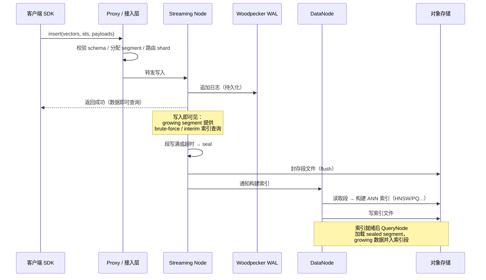
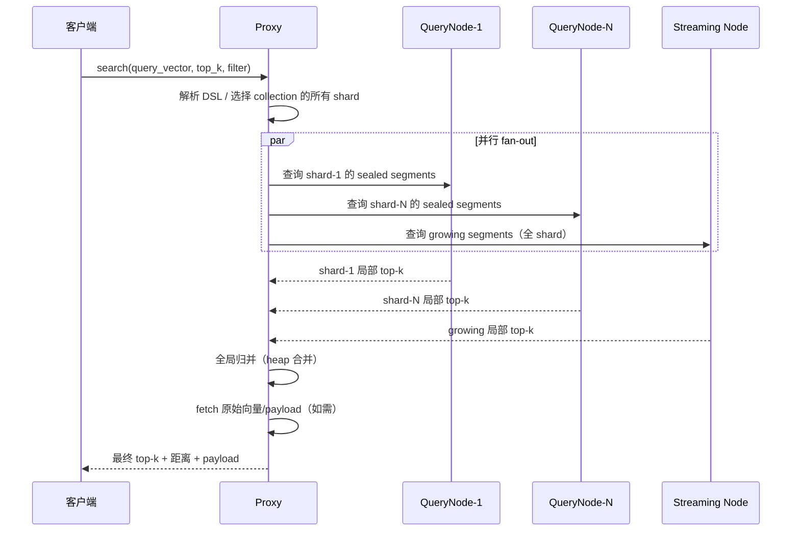
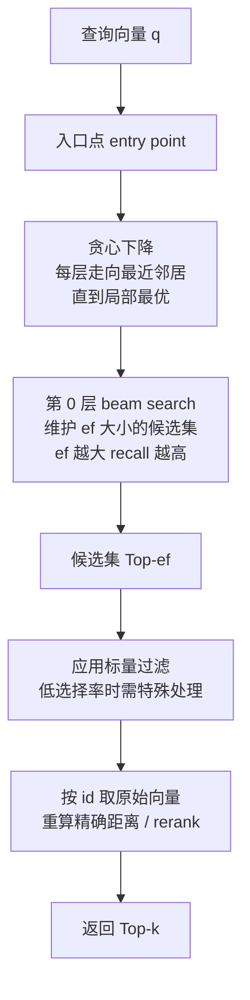
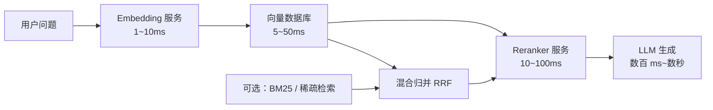

# 检索工作流程：从 Insert 到 Query 的完整路径

一条向量从写入到被查询到，要穿过 WAL、内存缓冲、段封存、索引构建、分片路由、段内检索、归并排序等十余个环节。本章沿数据面把这条链路走一遍，这是理解向量数据库行为（延迟从哪来、数据何时可见、删除何时生效）的基础。

## 4.1 写入路径（Insert Path）



关键语义：

1. **写入即可见**：确认写入成功的那一刻，向量已经能被查询到——只是走的是 growing segment 的暴力/小索引路径，速度慢但正确。这是"流"侧的承诺。
2. **WAL 是一致性的根基**：WAL 持久化成功才返回客户端；下游 DataNode 从 WAL 重放构建段与索引。Milvus 2.6 用 Woodpecker 替代 Kafka/Pulsar 正是为了砍掉外部消息队列的运维与成本。
3. **段（segment）是调度的最小单元**：growing → sealing → sealed 的生命周期由 coordinator 调度；compaction（段合并）也在这一层异步发生。

## 4.2 查询路径（Query Path）



一次查询的开销模型：

```text
延迟 ≈ 路由 + max(shard_i 内段查询延迟) + 归并 + fetch
```

其中"shard 内段查询"又由两部分组成：**sealed 段的索引查询**（快）与 **growing 段的暴力/小索引查询**（慢，与 growing 大小成正比）。高写入场景下 growing 段过大是 P99 抖动的常见来源——这就是流批分离要解决的资源争抢问题。

**Over-fetch**：每个 shard 返回的不是 k 个而是 k × 放大系数个候选（再经 filter、归并、rerank 后裁回 k）。分片越多、过滤越狠、rerank 越重，over-fetch 系数越大。

## 4.3 HNSW 查询遍历过程

以 HNSW 为例看段内检索的执行（详见[核心模块](05-core-modules)）：



层数与参数的作用：上层稀疏（跳表思想）负责快速定位到目标区域，第 0 层密集图负责精细搜索。`ef`（beam width）是查询时最重要的调优旋钮——从 Mini Demo 的实测可以看到 ef 从 4 提到 64，recall@10 从 0.76 升到 0.97，延迟只增加约 20%。

## 4.4 删除与更新路径

向量数据库的删除几乎都是**逻辑删除（tombstone）**：

- delete 操作写一条删除记录进 WAL；查询时结果经 tombstone 集合过滤。物理空间在 compaction 时才真正释放。
- 更新的实现是"删除 + 插入"：新向量进 growing segment，旧向量打 tombstone。因此**更新密集负载 = 删除 + 插入双份开销**，且会造成段内空洞，依赖 compaction 回收。
- 删除对图索引的质量有隐性伤害：HNSW 中被删节点留下的"断边"会降低图连通性，FAISS/Milvus 的处理是在检索时跳过删除点，长期运行后召回会缓慢退化——这是需要周期性重建索引的原因之一。

一致性谱系：Milvus 提供 bounded staleness（默认）到 strong 的可调一致性级别；Qdrant 写入默认即可读（单 shard 内），跨副本为最终一致。RAG 场景通常接受秒级延迟可见性，换取写入吞吐。

## 4.5 索引构建路径

索引构建是资源最重的后台任务，典型流水线：

1. **训练**：量化索引（IVF-PQ、SQ、RaBitQ）需要采样训练数据得到质心/旋转矩阵；HNSW 无训练阶段。
2. **编码/构图**：对段内全部向量编码或插点构图。GPU 加速（cuVS CAGRA 建图比 CPU 快 12~30 倍）主要收益在这一步。
3. **写入与发布**：索引文件落对象存储，QueryNode 原子切换（加载新索引、卸载旧索引）。
4. **调度**：构建任务由 coordinator 排队，受并发度与资源配额约束；大库全量重建可能耗时数小时，因此生产上尽量用增量索引避免全量重建。

## 4.6 端到端时序：一个 RAG 请求经过什么

把视野拉高到 RAG 全链路，向量库只是其中一环：



向量库的 SLO 通常只占端到端延迟的一小部分，但它的 P99 抖动会直接传导到 RAG 的 P99。对基础设施团队来说，更重要的是建立分环节的延迟归因：embedding、ANN 查询、fetch、rerank、生成分开计时（见 [AI SRE 主题](/07-ai-sre/) 的可观测实践）。

## 小结

- 写入路径的核心语义是"WAL 确认即成功、growing 段立即可查、sealed 段异步建索引"；查询路径的核心开销是"shard 并行 + 段内检索 + 全局归并 + fetch"。
- 删除是 tombstone、更新是"删+插"，两者的长期成本由 compaction 消化；图索引在删除压力下会缓慢退化，需周期性重建。
- 索引构建是资源大户，GPU 建图（CAGRA）与合理的调度配额是十亿级规模的两项基本功。
