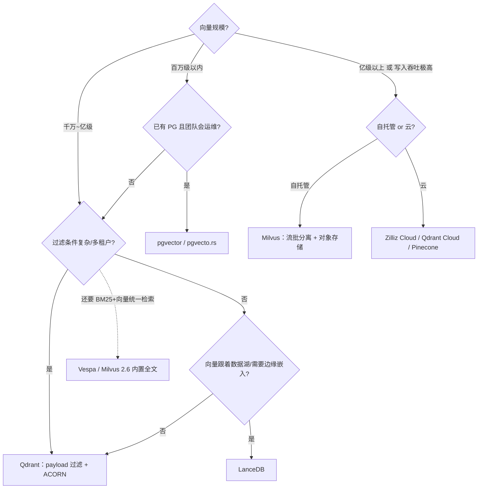

# 企业生产实践：选型、十亿级运维与成本

向量数据库的 benchmark 分数只回答"跑得多快"，生产要回答的问题多得多：选哪个系统、需要多少资源、写入高峰怎么扛、删改怎么管、GPU 值不值、账单怎么算。本章给出可落地的决策方法与运维清单。

## 8.1 选型决策树



决策要点补充：

- **延迟 SLO 是硬指标**：要求 P99 < 20ms 且数据量大 → 内存索引（HNSW + 量化）或 GPU；P99 < 100ms 可接受 → DiskANN（SSD）成本砍半。
- **团队栈优先**：PG 生态成熟就上 pgvector，百万级它完全够用，且事务/备份/权限零新增成本；不要为了"将来可能到亿级"提前付分布式的运维税。
- **云服务的真实账单**：托管向量库按 CU/容量计费，十亿级托管费用常是自托管的 3~10 倍——用云买"省运维"，不用云买"极限成本"。

## 8.2 十亿级规模的资源估算

内存账（HNSW，最常用配置）：

```text
每向量内存 ≈ 向量本体（量化后） + 图邻接 + payload/元数据
  float32 本体:     d × 4 B
  SQ8 本体:         d × 1 B
  PQ(m=96):         m × 1 B
  图 (M=16):        平均出度 × 4 B  ≈ 32×4 B（第 0 层 2M）
  payload + id:     50~200 B（视业务字段）

示例：10 亿条、768 维、SQ8 + M=16
  ≈ 1e9 × (768 + 128 + 100) B ≈ 1 TB 内存
```

应对手段（Milvus 2.6 的降本三件套正是为此）：

1. **RaBitQ / PQ 压本体**：1-bit 本体把上例的 768B 压到 96B，内存需求降约 72%；
2. **冷热分层**：热点 10% 常驻内存，冷数据在对象存储按需加载——查询延迟分层（热亚毫秒、冷数十毫秒），适合"近期文档被频繁检索"的负载；
3. **DiskANN 路线**：图放 SSD，内存只放量化向量 + 缓存，单机成本最低但延迟高一档。

QPS 与延迟预算：HNSW 单分片（千万级向量、SQ8、ef=64）单核约 500~2000 QPS、P99 数毫秒；按目标 QPS ÷ 单分片能力 × 冗余系数（1.5~2）得分片数，再按分片数 × 副本数得节点数。

写入吞吐：Milvus Streaming Node + Woodpecker WAL 的流路径支撑百万级插入/秒集群吞吐（官方基准 S3 模式 750 MB/s WAL 吞吐）；Qdrant 单节点写入受 segment 封印频率约束，高写入场景调大 segment 阈值并关注磁盘 IO。

## 8.3 一致性、删除与更新

| 问题 | 机制 | 运维要点 |
|---|---|---|
| 写入可见性 | growing segment 立即可查（brute-force） | growing 越大查询越慢，监控 growing 段大小与查询延迟的相关性 |
| 一致性级别 | Milvus: bounded/strong/session/eventual 可调；Qdrant 写后可读 | RAG 默认 bounded staleness；金融级场景显式调 strong |
| 删除 | tombstone + compaction 回收 | 删除率高的库（如 GDPR 删除）要加 compaction 配额，否则磁盘膨胀 |
| 更新 | 删 + 插 | 更新密集场景预留双倍写入吞吐；关注段空洞率 |
| 图退化 | 删除断边 → 召回缓慢下降 | 周期性（如每月）重建索引；监控召回率回归测试集 |

召回率回归监控：固定 500~1000 条带标注的查询集，每日常跑（暴力对照或已验证基线），Recall@10 掉过阈值（如 -2pt）告警。这是向量库最重要的单一健康指标，比 CPU/延迟更早暴露问题（索引退化、量化漂移、embedding 模型变更都能被它捕捉）。评估方法论见 [Benchmark + Evaluation](/07-ai-sre/benchmark-evaluation/)。

## 8.4 Embedding 模型与服务选型（截至 2026-10）

| 模型 | 出品 | 维度 | 上下文 | 语言 | 许可/获取 | 备注 |
|---|---|---|---|---|---|---|
| text-embedding-3-large | OpenAI | 3072（MRL 可截断至 256） | 8K | 多语 | API | MTEB 均值约 64.6；截至 2026-10 OpenAI 公开在售最新文本 embedding 仍为 3 系列 |
| text-embedding-3-small | OpenAI | 1536（可截断） | 8K | 多语 | API | 性价比高 |
| Cohere Embed v4 | Cohere | 256~1536 | 128K | 多语+多模态 | API | 长上下文是差异化 |
| Voyage 4 系 | Voyage AI | 最高 2048 | 32K | 多语 | API | 代码/多语子型号 |
| Gemini Embedding | Google | 3072 | 长 | 多语+多模态 | API | 多模态向量 |
| Qwen3-Embedding-0.6B/4B/8B | 阿里 Qwen | 1024~4096（MRL） | 32K | 100+ 语言 | Apache 2.0 | 2025-06 发布，8B 以 70.58 分登顶 MTEB 多语榜；配套 Qwen3-Reranker |
| BGE-M3 | BAAI | 1024 | 8K | 100+ 语言 | MIT | 单模型同时输出稠密+稀疏+多向量（ColBERT 式），混合检索一站配齐 |
| GTE / E5 / Jina v3+ | 阿里/Microsoft/Jina | 768~4096 | 8K~长 | 多语 | 各异 | 自托管成熟选项 |

服务形态决策：

- **数据不出域 / 量大到 API 账单失控（月千亿 token 级）→ 自托管**。GPU 规划：BGE-M3（568M 参数）FP16 单卡 A10/L4 可跑数千 QPS（batch 饱和）；Qwen3-Embedding-8B 需更大显存，用 vLLM pooling 或 TEI 部署。
- **TEI vs Infinity vs vLLM**：TEI 最成熟（Rust、动态批处理、模型覆盖广）；Infinity 灵活（Python 生态、ONNX）；已部署 vLLM 的团队直接用其 embedding 模式统一运维（见 [vLLM 主题](/04-llmops/vllm/)）。
- **归一化与 metric 对齐**：服务输出归一化 + 向量库用 cosine/IP；混用不同模型/维度的向量必须分 collection。
- **云 API 的降级预案**：embedding 服务挂掉时 RAG 全链路不可用——网关侧配双供应商 failover 与本地小模型兜底（fastembed）。

**Embedding 版本管理**：模型升级 = 维度/分布变化 = 全量重建索引。流程：新模型双写一段时间 → 新 collection 建索引灰度切流 5%→50%→100% → 旧索引保留一个回滚窗口 → 回收。切勿原地换模型。

## 8.5 GPU 索引部署实践

- **GPU 建图（最普遍用法）**：cuVS CAGRA 把亿级向量建图从数小时压到分钟级。部署形态：独立 GPU 建索引池（甚至竞价实例），建完索引文件写对象存储，CPU QueryNode 加载服务（CAGRA 图可被 CPU 当 HNSW 搜）。Milvus 的 GPU_CAGRA 即此模式；生产注意锁定经过正确性验证的补丁版本（2.6.x 系列修复过若干 GPU_CAGRA 问题）。
- **GPU 查询服务**：热集千万级以内 + QPS 数万（如实时推荐）值得；十亿级常驻 GPU 显存成本通常不如 DiskANN。
- **与训练/推理抢卡**：建索引任务应进独立队列与配额（K8s 上用单独的 GPU node pool + 优先级），避免挤占在线推理（见 [GPU 调度](/02-cloud-native/gpu-scheduling/) 主题）。

## 8.6 成本对比：一个十亿级 RAG 的三种架构

以"10 亿条 768 维向量、1K QPS、P99 < 50ms、日写入 1%"为例（量级估算，2026 年市场价格）：

| 架构 | 组成 | 月成本量级 | 特点 |
|---|---|---|---|
| 全内存 HNSW | ~30 台 512GB 内存节点（RaBitQ 后约 12 台） | 中高 | 延迟最稳，扩容最贵 |
| 冷热分层（Milvus 2.6） | 3 热节点 + 对象存储 + 按需加载 | 中 | 热集命中率决定 P99；多数 RAG 负载 90%+ 查询落在热集 |
| DiskANN SSD | 5~8 台 NVMe 节点 | 低 | P99 略高（10~30ms），写入更新能力强 |

实际账单构成提醒：对象存储与跨 AZ 流量常被低估（索引文件 GB~TB 级，跨区复制要算钱）；托管服务溢价 3~10 倍但省去 0.5~2 个运维 HC——按团队人力成本折算后再决策。

## 8.7 上线检查清单

1. **容量**：内存/磁盘按峰值 ×1.5 规划；growing segment 上限有监控。
2. **召回率**：评测集进 CI/CD 与每日回归；变更索引参数/量化档/模型必须过召回门禁。
3. **延迟**：分环节埋点（embedding / ANN / fetch / rerank），P99/P999 有 SLO 与告警。
4. **写入**：峰值插入速率压测（含删除 20% 混合）；WAL 堆积有告警。
5. **高可用**：分片副本 ≥2，跨 AZ；故障注入演练（杀 QueryNode / Streaming Node）。
6. **安全**：多租户隔离（partition key / collection 隔离）、API 密钥轮换、审计日志。
7. **数据生命周期**：compaction 策略、快照备份到对象存储、删除合规（tombstone 清理时限）。
8. **模型治理**：embedding 模型版本注册、灰度切换预案、回滚窗口。

## 小结

- 选型先画决策树：规模决定系统档位，延迟 SLO 决定索引介质，团队栈决定插件派还是专用派。
- 十亿级的本质是内存账：RaBitQ/PQ 压本体、冷热分层压热集、DiskANN 压介质——Milvus 2.6 三件套分别对应这三条路。
- 向量库生产的头号健康指标是**召回率回归**，它比任何系统指标都更早暴露索引退化与模型变更事故。
- Embedding 基础设施要按"服务"运营：版本管理、灰度重建、双供应商兜底，而不是"一个模型跑到底"。
