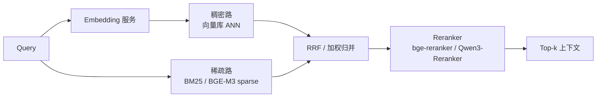

# 最佳实践：参数调优、Over-fetch 与混合检索

本章是把前八章知识落成操作手册的部分：索引参数怎么调、top-k 怎么定、增量更新怎么做、混合检索怎么搭、评测纪律怎么立。

## 9.1 索引参数调优

### HNSW 三参数

| 参数 | 生产起点 | 何时调大 | 代价 |
|---|---|---|---|
| M | 16（千万级）、32（亿级） | 召回不达标且延迟有余量 | 内存 ≈ 线性，建图变慢 |
| ef_construction | 100~200 | 建索引离线跑、追求高召回上限 | 建图时间成倍增加 |
| ef（查询） | 从 64 起步按 recall-延迟曲线选 | 在线可调，按租户/SLO 分级 | 延迟线性-ish 上升 |

调优方法：固定 500~1000 条真实查询评测集，画出 recall-latency 曲线（如 Mini Demo S3：ef 4→64 召回 0.76→0.97），在曲线的"膝盖点"（收益骤降处）定 ef。不要照搬默认值，也不要只看平均延迟——看 P99。

### IVF-PQ

- nlist：经验 `sqrt(n)` ~ `n/100`；亿级常用 4096~65536。nlist 越大单簇越小、扫描越快，但训练与质心存储成本上升。
- nprobe：从 recall-latency 曲线选（Mini Demo S2 显示聚类友好数据 nprobe=2 即满分，真实数据常见 8~32）。
- PQ 段数 m：d/4 ~ d/8（如 768 维取 m=96，段内 8 维）；k=256（1 字节码）。
- **必配 refine**：PQ 粗排 + 原始向量/SQ8 精排，把召回从"裸 PQ"水平救回生产可接受区间。

### DiskANN

- beam width（L_search）：8~32 起步；与 HNSW 的 ef 同地位。
- 缓存：量化向量与热点图页缓存越大 P99 越稳；监控 SSD 读放大（每次查询的平均读取字节数）。
- 更新频繁场景评估 SPFresh 类方案或 Milvus 流路径，避免全量重建。

## 9.2 Top-k、Over-fetch 与 Rerank 衔接

RAG 的 top-k 不是拍脑袋的数字，由下游 reranker 与上下文窗口倒推：

```text
向量库召回 k_0（如 100）
  → 过滤后 k_1（如 60）
    → reranker 精排取 k_2（如 10~20）
      → 去重/压缩进 LLM 上下文（如 5~10 chunks）
```

原则：

1. **向量库侧 over-fetch 2~10 倍**：Reranker（cross-encoder）能纠正 ANN 的排序误差，但前提是正确文档得在候选集里。Recall@100 往往比 Recall@10 高 5~15 个百分点，这就是 over-fetch 买到的东西。
2. **fetch 与 rerank 的延迟预算**：fetch 原始向量 + payload 是查询路径上容易被忽视的尾巴（第 4 章的开销模型）；reranker 是 GPU 服务时还要算排队（见 [vLLM](/04-llmops/vllm/) 的 continuous batching 讨论）。
3. **k 不要超过 reranker 的有效工作区**：cross-encoder 对 top-100 重排质量好于 top-1000；更大 k 用两阶段（BM25 粗筛 + 向量 + cross-encoder）。
4. **多样性**：去重（同源文档 MMR 或 Qdrant 内置 MMR）防止 top-k 被同一文档的多个 chunk 占满。

## 9.3 增量更新策略

| 负载特征 | 推荐策略 |
|---|---|
| 追加为主、几乎无更新 | growing/sealed 自然流转即可；调大 segment 阈值减少索引构建次数 |
| 高频更新（>5%/日） | 接受"删+插"双份开销；监控 tombstone 比例与段空洞；compaction 配额给足 |
| 批量导入（离线构建知识库） | 批量接口 + 建索引资源池隔离；导入期间暂停 compaction 减少写放大 |
| embedding 模型升级 | 新 collection 双写重建、灰度切流（第 8 章流程），绝不原地换模型 |
| 时效性内容（新闻、行情） | 按时间分区，TTL 到期整分区删除（物理删除，绕开 tombstone 堆积） |

通用原则：**删除能分区就分区，能 TTL 就 TTL**——物理删除是唯一能绕过 tombstone/compaction 成本的删除方式。

## 9.4 混合检索架构



落地要点：

1. **稀疏路别自己造轮子**：Milvus 2.6 内置 BM25（官方称比 ES 快 4 倍）、Qdrant 原生全文过滤、ES/OpenSearch 本来就是搜索引擎——用向量库自带的全文能力减少系统数量。BGE-M3 的 learned-sparse 输出（lexical weights）是词面匹配的高质量替代，配 Vespa/Milvus 效果扎实。
2. **归并方法**：RRF 对两路分数量纲不敏感，是最稳的起点；有标注数据后换加权学习排序（LTR）。
3. **ColBERT 式多向量**（BGE-M3 multi-vector / ColQwen3）：token 级 late interaction，词面精确性最好，存储与计算贵 5~20 倍——只在法律/医疗等高精确场景上。
4. **Query 侧增强**：HyDE、query 改写、多查询扩展在向量库之外做，向量库只负责忠实执行（这与 [RAG 主题](/06-rag/) 的分工一致）。

## 9.5 评测与发布纪律

向量检索系统的发布门禁比传统服务更严格，因为"看起来正常"不代表"召回没掉"：

1. **固定评测集**：500~1000 条真实查询 + 标注结果，版本化管理；防污染要求见 [Benchmark + Evaluation](/07-ai-sre/benchmark-evaluation/)（评测集与训练语料隔离、定期换新）。
2. **CI 门禁**：任何索引参数、量化档、模型版本变更，Recall@10/Recall@100 与 P99 延迟必须同时过门；召回掉 1 个百分点都应视为 release blocker。
3. **影子流量对比**：新旧索引并行双跑抽样对比，线上召回差异 > 阈值自动回滚。
4. **指标分层**：Recall@k（质量）、P99/P999（体验）、QPS/资源成本（效率）、growing 大小/tombstone 比例（健康）四组指标分别告警。
5. **榜单使用纪律**：MTEB 等公开榜用于初筛模型，最终选型必须用自己的评测集复测——领域分布差异可以让榜单第一名在你的数据上输给第五名。

## 9.6 常见反模式清单

| 反模式 | 后果 | 正解 |
|---|---|---|
| post-filter 低选择率过滤 | 静默漏召回 | pre-filter / ACORN / 分区（第 5 章） |
| 默认参数上生产 | 召回与成本双输 | 评测集上画 recall-latency 曲线定参 |
| top-k=3 直接给 LLM | 漏召回直接进答案 | over-fetch + rerank |
| 裸 PQ 不 refine | 召回损失被低估 | 粗码 + 原始向量/SQ8 精排 |
| 原地升级 embedding 模型 | 索引整体失效 | 新 collection 灰度重建 |
| 用训练集测召回 | 虚高 5~20pt | 独立评测集 + 防污染 |
| 只看平均延迟 | P99 爆炸无人知 | P99/P999 SLO + 分环节埋点 |
| 删除全靠 tombstone | 磁盘膨胀、图退化 | TTL/分区物理删除 + compaction 配额 |

## 小结

- 参数调优的标准动作：固定评测集 → 画 recall-latency 曲线 → 找膝盖点；HNSW 看 ef，IVF 看 nprobe，DiskANN 看 beam width。
- top-k 由下游倒推，向量库侧 over-fetch 是便宜且有效的质量保险；与 reranker 的分工是"召回靠 ANN、排序靠 cross-encoder"。
- 混合检索优先用向量库自带全文能力；BGE-M3 三路输出按精确性需求选用。
- 发布纪律的核心：召回率回归门禁 + 影子对比 + 分指标告警，把"静默退化"变成"可回滚变更"。
