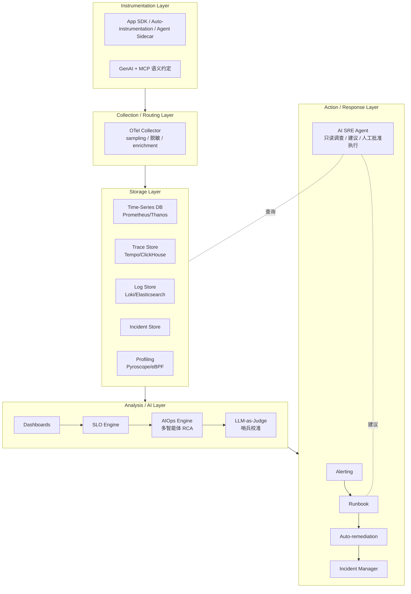

# 架构设计

AI SRE 平台需要同时处理高频低价值的指标数据、低频高价值的 trace 与日志，并把三者关联到业务 SLO。其架构通常分为五层。

## 分层架构

## 1. Instrumentation Layer

- **SDK**：OpenTelemetry SDK 在应用代码中生成 trace、metrics、logs。
- **Auto-instrumentation**：对 FastAPI/Flask、HTTP 客户端、数据库、消息队列自动埋点；eBPF 无侵入埋点（Beyla/OBI 路线）2026 年进入 Beta。
- **GenAI 扩展**：在 LLM 调用处手动创建 span，记录 `gen_ai.provider.name`、`gen_ai.request.model`、token 用量、temperature、`finish_reasons`、tool name、cache hit；Agent 运行按 `invoke_agent` → `chat` / `execute_tool` / `retrieval` 的 span 树建模。
- **MCP 工具调用**：MCP 客户端/服务端 span（`mcp.method.name`）+ `_meta` 字段携带 `traceparent`，把工具调用链拼进同一 trace。
- **PII 控制**：通过环境变量或 collector 配置关闭 prompt/completion 内容捕获（`gen_ai.input.messages` 等为 opt-in），必要时做脱敏。

## 2. Collection / Routing Layer

OpenTelemetry Collector 负责：

- **接收**：OTLP/gRPC/HTTP、Prometheus remote write、filelog。
- **处理**：batch、采样、属性增强（tenant、环境、版本）、PII 脱敏。
- **导出**：按数据类型路由到不同后端；同时支持测试/灰度/生产多目的地。

采样策略：

- **Head-based sampling**：在请求入口处决定，实现简单但可能丢弃关键错误。
- **Tail-based sampling**：等 trace 完成后再根据错误/延迟/高成本决定是否保留，更适合 AI 场景。

## 3. Storage Layer

| 数据类型 | 典型存储 |  retention 策略 |
|---|---|---|
| Metrics | Prometheus / Thanos / VictoriaMetrics | 15s–1h 粒度，长期降采样 |
| Traces | Jaeger / Tempo / ClickHouse / AWS X-Ray | 7–30 天热，90 天温，1–7 年冷 |
| Logs | Loki / Elasticsearch / OpenSearch | 与 traces 对齐 |
| Profiles | Pyroscope / Grafana Profiles / OTel eBPF 剖析器 | 短周期热存储，按 service 聚合 |
| Incidents | PagerDuty / Opsgenie / 内部 DB | 永久 |

## 4. Analysis / AI Layer

- **Dashboards**：Grafana 展示 SLI、SLO、Error Budget、Burn Rate。
- **SLO Engine**：周期性计算 SLI，判断是否消耗预算。
- **AIOps Engine**：动态基线、异常检测、事件聚类；根因分析从单模型提示词演进为**多智能体 + RAG over 历史事故/变更 + CMDB 拓扑**（见 05 章）。
- **LLM-as-Judge**：对输出质量、幻觉、相关性打分，作为质量 SLI；带哨兵样本校准与人工否决率监控，防止 judge 自身漂移污染 SLO。

## 5. Action / Response Layer

- **Alerting**：Prometheus Alertmanager、Grafana Alerting、PagerDuty。
- **Runbook**：把告警与 runbook 绑定，提供下一步操作。
- **Auto-remediation**：自动扩容、模型降级、缓存切换、流量摘除。
- **Incident Manager**：记录 incident 时间线、沟通、action item。
- **AI SRE Agent（2026 新增）**：以只读工具接入告警流，自动完成“查指标 → 看日志 → 调 trace → 出假设”的调查闭环，按自治级别输出建议或经人工批准后执行；所有工具调用过策略门禁（如 OPA）并留审计链。

## 与 LLM Gateway / Agent Runtime / RAG 的集成

- **LLM Gateway**：天然是 metrics 与 trace 的汇聚点，提供统一的 provider、模型、成本维度。
- **Agent Runtime**：每个 Agent step 生成 span，工具调用作为子 span；MCP 工具调用通过 `_meta.traceparent` 拼接跨进程 trace。
- **RAG**：retriever、reranker、generator 各自生成 span 与 metrics。
- **推理集群**：vLLM/SGLang 的 TTFT/ITL/KV cache 指标与 NVIDIA DCGM 硬件遥测（ECC、XID、throttle reason）需要在同一平台关联，才能同时回答“服务为什么慢”与“哪张卡病了”（详见 08 章）。

## 小结

AI SRE 平台不是单一工具，而是一个能把**应用埋点、数据路由、存储、分析、响应**串起来的体系。下一章将按事故生命周期梳理这套体系的实际工作流程。
