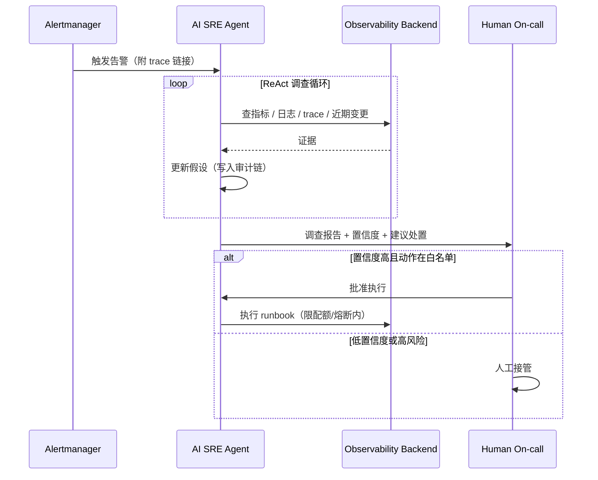

# AI SRE 工作流程

AI SRE 的工作流程以“检测 → 分类 → 响应 → 缓解 → 恢复 → 复盘 → 改进”为核心循环。把它建模成状态机，有助于落地自动化与人工协同。

## 状态机

```text
[Telemetry Ingestion]
         │
         ▼
[Detection] ──▶ Anomaly / Alert / User Report
         │
         ▼
[Triage] ──▶ False positive? ──▶ Close
         │
         ▼
[Response] ──▶ Page / Ticket / Auto-remediation
         │
         ▼
[Mitigation] ──▶ Stop bleeding (rollback, shed, cache, fallback)
         │
         ▼
[Recovery] ──▶ Service back to SLO
         │
         ▼
[Postmortem] ──▶ Timeline / Root cause / Action items
         │
         ▼
[Improve] ──▶ Runbook / SLO / Instrumentation update
```

AI SRE Agent 参与后，Triage 与 Response 之间多了一条自动调查回路：



## 1. Telemetry Ingestion

- 应用通过 OTLP 或 Prometheus exposition 上报。
- Collector 采样、脱敏、打标签后写入后端。
- 关键：trace_id 必须在 Gateway、模型调用、Agent step、RAG 检索之间传递。

## 2. Detection

| 检测来源 | 示例 |
|---|---|
| Metrics 告警 | Burn rate > 14.4x、P95 TTFT > 300ms |
| Trace 异常 | LLM span error、tool call 失败、空召回 |
| 评估器 | LLM-as-judge 质量分数低于阈值、judge 哨兵样本漂移 |
| 用户反馈 | 点踩率突增 |
| 成本监控 | 单用户 token 用量异常 |
| Agent 巡检 | AI SRE Agent 7×24 后台巡检发现的异常模式 |

## 3. Triage

On-call 工程师确认：

- 影响范围：哪些租户、功能、模型版本受影响？
- 严重等级：P0 服务完全不可用，P1 核心功能降级，P2 非核心问题。
- 是否误报：采样偏差、阈值过严、依赖方抖动。

2026 年的新实践：triage 之前通常已有一份 **AI SRE Agent 自动调查报告**（影响面、可疑变更、证据链），人类从“从零查起”变成“审核假设”。

## 4. Response

- **Page**：需要立即人工介入。
- **Ticket**：工作时间处理。
- **Auto-remediation**：已知故障模式直接执行 runbook。
- **Agent 响应（新）**：AI SRE Agent 按自治级别参与，形成渐进信任：

```text
L0 只读调查：agent 查 telemetry，产出报告，人来做所有决策
L1 建议模式：agent 给出处置建议与证据，人确认后执行
L2 批准执行：agent 在 runbook 白名单内执行，人工点“批准”
L3 护栏自治：agent 在策略门禁（OPA/配额/熔断）内自动执行并留审计链
```

落地纪律：新 Agent 必须先以 L0 运行至少两周（shadow mode），用自己的事故回放集验证命中率后再逐级放权；降级永远比升级快。

## 5. Mitigation

目标是最快止血，不一定是根因修复：

- 切换模型或 provider。
- 关闭某个 Agent tool。
- 启用缓存或 fallback。
- 限流或 shedding。
- 回滚 prompt 或模型版本。

## 6. Recovery

- 验证 SLO 恢复。
- 监控后续 30 分钟确保无复燃。
- 更新 status page 与内部沟通。

## 7. Postmortem

- **Timeline**：故障发生、检测、响应、缓解、恢复的精确时间线。
- **Root Cause**：区分触发因素与系统性原因。
- **Action Items**：具体、可Owner、有截止日期，直接进入 backlog。
- **Blameless**：关注系统改进而非个人追责。

AI 辅助的两个新实践：

1. **Timeline 自动缝合**：Agent 从告警流、chat transcript、deploy 记录、trace 中抽取时间线草稿（标注来源与置信度），人只做校对——业界经验值是约 80% 自动化 + 20% 人工修正。
2. **Agent 自身也要复盘**：如果事故由自动化引起（误执行 runbook、Agent 越权调用、MCP 工具被注入），postmortem 的对象就是 Agent 本身——检查其工具权限、提示词注入防线与审计日志。2026 年已出现多起“自动化即事故”的公开案例。

## 8. Improve

- 更新 runbook。
- 调整 SLO/阈值/采样。
- 增加 instrumentation 覆盖盲区。
- 把 bad case 加入评估集。

## AI 特有的响应策略

| 故障 | 快速缓解 |
|---|---|
| 模型幻觉激增 | 切换 temperature、启用 RAG、fallback 到拒绝回答 |
| 延迟飙升 | 模型降级、缓存命中、流式首 token、限流 |
| 成本异常 | 限流、切换低价模型、启用批量/异步 |
| 工具错误 | 禁用该 tool、切换到安全模式 |
| 安全事件 | 立即人工接管、审计日志、隔离 |

## 小结

AI SRE 工作流程的核心是**快速止血、数据驱动、闭环改进**；2026 年的增量是让 Agent 承担调查与执行的“粗活”，但把决策 gate 留在人手里。下一章将拆解支撑这套流程的核心模块。
